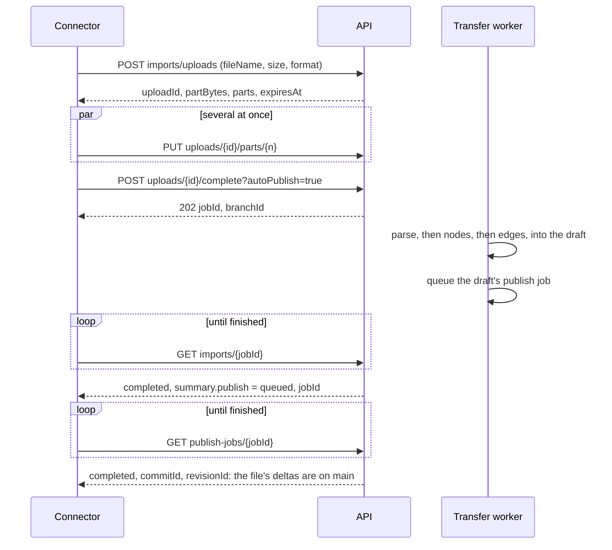

# Building a Connector

> **Who this is for:** a team sending another system's catalog into a data source's graph through
> the HTTP API alone: a warehouse, a BI tool, a pipeline scheduler, a spreadsheet of record. It
> runs on a schedule or on every change, from a few rows up to files of several gigabytes. Each
> import can be published onto the published graph with no person in the loop, or left in a draft
> for review.
>
> **Related reading:**
> - the format's identity rules: [18 · Entity Identity](/docs/versioning-identity);
> - the pipeline inside: [Import / Export](/docs/versioning-import-export);
> - every route and refusal: the [Versioning API reference](/docs/versioning-api-reference);
> - credentials: the [Integration Quickstart](/docs/integration-quickstart).
>
> A working connector is in `docs/examples/connector/`.

A connector does five things. Each has a section below.

1. **Map** the source's records to import records, and write them as a file (§2–§4).
2. **Send** the file: in one request, or in resumable parts up to 10 GiB (§5).
3. **Import** it into a draft, which reconciles every row against the graph (§5).
4. **Publish** it: the import publishes itself, you publish it, or a person reviews it (§6).
5. **Follow** the jobs, and read what they did (§7).

Run it again on the same source and nothing changes. Change the source, and only what changed is
written.



## 1. Before you start

### A key, and what it may do

Use a **service account's key** (`nxsat_…`) for anything that runs unattended: it acts as the
account, not as whoever made it, and keeps working when people leave. A personal key (`nxpat_…`)
acts as you. Make either as the [Integration Quickstart](/docs/integration-quickstart) shows. Send
it as `Authorization: Bearer nxsat_…` on every request.

| To do this | The key needs | Its account needs, in the workspace |
|---|---|---|
| Read the schema, template and jobs | Data: read | read on the data source |
| Dry-run a file (`…/imports/validate`) | Data: read | read |
| Import into a draft | Data: read & write | manage (Member or above) |
| Place what it creates in a view (`viewId`) | Views: read & write as well | edit on that view |
| Publish the import (`autoPublish`), publish a draft, merge a merge request, sync a snapshot | Data: read & write | **Publisher** or **Data engineer** (`workspace:datasource:publish`; Data engineer carries it by default) — not Workspace member |
| Turn version control on, make the graph, open a draft by data source | Data: read & write | manage (Member or above) |

A key never holds publish itself. It publishes where the person or service account it belongs to
publishes. Write main directly (bulk ingest), publish a draft, merge a review: all follow the same
rule. So a **Data: read & write** key whose account is a Publisher can advance the published graph.
Give such an account Publisher only where it should. The key's own **publish** switch is about
views, not data.

`GET /api/v1/api-keys/self` with the key says what it can do right now: `effectiveAccess`, per
workspace, with `publishData` where it can publish. Check it when a connector is first set up, and
when it meets `403 publish_required`. A role given to the account reaches its keys within 30
seconds.

### Finding the ids

```bash
api() { curl -sS -H "Authorization: Bearer $SYNODIC_TOKEN" "$SYNODIC_URL$2" -X "$1" "${@:3}"; }

api GET /api/v1/admin/workspaces | jq -r '.[] | [.id, .name, ([.dataSources[].id] | join(" "))] | @tsv'
GID=$(api GET "/api/v1/$WS/versioning/resolve?dataSourceId=$DS" | jq -r .graphId)   # the graph_… id
```

- **`ws_…` and `ds_…`:** the workspace and the data source, from the first call.
- **`graph_…`:** the data source's versioned graph. A `404` means version control isn't on for the
  data source (turn it on, below). A `bootstrap` object means it is still being turned on: wait
  until it is `null`.
- **`br_…`:** a draft. Every import answers with its own, as `branchId`.

The API explorer is at `/docs` on the API's host (`/viz-docs` through the app). It marks every
operation a key may call. A production deployment may turn it off (`API_DOCS_ENABLED`).

### A data source that isn't versioned yet

A key with **Data: read & write** can set up the graph it will import into, as a person with
manage can:

- **Turn version control on** for a data source that already holds a graph:
  `POST /api/v1/$WS/graph/bootstrap?dataSourceId=$DS` copies it into history as one commit. `202`
  with the job; follow `GET /api/v1/$WS/graph/bootstrap/status?dataSourceId=$DS`. A copy that
  stopped is resumed with `POST …/graph/bootstrap/retry?dataSourceId=$DS&mode=resume`. A copy
  paused on duplicate identifiers waits for a person to decide (`needs_decision`): keys can't
  collapse them, or abandon the copy.
- **Make an empty versioned graph** for a data source: `POST /api/v1/$WS/versioning/graphs`
  `{"dataSourceId": "$DS", "workspaceId": "$WS"}`.
- **Open a draft by data source:** `POST /api/v1/$WS/versioning/resolve` `{"dataSourceId": "$DS"}`
  answers with the graph and your draft on it, opening one if you have none.

A key limited to some data sources sets up only those (`403 api_key_out_of_scope` otherwise).

## 2. The record format

One record per node or edge, with the same columns in every format: an NDJSON line, a JSON object,
or a CSV, TSV or Excel row (where every cell is text). Version 1 only ever gains columns, so a
connector written against it keeps working.

| Columns | What they say |
|---|---|
| `kind` | `node` or `edge` |
| `urn`, `entity_id` | Which node a row is, as a pointer ([§3](#3-identity-point-at-nodes-dont-name-them)) |
| `entityType` | A node's type, one the data source's ontology names. Needed to create a node |
| `displayName`, `description`, `sourceSystem`, `layerAssignment` | A node's own fields |
| `qualifiedName` | A node's qualified name. Where no `urn` matches, an import finds a node by it |
| `tags` | A node's tags: a JSON list, or a `;`-separated cell. Tags a row adds are added to the node's tags; a stale exported row's removals apply too |
| `edgeType`, `confidence` | An edge's type (one the ontology names), and an optional confidence from 0 to 1 |
| `sourceUrn`, `targetUrn`, `source_entity_id`, `target_entity_id`, `sourceQualifiedName`, `targetQualifiedName` | How each end of an edge is found |
| `source.<field>`, `target.<field>` | An edge's end, found by a field of its node: the data source's identifier, or a field marked "Match imports by this" |
| `prop.<name>` | One property per column |
| `properties_json` | Properties too nested for a column, as a JSON object |
| `baseVersion` | The version an export wrote the row at. An exported row edited offline is merged with what changed since ([§4](#4-full-snapshots-and-deltas)) |
| `_op` | Blank (or `upsert`) creates or updates; `delete` deletes |

**What a row says, and what it leaves alone:**

- **A blank cell, or a property left out, keeps what the graph holds.** Send only what you know.
- **`\N` removes a property** (`null` in `properties_json`). `\NULL` and `\n` mean the same. A
  node's own fields (`description`, …) can't be cleared by an import: set them to a new value.
- **`_op=delete` deletes the node** a row points at, and the edges on it, and what it contains
  (its containment subtree, as the ontology says). An edge row with `_op=delete` deletes that edge.
- **A delete of something that isn't there is done already.** Whether it was deleted by an earlier
  run, or never existed, the row is unchanged, with the note "nothing to delete". So a delta sent
  twice is safe, and the dry run counts such rows in a hint, since a mistyped name lands there too.

**Three ways to learn a data source's columns:**

- **The schema.** `GET /api/v1/{ws}/versioning/graphs/{graphId}/imports/schema` is the JSON Schema
  (draft 2020-12) of one record, narrowed to the data source: its entity and edge types as enums,
  and its properties typed. Validate what you write against it in your own CI.
  - The generic version is committed at `backend/common/schema/import-record.v1.json`.
  - `X-Schema-Version` is the format's version.
  - The schema follows the ontology, so cache it by its `ETag`: `If-None-Match` answers `304` while
    nothing changed.
- **The template.** `GET …/imports/template?format=xlsx|csv|ndjson` gives every column the data
  source can carry, with a worked row of each entity type and an edge of each relationship type.
  The Excel one explains every column on its Columns sheet, and names the identifier property.
- **An export.** It is what a round trip looks like, with real data.

```bash
api GET "/api/v1/$WS/versioning/graphs/$GID/imports/schema" > import-record.json
```

**Formats.**
- **NDJSON, CSV and TSV are read a line at a time,** so they go up to 10 GiB. NDJSON is the format
  for a program: a CSV parses about a fifth slower (§9).
- **A JSON array and an Excel workbook are read whole,** so they stay at 100 MB.
- **Line breaks.** A CSV cell may hold one inside quotes. A line, or a quoted CSV record, longer
  than 16 MB fails the import, naming the line; it is almost always CR-only line endings or a quote
  left open.
- **Encodings.** UTF-8, with or without a BOM, and Windows-1252 are both read.

## 3. Identity: point at nodes, don't name them

The platform names every node itself (a `urn:uuid:`), so ids stay stable and opaque. A file's ids
are **pointers**:

- **`urn` is your system's name for the thing.** Use one that never changes, such as
  `urn:acme:table:sales.orders`. The first import creates the node with an id derived from that
  urn. Every later import finds it by the same urn, so re-running a file updates instead of
  duplicating — whichever draft it goes to, in a fork, or after the graph is made again. The urn
  is not stored on the node.
- **The data source's identifier property** (`prop.<identifier>`) is a pointer too, for a source
  identified by it. It is reserved: the node's identifier holds its platform urn.
- **A `urn:uuid:` your system already gave the entity** is kept as its id. Use that when the same
  entity must have the same id in several environments.
- **`entity_id` is file-local.** It links rows of one file — an edge to a node row — and nothing
  more, unless it is a node's real id, as in an export. A row that points by nothing else is
  created again on every import.
- **Keep your own key as a property** if people should see or search it: `prop.sap_id`. Mark the
  field "Match imports by this" in the ontology to match rows by it, and "Must be unique" to keep it
  unique.
- **An edge finds its ends the same way:** `sourceUrn` / `targetUrn`, `source.<field>` /
  `target.<field>`, or `source_entity_id` / `target_entity_id` (another row's file id). An edge
  itself is its two ends and its type, so sending it again changes nothing. To re-point an edge,
  delete its row and add a new one.

## 4. Full snapshots and deltas

| You send | Use | What happens |
|---|---|---|
| Only what changed | `reconcileMode=upsert` (the default) | Rows set what they name and leave the rest. Deletes are `_op=delete` rows. |
| Everything in a scope, every time | `reconcileMode=replace`, with `viewId` for the scope | The same as upsert, and what the file leaves out of the scope is deleted. With no `viewId`, the scope is the whole data source. |

- **Unchanged rows cost nothing.** An import writes only fields that differ, so a full snapshot
  run nightly writes only that day's changes.
- **A replace deletes nothing while any row is refused,** since the refused row might name what it
  means to keep. The job fails, and the file's other rows stay on its draft.
- **A row without `baseVersion` sets what it carries.** A connector's own rows are the source's
  truth: if two runs write one field, the later wins.
- **A row an export wrote carries `baseVersion`,** and is merged with what changed since: only the
  cells it changed apply, and one someone else also changed refuses the row, naming the field.
- **One row per entity.** When two rows of a file name one node or edge and say different things,
  the second is refused. Send each entity once per file.

**Syncing a snapshot straight into the published version.** `POST …/graphs/{graphId}/sync`
(NDJSON body) merges an authoritative snapshot into main as one commit, keeping people's edits to
fields the snapshot didn't change; `strategy=external_wins` takes the snapshot's value where both
changed. It needs what publishing needs: a key whose account is a Publisher. It refuses to drop
people's curation or delete past a limit (`409 curation_at_risk`, `mass_delete_blocked`) unless a
workspace admin overrides it, and no key can. Bulk ingest only seeds an empty graph; on one that
holds data it answers "use sync". Prefer an import into a draft when someone should see the change
first.

## 5. Sending the file

| File | Send it with |
|---|---|
| Up to 10 GiB (NDJSON, CSV or TSV), in parts | The resumable upload, below. Use it for anything over a few MB: a dropped connection costs one part |
| Up to 10 GiB, as one body | The resumable upload with the whole file sent to part 0 (step 2): it is cut into parts as it arrives, and a dropped connection keeps every whole part |
| Up to 10 GiB, as one body, no resuming | `POST …/imports?format=ndjson&idempotencyKey=…`, with the file as the body. A dropped connection starts it over. JSON and Excel files: 100 MB |

**The resumable upload, step by step:**

1. **`POST …/imports/uploads`** `{"fileName": "catalog.ndjson", "size": 4294967296, "format": "ndjson"}`.
   - It answers `201` with `uploadId`, `partBytes` (16 MiB), `parts`, `received` (`[]`) and
     `expiresAt`.
   - A client that splits files its own way says so: `"partBytes": 67108864` sends 64 MiB parts.
     It can be from 5 MiB to 100 MiB, else `422`. Larger parts mean fewer requests for a
     multi-gigabyte file; a dropped connection costs a larger part.
   - A file too large for its format is refused here, `413`, before any of it is sent.
2. **`PUT …/imports/uploads/{uploadId}/parts/{n}`** for `n` from `0` to `parts - 1`, each with its
   bytes as the raw body (`application/octet-stream`, not a form).
   - Part `n` is the file's bytes from `n × partBytes`: every part holds exactly `partBytes`, and
     the last holds the rest. A part of any other size is `422`, and the answer says the size it
     should be and how the file is split. A `Content-Length` of another size is refused at once,
     before any of the body is read or stored.
   - **Or send a run of parts in one request**: the file's bytes from `n × partBytes` on to the end
     of a later part or of the file — the whole file, to part `0`. It is cut into its parts as it
     arrives, and the answer's `lastPart` says how far it went. A run that ends anywhere else is
     `422`, and none of it is kept. One cut off keeps the parts it brought whole: `GET` the upload
     (step 3) and send the rest of the file to the first part missing.
   - Parts go in any order, and several at once.
   - `429` with `Retry-After`: the server is taking in as many files at once as it allows. Send the
     part again after that many seconds (the reference connector does).
   - Sending a part again replaces it — until the upload is completed: then it is `409`.
3. **`GET …/imports/uploads/{uploadId}`** lists `received`, the parts stored whole. To resume after
   a failure or a restart, send the others. Keep `uploadId`, or you start again: a new upload knows
   nothing of an old one.
4. **`POST …/imports/uploads/{uploadId}/complete`**, with `reconcileMode`, `viewId`, `branchId` or
   `autoPublish` as query parameters.
   - It answers `202` with `jobId` and `branchId`.
   - An upload is imported once, however often it is completed: asking again — after a lost
     answer, or twice at once — answers with the same import. One that broke off before its import
     was queued is queued then.
   - A part still missing is `409`.

**Timing and the uplink.**
- **A request is cut off only when its body stops arriving**: 120 s with nothing at the API, 60 s
  at the bundled proxies, however long the body takes in all. A slow link takes longer; it doesn't
  fail. Behind the GKE load balancer a request has an hour in all: a 4 GiB file in one request
  needs 9.5 Mbit/s there, and parts need nothing.
- **An upload has 24 hours** from its creation (`expiresAt`) to be completed. After that, its
  parts are swept, and `GET` answers `404`.
- **What's checked.** Parts are checked by their exact size, and TLS carries them intact. There is
  no checksum, so make sure that an upload you resume is of the same file: the reference connector
  keys it by the file's sha256.

**Where it lands.**
- **A draft, every time.** Without `branchId`, an import opens a draft of its own. With it, the
  import stacks onto your open draft (one import at a time per draft: `409 job_active` while
  another runs).
- **`main` is never written by the import itself:** only by its publish (§6).
- **`idempotencyKey`** on the single request is permanent per graph. The same key from the same
  caller always answers with the job it started, whatever happened to that job since, and whatever
  `branchId` it is sent with. So derive it from the file and the run, such as
  `nightly-2026-11-05-<sha256>`, not from the file alone: a key whose job failed would otherwise
  answer with that failure forever. Only a job whose file never arrived is taken back by its key.

## 6. Publishing

An import lands in a draft. Three ways on from there:

| Way | How | Needs |
|---|---|---|
| **The import publishes itself** | `autoPublish=true` when you start the import | Publisher, and a data source that lets people merge their own changes |
| **You publish the draft** | `POST …/branches/{branchId}/publish` `{"message": "…"}` | the same |
| **A person reviews it** | `POST …/branches/{branchId}/merge-requests` `{"title": "…", "reviewers": […]}`; once approved, `POST …/merge-requests/{prId}/merge` | merging: Publisher. A service account's own managers can't approve its reviews (four eyes) |

**A draft someone else opened** — a person's, or another account's — is published directly only by
its owner or a maintainer: anyone else gets `403` `not_draft_owner` (or `not_owner_or_member`) with
`hint: merge_request`. Land it through its merge request instead: its owner opens one, and any
Publisher who can see it merges it. A private draft is seen only by its owner and the reviewers they
name, so make it visible to the workspace first if an account is to merge it.

### `autoPublish`: an import that publishes itself

Ask for it on `POST …/imports` or on `…/uploads/{id}/complete`. It is checked before anything is
created:
- **`403 publish_required`:** the caller can't publish. For a key, its account isn't a Publisher.
- **`409 review_required`:** the data source's review policy says nobody merges their own changes.
- **`422 auto_publish_needs_own_draft`:** you sent `branchId`. An import that publishes itself
  opens a draft of its own, so it never publishes anyone else's work.

When the import completes, `summary.publish` on its job says what happened:

| `summary.publish.state` | What happened | What to do |
|---|---|---|
| `queued`, with `jobId` | The draft is being published, as a large publish is: a job | Follow `GET …/publish-jobs/{jobId}` to `completed` (with `commitId` and `revisionId`) or `failed` (with `error`) |
| `unchanged` | The file changed nothing. Its empty draft was closed | Nothing |
| `skipped`, with `reason` | It wasn't published, and the draft is kept for review | Read `reason.type` (below) |
| missing, a minute after `completed` | The worker stopped between the two steps | Publish the draft yourself: `POST …/branches/{branchId}/publish` |

Why a publish is skipped (`reason.type`):
- **`rows_refused`:** some rows weren't imported (refused or unreadable). Look at the import's
  preview, fix the file, and send it again; or fix the draft and publish it.
- **`not_up_to_date`, with `behindBy`:** someone published to the same data source while the file
  was imported, so the draft is behind `main`.
  - A small draft can be updated from main (`POST …/branches/{branchId}/rebase`) and published.
  - A draft of millions of changes can't: updating it reads every change at once. Import the file
    again instead, and keep other publishing to that data source out of the import's window.
- **Others:** the refusal the publish route would give: the draft closed meanwhile
  (`branch_closed`), the policy changed (`review_required`), …

The publish job checks again, when it runs, that the import's owner may still publish. The review
policy as it is then holds too.

A `completed` publish job says where the file landed: `commitId`, the commit on `main`, and
`revisionId`, the revision of `main` that holds it. Look it up at `GET …/revisions/{revisionId}`,
or export the published graph as it was then (`POST …/exports?asOfSeq={revisionId}`). A draft
you publish or merge yourself answers the same, `{commitId, revisionId, status: "completed"}`,
or, when it is large enough to run as a job, `202` with that job's `statusUrl` to follow.

## 7. Following a job

`GET …/imports/{jobId}` (and `GET …/publish-jobs/{jobId}`) is read-only, so poll it as often as you
like. Every few seconds at first, and every 30 s or so for a long job, is plenty.

| Field | Means |
|---|---|
| `status` | `pending`, `running`, `completed`, `failed`, `cancelled` |
| `phase` | Where it is: `queued`, `parse` (reading the file into staged rows), `nodes`, `edges`, `replace` (the deletes of a replace) |
| `processed`, `total`, `progress` | Rows applied so far, rows in the file, and a percentage |
| `queuedAhead` | While queued: the jobs before it |
| `stale` | Running, but its worker has gone quiet. Another worker takes it over and resumes it: wait |
| `attempt` | Which attempt this is. A job taken over more than 3 times fails |
| `errorMessage`, `summary.failure` | Why it failed, and whether starting it again would help |
| `summary` | The tallies: `new`, `updated`, `unchanged`, `deleted`, `invalid` (refused), `skipped` (records that are neither a node nor an edge), `viewAssignments`, `publish` |

- **The preview.** `GET …/imports/{jobId}/preview` lists changed rows, up to 200, with the reason
  for each refused one. For the whole change, read the draft's diff against `main`:
  `GET …/diff/summary?branchId={branchId}`.
- **Refused rows don't stop the others.** A refused row is quarantined with its reason, and the
  rest import.
- **An import survives its worker.** A deploy or a crash hands it to another worker, which carries
  on from its last window of 10,000 rows. A publish job is safe to run again: a draft is never
  published twice.

## 8. Errors and retries

Errors come back as `{"detail": …}`: a sentence, or an object with a `type`, `code` or `error`
(see [API Guide → Errors](/docs/api-guide)). What an import connector meets:

| Status | `detail` | Means | Retry? |
|---|---|---|---|
| `401` | `api_key_expired`, … | The key isn't accepted | No: fix the key |
| `403` | `missing_permission`, `publish_required`, `api_key_read_only`, `api_key_out_of_scope` | The key, or its account, may not | No |
| `403` | `not_draft_owner`, `not_owner_or_member` (with `hint: merge_request`) | A direct publish of someone else's draft | No: merge its merge request (§6) |
| `404` | | An unknown graph, job or draft, or an upload that expired | No |
| `409` | `job_active` | Another import is running on that draft | Yes: wait for it |
| `409` | `branch_closed`, `main_write_forbidden`, `review_required`, `not_up_to_date` | The draft can't take this | No: see §6 |
| `409` | `idempotency_key_reused` | The key started another kind of job | No: use a new key |
| `409` | parts missing (a sentence) | The upload isn't complete | Send the missing parts |
| `413` | | Too large: for the request (use the upload), the format (split the file), or the dry run (8 MiB) | No |
| `422` | | A file that can't be read, or a part of the wrong size | No: fix it |
| `429` | `rate_limited`, `PROVIDER_BUSY` | Too many requests: a key has 1,200 a minute | Yes, after `Retry-After` |
| `503` | `lock_busy`, `DB_UNAVAILABLE`, `api_keys_unavailable` | Busy or out of reach for a moment | Yes, after `Retry-After`, else a few seconds |
| `504` | `REQUEST_TIMEOUT` | The request ran out of time, which may have been after it did its work | Read the state before you write again |

Every call an import connector makes does no harm sent twice:
- a part replaces itself;
- completing an upload answers with its import;
- a single request with an `idempotencyKey` answers with its job;
- a publish sent twice finds its draft published: `409 branch_closed` with the draft `merged`.

## 9. Large files

Measured end to end over HTTP on one machine, through the reference connector with `--publish`. The
setup:
- 4 vCPU and 15 GB RAM;
- Postgres 16 with default settings, holding the parts (the `database` store);
- the API and one transfer worker.

The data: tables, each with 10 columns, `CONTAINS` and `FLOWS_TO` edges, and about 120 bytes per
row.

| Run | File | Rows | Upload | Import | Publish | Peak memory |
|---|---|---|---|---|---|---|
| NDJSON | 501 MB | 4,180,000 | 6 s (30 parts, sha256 included) | 1,176 s (20 min), about 3,550 rows/s | 936 s (16 min) | worker 230 MB importing, 450 MB publishing; API 330 MB; connector 40 MB |
| NDJSON | 53 MB | 440,000 | under 1 s | 125 s, about 3,500 rows/s | 65 s | as above |
| CSV, the same rows | 30 MB | 440,000 | under 1 s | 155 s, about 2,800 rows/s | 65 s | as above |
| A 1% delta into the 4.18M graph: 1,900 updates, 190 deletes | 195 KB | 2,090 | under 1 s | 17 s end to end, publish included | | |
| Export of the 4.18M graph, NDJSON | 1.65 GB out | 4,180,000 | | 152 s, about 27,500 entities/s | | |

The import's time goes into Postgres: the worker waits on it about three quarters of the time.
About 12% of the import is reading the file into staged rows; the rest is reconciling rows against
the graph and writing them, node windows then edge windows.

**What follows for a 2–4 GB file:**

- **Time.** The import's rate held from 440,000 rows to 4.18 million, so it scales with the file:
  a 4 GB NDJSON file of rows like these (about 33 million) imports in about 2.6 hours. The publish
  slows a little as drafts grow (6,800 entities/s at 440,000, 4,500 at 4.18 million), so allow 2 to
  2.5 hours for it: about 5 hours end to end, and half that for 2 GB. Rows of 250 bytes halve the
  row count, and roughly the time. A CSV takes about a quarter longer to import.
- **Deltas are cheap.** A delta costs what its file holds, not what the graph holds: the 1% delta
  above took 17 seconds into a graph of 4 million entities. Send the first load once, then deltas.
- **Can't send deltas?** A full snapshot each time is reconciled into its delta by the server: only
  what changed is written to the graph and published. Ask an administrator to turn on **Admin →
  Features → Reconcile imports in memory**, so the rows that change nothing aren't staged whole on
  the way: about a fifth of the staged rows and two fifths less time for a snapshot 1% changed
  ([Import & export §3f](/docs/versioning-import-export#3f-reconciling-in-memory)).
- **Memory** stays flat: windows of 10,000 rows, whatever the file's size.
- **The upload** is the quick part. 16 MiB parts at 4 at a time fill the link, and at
  100 Mbit/s a 4 GB file is up in about 6 minutes.

**What to set up for gigabyte imports:**

- **Disk, first of all.** An import writes far more into Postgres than its file holds. The 501 MB
  file took 16.7 GB:
  - **the graph, 13.1 GB, about 26 times the file:** every entity is kept twice, as the draft's
    version and the published copy, with their indexes, about 3.1 KB per entity;
  - **the staged rows, 3.5 GB, about 7 times the file:** about 840 bytes per row, kept for 3 days
    after the import ends (`IMPORT_STAGING_GC_DAYS`; `1` keeps them a day), then swept within the
    hour;
  - **the uploaded parts, 30 MB:** they compress well.

  For 4 GB of rows like these, that is about 105 GB of graph and 28 GB of staged rows. Size
  Postgres for it before the first gigabyte import: the in-cluster Postgres volumes are 10–20 Gi.
- **The object store.**
  - The default keeps uploaded parts in Postgres, where they compress well.
  - Above about 1 GB, set `OBJECT_STORE_BACKEND=s3` (an image with `requirements-s3.txt`), or
    `local` on a volume every API and transfer-worker pod mounts. Parts are swept a day after they
    arrive.
- **Proxies.** The bundled ones (the frontend's nginx, the Helm chart's ingress) pass an import's
  file on as it arrives, up to 10 GiB, without buffering it.
  - A proxy of your own in front must do the same on `…/imports` and
    `…/imports/uploads/*/parts/*`, for a file sent as one body: in nginx,
    `client_max_body_size 10g; proxy_request_buffering off;`. Parts of 16 MiB need nothing raised.
  - Every proxy must allow a request at least 120 s.
- **One import at a time per draft, two per worker.** `GRAPHVER_TRANSFER_SLOTS` (2) jobs run at
  once on each transfer worker. Run more workers for more at once.
- **Keep main quiet while a large import runs.** An import that publishes itself needs `main` not
  to have moved since it began (§6).

## 10. Walkthroughs

### A small file, with curl

```bash
export SYNODIC_URL=https://synodic.example.com SYNODIC_TOKEN=nxsat_…
api POST "/api/v1/$WS/versioning/graphs/$GID/imports/validate?format=ndjson" \
    --data-binary @catalog.ndjson | jq '{summary, unknownColumns, hints, refused: [.rows[] | select(.op == "invalid")]}'
JOB=$(api POST "/api/v1/$WS/versioning/graphs/$GID/imports?format=ndjson&autoPublish=true&idempotencyKey=nightly-$(date +%F)" \
    --data-binary @catalog.ndjson | jq -r .jobId)
until api GET "/api/v1/$WS/versioning/graphs/$GID/imports/$JOB" | jq -e '.status | test("completed|failed")' >/dev/null; do sleep 5; done
api GET "/api/v1/$WS/versioning/graphs/$GID/imports/$JOB" | jq '{status, summary}'
```

The dry run takes up to 8 MiB and 10,000 rows, reads them as an import would, and writes nothing.
It reports:
- `summary`: how many rows would be new, updated, unchanged, deleted or refused;
- `rows`: up to 200 changed rows, with their reasons;
- `unknownColumns`: usually a typo (`prop_owner` for `prop.owner`);
- `hints`.

For a larger file, dry-run its first rows. An edge whose end node comes later in the file reads as
refused there.

### A large file, with the reference connector

```bash
pip install httpx
export SYNODIC_URL=https://synodic.example.com SYNODIC_TOKEN=nxsat_…
python docs/examples/connector/connector.py --file catalog.ndjson --workspace "$WS" --graph "$GID" --check
python docs/examples/connector/connector.py --file catalog.ndjson --workspace "$WS" --graph "$GID" --publish
```

What the connector does:
- **Sending:** 4 parts at a time from disk, each retried after `Retry-After` on `429`/`503`, or
  after a growing pause on other `5xx` and dropped connections.
- **Resuming:** a run that stops is resumed by the next one, from `catalog.ndjson.upload.json`.
- **Following:** the import, then its publish. If the import never wrote how its publish went, it
  publishes the draft itself.
- **Exit code:** non-zero when the import fails or couldn't publish itself, with the reason in its
  output.

Given a catalog instead of `--file`, it maps one first: `source.json`, a warehouse's tables, columns
and lineage, and a table it dropped. `backend/tests/test_connector_example.py` holds it to the
record contract, and its calls to the routes a key may call.

## 11. Troubleshooting

| Symptom | Cause | Fix |
|---|---|---|
| `413` on `POST …/imports` | Over 10 GiB (100 MB as JSON or Excel), or a proxy of your own caps the body | Split the file, or send JSON or Excel as NDJSON or CSV; raise your proxy's limit on the import routes |
| `504` on a part, or on a file sent as one body | Nothing of its body arrived for 120 s | Check the client is still sending; on a slow uplink, send fewer parts at once |
| `429` `busy` on a part, or on a file sent as one body | The API is taking in as many import files at once as it allows | Send it again after `Retry-After` |
| `404` resuming an upload | It expired (24 h), or it is another caller's | Start a new upload |
| `409` on a part | The upload is complete | Start a new upload to send a different file |
| The job failed: "Line N … has no line break within 16 MB" | CR-only line endings, or no line breaks | Save the file with LF or CRLF line endings |
| The job failed: "… opens a quoted cell that doesn't close" | A CSV quote left open | Close the quote, or escape it as `""` |
| `summary.invalid` > 0, and `publish.state: skipped` | Rows refused: unknown types, missing ends, … | Read the preview's reasons, fix the file, send it again |
| `publish.reason.type: not_up_to_date` | Something was published to the data source mid-import | Update a small draft from main and publish it; import a large file again |
| `403 publish_required` with `autoPublish` | The key's account isn't a Publisher | Give the account Publisher, or import without `autoPublish` and have a person publish |
| `403 publish_required` though the account "can manage data" | Its role holds `manage` but not publish: Workspace member, or a custom role made before publish existed | Give it Workspace publisher. An admin sees such roles under Permissions → Roles, and can add publish to one |
| `403 not_draft_owner` publishing a draft | The draft is someone else's | Merge its merge request (§6) |
| `403 api_key_not_allowed` on sync, bootstrap or making a graph | An older deployment | Upgrade: these take keys now |
| Every run creates new nodes | Rows point by `entity_id` alone, which is file-local | Give each node a stable `urn` |
| `stale: true` for a while | The worker running the job stopped | Wait: another takes it over and resumes it |
| A delete row is `unchanged` with "nothing to delete" | What it names isn't in the graph | Fine for a delta sent again; otherwise check the name |

## 12. The format's versioning

- **Version 1 only gains columns.** An import ignores columns it doesn't know, and the dry run
  reports them.
- **A change to how v1 rows are read is announced in the [changelog](/docs/changelog)** before it
  ships, under **Changed**, with what to do (for example, rows exported with `baseVersion` merged
  field by field, or deletes of what's gone counting as done).
- **A breaking change would be version 2,** with its own schema, alongside version 1 for at least a
  release. `X-Schema-Version` on the schema says which a server speaks.
