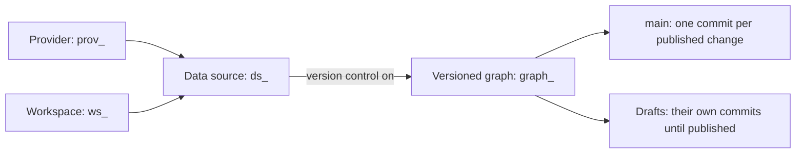

# Graph Metadata & History API

*For integrators — scripts and services that keep track of a workspace's graphs and keep a copy of the versioned ones' history.*

Everything a program needs to find the graphs in a workspace, tell an external graph from a
versioned one, and read each versioned graph's complete commit history — then keep its own copy
in step with a cheap poll. Every field is explained, with what it means, when it is empty, and
what you can rely on.

Two routes do it, both on the API you already use, both callable with an API key:

| You want | Call |
|---|---|
| The graphs in a workspace (one provider's, if you like), and which are under version control | `GET /api/v1/admin/workspaces/{ws_id}/data-sources?include=versioning` |
| A versioned graph's commits, newest first, page by page | `GET /api/v1/{ws_id}/versioning/graphs/{graph_id}/commits` |

**This page covers:**

- The **objects** — providers, workspaces, data sources, versioned graphs, `main`, drafts and commits
- **External or versioned**: what each means, and how to tell them apart
- **Listing a workspace's graphs**: parameters, every field of the answer, the `versioning` object
- **Reading a versioned graph's history**: parameters, every field of a commit, every kind of commit
- **What you can rely on**: ordering, immutability, sequence numbers
- **Keeping a copy in step**: the polling loop, a full backfill, and what to do when a graph leaves
- **Permissions, API keys and errors**, what isn't supported, and where the code lives

To sign a script in — with an API key or a password — see
[Sign in from a script](/docs/api-guide#sign-in-from-a-script). The curl examples below use the
`B` and `api` helpers defined there.

---

## The objects



| Object | Id | What it is |
|---|---|---|
| **Provider** | `prov_…` | A connection to a graph store — FalkorDB, Neo4j, DataHub or Spanner. Administrators configure providers; they are platform infrastructure, shared by workspaces, and an API key can't read them. A data source tells you which provider it is on. |
| **Workspace** | `ws_…` | The unit of access. Who can see what is decided per workspace, and every data route names one. |
| **Data source** | `ds_…` | One graph of one provider, mounted in one workspace: what views read and what people version. A provider's graph is mounted at most once per workspace, though the same graph can be mounted in several workspaces. |
| **Versioned graph** | `graph_…` | The version history of one data source, once version control is on. One per data source, for the data source's life. |
| **`main`** | `br_…` | The published line of a versioned graph. Every change that reaches it — a publish, a merged review, an import, a revert — is exactly one commit on it. |
| **Draft** | `br_…` | Someone's working copy. It has its own commits until it is published, when they fold into one commit on `main`. |
| **Commit** | `cmt_…` | One recorded change: who made it, when, why, and how many things it changed. |

---

## External or versioned

Every data source is one or the other.

- **External** — the graph is loaded and owned outside {brand}: an ETL job, a connector, another
  system of record writes to it, and {brand} reads it from its provider. There is no history here
  to read. To hear when an external graph changed, see
  [Telling us an external data source changed](/docs/feature-external-change-notification).
- **Versioned** — {brand}'s version store is the graph's system of record. People change it in
  drafts and publish; every published change is a commit on `main`, and the graph in the provider is
  a copy rebuilt from those commits. Its full history is readable from the first commit.

To tell them apart, list the workspace's data sources with `include=versioning` and read
`versioning.enabled`.

> **While version control is being turned on,** `enabled` stays `false` until the job that copies
> the graph into the version store finishes — and stays `false` if that job fails, until it is
> resumed or cancelled. Until then the graph isn't one yet, and a cancelled enable removes it: the
> next enable makes a new `graphId`. So a `graphId` you are given never disappears while its data
> source keeps version control. The Explorer's **Versioned** filter counts a source a little
> earlier, from the moment turning it on starts.

---

## List a workspace's graphs

```http
GET /api/v1/admin/workspaces/{ws_id}/data-sources?providerId={prov_id}&include=versioning
```

| Parameter | Values | What it does |
|---|---|---|
| `providerId` | a provider id | Only the data sources on that provider. An id that matches none — or doesn't exist — gives `[]`. |
| `include` | `versioning` | Adds each data source's `versioning` object. Without it, `versioning` is `null` and the version store isn't asked. |

The answer is a JSON array of data sources, oldest first. Data sources in the trash aren't listed.

```bash
api GET "/api/v1/admin/workspaces/$WS/data-sources?include=versioning" |
  jq '.[] | {id, label, providerId, graphName, versioning}'
```

```json
{
  "id": "ds_124482eedff6",
  "label": "Orders",
  "providerId": "prov_9f2c1a7d3b44",
  "graphName": "orders_lineage",
  "versioning": {
    "enabled": true,
    "graphId": "graph_01M5DQ5P41JQC6HYTWN1YTPWVE",
    "kind": "manual",
    "mainHeadCommitSeq": 3,
    "mainHeadCommitId": "cmt_01M5DQ5P9JVG6Y1WHZ7RNZ2PQ2",
    "mainHeadCommittedAt": "2026-10-20T22:33:35.794538+00:00"
  }
}
```

The route sits under `/admin/` for historical reasons; it needs only read access to the workspace.

### Each data source

| Field | What it means |
|---|---|
| `id` | The data source's id (`ds_…`). Stable for its life, including a move to another workspace. |
| `workspaceId` | The workspace it is in — the one you asked about. |
| `providerId` | The provider the graph lives on (`prov_…`). |
| `graphName` | The graph's name on that provider. Unique per workspace and provider. |
| `label` | The name people see: the label given to it, else its catalog entry's name, else `graphName`. |
| `catalogItemId` | The catalog entry it was attached from (`cat_…`), or `null`. |
| `ontologyId` | The semantic layer that types its entities and relationships, or `null` for the system defaults. |
| `isPrimary` | Whether it is the workspace's primary data source — the one a route reads when it names no data source. |
| `isActive` | `false` while someone has paused it. A paused source is still listed. |
| `isRestricted` | Whether views over it always need the publish permission to be shared, whatever the workspace's policy. |
| `accessLevel` | `read`, `write` or `admin`: how the graph may be written. In practice `write` for a model built from scratch in {brand}, `read` otherwise. |
| `projectionMode` | Where its lineage summaries are kept: `in_source` (in the graph itself), `dedicated` (in a separate graph, named by `dedicatedGraphName`), or `null` to follow its provider. |
| `dedicatedGraphName` | The separate graph's name when `projectionMode` is `dedicated`. |
| `identityProperty`, `identityPropertySource` | The property that identifies a node (`urn` unless configured otherwise), and where that setting comes from: `data_source`, `provider`, `workspace`, `global` or `default`. |
| `nameProperty`, `namePropertySource` | The property that holds a node's display name (`name` unless configured otherwise), and where that comes from. |
| `sourceMode`, `writeBackEnabled` | `managed` or `federated`, recorded by some setup paths; often `null`. **Don't use it to tell external from versioned** — use `versioning.enabled`. |
| `extraConfig` | Per-source settings, with any secrets redacted. |
| `aggregationStatus`, `lastAggregatedAt`, `aggregationEdgeCount`, `aggregationSchedule` | Not filled in by this route: they read `none`, `null`, `0` and `null`. Read a source's lineage-summary state from `GET /api/v1/admin/data-sources/{ds_id}/readiness`. |
| `createdAt`, `updatedAt` | When it was attached and last changed, ISO-8601 in UTC. |
| `versioning` | Its version control — below — when you asked with `include=versioning`; `null` otherwise. `null` says nothing about whether the source is versioned. |

### The versioning object

| Field | What it means |
|---|---|
| `enabled` | `true` when a versioned graph backs the data source in this workspace and turning version control on has finished. `false` for an external graph, and while version control is being turned on. |
| `graphId` | The versioned graph (`graph_…`) — what the history routes take. `null` when `enabled` is `false`. |
| `kind` | Where the graph's content comes from — below. |
| `mainHeadCommitSeq` | The sequence number of the newest commit on `main`: the graph's current revision. **This is your change watermark** — the history has something new exactly when it moved. |
| `mainHeadCommitId` | That commit's id. |
| `mainHeadCommittedAt` | When it landed, ISO-8601 in UTC: when the graph last changed. |

| `kind` | Meaning |
|---|---|
| `manual` | Copied from an existing graph when version control was turned on, then curated in {brand}. |
| `authoritative` | Seeded and refreshed from an external system of record, with curation layered on top. |
| `hybrid` | Both. |
| `blank` | Built from scratch in {brand}: its first commits are people's, not an import. |

---

## Read a versioned graph's history

```http
GET /api/v1/{ws_id}/versioning/graphs/{graph_id}/commits?limit=500&after={seq}&before={seq}
```

Newest first. Without parameters you get the newest 100 commits of `main`.

| Parameter | Values | What it does |
|---|---|---|
| `limit` | 1–500, default 100 | How many commits a page holds. |
| `before` | a `commit_seq` | Only commits with a lower sequence number. Pass the previous page's `nextBefore` to get the next page. |
| `after` | a `commit_seq` | Only commits with a higher sequence number — usually the newest one you already have. |
| `offset` | default 0 | Skips that many commits. Kept for older callers; it shifts as commits land, so page with `before` instead. It can't be combined with `before` or `after`. |
| `branchId` | a branch id | A draft's own commits instead of `main`'s. You can read your own drafts, drafts shared with you, drafts whose review you take part in, and every draft if you manage the workspace's data. |
| `originatingViewId`, `publishedOnly` | a view id, `true` | One view's history: with `publishedOnly=true`, the `main` commits it published plus the graph-wide ones it shares; without it, every draft commit attributed to the view across branches. That second history spans branches, so it pages by `offset` only. |

```bash
api GET "/api/v1/$WS/versioning/graphs/$GID/commits?limit=1" | jq .
```

```json
{
  "commits": [
    {
      "commit_id": "cmt_01M5DQ5P9JVG6Y1WHZ7RNZ2PQ2",
      "commit_seq": 3,
      "parent_commit_id": "cmt_01M5DQ5P7CPAWNFHPREKPYE4R7",
      "kind": "squash_publish",
      "message": "Add customers",
      "actor": "usr_4b8e1f2a9c3d",
      "contributors": ["usr_4b8e1f2a9c3d"],
      "source_branch_id": "br_01M5DQ5P8D4AE3ZSEFKNGRPYY4",
      "source_commit_count": 1,
      "originating_view_id": null,
      "merkle_root": "4f1434976550838a68943269f02c405bffa3ee87aca125d5853c1749f5dc0b6b",
      "stats": {"create": 1, "delete": 0, "update": 0},
      "created_at": "2026-10-20T22:33:35.794538+00:00"
    }
  ],
  "userNames": {"usr_4b8e1f2a9c3d": "Priya Raman"},
  "hasMore": true,
  "nextBefore": 3
}
```

The next page is `…/commits?limit=1&before=3`.

### The page

| Field | What it means |
|---|---|
| `commits` | This page's commits, newest first. |
| `userNames` | A display name for every person this page names as an `actor` or contributor. An id with no name here — a system actor, or someone the directory doesn't know — is left out. |
| `hasMore` | Whether older commits lie past this page, within your bounds. A page can hold fewer than `limit` commits and still have more — keep going until this is `false`. |
| `nextBefore` | The `commit_seq` of this page's oldest commit, while `hasMore` is `true`: send it back as `before`. `null` on the last page, and on a view's cross-branch history. |

### Each commit

The fields of a commit use the names the version store keeps them under, in snake_case.

| Field | What it means |
|---|---|
| `commit_id` | The commit's id (`cmt_…`). Unique, and never reused: key your copy on it. |
| `commit_seq` | Its place on its branch. On `main` it is the graph's revision number: the genesis commit is 1, and each commit is one more than the one before. Drafts number their own commits from 1. |
| `parent_commit_id` | The commit before it on the same branch; `null` for the first. |
| `kind` | What made it — below. |
| `message` | What its author said it was for. May be empty for a machine's commits. |
| `actor` | Who made it: a user id (`usr_…`; its name is in `userNames`), or a system actor such as `system` for a change {brand} made itself. |
| `contributors` | For a publish or a merged review, everyone whose draft commits it folds in. Otherwise `null`. |
| `source_branch_id`, `source_commit_count` | For a publish or merged review: the draft it came from and how many of the draft's commits it folds in. |
| `originating_view_id` | The view it was made from, when it was made from one. |
| `merkle_root` | A fingerprint of the graph's content at this commit. May be `null` at first and filled in shortly after the commit lands — the only field of a commit that ever changes. |
| `stats` | How much it changed — its shape depends on `kind`, below. |
| `created_at` | When it landed, ISO-8601 in UTC. |

| `kind` | On | What it records |
|---|---|---|
| `genesis` | `main` | The empty start of a graph, commit 1 — or, for a fork, the point it was forked from. `stats`: `{"nodes": 0, "edges": 0}`, or `{}` for a fork. |
| `import` | `main` | A bulk load straight onto `main`: turning version control on copies the existing graph in as commit 2, and the bulk-ingest route adds one. `stats`: `{"nodes", "edges"}` loaded. A file import goes through a draft instead, and lands as `squash_publish`. |
| `sync` | `main` | A refresh from an external system of record, merged in without overwriting people's edits. |
| `squash_publish` | `main` | A draft published, or a review request merged: the draft's commits folded into one. |
| `revert` | `main` | One earlier commit undone, as a new commit. |
| `restore` | `main` | `main` set back to an earlier commit's state, as a new commit. Nothing before it is removed. |
| `edit` | any branch | Changes applied directly: on a draft, an edit saved from the canvas; on `main`, a change written straight through to it. |
| `checkpoint` | drafts | A draft's saved point, folding the changes staged since the last one. |
| `pull` | drafts | `main`'s newer commits brought into a draft. Its `stats` also carry `rebased`, `from_seq` and `to_seq`: how the draft's own edits were rewritten, and the window of `main` it took in. |

Unless a row above says otherwise, `stats` is `{"create", "update", "delete"}`: how many nodes and
relationships the commit created, updated and deleted.

### What went into a publish

A `squash_publish` commit folds a draft's commits into one. To see them, ask for that commit's
squashed commits — the same page shape, with `hasMore`; page it with `offset`:

```bash
api GET "/api/v1/$WS/versioning/graphs/$GID/commits/$CID/squashed?limit=100"
```

What a commit changed, entity by entity, is at `GET …/graphs/{graph_id}/commits/{commit_id}/diff/summary`
— see the [Versioning API reference](/docs/versioning-api-reference).

---

## What you can rely on

- **Newest first, by `commit_seq`.** On one branch no two commits share a sequence number, and
  numbers only grow.
- **A walk never skips or repeats.** Paging by `before` holds however many commits land while you
  page: new ones arrive above the page you started from, and `after` collects them next time.
- **Only landed commits.** The log of `main` stops at its head, so every commit it shows is part
  of the published graph and keeps its place.
- **Commits don't change**, apart from a `merkle_root` being filled in once. Nothing is removed
  from `main`: undoing a change — `revert`, `restore` — adds a commit.
- **The head tells you everything changed.** `mainHeadCommitSeq` moves exactly when a commit lands on
  `main`, so comparing it with the number you stored is a complete test for "anything new?".
- **A fork's history starts at its fork point.** Its log holds only its own commits; what came
  before is on the graph it was forked from — `GET …/graphs/{graph_id}` names it
  (`forkParentGraphId`) and the commit it forked at (`forkBaseCommitSeq`).
- **Times** are ISO-8601 with an explicit UTC offset.

---

## Keep a copy in step

1. **List** the workspace's data sources with `include=versioning`. Store what you need of each
   (`id`, `label`, `providerId`, `graphName`, `versioning`).
2. For each with `versioning.enabled`, **compare** `mainHeadCommitSeq` with the newest `commit_seq`
   you hold for that `graphId` (0 if none). Equal: nothing new — move on.
3. Otherwise **read what is new**: ask for `after=<the newest you hold>&limit=500`; while `hasMore`,
   ask again with `before=<nextBefore>` as well, keeping `after`.
4. **Store** each commit keyed by `commit_id`: an insert-or-replace, so reading a commit twice is
   harmless.
5. **Remember** the highest `commit_seq` you stored as the newest you hold. Do it last: if the job
   stops midway, the next run reads the same window again and nothing is lost.

A first run, or a full backfill, is the same loop with nothing held: `after=0` reads the whole
history, back to commit 1.

```bash
SEEN=0                                     # the newest commit_seq you already hold
Q="after=$SEEN&limit=500"
while :; do
  PAGE=$(api GET "/api/v1/$WS/versioning/graphs/$GID/commits?$Q")
  jq -c '.commits[]' <<<"$PAGE" >> commits.ndjson
  [ "$(jq -r .hasMore <<<"$PAGE")" = true ] || break
  Q="after=$SEEN&before=$(jq -r .nextBefore <<<"$PAGE")&limit=500"
done
```

```python
import os
import httpx

api = httpx.Client(base_url=os.environ["API_BASE"], timeout=150,
                   headers={"Authorization": f"Bearer {os.environ['API_KEY']}"})


def graphs(ws, provider=None):
    """The workspace's data sources, each with its version control."""
    params = {"include": "versioning"} | ({"providerId": provider} if provider else {})
    r = api.get(f"/api/v1/admin/workspaces/{ws}/data-sources", params=params)
    r.raise_for_status()
    return r.json()


def commits_after(ws, graph_id, seen):
    """Every commit on main newer than `seen`, newest first."""
    params, commits = {"after": seen, "limit": 500}, []
    while True:
        r = api.get(f"/api/v1/{ws}/versioning/graphs/{graph_id}/commits", params=params)
        r.raise_for_status()
        page = r.json()
        commits += page["commits"]
        if not page["hasMore"]:
            return commits
        params["before"] = page["nextBefore"]


def sync(ws, store):
    for ds in graphs(ws):
        store.save_source(ds)
        v = ds["versioning"]
        if not v["enabled"]:
            continue                                   # external: no history to read
        seen = store.newest_seq(v["graphId"])          # 0 when you hold none
        if v["mainHeadCommitSeq"] == seen:
            continue                                   # nothing new
        new = commits_after(ws, v["graphId"], seen)
        for commit in new:
            store.save_commit(v["graphId"], commit)    # insert-or-replace on commit_id
        store.set_newest_seq(v["graphId"], max((c["commit_seq"] for c in new), default=seen))
```

A poll is cheap: the list is one call per workspace, and a graph whose head didn't move costs
nothing more. Honour `Retry-After` on a `429` or `503` —
[When the server sheds load](/docs/api-guide#when-the-server-sheds-load) shows how.

**When a data source leaves.** A source can drop out of the list, or stop being versioned:

| You see | It means | What to do |
|---|---|---|
| The source is gone from the list | It was deleted (it sits in the trash for a while, then is removed) — or moved to another workspace | Look for its `id` in your other workspaces: a moved source keeps its `id` and its `graphId`, and its history carries on there. Otherwise treat it as deleted |
| `versioning.enabled` turned `false` | Version control was turned off for it | Its history is no longer served; keep or discard your copy |
| History routes answer `404` for a `graphId` you hold | The graph was deleted, or is no longer in this workspace | As above |

---

## Permissions and API keys

| Call | Needs | With an API key |
|---|---|---|
| List a workspace's data sources | `workspace:datasource:read` in the workspace | The key must cover the whole workspace, with **Data: read** |
| Read a graph's commits | `workspace:datasource:read` in the workspace | The key must cover the graph's data source, or its workspace, with **Data: read** |

A read-only key is enough for both. A key limited to particular data sources can't list the
workspace; it can read the history of the sources it covers, finding each one's graph with
`GET /api/v1/{ws_id}/versioning/resolve?dataSourceId={ds_id}` (a `404` there means version control
isn't on for it). How to create and limit a key is in [API Keys](/guide/api-keys).

For a scheduled job, make the key on a [service account](/guide/service-accounts) rather than
your own: it keeps working when you leave, and reaches only what the account's roles give it. Its
key is `nxsat_…` and is used exactly as above.

---

## Errors

| Answer | When | What to do |
|---|---|---|
| `400` | `before`/`after` combined with `offset`, or used on a view's cross-branch history | Page by `before`/`after`, or by `offset` — not both |
| `401` | Not signed in, or the key isn't accepted | See [When a key is refused](/guide/api-keys#when-a-key-is-refused) |
| `403` `missing_permission` | You can't read this workspace's data sources | Ask for access to the workspace |
| `403` `api_key_out_of_scope` | The key doesn't cover the whole workspace (the list) or the graph's data source (the history) | Use a key that does |
| `404` | The workspace or graph doesn't exist, isn't in the workspace you named, or the graph was deleted | Check the ids — a graph in another workspace answers `404`, never `403` |
| `422` | A parameter out of range: a `limit` above 500, a negative `before`, `include` other than `versioning` | Fix the request |
| `503` `DB_UNAVAILABLE` | The version store can't be read right now (`include=versioning` only) | Wait `Retry-After` seconds and ask again. Leave out `include=versioning` to list the sources without it |
| `504` | The request ran past its time limit | Ask again, with a smaller `limit` |

---

## What isn't supported

- **Being told.** There is no push notification of new commits yet; poll the list and compare
  `mainHeadCommitSeq`, which costs one call per workspace.
- **Every workspace in one call.** The list answers for one workspace; repeat it per workspace —
  `GET /api/v1/admin/workspaces` lists the workspaces you can read.
- **A provider's graphs that aren't data sources.** Only graphs mounted in a workspace are
  listed; seeing everything on a provider is an administrator's view.
- **What changed, inside the commit list.** A commit says how much it changed; what, entity by
  entity, is a separate read (`…/commits/{commit_id}/diff/summary`).

---

## Where the code lives

| Concern | File | Symbol |
|---|---|---|
| The data-source list, `providerId`, `include=versioning`, the `503` | `backend/app/api/v1/endpoints/workspaces.py` | `list_data_sources` |
| Its answer | `backend/common/models/management.py` | `DataSourceResponse`, `DataSourceVersioning` |
| Which sources are versioned, and the head of each `main` | `backend/app/services/versioning/service.py` | `GraphVersioningService.main_heads` |
| The commit log: bounds, `hasMore`, `nextBefore`, the head cap | `backend/app/api/v1/endpoints/versioning.py`, `backend/app/services/versioning/service.py` | `get_commit_log`, `CommitLogEntry`, `GraphVersioningService.commit_log_page` |
| What an API key may call | `backend/app/auth/api_key_surface.py` | `SURFACE` |

---

## Where to next

- [API Guide](/docs/api-guide) — sign-in, conventions shared by every route, and more recipes.
- [Versioning API reference](/docs/versioning-api-reference) — every route of the version store:
  drafts, review requests, diffs, time travel, imports and exports.
- [Versioning: Data Model](/docs/versioning-data-model) — how commits, branches and versions are
  stored.
- [API Keys](/guide/api-keys) — making a key that reaches exactly what your script needs.
