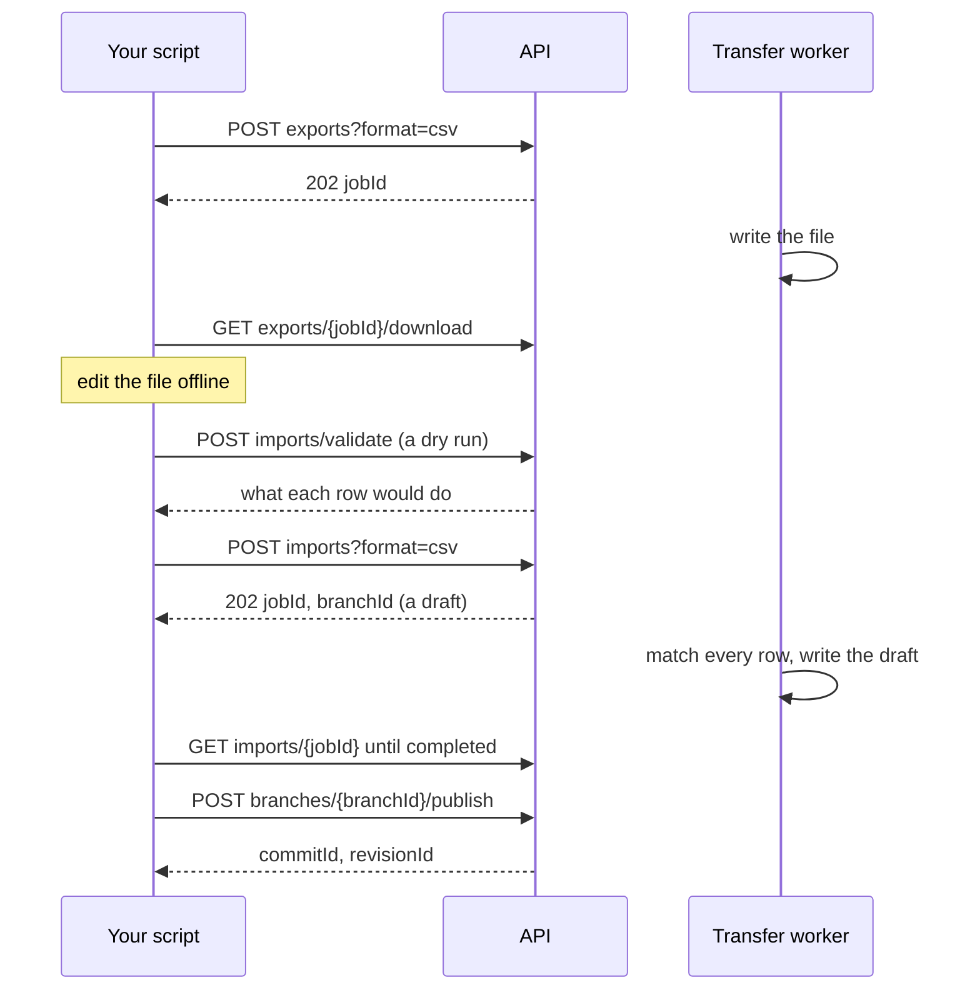

# Export, edit offline, import back: the Import & Export API

*For integrators — anyone who writes a script, a tool or a pipeline that takes a graph's data out,
changes it, and brings it back.*

This page builds the round trip step by step: export a data source's graph as a file, change the
file in a spreadsheet or in code, check it, import it, and publish it. Then it walks the trip three
times, once for each way a file's rows can find the items they describe: by **entity id**, by
**URN**, and by a **property** of your own. Every request is the real one, and every answer was
captured from a run of these exact requests (trimmed with `jq`, never invented).

> **Related reading:**
> - signing in from a script, and the conventions every route shares: the [API Guide](/docs/api-guide);
> - sending another system's catalog on a schedule: [Building a Connector](/docs/connector-guide);
> - how an import reads, matches and applies a file: [Import / Export](/docs/versioning-import-export);
> - how ids are made: [18 · Entity Identity](/docs/versioning-identity);
> - every route and refusal: the [Versioning API reference](/docs/versioning-api-reference#210-imports--exports);
> - the same round trip in the app: [Import & Export](/guide/import-export).



## Before you start

### What you need

- **The app's address.** Every route below is under `$BASE/api/v1`.
- **Version control on for the data source**, and the **Version control** switch on
  (`versioningEnabled`): an import always lands in a draft. Exporting also needs the
  **Export graph data** switch (`graphExportEnabled`, on by default).
- **An API key**, a personal one (`nxpat_…`) or a service account's (`nxsat_…`): see
  [API Keys](/guide/api-keys) and the [Integration Quickstart](/docs/integration-quickstart). Use a
  service account's for anything that runs unattended. What the key, and the account it acts as,
  need for each step:

  | To do this | The key needs | Its account needs in the workspace |
  |---|---|---|
  | Export, dry-run a file, read jobs, read import settings, look ids up | **Data: read** (a read-only key will do) | read on the data source |
  | Import into a draft | **Data: read & write** | manage: Workspace member or above |
  | Publish the draft, or ask the import to publish itself (`autoPublish`) | **Data: read & write** | **Publisher** or **Data engineer** (`workspace:datasource:publish`) |
  | Set the graph's default identifier | No key: a person signed in | **Workspace admin** |

  A key never holds publish itself: it publishes where its account does, else `403` with
  `"code": "publish_required"`.
- **The workspace, the data source and its graph.** List your workspaces with their data sources,
  then resolve the data source to its versioned graph:

  ```bash
  curl -sS "$BASE/api/v1/admin/workspaces" -H "Authorization: Bearer $TOKEN" \
    | jq '.[] | {id, name, dataSources: [.dataSources[] | {id, label}]}'
  curl -sS "$BASE/api/v1/$WS/versioning/resolve?dataSourceId=$DS" -H "Authorization: Bearer $TOKEN" \
    | jq '{graphId, mainHeadCommitSeq, bootstrap}'
  ```

  ```json
  {"graphId": "graph_01M77NSAEADB9QD69M3GVP0XZ8", "mainHeadCommitSeq": 1, "bootstrap": null}
  ```

  A `404` means version control isn't on for the data source. A `bootstrap` object means it is
  still being turned on: wait until it is `null`.

Set them once in your shell. The examples pass the key in a header for clarity; on a shared
machine, keep it off the process list as the [API Guide](/docs/api-guide#with-an-api-key) shows.

```bash
BASE=https://lineage.example.com    # the address you open the app at
TOKEN=nxsat_…                       # the API key, from your secrets manager
WS=ws_…                             # the workspace
DS=ds_…                             # the data source
GID=graph_…                         # its versioned graph, from /resolve above

# Poll a job (an import, an export or a publish job) until it ends, then print it.
wait_for() {
  local job
  while :; do
    job=$(curl -sS "$BASE/api/v1/$WS/versioning/graphs/$GID/$1" -H "Authorization: Bearer $TOKEN")
    case $(jq -r .status <<<"$job") in
      completed|failed|cancelled) printf '%s\n' "$job"; return ;;
    esac
    sleep 3
  done
}
```

### The model in one minute

- **Every item has one platform id**, its `entity_id`: a `urn:uuid:…` for an item made today.
  It never changes, whatever matched it, and an id an item already has is kept. Every node and edge
  keeps its id, and so its history, through every import.
- **A file's keys only find ids.** Each row finds the item it describes by the import's
  `identifier`: `entity_id`, `urn`, or `prop.<name>` (a property of your own). The key a row
  matched by is never written over the item's id or urn.
- **A row that finds nothing makes a new item**, under an id derived from its key, its urn or its
  property's value (a UUIDv5). The same file imported again derives the same id, so it finds that
  item instead of making it twice.
- **An import writes a draft, never the published graph.** You review the draft and publish it, or
  ask the import to publish itself.

Choose the identifier by where the file comes from:

| Your file | `identifier` | A row finds its item by | A new row needs |
|---|---|---|---|
| An export of this graph, edited, with rows added | `entity_id` (the default) | its `entity_id`; else its `urn`; else a field its type matches imports by ("Match imports by this"); else, with no urn, a `qualifiedName` exactly one item carries | an `entityType` and a `urn` (or a `qualifiedName`) |
| From a system that names items by URN (DataHub, OpenMetadata, your own) | `urn` | its `urn` (or an `entity_id` of this graph), nothing else | an `entityType` and a `urn` |
| From a system with ids of its own, kept in a property | `prop.<name>`, such as `prop.external_id` | its value of that property (or an `entity_id` of this graph), nothing else | an `entityType` and that property's value |

Leave `identifier` out and the graph's default applies: a workspace admin sets it on the data
source's **Versioning** tab, under **Imports**. Without one, the platform's applies, `entity_id`
unless your operator set `GRAPHVER_IMPORT_IDENTIFIER`. `GET …/graphs/$GID/import-settings` says
which holds and where it came from (walkthrough 3 reads it). In the app, the Import dialog's
**Match existing items by** is the same choice: **Entity ID**, **URN** or **A property**.

Whichever identifier an import names:

- **A row that carries an `entity_id` of this graph is that item.** Every row of an export does.
- **Keys that name two different items refuse the row** (`two_entities`), and a value several live
  items hold refuses the rows that name it (`duplicate_value`). An import never guesses.
- **A node row with no key the identifier can use is refused** (`no_key`), rather than made again
  by every import.
- **Only the fields a row carries are written.** A blank cell keeps what the item holds; `\N` in a
  `prop.<name>` cell removes that property.
- **A row an export wrote carries `baseVersion`**, and is merged three ways with what changed since
  the export: only the cells you changed apply.
- **A row that changes nothing writes nothing**: no version, no commit.

An **edge** is matched by its own `entity_id` (an export's) or by its two ends and its type, and a
new edge's id is derived from its ends and type. Its ends are named in these columns, read in
this order:

| `identifier` | An edge's end is found by |
|---|---|
| `entity_id` | `source_entity_id` / `target_entity_id` → `sourceUrn` / `targetUrn` (or the data source's identifier property, `source.<it>`) → `source.<field>` / `target.<field>` (a field its type matches imports by) → `sourceQualifiedName` / `targetQualifiedName` |
| `urn` | `source_entity_id` / `target_entity_id` → `sourceUrn` / `targetUrn` |
| `prop.<name>` | `source_entity_id` / `target_entity_id` → `source.<name>` / `target.<name>` |

A `source_entity_id` is an entity id of this graph, or the file's own `entity_id` of a node row:
that links an edge to a node the same file makes.

## Step by step

### 1. Export

Ask the workers to write the file, follow the job, then download it:

```bash
JOB=$(curl -sS -X POST "$BASE/api/v1/$WS/versioning/graphs/$GID/exports?format=csv" \
        -H "Authorization: Bearer $TOKEN" | jq -r .jobId)
wait_for "exports/$JOB" | jq '{status, summary, kept}'
curl -sS "$BASE/api/v1/$WS/versioning/graphs/$GID/exports/$JOB/download" \
  -H "Authorization: Bearer $TOKEN" -C - -o export.csv
```

`POST …/exports` answers `202` with `{jobId, resultUri, status: "pending"}`. The job's `summary`
says `{nodes, edges, bytes}` once it is `completed`, and `kept` whether the file is still there:
it is kept for a day. `-C -` resumes a download that broke off.

What the export holds:

| Parameter | What it does |
|---|---|
| `format` | `ndjson` (the default), `csv`, `tsv`, `xlsx` or `json`. The same five an import reads |
| *(none of the below)* | The whole published graph |
| `branchId` | A draft as it stands, main and the draft's changes together, so you can export your draft, edit it and import it back into the same draft |
| `asOfSeq` | The graph as it was at a past revision |
| `viewId` | Only a view's entities: what it places, with their containment descendants. An edge only when both its ends are in |
| `ids`, `types` | Comma-separated entity ids or urns, and entity types: only those. An edge only when both its ends are kept |
| `props` | Comma-separated property names to add as empty `prop.<name>` columns to fill |
| `filename`, `idempotencyKey` | The download's name (no extension); a key that makes the request safe to send again |

`GET …/exports/plan`, with the same parameters, says first how many nodes and edges the file
would hold, and whether an Excel sheet can hold them (1,048,575 rows). `GET …/exports/stream`
streams the same file as it is read, with no job: it doesn't resume. An export can be up to 50 GB.

**The columns** are the same in every format: a CSV, TSV or Excel row, an NDJSON line or a JSON
object, one per node or edge. CSV and TSV files start with a UTF-8 byte-order mark.

| Column | On | What it holds |
|---|---|---|
| `kind` | both | `node` or `edge` |
| `entity_id` | both | The item's platform id. It is the item: leave it as exported |
| `urn` | node | The node's urn: its name in the system it came from, or its id when it was given none |
| `baseVersion` | both | The version the export wrote the row at (a content hash): the base of the three-way merge |
| `entityType`, `displayName`, `qualifiedName`, `description`, `sourceSystem`, `layerAssignment`, `tags` | node | The node's own fields. `tags` is a list, or one comma-separated cell |
| `edgeType`, `confidence` | edge | The edge's type, and an optional confidence from 0 to 1 |
| `source_entity_id`, `target_entity_id` | edge | Its ends' entity ids |
| `sourceUrn`, `targetUrn`, `sourceQualifiedName`, `targetQualifiedName` | edge | Its ends' urns and qualified names |
| `prop.<name>` | both | One property per column. The data source's name property, `prop.name` unless it names another, is kept in step with `displayName`: edit either |
| `properties_json` | both | Properties too nested for a column, as a JSON object |
| `_op` | both | Blank to create or update; `delete` to delete |

An Excel workbook has a **Nodes** and an **Edges** sheet instead of the `kind` column, with the
identity columns greyed. An import also reads `source.<name>` and `target.<name>`: an edge's end
named by a property of its node. The data source's own record format, its types and properties
typed, is `GET …/imports/schema` (a JSON Schema), and `GET …/imports/template?format=xlsx` is a
file of every column with a worked row of each type.

### 2. Edit offline

| To | Do this | What the import does |
|---|---|---|
| Change a value | Edit the cell | Writes that field, and only that field |
| Keep a value | Leave the cell as it is, or empty it | Leaves the field alone. An import never empties a field |
| Remove a property | Put `\N` (or `\NULL`) in its `prop.<name>` cell, or `null` for it in `properties_json` | Removes the property |
| Add a property | Add a `prop.<name>` column, or export with `props=<name>` to get one | Sets it where a row gives a value |
| Add a node | A row with no `entity_id`: its `entityType`, a key, and its fields | Makes it under an id derived from its key. It keeps the urn it gives; with none, its id is its urn |
| Add an edge | A row with `kind` `edge`, its `edgeType`, and its two ends | Makes it under an id derived from its ends and type, or finds the edge already there |
| Delete a node or an edge | Set `_op` to `delete` on its row | Deletes it. A node goes with the edges on it and what it contains (its containment subtree, by the ontology's containment types). Under `replace`, a node the file leaves out goes, but nothing a row names goes with it |
| Re-point an edge | Set `_op` to `delete` on its row, and add a row for the new edge | Deletes one, makes the other |

- **Delete a node's edge rows with it.** Remove them from the file, or set `_op` to `delete` on
  them too. An edge row left as it was is refused when the import runs, `end_not_found`: its end is
  gone by then. The dry run reads edges against the graph as it stands, so it doesn't catch this.
- **A node's own fields can't be removed** by an import: `\N` removes a property only in a
  `prop.<name>` cell. Give `description` and the other fields a new value instead. A row with `\N`
  in one of them is refused (`invalid_row`, naming the field), so the text `\N` is never stored.
- **Never edit these:**
  - `entity_id` on an exported row: it is the item.
  - `urn` on an existing node: an import never changes a node's urn. The row's other cells apply,
    and the row says *"urn '…' isn't stored: an import never changes a node's urn"*. Keep your
    own id in a property instead.
  - `baseVersion`: leave it as exported. Empty it only to overwrite the item with the row as it
    stands (step 5 of walkthrough 1).
  - An exported edge's ends: the row is refused (`edge_moved`). Re-point it as the table says.
  - `kind`, and a column for the data source's identifier property if it has one: it holds the
    node's urn.
- **One row per item.** A second row for an item that says something else is refused
  (`named_already`); one that says the same is unchanged.

### 3. Validate: a dry run

Send the file to `POST …/imports/validate`, with the `format` and the `identifier` the import will
use. It reads and matches every row as the import would, against the published graph or a draft
(`branchId`), and writes nothing: no draft, no job.

```bash
curl -sS -X POST "$BASE/api/v1/$WS/versioning/graphs/$GID/imports/validate?format=csv" \
  -H "Authorization: Bearer $TOKEN" --data-binary @export.csv \
  | jq '{identifier, identifierSource, summary, rows}'
```

| Field | What it says |
|---|---|
| `summary` | How many rows would be `new`, `updated`, `unchanged`, `deleted` or `invalid` (refused), and `skipped`: records that are neither a node nor an edge |
| `rows` | Up to 200 rows that change something, in file order: `rowIndex` (the file's records counted from 0, the header not one), `kind`, `op` (`create`, `update`, `delete` or `invalid`), `matchedEntityId` (the item it found, or the id a new one would take), `label`, `reasons`, and `code` on a refused row |
| `rowsTruncated` | More rows changed than are listed |
| `unknownColumns` | Columns the record format doesn't name, usually a typo (`prop_owner` for `prop.owner`). An import ignores them |
| `hints` | What to look at, such as delete rows that find nothing to delete |
| `identifier`, `identifierSource` | The identifier the rows were matched by, and whose it is: `request`, `data_source` or `platform` |
| `checkedAgainst` | `main`, or the draft's id |

A dry run reads up to 8 MiB and 10,000 rows (else `413`). It doesn't run a strict ontology's
write gate, which can still refuse a row at the commit (`write_refused`), or the deletions a
`replace` would make: the import's preview and its draft show those. By a property no import has
matched by yet it answers `409 identifier_not_indexed`: the first import builds the property's
index (walkthrough 3).

### 4. Import

**A file in one request** goes as the request's body:

```bash
curl -sS -X POST "$BASE/api/v1/$WS/versioning/graphs/$GID/imports?format=csv" \
  -H "Authorization: Bearer $TOKEN" --data-binary @export.csv | jq '{jobId, branchId, status}'
```

It answers `202` with the import job (`status: "pending"`) and `branchId`, the draft it writes.
`-T export.csv` in place of `--data-binary` streams a large file from disk. An NDJSON, CSV or TSV
file can be up to 10 GiB; a JSON array or an Excel workbook, which is read whole, 100 MB.

| Parameter | What it does |
|---|---|
| `format` | `ndjson` (the default), `csv`, `tsv`, `json` or `xlsx` |
| `identifier` | `entity_id`, `urn` or `prop.<name>`. Left out, the graph's default |
| `reconcileMode` | `upsert` (the default) writes what the file names; `replace` also deletes what it leaves out ([Upsert or replace](#upsert-or-replace)) |
| `branchId` | Import into your open draft, beside what it holds. Without it, the import opens a draft of its own |
| `viewId` | Place the nodes the import makes in that view's layout. Needs edit access to the view, and with a key, **Views: read & write** |
| `autoPublish` | `true`: the draft publishes itself once every row is in ([step 6](#6-publish)). Not with `branchId` |
| `allowMassDelete` | `true`: a replace may delete past the replace guard |
| `idempotencyKey` | Makes the request safe to send again ([Sending again](#sending-again-idempotency-and-retries)) |

**A large file, or a link that drops,** goes as a resumable upload: ask for one, send its parts,
then complete it with the import's parameters. Walkthrough 2 sends one; the
[API Guide](/docs/api-guide#bulk-import-and-export-graph-data) splits a large file into parts in a
loop, and [Building a Connector](/docs/connector-guide#5-sending-the-file) covers every rule.

1. `POST …/imports/uploads` `{"fileName", "size", "format"}` answers `201` with `uploadId`,
   `partBytes` (16 MiB unless you ask for your own, 5 to 100 MiB), `parts`, `received` and
   `expiresAt`: an upload has a day to finish.
2. `PUT …/imports/uploads/{uploadId}/parts/{n}`, for `n` from `0`, each part's bytes as the body.
   Parts go in any order and several at once. Or send the whole file to part `0`: it is cut into its
   parts as it arrives.
3. `GET …/imports/uploads/{uploadId}` lists the parts `received`. To resume, send the others.
4. `POST …/imports/uploads/{uploadId}/complete`, with `identifier`, `reconcileMode`, `branchId`,
   `viewId`, `autoPublish` and `allowMassDelete` as query parameters, answers `202` as
   `POST …/imports` does. An upload is imported once: completing it again answers with that import.

### 5. Follow the job

`GET …/imports/{jobId}` is read-only: poll it every few seconds.

| Field | What it says |
|---|---|
| `status` | `pending`, `running`, `completed`, `failed` or `cancelled` |
| `phase`, `processed`, `total`, `progress` | Where it is (`queued`, `parse`, `nodes`, `edges`, `replace`), and how far |
| `identifier`, `importSettings` | What its rows were matched by, where that came from, and the replace guard's limits it ran under. A job keeps what it was made with |
| `summary` | `new`, `updated`, `unchanged`, `deleted`, `invalid`, and `skipped` when some records were neither a node nor an edge |
| `summary.replaceGuard` | A replace's verdict ([The replace guard](#the-replace-guard)) |
| `summary.publish` | How an `autoPublish` import's publish went ([step 6](#6-publish)) |
| `errorMessage`, `summary.failure` | Why a job failed: `{code, action, phase, reason}` |
| `queuedAhead`, `stale`, `attempt` | While queued, the jobs before it; a worker gone quiet (another takes the job over and resumes it: wait); which attempt this is |

`GET …/imports/{jobId}/preview` lists up to 200 rows that changed something, each with its `op`,
`status`, `matchedEntityId`, `label`, `reasons` and, refused, its `code`. A refused row doesn't
stop the others: it is left out, and the rest import. The draft's diff is the whole change
(step 6).

### 6. Publish

Review what the draft changes, then publish it:

```bash
BRANCH=br_…    # the import's branchId
curl -sS "$BASE/api/v1/$WS/versioning/graphs/$GID/diff/summary?branchId=$BRANCH" \
  -H "Authorization: Bearer $TOKEN" | jq '{counts, entityCounts, edgeCounts}'
curl -sS -X POST "$BASE/api/v1/$WS/versioning/graphs/$GID/branches/$BRANCH/publish" \
  -H "Authorization: Bearer $TOKEN" -H 'Content-Type: application/json' \
  -d '{"message": "What changed, and why"}'
```

`GET …/diff/entries?branchId=$BRANCH` lists the changes a page at a time. A publish answers
`{commitId, revisionId, status: "completed"}`: the commit the draft landed as, and the revision of
the published graph that holds it. A draft of more than 20,000 changes publishes as a job: the
answer is `202` with a `statusUrl` (`GET …/publish-jobs/{jobId}`) to poll until `completed`, with
`commitId` and `revisionId`, or `failed`, with `error`. To have a person review it first, open a
merge request instead: `POST …/branches/$BRANCH/merge-requests`.

**Others published meanwhile?** A draft that started before someone else published is behind the
published graph. When a person published since, or automation changed what the draft changes, its
publish answers `409` `not_up_to_date` (commits a service account or a key made elsewhere don't
stop it). Pull the latest into the draft, then publish again:

```bash
curl -sS -X POST "$BASE/api/v1/$WS/versioning/graphs/$GID/branches/$BRANCH/rebase" \
  -H "Authorization: Bearer $TOKEN" -H 'Content-Type: application/json' -d '{}' | jq '{clean, conflicts}'
```

The pull merges field by field: what others changed stays, and your changes go on top. It answers
`clean: false` with `conflicts` only where both changed the same field differently. Send it again
with `resolutions`, the value to keep for each conflicting entity by its id, or resolve them with
the draft's **Pull latest** in the app; then publish.

**`autoPublish=true`** publishes the import's draft once every row is in, and records how on the
job's `summary.publish`:

| `state` | What happened | What to do |
|---|---|---|
| `queued`, with `jobId` | The draft is being published, as a job. `pulls` says how often it pulled the published graph first | Follow `GET …/publish-jobs/{jobId}` to `completed` (`commitId`, `revisionId`) or `failed` (`error`) |
| `unchanged` | The file changed nothing. Its empty draft was closed | Nothing |
| `skipped`, with `reason` | It wasn't published; the draft waits for review. `reason.type` says why: `rows_refused` (some rows were refused), `conflicts` (someone changed the same fields differently meanwhile), `not_up_to_date` (the published graph kept moving through three pulls), or the refusal a publish would give | Fix and import again, or resolve the draft and publish it |

When the published graph moved while the file was imported, the draft pulls it first with the same
field-by-field merge, and publishes once it pulls clean, up to three times. It needs what a
publish needs, checked before anything is made: `403` (`code` `publish_required`) when the account
can't publish, `409 review_required` when the data source's policy says nobody merges their own
changes, and `422 auto_publish_needs_own_draft` with `branchId`.

### After publishing: when the graph shows it

The commit is the system of record at once. The graph you read and trace catches up with it:
`GET …/graphs/$GID/watermark` says how far.

```bash
curl -sS "$BASE/api/v1/$WS/versioning/graphs/$GID/watermark" -H "Authorization: Bearer $TOKEN" \
  | jq '{committed, served, fresh}'
```

`committed` is the published graph's head revision: the `revisionId` your publish answered, or a
later one. `served` is the revision reads of the graph show right now. `fresh` turns `true` once
the graph holds the head (`projected` has reached `committed`).

While the graph catches up, reads don't wait and don't fail. Every read of the published graph
(the canvas, `…/graph/…` reads, traces, native queries) answers from the revision it last
finished, complete with its connections, and `served` names it. A large import can take a while
to be written; reads keep answering from the revision before it until then. The app's sync chip
says the same to people ("Showing #12 · writing #14").

To read your own change through the graph, poll until `served` reaches the `revisionId` your
publish answered:

```bash
until [ "$(curl -sS "$BASE/api/v1/$WS/versioning/graphs/$GID/watermark" \
  -H "Authorization: Bearer $TOKEN" | jq --argjson r "$REVISION" '(.served // 0) >= $r')" = true ]; do
  sleep 2
done
```

`served` is `null` only while the graph holds no revision at all: just enabled, moved to another
graph store, or unloaded to free memory. Reads come from the system of record then, slower and
without the rolled-up connections between collapsed items.

## Walkthrough 1: by entity id — export, edit in a spreadsheet, import back

The graph holds three tables a connector loaded, `orders`, `customers` and `orders_2019`, and two
`FLOWS_TO` edges into `orders`. You export it, change it offline, and bring it back. The rows of an
export carry their entity ids, so the default identifier, `entity_id`, is the right one.

**1. Export it as CSV, with an empty `prop.domain` column to fill:**

```bash
JOB=$(curl -sS -X POST "$BASE/api/v1/$WS/versioning/graphs/$GID/exports?format=csv&props=domain" \
        -H "Authorization: Bearer $TOKEN" | jq -r .jobId)
wait_for "exports/$JOB" | jq '{status, summary, kept}'
```

```json
{"status": "completed", "summary": {"bytes": 1610, "edges": 2, "nodes": 3}, "kept": true}
```

```bash
curl -sS "$BASE/api/v1/$WS/versioning/graphs/$GID/exports/$JOB/download" \
  -H "Authorization: Bearer $TOKEN" -C - -o sales.csv
```

`sales.csv`:

```csv
kind,entity_id,urn,entityType,displayName,qualifiedName,description,sourceSystem,layerAssignment,tags,baseVersion,edgeType,sourceQualifiedName,targetQualifiedName,sourceUrn,targetUrn,source_entity_id,target_entity_id,confidence,prop.domain,prop.name,prop.owner,prop.tier,_op
node,urn:uuid:318cb131-0fba-5839-8e2c-3ac28980237b,urn:acme:table:sales.orders_2019,Table,orders_2019,sales.orders_2019,Orders placed before 2020,,,,c482327e1159f00f39f2346aeb995a49d3d38cc928d499fb52c5b7515fb1042f,,,,,,,,,,orders_2019,alice,,
node,urn:uuid:327ab3e9-d848-5906-b99a-f4a3da974f55,urn:acme:table:sales.orders,Table,orders,sales.orders,One row per order,,,,a13375be6310c29bf988f5b4b7badcba7896d623ab904a6aac62ab76fa103215,,,,,,,,,,orders,alice,gold,
node,urn:uuid:c28150d9-c3e7-5b73-8ddb-a796a147fcbd,urn:acme:table:sales.customers,Table,customers,sales.customers,One row per customer,,,,d27da16bd205f5a31d8e289834a99e97691a7e6fefa6fd6dceda051ebd209b71,,,,,,,,,,customers,bob,,
edge,urn:uuid:b8c990f8-5ce9-5cc3-aca5-8fc2e3d813f7,,,,,,,,,a3dd3b33ef73cab99129953abb5b3d66b06b4820148b81a209da8a2c4edd72e4,FLOWS_TO,sales.orders_2019,sales.orders,urn:acme:table:sales.orders_2019,urn:acme:table:sales.orders,urn:uuid:318cb131-0fba-5839-8e2c-3ac28980237b,urn:uuid:327ab3e9-d848-5906-b99a-f4a3da974f55,,,,,,
edge,urn:uuid:c2b25b9f-f313-5291-9f84-a04fc2421d02,,,,,,,,,cd470455573c22c5e70b40299365900c682c4ec9b71e390745388a416bf2e02a,FLOWS_TO,sales.customers,sales.orders,urn:acme:table:sales.customers,urn:acme:table:sales.orders,urn:uuid:c28150d9-c3e7-5b73-8ddb-a796a147fcbd,urn:uuid:327ab3e9-d848-5906-b99a-f4a3da974f55,,,,,,
```

Meanwhile, a colleague changes two descriptions in the app and publishes them: `orders` becomes
*"One row per order, net of refunds"* and `customers` *"Every customer we have billed"*.

**2. Edit the file:**

| Row | Edit |
|---|---|
| `orders` | `prop.owner` `alice` → `dana`; `prop.tier` `gold` → `\N` (remove it); `prop.domain` → `sales` |
| `customers` | `description` → `Customers who have placed an order` (the colleague changed it too) |
| `orders_2019` | `_op` → `delete`; and remove the row of its edge into `orders` |
| *(new)* | A node: `urn` `urn:acme:table:sales.refunds`, `entityType` `Table`, its name, qualified name, description and owner |
| *(new)* | An edge `FLOWS_TO` from `orders` (its `entity_id`, as `source_entity_id`) to the new node (its urn, as `targetUrn`) |

`sales.csv`, edited:

```csv
kind,entity_id,urn,entityType,displayName,qualifiedName,description,sourceSystem,layerAssignment,tags,baseVersion,edgeType,sourceQualifiedName,targetQualifiedName,sourceUrn,targetUrn,source_entity_id,target_entity_id,confidence,prop.domain,prop.name,prop.owner,prop.tier,_op
node,urn:uuid:318cb131-0fba-5839-8e2c-3ac28980237b,urn:acme:table:sales.orders_2019,Table,orders_2019,sales.orders_2019,Orders placed before 2020,,,,c482327e1159f00f39f2346aeb995a49d3d38cc928d499fb52c5b7515fb1042f,,,,,,,,,,orders_2019,alice,,delete
node,urn:uuid:327ab3e9-d848-5906-b99a-f4a3da974f55,urn:acme:table:sales.orders,Table,orders,sales.orders,One row per order,,,,a13375be6310c29bf988f5b4b7badcba7896d623ab904a6aac62ab76fa103215,,,,,,,,,sales,orders,dana,\N,
node,urn:uuid:c28150d9-c3e7-5b73-8ddb-a796a147fcbd,urn:acme:table:sales.customers,Table,customers,sales.customers,Customers who have placed an order,,,,d27da16bd205f5a31d8e289834a99e97691a7e6fefa6fd6dceda051ebd209b71,,,,,,,,,,customers,bob,,
edge,urn:uuid:c2b25b9f-f313-5291-9f84-a04fc2421d02,,,,,,,,,cd470455573c22c5e70b40299365900c682c4ec9b71e390745388a416bf2e02a,FLOWS_TO,sales.customers,sales.orders,urn:acme:table:sales.customers,urn:acme:table:sales.orders,urn:uuid:c28150d9-c3e7-5b73-8ddb-a796a147fcbd,urn:uuid:327ab3e9-d848-5906-b99a-f4a3da974f55,,,,,,
node,,urn:acme:table:sales.refunds,Table,refunds,sales.refunds,One row per refund,,,,,,,,,,,,,,,dana,,
edge,,,,,,,,,,,FLOWS_TO,,,,urn:acme:table:sales.refunds,urn:uuid:327ab3e9-d848-5906-b99a-f4a3da974f55,,,,,,,
```

**3. Dry-run it:**

```bash
curl -sS -X POST "$BASE/api/v1/$WS/versioning/graphs/$GID/imports/validate?format=csv" \
  -H "Authorization: Bearer $TOKEN" --data-binary @sales.csv \
  | jq '{identifier, identifierSource, summary, rows}'
```

```json
{
  "identifier": "entity_id",
  "identifierSource": "platform",
  "summary": {"new": 2, "updated": 1, "unchanged": 1, "deleted": 1, "invalid": 1, "skipped": 0},
  "rows": [
    {"rowIndex": 0, "kind": "node", "op": "delete", "matchedEntityId": "urn:uuid:318cb131-0fba-5839-8e2c-3ac28980237b",
     "label": "orders_2019", "reasons": [], "code": null},
    {"rowIndex": 1, "kind": "node", "op": "update", "matchedEntityId": "urn:uuid:327ab3e9-d848-5906-b99a-f4a3da974f55",
     "label": "orders", "reasons": [], "code": null},
    {"rowIndex": 2, "kind": "node", "op": "invalid", "matchedEntityId": "urn:uuid:c28150d9-c3e7-5b73-8ddb-a796a147fcbd",
     "label": "customers",
     "reasons": ["changed since you exported it: description — export again, or clear baseVersion to overwrite"],
     "code": "changed_since_export"},
    {"rowIndex": 4, "kind": "node", "op": "create", "matchedEntityId": "urn:uuid:34734ab4-fe07-5196-8caf-b45e8bb59e22",
     "label": "refunds", "reasons": [], "code": null},
    {"rowIndex": 5, "kind": "edge", "op": "create", "matchedEntityId": "urn:uuid:0b380e30-9750-5b25-b6c8-878c23601946",
     "label": "FLOWS_TO", "reasons": [], "code": null}
  ]
}
```

- `orders` is an update, though the colleague changed it too: you changed other cells, so both
  stand. `customers` is refused: you both changed its description.
- `refunds` would take `urn:uuid:34734ab4-…`, derived from its urn. The same row imported again
  derives the same id.
- Row 3, the edge from `customers`, isn't listed: it changes nothing.

**4. Import it.** No `identifier`: the graph's default, `entity_id`, applies.

```bash
curl -sS -X POST "$BASE/api/v1/$WS/versioning/graphs/$GID/imports?format=csv" \
  -H "Authorization: Bearer $TOKEN" --data-binary @sales.csv | jq '{jobId, branchId, status}'
```

```json
{"jobId": "vjob_01M77NRWR18A7Y258PRVP4PXQ8", "branchId": "br_01M77NRWQX9RV8T3KE54E38TJR", "status": "pending"}
```

```bash
JOB=vjob_01M77NRWR18A7Y258PRVP4PXQ8 BRANCH=br_01M77NRWQX9RV8T3KE54E38TJR
wait_for "imports/$JOB" | jq '{status, identifier, summary}'
curl -sS "$BASE/api/v1/$WS/versioning/graphs/$GID/imports/$JOB/preview" \
  -H "Authorization: Bearer $TOKEN" | jq '.sample[] | select(.code) | {rowIndex, label, reasons, code}'
```

```json
{"status": "completed", "identifier": "entity_id",
 "summary": {"new": 2, "deleted": 1, "invalid": 1, "updated": 1, "unchanged": 1}}
```

```json
{"rowIndex": 2, "label": "customers",
 "reasons": ["changed since you exported it: description — export again, or clear baseVersion to overwrite"],
 "code": "changed_since_export"}
```

The import did what the dry run said. Its draft holds the changes; the published graph doesn't
yet.

**5. Settle the refused row.** To keep your description over your colleague's, send the row again
with its `baseVersion` emptied, into the same draft. `customers.csv`:

```csv
kind,entity_id,urn,entityType,displayName,qualifiedName,description,sourceSystem,layerAssignment,tags,baseVersion,edgeType,sourceQualifiedName,targetQualifiedName,sourceUrn,targetUrn,source_entity_id,target_entity_id,confidence,prop.domain,prop.name,prop.owner,prop.tier,_op
node,urn:uuid:c28150d9-c3e7-5b73-8ddb-a796a147fcbd,urn:acme:table:sales.customers,Table,customers,sales.customers,Customers who have placed an order,,,,,,,,,,,,,,customers,bob,,
```

```bash
curl -sS -X POST "$BASE/api/v1/$WS/versioning/graphs/$GID/imports?format=csv&branchId=$BRANCH" \
  -H "Authorization: Bearer $TOKEN" --data-binary @customers.csv | jq '{jobId, branchId, status}'
wait_for "imports/vjob_01M77NRX8CGCWF05BBVM9EYD50" | jq .summary
```

```json
{"jobId": "vjob_01M77NRX8CGCWF05BBVM9EYD50", "branchId": "br_01M77NRWQX9RV8T3KE54E38TJR", "status": "pending"}
```

```json
{"new": 0, "deleted": 0, "invalid": 0, "updated": 1, "unchanged": 0}
```

To keep your colleague's instead, do nothing: the refused row changed nothing.

**6. Review the draft and publish it:**

```bash
curl -sS "$BASE/api/v1/$WS/versioning/graphs/$GID/diff/summary?branchId=$BRANCH" \
  -H "Authorization: Bearer $TOKEN" | jq '{counts, entityCounts, edgeCounts}'
```

```json
{"counts": {"added": 2, "modified": 2, "removed": 2},
 "entityCounts": {"added": 1, "modified": 2, "removed": 1},
 "edgeCounts": {"added": 1, "modified": 0, "removed": 1}}
```

The edge from `orders_2019` went with it.

```bash
curl -sS -X POST "$BASE/api/v1/$WS/versioning/graphs/$GID/branches/$BRANCH/publish" \
  -H "Authorization: Bearer $TOKEN" -H 'Content-Type: application/json' \
  -d '{"message": "Sales tables: owners and refunds"}'
```

```json
{"commitId": "cmt_01M77NRXJ9H76KNP49GR7HGSTV", "revisionId": 4, "status": "completed"}
```

**7. See what changed.** `orders` has three versions: the load, the colleague's and yours. Each
says what it changed, and yours changed only the cells you edited:

```bash
ORDERS=urn:uuid:327ab3e9-d848-5906-b99a-f4a3da974f55
curl -sS "$BASE/api/v1/$WS/versioning/graphs/$GID/entities/$ORDERS/history?scope=published" \
  -H "Authorization: Bearer $TOKEN" \
  | jq '[.versions[] | {commit_message, changed: [.changes[] | .path | join(".")]}]'
```

```json
[
  {"commit_message": "Sales tables: owners and refunds",
   "changed": ["properties.domain", "properties.owner", "properties.tier"]},
  {"commit_message": "Clarify descriptions", "changed": ["description"]},
  {"commit_message": "Load the sales tables",
   "changed": ["description", "displayName", "entityType", "qualifiedName", "urn",
               "properties.name", "properties.owner", "properties.tier"]}
]
```

**8. Send the same file again.** Nothing has changed since you published it, so it writes nothing
and, asked to publish itself, publishes nothing:

```bash
curl -sS -X POST "$BASE/api/v1/$WS/versioning/graphs/$GID/imports?format=csv&autoPublish=true" \
  -H "Authorization: Bearer $TOKEN" --data-binary @sales.csv | jq -r .jobId
wait_for "imports/vjob_01M77NSA4QGA5SWNTG2NK7SX4C" | jq .summary
```

```json
{"new": 0, "deleted": 0, "invalid": 0, "publish": {"state": "unchanged"}, "updated": 0, "unchanged": 6}
```

Its rows are older than the graph now, and each is merged with what changed since: every cell you
changed already holds your value. The delete of `orders_2019` finds nothing to delete, which is
done already, not refused. The `refunds` row finds its node by its urn.

## Walkthrough 2: by URN — a catalog's nightly snapshot

A catalog names every table by a urn of its own, as DataHub does, and sends its whole catalog
each night as NDJSON. Its rows carry no entity ids: `identifier=urn` finds each by its urn alone.
Each night replaces the graph's contents (`reconcileMode=replace`), and the import publishes
itself.

**Night 1: the first snapshot, as a resumable upload.** `catalog.ndjson`:

```json
{"kind": "node", "urn": "urn:li:dataset:shop.orders", "entityType": "Table", "displayName": "orders", "prop.owner": "alice"}
{"kind": "node", "urn": "urn:li:dataset:shop.customers", "entityType": "Table", "displayName": "customers", "prop.owner": "bob"}
{"kind": "node", "urn": "urn:li:dataset:shop.payments", "entityType": "Table", "displayName": "payments", "prop.owner": "carol"}
{"kind": "edge", "edgeType": "FLOWS_TO", "sourceUrn": "urn:li:dataset:shop.customers", "targetUrn": "urn:li:dataset:shop.orders"}
{"kind": "edge", "edgeType": "FLOWS_TO", "sourceUrn": "urn:li:dataset:shop.payments", "targetUrn": "urn:li:dataset:shop.orders"}
```

```bash
SIZE=$(wc -c < catalog.ndjson)
curl -sS -X POST "$BASE/api/v1/$WS/versioning/graphs/$GID/imports/uploads" \
  -H "Authorization: Bearer $TOKEN" -H 'Content-Type: application/json' \
  -d "{\"fileName\": \"catalog.ndjson\", \"size\": $SIZE, \"format\": \"ndjson\"}"
```

```json
{"uploadId": "iu_7436d9cbaaf0470ba674473352a3cf23", "fileName": "catalog.ndjson", "size": 642, "format": "ndjson",
 "partBytes": 16777216, "parts": 1, "received": [], "jobId": null, "expiresAt": "2026-11-13T10:45:18.981917+00:00"}
```

The file is one part. Send it, check what arrived, and complete the upload with the import's
parameters:

```bash
UP=iu_7436d9cbaaf0470ba674473352a3cf23
curl -sS -X PUT "$BASE/api/v1/$WS/versioning/graphs/$GID/imports/uploads/$UP/parts/0" \
  -H "Authorization: Bearer $TOKEN" --data-binary @catalog.ndjson
curl -sS "$BASE/api/v1/$WS/versioning/graphs/$GID/imports/uploads/$UP" \
  -H "Authorization: Bearer $TOKEN" | jq '{parts, received}'
curl -sS -X POST "$BASE/api/v1/$WS/versioning/graphs/$GID/imports/uploads/$UP/complete?identifier=urn&reconcileMode=replace&autoPublish=true" \
  -H "Authorization: Bearer $TOKEN" | jq '{jobId, branchId, status}'
```

```json
{"part": 0, "size": 642, "lastPart": 0}
```

```json
{"parts": 1, "received": [0]}
```

```json
{"jobId": "vjob_01M77NSAHF644WD196VPTGT7JD", "branchId": "br_01M77NSAH71QCKX70V5CAK0YYK", "status": "pending"}
```

Completing it again answers with the same job: an upload is imported once.

```bash
wait_for "imports/vjob_01M77NSAHF644WD196VPTGT7JD" | jq '{status, identifier, summary}'
```

```json
{
  "status": "completed",
  "identifier": "urn",
  "summary": {
    "new": 5, "deleted": 0, "invalid": 0,
    "publish": {"jobId": "vjob_01M77NSB4A334W2Y2EW34VP6RQ", "state": "queued"},
    "updated": 0, "unchanged": 0,
    "replaceGuard": {"live": 0, "state": "passed", "limits": {"minLive": 1000, "createFraction": 0.5, "deleteFraction": 0.5},
                     "creates": 5, "deletes": 0,
                     "sources": {"minLive": "platform", "createFraction": "platform", "deleteFraction": "platform"}}
  }
}
```

```bash
wait_for "publish-jobs/vjob_01M77NSB4A334W2Y2EW34VP6RQ"
```

```json
{"jobId": "vjob_01M77NSB4A334W2Y2EW34VP6RQ", "graphId": "graph_01M77NSAEADB9QD69M3GVP0XZ8", "status": "completed",
 "commitId": "cmt_01M77NSB6JPQSJPH851DWT5708", "revisionId": 2, "error": null}
```

Each table keeps its urn, under an id derived from it: `urn:li:dataset:shop.customers` is
`urn:uuid:1ed01762-c5f1-573a-ba7d-1a0de4dfd425`, every night.

**Night 2: dry-run first.** `customers` has a new owner, `refunds` is new with an edge from
`orders`, and `payments` is gone. The catalog sent `invoices` without its urn:

```json
{"kind": "node", "urn": "urn:li:dataset:shop.orders", "entityType": "Table", "displayName": "orders", "prop.owner": "alice"}
{"kind": "node", "urn": "urn:li:dataset:shop.customers", "entityType": "Table", "displayName": "customers", "prop.owner": "dana"}
{"kind": "node", "urn": "urn:li:dataset:shop.refunds", "entityType": "Table", "displayName": "refunds", "prop.owner": "carol"}
{"kind": "node", "qualifiedName": "shop.invoices", "entityType": "Table", "displayName": "invoices", "prop.owner": "carol"}
{"kind": "edge", "edgeType": "FLOWS_TO", "sourceUrn": "urn:li:dataset:shop.customers", "targetUrn": "urn:li:dataset:shop.orders"}
{"kind": "edge", "edgeType": "FLOWS_TO", "sourceUrn": "urn:li:dataset:shop.orders", "targetUrn": "urn:li:dataset:shop.refunds"}
```

```bash
curl -sS -X POST "$BASE/api/v1/$WS/versioning/graphs/$GID/imports/validate?format=ndjson&identifier=urn" \
  -H "Authorization: Bearer $TOKEN" --data-binary @catalog.ndjson \
  | jq '{identifierSource, summary, refused: [.rows[] | select(.code)]}'
```

```json
{
  "identifierSource": "request",
  "summary": {"new": 2, "updated": 1, "unchanged": 2, "deleted": 0, "invalid": 1, "skipped": 0},
  "refused": [
    {"rowIndex": 3, "kind": "node", "op": "invalid", "matchedEntityId": null, "label": "invoices",
     "reasons": ["it has no urn, and with identifier=urn a row is found by its urn (or the entity_id of a node in this graph): give it one"],
     "code": "no_key"}
  ]
}
```

By `urn`, a qualified name finds nothing. Imported as it is, the replace would refuse to delete
anything: a refused row might name what the file means to keep, so the job fails, `"Nothing was
deleted: 1 row(s) of the file couldn't be applied, …"`. The dry run doesn't count a replace's
deletions either: `deleted` is `0` above.

**Fix the row and import the night's file.** `invoices` gets its urn,
`{"kind": "node", "urn": "urn:li:dataset:shop.invoices", "entityType": "Table", "displayName": "invoices", "prop.owner": "carol"}`.
An `idempotencyKey` named for the night makes the request safe to send again:

```bash
curl -sS -X POST "$BASE/api/v1/$WS/versioning/graphs/$GID/imports?format=ndjson&identifier=urn&reconcileMode=replace&autoPublish=true&idempotencyKey=catalog-2026-11-13" \
  -H "Authorization: Bearer $TOKEN" --data-binary @catalog.ndjson | jq '{jobId, branchId, status}'
wait_for "imports/vjob_01M77NSR0SFR270TYRS3GC3GNJ" | jq '{status, summary}'
```

```json
{"jobId": "vjob_01M77NSR0SFR270TYRS3GC3GNJ", "branchId": "br_01M77NSR0PZR1X23MMM3Y5XDA7", "status": "pending"}
```

```json
{
  "status": "completed",
  "summary": {
    "new": 3, "deleted": 2, "invalid": 0,
    "publish": {"jobId": "vjob_01M77NSRMETWG7N9CADQAP9NGV", "state": "queued"},
    "updated": 1, "unchanged": 2,
    "replaceGuard": {"live": 5, "state": "passed", "limits": {"minLive": 1000, "createFraction": 0.5, "deleteFraction": 0.5},
                     "creates": 3, "deletes": 2,
                     "sources": {"minLive": "platform", "createFraction": "platform", "deleteFraction": "platform"}}
  }
}
```

The replace deleted `payments` and its edge into `orders`, which the file left out. The same
request sent again, after a timeout say, answers with the same job and its status now, and makes
nothing new:

```json
{"jobId": "vjob_01M77NSR0SFR270TYRS3GC3GNJ", "branchId": "br_01M77NSR0PZR1X23MMM3Y5XDA7", "status": "completed"}
```

```bash
wait_for "publish-jobs/vjob_01M77NSRMETWG7N9CADQAP9NGV" | jq '{status, commitId, revisionId}'
```

```json
{"status": "completed", "commitId": "cmt_01M77NSRQ57HQTARQ585QGJNQE", "revisionId": 3}
```

`customers` is the same node, `urn:uuid:1ed01762-…`, with its new owner. `refunds` is
`urn:uuid:9db19ecb-221b-53c3-930d-2e8c9a69af87`, derived from its urn.

**Night 3: the same catalog.** A new key for a new night, and nothing to do:

```bash
curl -sS -X POST "$BASE/api/v1/$WS/versioning/graphs/$GID/imports?format=ndjson&identifier=urn&reconcileMode=replace&autoPublish=true&idempotencyKey=catalog-2026-11-14" \
  -H "Authorization: Bearer $TOKEN" --data-binary @catalog.ndjson | jq -r .jobId
wait_for "imports/vjob_01M77NT35EBRPA9FKVEQQGCD19" | jq '.summary | {new, updated, unchanged, deleted, invalid, publish}'
```

```json
{"new": 0, "updated": 0, "unchanged": 6, "deleted": 0, "invalid": 0, "publish": {"state": "unchanged"}}
```

## Walkthrough 3: by a property — an ERP's own ids

An ERP gives each table an id of its own, `E-1001` and on, and no urn. Its spreadsheet keeps the
id in a column; the graph keeps it in the property `external_id`. `identifier=prop.external_id`
finds each row's node by that value.

**Check the graph's settings.** Its default identifier, and the properties its imports match by
(none yet):

```bash
curl -sS "$BASE/api/v1/$WS/versioning/graphs/$GID/import-settings" -H "Authorization: Bearer $TOKEN" \
  | jq '{identifier: .effective.identifier, from: .effective.sources.identifier, matchingProperties, maxMatchingProperties}'
```

```json
{"identifier": "entity_id", "from": "platform", "matchingProperties": [], "maxMatchingProperties": 10}
```

**The first file.** `erp.csv`, its edges' ends named by the same id, in `source.external_id` and
`target.external_id`:

```csv
kind,prop.external_id,entityType,displayName,description,prop.owner,edgeType,source.external_id,target.external_id
node,E-1001,Table,orders,,alice,,,
node,E-1002,Table,customers,,bob,,,
node,E-1003,Table,payments,,carol,,,
edge,,,,,,FLOWS_TO,E-1002,E-1001
edge,,,,,,FLOWS_TO,E-1003,E-1001
```

A dry run by a property no import has matched by yet can't match anything:

```bash
curl -sS -X POST "$BASE/api/v1/$WS/versioning/graphs/$GID/imports/validate?format=csv&identifier=prop.external_id" \
  -H "Authorization: Bearer $TOKEN" --data-binary @erp.csv
```

```json
{"detail": {"type": "identifier_not_indexed",
            "message": "no import has matched this graph's nodes by external_id yet, so a dry run can't: import a file with identifier=prop.external_id to build its index (it reads every node once), then check files against it"}}
```

The first import builds the property's index: it reads every node once, minutes on a large graph.
It goes into a draft, so you still review it before it's published:

```bash
curl -sS -X POST "$BASE/api/v1/$WS/versioning/graphs/$GID/imports?format=csv&identifier=prop.external_id" \
  -H "Authorization: Bearer $TOKEN" --data-binary @erp.csv | jq '{jobId, branchId, status}'
wait_for "imports/vjob_01M77NT3G27K6DJ4A5JJSB32PR" | jq '{status, identifier, summary}'
```

```json
{"jobId": "vjob_01M77NT3G27K6DJ4A5JJSB32PR", "branchId": "br_01M77NT3FY3QPZBRENAEY06MNP", "status": "pending"}
```

```json
{"status": "completed", "identifier": "prop.external_id",
 "summary": {"new": 5, "deleted": 0, "invalid": 0, "updated": 0, "unchanged": 0}}
```

Publish the draft (step 6), and the settings list the property:

```bash
curl -sS "$BASE/api/v1/$WS/versioning/graphs/$GID/import-settings" -H "Authorization: Bearer $TOKEN" \
  | jq .matchingProperties
```

```json
[{"name": "external_id", "status": "ready", "seq": 1, "current": false, "createdAt": "2026-11-12T10:45:44.623626+00:00"}]
```

`current: false` means the published graph has moved past the index (your publish moved it). The
next import catches it up first, so it finds nodes made or edited in the app since.

Each node's id is derived from the property and its value: `E-1001` is
`urn:uuid:eda6dca5-2086-51e3-943c-b893c93554bb`. With no urn in the file, each node's urn is its id,
and it keeps `external_id` as a property.

**Meanwhile, in the app,** someone adds a `refunds` table with `external_id` `E-1004`, and
publishes it. The ERP's next file is a partial one: each row, its id and only what changed.
`erp-2.csv`:

```csv
kind,prop.external_id,entityType,displayName,description,prop.owner,edgeType,source.external_id,target.external_id
node,E-1001,,,,dana,,,
node,E-1004,,,"Refunds, from the ERP",,,,
node,E-1005,Table,invoices,,carol,,,
edge,,,,,,FLOWS_TO,E-1001,E-1005
```

The index is built now, so the dry run reads by it:

```bash
curl -sS -X POST "$BASE/api/v1/$WS/versioning/graphs/$GID/imports/validate?format=csv&identifier=prop.external_id" \
  -H "Authorization: Bearer $TOKEN" --data-binary @erp-2.csv | jq '{summary, rows: [.rows[] | {rowIndex, op, matchedEntityId}]}'
```

```json
{
  "summary": {"new": 2, "updated": 2, "unchanged": 0, "deleted": 0, "invalid": 0, "skipped": 0},
  "rows": [
    {"rowIndex": 0, "op": "update", "matchedEntityId": "urn:uuid:eda6dca5-2086-51e3-943c-b893c93554bb"},
    {"rowIndex": 1, "op": "update", "matchedEntityId": "urn:uuid:0193a1b2-c3d4-7e5f-8a6b-7c8d9e0f1a2b"},
    {"rowIndex": 2, "op": "create", "matchedEntityId": "urn:uuid:37a03855-fbb2-537c-90bf-cc966e867d63"},
    {"rowIndex": 3, "op": "create", "matchedEntityId": "urn:uuid:0d73130e-5937-5004-a996-d1dec1769626"}
  ]
}
```

`E-1004` finds the node made in the app, by its value, rather than making a second one. Import the
file the same way, and publish it:

```bash
curl -sS -X POST "$BASE/api/v1/$WS/versioning/graphs/$GID/imports?format=csv&identifier=prop.external_id" \
  -H "Authorization: Bearer $TOKEN" --data-binary @erp-2.csv | jq -r .jobId
wait_for "imports/vjob_01M77NTFJPG60R7GXA7VG9R4VF" | jq .summary
```

```json
{"new": 2, "deleted": 0, "invalid": 0, "updated": 2, "unchanged": 0}
```

`orders` (`E-1001`) has the owner `dana` and keeps its name; the app's `refunds` has the ERP's
description and keeps the owner it was given in the app. Only the columns a row carries change.
The same file again writes nothing:

```json
{"new": 0, "deleted": 0, "invalid": 0, "updated": 0, "unchanged": 4}
```

**Look ids up without importing.** To write through the routes that name items by entity id
(`POST /graph/changes`, a draft's changes), find each value's id first, up to 10,000 a call:

```bash
curl -sS -X POST "$BASE/api/v1/$WS/versioning/graphs/$GID/identities/resolve" \
  -H "Authorization: Bearer $TOKEN" -H 'Content-Type: application/json' \
  -d '{"identifier": "prop.external_id", "values": ["E-1001", "E-1004", "E-9999"]}'
```

```json
{
  "identifier": "prop.external_id",
  "results": [
    {"value": "E-1001", "status": "found", "entityId": "urn:uuid:eda6dca5-2086-51e3-943c-b893c93554bb"},
    {"value": "E-1004", "status": "found", "entityId": "urn:uuid:0193a1b2-c3d4-7e5f-8a6b-7c8d9e0f1a2b"},
    {"value": "E-9999", "status": "none", "entityId": null}
  ]
}
```

A value two live nodes hold answers `duplicate`, with both in `entityIds`. Values compare as text
with spaces at either end ignored: `ABC` and `abc` are different values.

**Make it the graph's default.** So the ERP's imports needn't name it, a workspace admin chooses
**A property** under **Match existing items by** on the data source's **Versioning** tab, under
**Imports**, or from a signed-in session (not with a key) sends
`PUT …/graphs/$GID/import-settings` `{"identifier": "prop.external_id"}`; it answers as `GET` does.
`"inherit"` goes back to the platform's. An import already made keeps the settings it was made
with. A graph matches by at most 10 properties (`GRAPHVER_MAX_MATCHING_PROPERTIES`), and a fork by
none yet.

## Edge cases

Every row of a dry run or an import is made or refused with its reason: none is applied or
dropped in silence. The reasons below are the ones the API gives.

**Refused rows**, by their `code`:

| Situation | What happens | `code`, and the reason |
|---|---|---|
| A node row with nothing to find it by again: no urn, no qualified name, no field its type matches by (by `entity_id`) | Refused, so it isn't made again by every import | `no_key`: *"it names nothing an import could find it by again: give it a urn (or the entity_id of a node in this graph). …"* |
| By `urn`, a row with no urn; by `prop.external_id`, a row with no value | Refused | `no_key`: *"it has no urn, and with identifier=urn a row is found by its urn …"*, *"it has no external_id, and with identifier=prop.external_id …"* |
| A new node, or a new edge, with no type | Refused | `missing_type`: *"node create requires entityType"*, *"edge missing edgeType"* |
| A type the data source's ontology doesn't define | Refused | `invalid_type`: *"'View' is not a valid entity type in this ontology"* |
| Two rows for one item that say different things | The first applies; the second is refused. Two that say the same: the second is `unchanged` | `named_already`: *"row 4 of this file already names this node — give each node one row"* (rows counted from 1) |
| An `entity_id` and a `urn` (or a property's value) that name two different items | Refused | `two_entities`: *"its entity_id and its urn name two different entities — give it one of them"* |
| A value two live items hold, by `prop.<name>` | The rows naming it are refused, naming both items | `duplicate_value`: *"external_id 'E-1002' is held by 2 nodes (urn:uuid:…, urn:uuid:…): make it unique to one, or give the row its entity_id"* |
| A qualified name several items carry, a key field several hold, or a unique field's value another holds | Refused | `duplicate_value` |
| The item changed since the export, in a cell you changed too | Refused; your other rows apply | `changed_since_export`: *"changed since you exported it: description — export again, or clear baseVersion to overwrite"* |
| A delete row of an item changed since the export | Refused | `changed_since_export`: *"changed since you exported it — export again, or clear baseVersion to delete it anyway"* |
| An edge end that names no node | Refused | `end_not_found`: *"edge endpoint not found"* |
| An edge row kept in a file that deletes one of its nodes | Refused when the import runs. The dry run doesn't catch it | `end_not_found`: *"edge endpoint not found"* |
| An exported edge given other ends or another type | Refused, rather than made a second edge | `edge_moved`: *"its ends or type differ from edge urn:uuid:…'s — to re-point an edge, mark its row _op=delete and add a new row without an entity_id"* |
| `_op` is anything but blank, `upsert` or `delete` | Refused: the columns are usually shifted | `invalid_row`: *"unexpected _op value 'remove' — the _op column only accepts blank or 'delete'; …"* |
| A strict ontology's write gate refuses a row when the draft commits | Refused; the window's other rows apply | `write_refused` |

**Rows that aren't refused:**

| Situation | What happens |
|---|---|
| A row that changes nothing | `unchanged`: no version, no commit |
| A delete of what isn't there (deleted already, or never there) | `unchanged`, with *"nothing to delete: it isn't in the graph (deleted already, or never there)"*. The dry run counts such rows in a hint. So a delta sent twice is safe |
| A matched row whose `urn` you edited | Its other cells apply; the urn stays, with *"urn '…' isn't stored: an import never changes a node's urn — keep your own id in another property"* |
| By `entity_id`, a `urn:uuid:` entity id no item holds (an export from another environment) | A new node under that id, so an item keeps one id across environments |
| Any other `entity_id` on a new row (`new-1`) | A link between the file's rows: an edge's `source_entity_id: new-1` finds that node. It still needs a urn to be found again later |
| By `entity_id`, a new row found again only by its qualified name or a key field | Made under a new id (a UUIDv7); a later import finds it by that name or field |
| By `prop.<name>`, a changed value | A new key: a row with the old value makes a new node. To keep the node, send its `entity_id` with the new value once |
| A node deleted, then named again by its urn or its value | Brought back under its own id, with its history |
| A record whose `kind` is neither `node` nor `edge` | Skipped and counted (`summary.skipped`). A replace with skipped records imports nothing |

**Requests refused before anything is made:**

| Situation | Answer |
|---|---|
| `identifier=external_id` (no `prop.`) | `422` `invalid_identifier`: *"identifier is entity_id, urn or prop.<name>, not 'external_id'"* |
| `autoPublish=true` with `branchId` | `422` `auto_publish_needs_own_draft` |
| A dry run by a property no import has matched by | `409` `identifier_not_indexed` |
| An `idempotencyKey` you used for an export, on an import | `409` `idempotency_key_reused`: *"This idempotencyKey started another kind of job on this graph. Send a new one."* |
| Another import still running on the draft (`branchId`) | `409` `job_active`, with its `jobId` |

## Upsert or replace

| You send | `reconcileMode` | What happens |
|---|---|---|
| What changed | `upsert` (the default) | Rows set what they name and leave the rest. Deletes are `_op=delete` rows |
| Everything, every time | `replace` | The same, and every item in scope that no row matched is deleted. The scope is the whole graph, or with `viewId`, that view's entities |

- **A replace deletes nothing while any row is refused,** since the refused row might name what the
  file means to keep. The job fails (`summary.failure.code` `rows_refused`, action `fix_rows`; its
  `errorMessage` `"Nothing was deleted: …"`), and the file's other rows stay on its draft. The preview names the refused rows: fix them and import again.
- **Deletes are in the draft, like everything else.** The draft's diff lists them before anything
  is published.

### The replace guard

A file whose rows name their items by another key than the import's identifier matches nothing.
Replaced, it would delete its scope and make it again, every id and its history with it. So before
it deletes anything, a replace counts what it would delete and what its draft makes, and in a scope
of at least 1,000 items refuses one that would delete half of them or more **and** make at least
half as many again.

- **Refused:** nothing is deleted, and the file's rows wait on the draft for review. The job fails
  with `summary.failure` `{code: "mass_delete_blocked", action: "allow_mass_delete"}`, and
  `summary.replaceGuard` says `state: "blocked"`, with `live`, `deletes`, `creates` and the
  `limits` in force. Check the `identifier` first: that is what such a file usually gets wrong.
- **Meant it?** Import the file again with `allowMassDelete=true`, into the same draft (its
  `branchId`): `replaceGuard.state` is `overridden`, and the job keeps `allowMassDelete: true`.
- **The limits** are your operator's (`IMPORT_REPLACE_GUARD_MIN_LIVE`,
  `IMPORT_REPLACE_GUARD_DELETE_FRACTION`, `IMPORT_REPLACE_GUARD_CREATE_FRACTION`), and a workspace
  admin can set a data source's own on its **Versioning** tab. `summary.replaceGuard.sources` says
  whose each one is. A replace that passes says `state: "passed"`, as both of walkthrough 2's do.

### Fail fast

A whole graph's replace whose first full window of node rows (10,000) finds an item for fewer than
5% of them, in a graph of at least 1,000 items, stops there rather than read the rest of the file:
the job fails with `summary.failure.code` `identifier_matched_nothing` (`action: "identifier"`),
naming the identifier it matched by. Nothing is deleted; the rows read so far are on the draft. A
view's replace is left to the guard.

## Sending again: idempotency and retries

- **`idempotencyKey`** on `POST …/imports` (and `POST …/exports`): the same key from you on the
  same graph answers with the job it started, whatever happened to it since, with no second draft
  or job. Keys are yours alone, and permanent per graph, so name each run: the night, and the
  file's hash. If the first request broke off before its file was stored, the same key takes that
  import back with this request's file.
- **An upload** is imported once: completing it again answers with its import. A part sent again
  replaces itself, until the upload is completed (`409` then).
- **A file sent again with a new key** is a new import, and harmless: rows that change nothing
  write nothing, and deletes of what's gone are done already. Walkthrough 1's step 8 and
  walkthrough 2's third night show it.
- **A publish sent twice** finds its draft published: `409` `branch_closed`.
- **Retry** a `429` or `503` after its `Retry-After`: the API takes in a few import files at once,
  and asks the rest to wait. A `504` means the server stopped waiting, not that nothing happened:
  read the job, or find it by its key, before you send a write again. Never retry a `400`, `403`,
  `404` or `422` unchanged. The [API Guide](/docs/api-guide#when-the-server-sheds-load) has a retry
  loop.

## Errors

Errors come back as `{"detail": …}` ([API Guide → Errors](/docs/api-guide#errors)). What the
round trip meets:

| Status | `detail` | Where | Means |
|---|---|---|---|
| `401`, `403` | `api_key_…`, `missing_permission` | any | The key, or its account, may not |
| `403` | `"code": "publish_required"` | publish, `autoPublish` | The account can't publish here |
| `403` | `feature_disabled` | export | **Export graph data** is off |
| `404` | | any | No such graph, job or draft, an upload that expired, or an export no longer kept |
| `409` | `not_up_to_date` | publish | Pull the latest into the draft (`…/rebase`), then publish |
| `409` | `review_required` | publish, `autoPublish` | The data source's policy says a person reviews: open a merge request |
| `409` | `branch_closed`, `main_write_forbidden` | import with `branchId`, publish | The draft is closed, or the branch is the published graph |
| `409` | `job_active` | import | Another import is running on that draft: wait for it |
| `409` | `idempotency_key_reused` | import, export | The key started the other kind of job |
| `409` | `identifier_not_indexed` | dry run, `identities/resolve` | No import has matched by that property yet |
| `409` | `not_ready` | export download | The export hasn't finished |
| `409` | *(a sentence)* | upload `complete` | A part is missing |
| `413` | `too_large` | dry run | Over 8 MiB or 10,000 rows: import it into a draft instead |
| `413` | | import, upload | Over 10 GiB, or over 100 MB as JSON or Excel |
| `422` | `invalid_identifier` | import, upload `complete`, dry run, `identities/resolve`, `import-settings` | Not `entity_id`, `urn` or `prop.<name>` |
| `422` | `invalid_file` | dry run | The file can't be read as its format |
| `422` | `auto_publish_needs_own_draft` | import, upload `complete` | `autoPublish` with `branchId` |
| `422` | `matching_property_on_fork` | dry run, `identities/resolve` | A fork can't match by a property yet |
| `429` | `busy`, `rate_limited` | import, upload parts, any | Too many at once: retry after `Retry-After` |
| `503` | `identity_unavailable` | dry run | The data source's identity settings can't be read: retry |

A job that fails says why in `errorMessage` and `summary.failure.code`: `mass_delete_blocked`,
`rows_refused` (a replace whose file has rows it couldn't apply: fix them), `identifier_matched_nothing`, `too_many_matching_properties` (a graph already matches by 10
properties), `matching_property_on_fork`, `infrastructure` (an outage outlasted the retries:
`action: "resume"`), or `internal`.

## Where to next

- [API Guide](/docs/api-guide) — sign-in, the conventions every route shares, and the other
  scripted integrations.
- [Building a Connector](/docs/connector-guide) — when another system sends its catalog on a
  schedule, up to several gigabytes, and publishes it itself.
- [Import / Export](/docs/versioning-import-export) — how an import reads, matches and applies a
  file, a window at a time.
- [18 · Entity Identity](/docs/versioning-identity) — how every id is made, and why it never
  changes.
- [Import & Export](/guide/import-export) — the same round trip in the app, for the people who edit
  the files.
