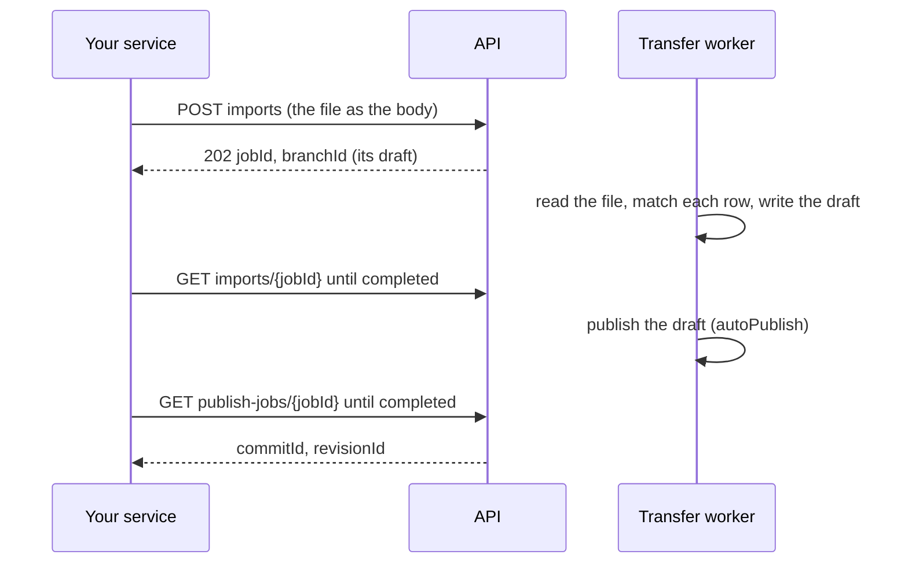

# Send Data From Your Service

*For developers whose service, pipeline, scheduled job or script sends data into a graph — from a
server, a container or a laptop — and publishes it.*

This page takes you from nothing to a published import, then to the full flow in your language:
an **upsert** of what changed, or a **full replace** of the whole snapshot, in curl, Python,
Node.js, Go or Java. Every request is the real one, and every answer was captured from a run of
these exact requests through the API behind its bundled proxy (trimmed with `jq`, never invented).

> **Other pages you may want:**
> - exporting a graph, editing it offline and importing it back, with a walkthrough per way of
>   matching rows: [Import & Export API](/docs/import-export-api);
> - mapping another system's catalog to records, and the reference connector:
>   [Building a Connector](/docs/connector-guide);
> - signing in from a script, and the conventions every route shares: the
>   [API Guide](/docs/api-guide);
> - every route and refusal: the [Versioning API reference](/docs/versioning-api-reference#210-imports--exports).

## How it works

Your service never writes the published graph directly. It sends a file; a worker turns the file
into a **draft**, a private set of changes; and the draft is **published**, becoming the next
revision of the graph everyone sees.



1. **You send the file** in a request: its bytes are the body. The API stores it as it arrives and
   answers at once (`202`) with the import's **job** and its **draft**.
2. **A worker imports it**, ten thousand rows at a time: each row finds the item it describes, by
   the **identifier** you chose, and only what changed is written to the draft.
3. **The draft is published** once every row is in, because you asked with `autoPublish=true`:
   it becomes one commit, the next **revision** of the published graph. Without `autoPublish`, it
   waits for someone to review and publish it.
4. **The graph people browse catches up** with that revision, seconds to minutes later for a
   large one. Until then they see the revision before, and the app says it is updating.

### The words this page uses

| Word | Means |
|---|---|
| **Data source** | A source of lineage registered in a workspace (`ds_…`) |
| **Versioned graph** | The data source's graph under version control (`graph_…`): every change is a commit, and every revision can be read again |
| **Published graph** (*main*) | What everyone sees, traces and exports. Only a publish changes it |
| **Draft** (*branch*) | Changes kept apart from the published graph until they are published (`br_…`). An import always writes one |
| **Import job** | The work of reading your file into a draft (`vjob_…`). You poll it until it ends |
| **Publish job** | The work of landing a draft on the published graph. It ends with a `commitId` and a `revisionId` |
| **Upsert** | `reconcileMode=upsert`, the default: write what the file names, and leave everything else as it is |
| **Full replace** | `reconcileMode=replace`: the same, and also delete what the file leaves out |
| **Identifier** | How each row finds the item it describes: `entity_id`, `urn`, or `prop.<name>`, a property of your own ([choosing one](/docs/import-export-api#the-model-in-one-minute)) |
| **Upload** | A file stored in parts before it is imported (`iu_…`), for large files and links that drop |

## Before you start

You need four things. [Import & Export API → What you need](/docs/import-export-api#what-you-need)
has the details, and how to find each id.

- **The app's address.** Every route is under `$BASE/api/v1`.
- **An API key**, ideally a service account's (`nxsat_…`), with **Data: read & write**. To publish,
  its account needs the **Publisher** or **Data engineer** role in the workspace.
- **The workspace, data source and graph ids.** Version control must be on for the data source.
- **A file**: NDJSON (one JSON object per line), CSV or TSV. Each row is a node or an edge:

  ```json
  {"kind": "node", "urn": "urn:svc:orders", "entityType": "Table", "displayName": "orders", "prop.owner": "alice"}
  {"kind": "node", "urn": "urn:svc:customers", "entityType": "Table", "displayName": "customers"}
  {"kind": "node", "urn": "urn:svc:refunds", "entityType": "Table", "displayName": "refunds"}
  {"kind": "edge", "edgeType": "FLOWS_TO", "sourceUrn": "urn:svc:orders", "targetUrn": "urn:svc:customers"}
  {"kind": "edge", "edgeType": "FLOWS_TO", "sourceUrn": "urn:svc:orders", "targetUrn": "urn:svc:refunds"}
  ```

  A node needs an `entityType` the data source's ontology knows, and a key the identifier can
  use: here, its `urn`. `prop.<name>` columns are its properties. An edge names its two ends, here
  by their urns. Every field, and the schema to check a file against:
  [Building a Connector → The record format](/docs/connector-guide#2-the-record-format).

Set them once in your shell:

```bash
BASE=https://lineage.example.com    # the address you open the app at
TOKEN=nxsat_…                       # the API key, from your secrets manager
WS=ws_…                             # the workspace
GID=graph_…                         # the data source's versioned graph
```

## Your first import

Save the five lines above as `catalog.ndjson`, then send them. `identifier=urn` matches each row
by its urn, and `autoPublish=true` publishes the draft once every row is in:

```bash
curl -sS -X POST "$BASE/api/v1/$WS/versioning/graphs/$GID/imports?format=ndjson&identifier=urn&autoPublish=true" \
  -H "Authorization: Bearer $TOKEN" -H 'Content-Type: application/octet-stream' -T catalog.ndjson
```

```json
{"jobId": "vjob_01M77ZCEG4MC6K3K4VK47Y146K", "branchId": "br_01M77ZCEFX4FEMJVAD0ME3V55E",
 "sourceUri": "ws1/ds_live_e35735c7/graph_01M77ZCDK1SJMZMFERJPA5ZJAC/vjob_01M77ZCEG4MC6K3K4VK47Y146K/source.ndjson",
 "status": "pending"}
```

`-T` streams the file from disk, so the same command sends a file of gigabytes. Follow the import
until its `status` is `completed` (or `failed`):

```bash
JOB=vjob_01M77ZCEG4MC6K3K4VK47Y146K
curl -sS "$BASE/api/v1/$WS/versioning/graphs/$GID/imports/$JOB" -H "Authorization: Bearer $TOKEN" \
  | jq '{status, identifier, summary: (.summary | {new, updated, unchanged, deleted, invalid, publish})}'
```

```json
{
  "status": "completed",
  "identifier": "urn",
  "summary": {
    "new": 5, "updated": 0, "unchanged": 0, "deleted": 0, "invalid": 0,
    "publish": {"jobId": "vjob_01M77ZCFATXE3EW9H2KW477TRZ", "state": "queued"}
  }
}
```

Five new items, three nodes and two edges, are in the draft, and its publish is queued. Follow the
publish to the revision that holds them:

```bash
curl -sS "$BASE/api/v1/$WS/versioning/graphs/$GID/publish-jobs/vjob_01M77ZCFATXE3EW9H2KW477TRZ" \
  -H "Authorization: Bearer $TOKEN" | jq '{status, commitId, revisionId}'
```

```json
{"status": "completed", "commitId": "cmt_01M77ZCFCS88FC2VA5X705A9SP", "revisionId": 2}
```

That's it: revision 2 of the published graph holds your three tables and their two edges, each
with an id of its own that never changes.

**Send the same file again** and nothing changes. Every row finds its item unchanged, so the
import writes nothing, and its empty draft is closed instead of published:

```json
{
  "status": "completed",
  "summary": {"new": 0, "updated": 0, "unchanged": 5, "deleted": 0, "invalid": 0,
              "publish": {"state": "unchanged"}}
}
```

So a run that failed halfway, or ran twice, is safe to send again.

## Upsert or full replace

| Your service sends | Use | What happens to items the file leaves out |
|---|---|---|
| **What changed** since last time | `reconcileMode=upsert` (the default) | Nothing: they stay. To delete one, send its row with `"_op": "delete"` |
| **Everything**, every time (a nightly snapshot) | `reconcileMode=replace` | Deleted, with their edges, in the draft, before it is published |

Either way, a row that names an existing item updates only the fields it carries, and every item
keeps its id. A full replace has two safety nets, both on by default:

- **The replace guard.** A replace that would delete most of a large graph and make most of it again
  usually means the rows name their items another way than the identifier you sent. It is refused
  before anything is deleted (`mass_delete_blocked`).
  [More, and how to proceed when you mean it](/docs/import-export-api#the-replace-guard).
- **Nothing is deleted while any row is refused** (`rows_refused`): a refused row might be one the
  file meant to keep. Fix it and send the file again.

## Choose how to send the file

| How | Send | Then | Choose it when |
|---|---|---|---|
| **In one request** | `POST …/imports?format=ndjson&reconcileMode=…&identifier=…&autoPublish=true`, the file as the body | Follow the job | You want one call. A connection that drops sends it again (safely, with an `idempotencyKey`) |
| **As an upload, in one request** | `POST …/imports/uploads?fileName=…&format=ndjson`, the file as the body | `POST …/imports/uploads/{uploadId}/complete?reconcileMode=…&identifier=…&autoPublish=true`, then follow the job | You store the file first, and import it when you complete it |
| **As an upload you can resume** | `POST …/imports/uploads` with the JSON description `{"fileName", "size", "format"}`, then `PUT …/imports/uploads/{uploadId}/parts/0` with the whole file | On a dropped connection, `GET …/imports/uploads/{uploadId}` and send the rest of the file from the first part missing; then complete | The link drops: you hold the `uploadId` before any of the file is sent ([walkthrough 2](/docs/import-export-api#walkthrough-2-by-urn--a-catalogs-nightly-snapshot), [step 4](/docs/import-export-api#4-import)) |

Whichever way:

- **The body is the file's bytes,** sent as `application/octet-stream` (any type but JSON will do).
  `POST …/imports/uploads` takes a JSON body as the upload's description, not as the file. Never send
  a form: `curl -F`, Postman's *form-data* and `requests.post(files=…)` are refused (`415`). Use
  `-T file`, Postman's *binary*, `content=`.
- **Sized or streamed.** With a `Content-Length` (curl's `-T file`, and every sample below), or
  streamed without one, such as `your-export | curl -T - …`. NDJSON, CSV and TSV files can be up
  to 10 GiB; JSON and Excel, 100 MB. The server holds one chunk of a body at a time: a 4 GiB file
  sent in one request, sized or streamed, was stored in about 24 s through the bundled nginx, the
  API process up less than 20 MB.
- **Checked, if you send its digest.** `Content-Digest: sha-256=:<the body's sha-256, base64>:`
  (RFC 9530; `sha-512` too). A body that doesn't match is refused (`422`) once it is in, and none of
  it is kept or imported. Every sample sends one.
- **A slow link takes longer; it doesn't fail.** A request is cut off only when its body stops
  arriving for 120 s.

## As an upload, step by step

Sent as an upload, the flow is four calls; [your first import](#your-first-import) did the first
two in one, `POST …/imports`. Either way the import lands in a draft (`branchId`), and
`autoPublish=true` publishes it once every row is in:

```bash
G="$BASE/api/v1/$WS/versioning/graphs/$GID"
# 1. Upload: the NDJSON itself is the body.
curl -sS -X POST "$G/imports/uploads?fileName=catalog.ndjson&format=ndjson" \
  -H "Authorization: Bearer $TOKEN" -H 'Content-Type: application/octet-stream' -T catalog.ndjson
# 2. Complete it: import into a new draft, and publish once every row is in.
curl -sS -X POST "$G/imports/uploads/$UP/complete?reconcileMode=upsert&identifier=urn&autoPublish=true" \
  -H "Authorization: Bearer $TOKEN"
# 3. Follow the import, then 4. its publish.
curl -sS "$G/imports/$JOB" -H "Authorization: Bearer $TOKEN"
curl -sS "$G/publish-jobs/$PUBLISH_JOB" -H "Authorization: Bearer $TOKEN"
```

```json
{"uploadId": "iu_fc43bd09e5da4ee499a7d38b41d3d05b", "size": 511, "parts": 1, "received": [0]}
{"jobId": "vjob_01M77YHMA6CKQHNYJR73XT64SD", "branchId": "br_01M77YHMA2YRFZG13ERX4ZNARJ", "status": "pending"}
{"status": "completed", "branchId": "br_01M77YHMA2YRFZG13ERX4ZNARJ",
 "summary": {"new": 2, "updated": 1, "unchanged": 2, "deleted": 0, "publish": {"jobId": "vjob_01M77YHN6WE5B8DFRYD0TSDJVM", "state": "queued"}}}
{"status": "completed", "commitId": "cmt_01M77YHNA67Z1JZJGN3ER78C80", "revisionId": 12}
```

`reconcileMode=replace` makes it a full replace. To review the draft before it is published,
leave `autoPublish` out, and publish it yourself ([step 6](/docs/import-export-api#6-publish)).

## What a run can end with

| You get | It means | Do |
|---|---|---|
| The import `completed`, `summary.publish.state: "queued"` | The draft is being published | Follow `GET …/publish-jobs/{jobId}` to `completed`: its `revisionId` is the published revision that holds your change |
| `summary.publish.state: "unchanged"` | The file changed nothing | Nothing |
| `summary.publish.state: "skipped"`, with `reason.type` | The draft waits for review: `rows_refused`, `conflicts` or `not_up_to_date` | Read `GET …/imports/{jobId}/preview`, fix the file and send it again, or resolve the draft and publish it |
| The import `failed`, `summary.failure.code: "mass_delete_blocked"` | A replace that would delete most of what's there ([the replace guard](/docs/import-export-api#the-replace-guard)) | Check `identifier` first. If you meant it, import the file again with `allowMassDelete=true&branchId=<its branchId>`, then publish that draft (`POST …/branches/{branchId}/publish`) |
| `failed`, `rows_refused` | A replace with rows it couldn't apply deletes nothing | Fix the rows the preview names, and send it again |
| `failed`, `identifier_matched_nothing` | The file's rows name their items by another key ([Fail fast](/docs/import-export-api#fail-fast)) | Send it again with the right `identifier` |
| `429` or `503`, with `Retry-After` | The server is taking in as many files at once as it allows | Send it again after that many seconds: the samples do |
| `413`; `415`; `422` | Too large for its format; a form; a parameter, or a body that doesn't match its digest | Read `detail`: it says how to send it |

## Samples in five languages

Each sample is a complete program that does the whole flow: it upserts in one request, or replaces
as an upload; streams the file from disk with a `Content-Digest`; follows the import and its
publish to the revision; and waits out a `429`. Set `BASE`, `TOKEN`, `WS` and `GID` in the
environment, then run it with `upsert` or `replace` and a file. On a new graph, each sample
prints the answers shown for `changes.ndjson`, the five lines of [your first
import](#your-first-import), then for `nightly.ndjson`, the next night's snapshot:

```json
{"kind": "node", "urn": "urn:svc:orders", "entityType": "Table", "displayName": "orders", "prop.owner": "bob"}
{"kind": "node", "urn": "urn:svc:customers", "entityType": "Table", "displayName": "customers"}
{"kind": "node", "urn": "urn:svc:invoices", "entityType": "Table", "displayName": "invoices"}
{"kind": "edge", "edgeType": "FLOWS_TO", "sourceUrn": "urn:svc:orders", "targetUrn": "urn:svc:customers"}
{"kind": "edge", "edgeType": "FLOWS_TO", "sourceUrn": "urn:svc:orders", "targetUrn": "urn:svc:invoices"}
```

The snapshot changes `orders`' owner, leaves `refunds` and its edge out, and brings `invoices`.
So the replace changed one table, deleted two items (`refunds` and its edge), and made two (the
`invoices` table and its edge).

### curl

```bash
#!/usr/bin/env bash
# Send a file to a versioned graph, and publish it, with curl and jq.
#
#   ./send_import.sh upsert changes.ndjson     # what changed, in one request
#   ./send_import.sh replace nightly.ndjson    # the whole snapshot, as an upload
#
# Needs BASE, TOKEN, WS and GID in the environment.
set -euo pipefail
GRAPH="$BASE/api/v1/$WS/versioning/graphs/$GID"

# The file's RFC 9530 Content-Digest, so the server checks what arrived.
digest() { echo "sha-256=:$(openssl dgst -sha256 -binary "$1" | base64):"; }

# Send the file as the body of a POST, streamed from disk (-T). --fail-with-body stops the run on
# a refusal and prints why; --retry sends it again after Retry-After when the server is busy.
send() {
  curl -sS --fail-with-body --retry 5 -X POST "$GRAPH/$1" -H "Authorization: Bearer $TOKEN" \
    -H 'Content-Type: application/octet-stream' -H "Content-Digest: $(digest "$2")" -T "$2"
}

# Poll a job (an import, or a publish) until it ends.
follow() {
  local job
  while :; do
    job=$(curl -sS --fail-with-body "$GRAPH/$1" -H "Authorization: Bearer $TOKEN")
    case $(jq -r .status <<<"$job") in completed|failed|cancelled) echo "$job"; return ;; esac
    sleep 3
  done
}

# The import's outcome, and its publish followed to the revision that holds it.
published() {
  local job=$1 note
  if [ "$(jq -r .status <<<"$job")" != completed ]; then
    jq -r '"import \(.status) (\(.summary.failure.code)): \(.errorMessage)"' <<<"$job" >&2; exit 1
  fi
  jq -c '.summary | {new, updated, unchanged, deleted, invalid}' <<<"$job"
  note=$(jq -c '.summary.publish' <<<"$job")
  if [ "$(jq -r .state <<<"$note")" != queued ]; then echo "publish: $note"; return; fi
  follow "publish-jobs/$(jq -r .jobId <<<"$note")" | jq -c '{status, commitId, revisionId, error}'
}

case $1 in
  upsert)
    JOB=$(send "imports?format=ndjson&reconcileMode=upsert&identifier=urn&autoPublish=true" "$2" | jq -r .jobId)
    published "$(follow "imports/$JOB")" ;;
  replace)
    UP=$(send "imports/uploads?fileName=$(basename "$2")&format=ndjson" "$2" | jq -r .uploadId)
    JOB=$(curl -sS --fail-with-body -X POST -H "Authorization: Bearer $TOKEN" \
      "$GRAPH/imports/uploads/$UP/complete?reconcileMode=replace&identifier=urn&autoPublish=true" | jq -r .jobId)
    published "$(follow "imports/$JOB")" ;;
esac
```

```console
$ ./send_import.sh upsert changes.ndjson
{"new":5,"updated":0,"unchanged":0,"deleted":0,"invalid":0}
{"status":"completed","commitId":"cmt_01M77YKSFXA517SMF6BYTWXH9P","revisionId":2,"error":null}
$ ./send_import.sh replace nightly.ndjson
{"new":2,"updated":1,"unchanged":2,"deleted":2,"invalid":0}
{"status":"completed","commitId":"cmt_01M77YM8N83HVCG6FARNZ89S8K","revisionId":3,"error":null}
```

`changes.ndjson` made three tables and two edges. `nightly.ndjson` left a table and its edge out,
and brought a new one: the replace deleted those two, made the new table and its edge, and changed
one table's owner. It needs bash, curl, jq and openssl: on Windows, run it in WSL, or use one of the
clients below.

### Python

`pip install httpx`. `content=` an open file streams it from disk with its `Content-Length`.

```python
"""Send a file to a versioned graph, and publish it.

    python send_import.py upsert changes.ndjson     # what changed, in one request
    python send_import.py replace nightly.ndjson    # the whole snapshot, as an upload

Needs BASE, TOKEN, WS and GID in the environment, and `pip install httpx`.
"""
import base64
import hashlib
import os
import sys
import time

import httpx

BASE, TOKEN, WS, GID = (os.environ[name] for name in ("BASE", "TOKEN", "WS", "GID"))
graph = httpx.Client(base_url=f"{BASE}/api/v1/{WS}/versioning/graphs/{GID}",
                     headers={"Authorization": f"Bearer {TOKEN}"},
                     timeout=httpx.Timeout(60, read=180))


def digest(path):
    """The file's RFC 9530 Content-Digest, so the server checks what arrived."""
    sha = hashlib.sha256()
    with open(path, "rb") as f:
        for block in iter(lambda: f.read(1 << 20), b""):
            sha.update(block)
    return f"sha-256=:{base64.b64encode(sha.digest()).decode()}:"


def call(method, route, path=None, **params):
    """One request: with a path, the file is its body, streamed from disk. Sent again after
    Retry-After while the server is busy (429, 503); any other refusal stops the run."""
    while True:
        if path is None:
            r = graph.request(method, route, params=params)
        else:
            with open(path, "rb") as body:
                r = graph.request(method, route, params=params, content=body, headers={
                    "Content-Type": "application/octet-stream", "Content-Digest": digest(path)})
        if r.status_code in (429, 503):
            time.sleep(int(r.headers.get("Retry-After", "15")))
            continue
        if r.is_error:
            sys.exit(f"{method} {route}: {r.status_code} {r.text}")
        return r.json()


def follow(route):
    """Poll a job (an import, or a publish) until it ends."""
    while (job := graph.get(route).json())["status"] not in ("completed", "failed", "cancelled"):
        time.sleep(3)
    return job


def published(job):
    """The import's outcome, and its publish followed to the revision that holds it."""
    summary = job.get("summary") or {}
    if job["status"] != "completed":
        failure = summary.get("failure") or {}
        sys.exit(f"import {job['status']} ({failure.get('code')}): {job.get('errorMessage')}")
    counts = {k: summary.get(k) for k in ("new", "updated", "unchanged", "deleted", "invalid")}
    note = summary.get("publish") or {}
    if note.get("state") != "queued":           # "unchanged", or "skipped" with its reason
        return {**counts, "publish": note}
    pub = follow(f"publish-jobs/{note['jobId']}")
    if pub["status"] != "completed":
        sys.exit(f"publish {pub['status']}: {pub.get('error')}")
    return {**counts, "revisionId": pub["revisionId"]}


def upsert(path):
    job = call("POST", "imports", path, format="ndjson", reconcileMode="upsert",
               identifier="urn", autoPublish="true")
    return published(follow(f"imports/{job['jobId']}"))


def replace(path):
    up = call("POST", "imports/uploads", path, fileName=os.path.basename(path), format="ndjson")
    job = call("POST", f"imports/uploads/{up['uploadId']}/complete", reconcileMode="replace",
               identifier="urn", autoPublish="true")
    return published(follow(f"imports/{job['jobId']}"))


if __name__ == "__main__":
    mode, path = sys.argv[1], sys.argv[2]
    print({"upsert": upsert, "replace": replace}[mode](path))
```

```console
$ python send_import.py upsert changes.ndjson
{'new': 5, 'updated': 0, 'unchanged': 0, 'deleted': 0, 'invalid': 0, 'revisionId': 2}
$ python send_import.py replace nightly.ndjson
{'new': 2, 'updated': 1, 'unchanged': 2, 'deleted': 2, 'invalid': 0, 'revisionId': 3}
```

### Node.js

Node.js 18 or later, no packages: `fetch` streams the file from disk (`duplex: 'half'`).

```javascript
// Send a file to a versioned graph, and publish it (Node.js 18 or later).
//
//   node send_import.mjs upsert changes.ndjson     # what changed, in one request
//   node send_import.mjs replace nightly.ndjson    # the whole snapshot, as an upload
//
// Needs BASE, TOKEN, WS and GID in the environment.
import { createHash } from 'node:crypto'
import { createReadStream, statSync } from 'node:fs'
import { basename } from 'node:path'
import { pipeline } from 'node:stream/promises'

const { BASE, TOKEN, WS, GID } = process.env
const graph = `${BASE}/api/v1/${WS}/versioning/graphs/${GID}`
const sleep = (ms) => new Promise((done) => setTimeout(done, ms))

// The file's RFC 9530 Content-Digest, so the server checks what arrived.
async function digest(path) {
  const sha = createHash('sha256')
  await pipeline(createReadStream(path), sha)
  return `sha-256=:${sha.digest('base64')}:`
}

// One request: with a path, the file is its body, streamed from disk. Sent again after
// Retry-After while the server is busy (429, 503); any other refusal stops the run.
async function call(method, route, params, path) {
  const url = `${graph}/${route}?${new URLSearchParams(params)}`
  for (;;) {
    const init = { method, headers: { Authorization: `Bearer ${TOKEN}` } }
    if (path) {
      Object.assign(init.headers, {
        'Content-Type': 'application/octet-stream',
        'Content-Length': String(statSync(path).size),
        'Content-Digest': await digest(path),
      })
      init.body = createReadStream(path)
      init.duplex = 'half'
    }
    const res = await fetch(url, init)
    if (res.status === 429 || res.status === 503) {
      await sleep(1000 * Number(res.headers.get('retry-after') ?? 15))
      continue
    }
    if (!res.ok) throw new Error(`${method} ${route}: ${res.status} ${await res.text()}`)
    return res.json()
  }
}

// Poll a job (an import, or a publish) until it ends.
async function follow(route) {
  for (;;) {
    const job = await (await fetch(`${graph}/${route}`, { headers: { Authorization: `Bearer ${TOKEN}` } })).json()
    if (['completed', 'failed', 'cancelled'].includes(job.status)) return job
    await sleep(3000)
  }
}

// The import's outcome, and its publish followed to the revision that holds it.
async function published(job) {
  const summary = job.summary ?? {}
  if (job.status !== 'completed') {
    throw new Error(`import ${job.status} (${summary.failure?.code}): ${job.errorMessage}`)
  }
  const { new: created, updated, unchanged, deleted, invalid } = summary
  const counts = { new: created, updated, unchanged, deleted, invalid }
  const note = summary.publish ?? {}
  if (note.state !== 'queued') return { ...counts, publish: note } // "unchanged", or "skipped" with its reason
  const pub = await follow(`publish-jobs/${note.jobId}`)
  if (pub.status !== 'completed') throw new Error(`publish ${pub.status}: ${pub.error}`)
  return { ...counts, revisionId: pub.revisionId }
}

async function upsert(path) {
  const job = await call('POST', 'imports',
    { format: 'ndjson', reconcileMode: 'upsert', identifier: 'urn', autoPublish: 'true' }, path)
  return published(await follow(`imports/${job.jobId}`))
}

async function replace(path) {
  const up = await call('POST', 'imports/uploads', { fileName: basename(path), format: 'ndjson' }, path)
  const job = await call('POST', `imports/uploads/${up.uploadId}/complete`,
    { reconcileMode: 'replace', identifier: 'urn', autoPublish: 'true' })
  return published(await follow(`imports/${job.jobId}`))
}

const [mode, path] = process.argv.slice(2)
console.log(JSON.stringify(await ({ upsert, replace })[mode](path)))
```

```console
$ node send_import.mjs upsert changes.ndjson
{"new":5,"updated":0,"unchanged":0,"deleted":0,"invalid":0,"revisionId":2}
$ node send_import.mjs replace nightly.ndjson
{"new":2,"updated":1,"unchanged":2,"deleted":2,"invalid":0,"revisionId":3}
```

### Go

The standard library only. Setting `ContentLength` sends the file with its size rather than
chunked; either works.

```go
// Send a file to a versioned graph, and publish it.
//
//	go run send_import.go upsert changes.ndjson     # what changed, in one request
//	go run send_import.go replace nightly.ndjson    # the whole snapshot, as an upload
//
// Needs BASE, TOKEN, WS and GID in the environment.
package main

import (
	"crypto/sha256"
	"encoding/base64"
	"encoding/json"
	"fmt"
	"io"
	"log"
	"net/http"
	"net/url"
	"os"
	"path/filepath"
	"strconv"
	"time"
)

var graph = fmt.Sprintf("%s/api/v1/%s/versioning/graphs/%s", os.Getenv("BASE"), os.Getenv("WS"), os.Getenv("GID"))

// digest is the file's RFC 9530 Content-Digest, so the server checks what arrived.
func digest(path string) string {
	f, err := os.Open(path)
	if err != nil {
		log.Fatal(err)
	}
	defer f.Close()
	sha := sha256.New()
	if _, err := io.Copy(sha, f); err != nil {
		log.Fatal(err)
	}
	return "sha-256=:" + base64.StdEncoding.EncodeToString(sha.Sum(nil)) + ":"
}

// call sends one request: with a path, the file is its body, streamed from disk. It is sent again
// after Retry-After while the server is busy (429, 503); any other refusal stops the run.
func call(method, route string, params url.Values, path string) map[string]any {
	for {
		req, _ := http.NewRequest(method, graph+"/"+route+"?"+params.Encode(), nil)
		req.Header.Set("Authorization", "Bearer "+os.Getenv("TOKEN"))
		if path != "" {
			f, err := os.Open(path)
			if err != nil {
				log.Fatal(err)
			}
			defer f.Close()
			info, _ := f.Stat()
			req.Body, req.ContentLength = f, info.Size() // a Content-Length, not chunked
			req.Header.Set("Content-Type", "application/octet-stream")
			req.Header.Set("Content-Digest", digest(path))
		}
		res, err := http.DefaultClient.Do(req)
		if err != nil {
			log.Fatal(err)
		}
		body, _ := io.ReadAll(res.Body)
		res.Body.Close()
		if res.StatusCode == 429 || res.StatusCode == 503 {
			wait, err := strconv.Atoi(res.Header.Get("Retry-After"))
			if err != nil {
				wait = 15
			}
			time.Sleep(time.Duration(wait) * time.Second)
			continue
		}
		if res.StatusCode >= 400 {
			log.Fatalf("%s %s: %d %s", method, route, res.StatusCode, body)
		}
		var out map[string]any
		json.Unmarshal(body, &out)
		return out
	}
}

// follow polls a job (an import, or a publish) until it ends.
func follow(route string) map[string]any {
	for {
		job := call("GET", route, url.Values{}, "")
		switch job["status"] {
		case "completed", "failed", "cancelled":
			return job
		}
		time.Sleep(3 * time.Second)
	}
}

// published is the import's outcome, and its publish followed to the revision that holds it.
func published(job map[string]any) map[string]any {
	summary, _ := job["summary"].(map[string]any)
	if job["status"] != "completed" {
		failure, _ := summary["failure"].(map[string]any)
		log.Fatalf("import %v (%v): %v", job["status"], failure["code"], job["errorMessage"])
	}
	out := map[string]any{}
	for _, k := range []string{"new", "updated", "unchanged", "deleted", "invalid"} {
		out[k] = summary[k]
	}
	note, _ := summary["publish"].(map[string]any)
	if note["state"] != "queued" { // "unchanged", or "skipped" with its reason
		out["publish"] = note
		return out
	}
	pub := follow(fmt.Sprintf("publish-jobs/%v", note["jobId"]))
	if pub["status"] != "completed" {
		log.Fatalf("publish %v: %v", pub["status"], pub["error"])
	}
	out["revisionId"] = pub["revisionId"]
	return out
}

func upsert(path string) map[string]any {
	job := call("POST", "imports", url.Values{"format": {"ndjson"}, "reconcileMode": {"upsert"},
		"identifier": {"urn"}, "autoPublish": {"true"}}, path)
	return published(follow(fmt.Sprintf("imports/%v", job["jobId"])))
}

func replace(path string) map[string]any {
	up := call("POST", "imports/uploads", url.Values{"fileName": {filepath.Base(path)}, "format": {"ndjson"}}, path)
	job := call("POST", fmt.Sprintf("imports/uploads/%v/complete", up["uploadId"]), url.Values{
		"reconcileMode": {"replace"}, "identifier": {"urn"}, "autoPublish": {"true"}}, "")
	return published(follow(fmt.Sprintf("imports/%v", job["jobId"])))
}

func main() {
	mode, path := os.Args[1], os.Args[2]
	run := map[string]func(string) map[string]any{"upsert": upsert, "replace": replace}[mode]
	fmt.Println(run(path))
}
```

```console
$ go run send_import.go upsert changes.ndjson
map[deleted:0 invalid:0 new:5 revisionId:2 unchanged:0 updated:0]
$ go run send_import.go replace nightly.ndjson
map[deleted:2 invalid:0 new:2 revisionId:3 unchanged:2 updated:1]
```

### Java

Java 11 or later, no packages: `BodyPublishers.ofFile` streams the file from disk.

```java
// Send a file to a versioned graph, and publish it (Java 11 or later).
//
//   java SendImport.java upsert changes.ndjson     # what changed, in one request
//   java SendImport.java replace nightly.ndjson    # the whole snapshot, as an upload
//
// Needs BASE, TOKEN, WS and GID in the environment. It reads the few fields it needs with a
// pattern, to need no library; in your service, use your JSON library (Jackson, Gson).
import java.io.InputStream;
import java.net.URI;
import java.net.URLEncoder;
import java.net.http.HttpClient;
import java.net.http.HttpRequest;
import java.net.http.HttpResponse;
import java.nio.charset.StandardCharsets;
import java.nio.file.Files;
import java.nio.file.Path;
import java.security.MessageDigest;
import java.util.Base64;
import java.util.LinkedHashMap;
import java.util.Map;
import java.util.regex.Matcher;
import java.util.regex.Pattern;
import java.util.stream.Collectors;

public class SendImport {
    static final String GRAPH = System.getenv("BASE") + "/api/v1/" + System.getenv("WS")
        + "/versioning/graphs/" + System.getenv("GID");
    static final HttpClient HTTP = HttpClient.newHttpClient();

    // The file's RFC 9530 Content-Digest, so the server checks what arrived.
    static String digest(Path path) throws Exception {
        MessageDigest sha = MessageDigest.getInstance("SHA-256");
        try (InputStream in = Files.newInputStream(path)) {
            byte[] block = new byte[1 << 20];
            for (int n; (n = in.read(block)) > 0; ) sha.update(block, 0, n);
        }
        return "sha-256=:" + Base64.getEncoder().encodeToString(sha.digest()) + ":";
    }

    // One request: with a path, the file is its body, streamed from disk. Sent again after
    // Retry-After while the server is busy (429, 503); any other refusal stops the run.
    static String call(String method, String route, Map<String, String> params, Path path) throws Exception {
        String query = params.entrySet().stream()
            .map(e -> e.getKey() + "=" + URLEncoder.encode(e.getValue(), StandardCharsets.UTF_8))
            .collect(Collectors.joining("&"));
        while (true) {
            HttpRequest.Builder req = HttpRequest.newBuilder(URI.create(GRAPH + "/" + route + "?" + query))
                .header("Authorization", "Bearer " + System.getenv("TOKEN"));
            if (path != null) {
                req.header("Content-Type", "application/octet-stream")
                   .header("Content-Digest", digest(path))
                   .method(method, HttpRequest.BodyPublishers.ofFile(path)); // a Content-Length, streamed
            } else {
                req.method(method, HttpRequest.BodyPublishers.noBody());
            }
            HttpResponse<String> res = HTTP.send(req.build(), HttpResponse.BodyHandlers.ofString());
            if (res.statusCode() == 429 || res.statusCode() == 503) {
                Thread.sleep(1000L * Long.parseLong(res.headers().firstValue("Retry-After").orElse("15")));
                continue;
            }
            if (res.statusCode() >= 400) {
                throw new IllegalStateException(method + " " + route + ": " + res.statusCode() + " " + res.body());
            }
            return res.body();
        }
    }

    // A field of a JSON answer: the first `"name": value` in it.
    static String field(String json, String name) {
        Matcher m = Pattern.compile("\"" + name + "\"\\s*:\\s*(\"([^\"]*)\"|[^,}\\s]+)").matcher(json);
        return m.find() ? (m.group(2) != null ? m.group(2) : m.group(1)) : null;
    }

    // Poll a job (an import, or a publish) until it ends.
    static String follow(String route) throws Exception {
        while (true) {
            String job = call("GET", route, Map.of(), null);
            String status = field(job, "status");
            if (status.equals("completed") || status.equals("failed") || status.equals("cancelled")) return job;
            Thread.sleep(3000);
        }
    }

    // The import's outcome, and its publish followed to the revision that holds it.
    static Map<String, String> published(String job) throws Exception {
        if (!field(job, "status").equals("completed")) {
            throw new IllegalStateException("import " + field(job, "status") + " (" + field(job, "code") + "): "
                + field(job, "errorMessage"));
        }
        Map<String, String> out = new LinkedHashMap<>();
        for (String k : new String[] {"new", "updated", "unchanged", "deleted", "invalid"}) out.put(k, field(job, k));
        String publish = job.substring(job.indexOf("\"publish\""));
        if (!"queued".equals(field(publish, "state"))) {   // "unchanged", or "skipped" with its reason
            out.put("publish", field(publish, "state"));
            return out;
        }
        String pub = follow("publish-jobs/" + field(publish, "jobId"));
        if (!field(pub, "status").equals("completed")) {
            throw new IllegalStateException("publish " + field(pub, "status") + ": " + field(pub, "error"));
        }
        out.put("revisionId", field(pub, "revisionId"));
        return out;
    }

    static Map<String, String> upsert(Path path) throws Exception {
        String job = call("POST", "imports", Map.of("format", "ndjson", "reconcileMode", "upsert",
            "identifier", "urn", "autoPublish", "true"), path);
        return published(follow("imports/" + field(job, "jobId")));
    }

    static Map<String, String> replace(Path path) throws Exception {
        String up = call("POST", "imports/uploads", Map.of("fileName", path.getFileName().toString(),
            "format", "ndjson"), path);
        String job = call("POST", "imports/uploads/" + field(up, "uploadId") + "/complete", Map.of(
            "reconcileMode", "replace", "identifier", "urn", "autoPublish", "true"), null);
        return published(follow("imports/" + field(job, "jobId")));
    }

    public static void main(String[] args) throws Exception {
        Path path = Path.of(args[1]);
        System.out.println(args[0].equals("upsert") ? upsert(path) : replace(path));
    }
}
```

```console
$ java SendImport.java upsert changes.ndjson
{new=5, updated=0, unchanged=0, deleted=0, invalid=0, revisionId=2}
$ java SendImport.java replace nightly.ndjson
{new=2, updated=1, unchanged=2, deleted=2, invalid=0, revisionId=3}
```

## Large files

The same requests take files of up to 10 GiB (NDJSON, CSV or TSV; 100 MB for JSON or Excel).

- **Memory stays flat on both ends.** Every sample streams the file from disk rather than reading
  it into memory (curl's `-T`, not `--data-binary @file`). The server holds one chunk at a time. A
  4 GiB file sent in one request, sized or streamed, was stored in about 24 seconds through the
  bundled proxy, with the API process up less than 20 MB.
- **A slow link takes longer; it doesn't fail.** A request is cut off only when its body stops
  arriving for 120 seconds.
- **A link that drops: send it as an upload you can resume.** Start the upload with its
  description, so you hold its id before any of the file is sent; send the whole file to part 0;
  if it breaks off, ask which parts arrived and send the rest of the file from the first one
  missing; then complete it:

  ```bash
  G="$BASE/api/v1/$WS/versioning/graphs/$GID"
  SIZE=$(wc -c < nightly.ndjson)
  UP=$(curl -sS -X POST "$G/imports/uploads" -H "Authorization: Bearer $TOKEN" -H 'Content-Type: application/json' \
    -d "{\"fileName\": \"nightly.ndjson\", \"size\": $SIZE, \"format\": \"ndjson\"}")
  ID=$(jq -r .uploadId <<<"$UP"); PART=$(jq -r .partBytes <<<"$UP")
  curl -sS -X PUT "$G/imports/uploads/$ID/parts/0" -H "Authorization: Bearer $TOKEN" -T nightly.ndjson
  # Broke off? The first part missing, and the file from there:
  N=$(curl -sS "$G/imports/uploads/$ID" -H "Authorization: Bearer $TOKEN" | jq '[range(.parts)] - .received | first')
  tail -c +$((N * PART + 1)) nightly.ndjson |
    curl -sS -X PUT "$G/imports/uploads/$ID/parts/$N" -H "Authorization: Bearer $TOKEN" -T -
  curl -sS -X POST "$G/imports/uploads/$ID/complete?reconcileMode=replace&identifier=urn&autoPublish=true" \
    -H "Authorization: Bearer $TOKEN"
  ```

  An upload has 24 hours to be completed. Parts are 16 MiB unless you ask for others
  (`"partBytes"`, 5 to 100 MiB), and can also be sent one by one, several at once
  ([Building a Connector → Sending the file](/docs/connector-guide#5-sending-the-file)).
- **A proxy of your own** in front of the app must pass these bodies through, as the bundled ones
  do: in nginx, `client_max_body_size 10g; proxy_request_buffering off;` on `…/imports`,
  `…/imports/uploads` and `…/imports/uploads/*/parts/*`.
- **The import itself** runs at a few thousand rows a second, and a delta costs what its file holds,
  not what the graph holds: [Building a Connector → Large files](/docs/connector-guide#9-large-files)
  has measurements, and what to size for gigabyte files.

## Common mistakes

| What you see | Why | Do this |
|---|---|---|
| `413` from `POST …/imports/uploads`: "A JSON body here is the upload's description…" | The file was sent as JSON to the route that starts an upload | Send it as `application/octet-stream`, with `?fileName=…&format=…`; or send the description first |
| `415`: "Send the file's bytes as the request body, not as a form…" | The file was sent as a form (`curl -F`, Postman's *form-data*, `requests.post(files=…)`) | Send its bytes as the body: `-T file`, Postman's *binary*, `content=` |
| `422`: "The body's sha-256 is …, not the … its Content-Digest says" | The digest is of another file, or the body changed on the way | Compute the digest of the exact bytes you send, and send it again |
| `403` with `"code": "publish_required"` | The key's account can't publish in this workspace | Give the account the **Publisher** role, or leave out `autoPublish` and have someone publish the draft |
| `409 review_required` | The data source says a person reviews every change | Leave out `autoPublish`; open a merge request for the draft (`POST …/branches/{branchId}/merge-requests`) |
| The import `completed`, but `summary.publish.state` is `skipped` | Some rows were refused, or someone changed the same fields meanwhile | Read `GET …/imports/{jobId}/preview`: each refused row says why, with a `code` |
| A row refused with `no_key` | The row has no key the identifier can use | Give it one: a `urn`, or the property `identifier=prop.<name>` names |
| A replace `failed` with `mass_delete_blocked` | It would have deleted most of the graph: usually the wrong `identifier` | Check the identifier; [proceed only if you mean it](/docs/import-export-api#the-replace-guard) |
| Your client runs out of memory on a large file | It read the file into memory (`--data-binary @file`, `read()`) | Stream it: every sample here does |
| The canvas doesn't show the change yet | The graph people browse is catching up with the new revision | Wait, or poll `GET …/graphs/{gid}/watermark` until `served` reaches your `revisionId` ([when the graph shows it](/docs/import-export-api#after-publishing-when-the-graph-shows-it)) |
| `429` or `503` with `Retry-After` | The server is taking in as many files at once as it allows | Send it again after that many seconds |

Every refusal, with its status and code: [Import & Export API → Errors](/docs/import-export-api#errors).

## Where to next

- [Import & Export API](/docs/import-export-api) — the round trip: export a graph, edit it offline,
  import it back, walked through once for each identifier, with every edge case.
- [Building a Connector](/docs/connector-guide) — another system's catalog mapped to records, sent on
  a schedule, and the reference connector that does it.
- [API Guide](/docs/api-guide) — signing in, conventions, and the other automations.
- [Import / Export](/docs/versioning-import-export) — how an import reads, matches and applies a
  file, a window at a time.
