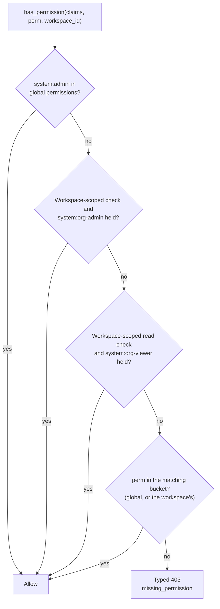

# RBAC

*For administrators granting access, and engineers writing permission checks.*

The authorization reference for {brand}: the seven built-in roles and the default `user`
tier, every permission the platform seeds, how a permission check is decided, the typed 403
body, and the machinery around them — custom roles, invitations, time-bound bindings, session
revocation and the activity log.

**How to read it.** To choose a role, start at [Built-in roles](#built-in-roles). To answer
"who holds this permission?", use the [Permission catalogue](#permission-catalogue). To
understand why a check passed or failed, read [Resolver behaviour](#resolver-behaviour). The
role and permission tables match `backend/app/config/rbac_seed.py` exactly; for the wider
security picture, see the [Security Overview](/docs/security-overview).

> **Caution:** `super_admin` carries `system:admin`, which short-circuits **every**
> permission check platform-wide. Bind it sparingly (platform owner, SRE break-glass) and
> prefer `org_admin` for cross-workspace operators who shouldn't manage users or SSO.

## TL;DR

* Eight built-in roles: three platform roles (`super_admin`, `org_admin`, `org_auditor`)
  and five workspace roles. Any account without a platform role is in the default `user`
  tier, which stores nothing and grants nothing.
* Permissions are namespaced by category — `system:*` or `workspace:*`. The resolver only
  emits permissions whose category matches the binding's scope; cross-category ones are
  silently dropped.
* `workspace:admin` auto-implies every other `workspace:*` permission in the same workspace.
  Operators don't enumerate.
* Three global shortcuts: `system:admin` passes every check; `system:org-admin` passes every
  workspace-scoped check in every workspace; `system:org-viewer` passes every workspace-scoped
  `:read` check in every workspace.

## Built-in roles

| Role (on screen) | Internal name | Bound at | When to bind |
|---|---|---|---|
| Super Admin | `super_admin` | Platform | Platform owner or SRE break-glass. Bind sparingly. |
| Org Admin | `org_admin` | Platform | Org-wide operator who curates workspaces, but doesn't manage users or SSO. |
| Org Auditor | `org_auditor` | Platform | Compliance or audit reviewer: sees every workspace, every binding and the activity log, and changes nothing. |
| Workspace Admin | `workspace_admin` | A workspace | Workspace owner who manages its members and settings. |
| Data Engineer | `workspace_data_engineer` | A workspace | Owns the data products in a workspace — data sources, views, semantic layers, catalog — without managing members or settings, or publishing views to everyone. |
| Member | `workspace_member` | A workspace | Standard contributor: edits views and manages data sources. |
| Steward | `workspace_steward` | A workspace | A member who also answers requests to join and adds people as viewers or members — for the person who knows a team, without administering the workspace. |
| Viewer | `workspace_viewer` | A workspace | Read-only, for someone who shouldn't be able to edit. |

**User** (`user`) is not a stored role. It's the default tier of any account without a
platform role: no platform permissions, and no workspace access until a workspace binding
grants it.

All eight roles are stored once, at `scope_type='global'` with `scope_id=NULL`. The three
platform roles are bound at global scope. The five workspace roles are templates you bind to a
specific workspace (`scope_type='workspace'`, `scope_id=<workspace id>`); bound at global
scope they grant nothing, because the resolver's category filter drops every `workspace:*`
permission from a global binding.

### Role grants

Exactly what `ROLE_GRANTS` in `backend/app/config/rbac_seed.py` stores for each role:

| Role | Count | Permissions granted |
|---|---|---|
| `super_admin` | 26 | `system:admin`, `system:analytics:read`, `system:sso:hosts:manage`, `system:audit:read`, `system:bindings:read`, `system:groups:manage`, `system:org-admin`, `system:org-viewer`, `system:service-accounts:manage`, `system:templates:manage`, `system:users:manage`, `system:workspaces:create`, `workspace:admin`, `workspace:catalog:manage`, `workspace:catalog:read`, `workspace:datasource:manage`, `workspace:datasource:read`, `workspace:members:add`, `workspace:ontology:manage`, `workspace:ontology:read`, `workspace:provider:read`, `workspace:view:create`, `workspace:view:delete`, `workspace:view:edit`, `workspace:view:publish`, `workspace:view:read` |
| `org_admin` | 20 | `system:analytics:read`, `system:groups:manage`, `system:org-admin`, `system:service-accounts:manage`, `system:templates:manage`, `system:workspaces:create`, `workspace:admin`, `workspace:catalog:manage`, `workspace:catalog:read`, `workspace:datasource:manage`, `workspace:datasource:read`, `workspace:members:add`, `workspace:ontology:manage`, `workspace:ontology:read`, `workspace:provider:read`, `workspace:view:create`, `workspace:view:delete`, `workspace:view:edit`, `workspace:view:publish`, `workspace:view:read` |
| `org_auditor` | 4 | `system:analytics:read`, `system:audit:read`, `system:bindings:read`, `system:org-viewer` |
| `workspace_admin` | 1 | `workspace:admin` |
| `workspace_data_engineer` | 11 | `workspace:catalog:manage`, `workspace:catalog:read`, `workspace:datasource:manage`, `workspace:datasource:read`, `workspace:ontology:manage`, `workspace:ontology:read`, `workspace:provider:read`, `workspace:view:create`, `workspace:view:delete`, `workspace:view:edit`, `workspace:view:read` |
| `workspace_member` | 9 | `workspace:catalog:read`, `workspace:datasource:manage`, `workspace:datasource:read`, `workspace:ontology:read`, `workspace:provider:read`, `workspace:view:create`, `workspace:view:delete`, `workspace:view:edit`, `workspace:view:read` |
| `workspace_steward` | 10 | `workspace:catalog:read`, `workspace:datasource:manage`, `workspace:datasource:read`, `workspace:members:add`, `workspace:ontology:read`, `workspace:provider:read`, `workspace:view:create`, `workspace:view:delete`, `workspace:view:edit`, `workspace:view:read` |
| `workspace_viewer` | 5 | `workspace:catalog:read`, `workspace:datasource:read`, `workspace:ontology:read`, `workspace:provider:read`, `workspace:view:read` |

What a role can actually do differs from its stored grants in four places, all covered in
[Resolver behaviour](#resolver-behaviour):

* `super_admin` and `org_admin` are bound at global scope, so only their `system:*` grants
  reach a session. Their workspace powers come from the shortcuts: `system:admin` passes every
  check, and `system:org-admin` passes every workspace-scoped check in every workspace.
* `org_auditor` reads every workspace through `system:org-viewer`, which passes any
  workspace-scoped `:read` check.
* `workspace_admin` stores only `workspace:admin`, which the resolver expands to every
  `workspace:*` permission in that workspace.
* `workspace_data_engineer` has neither `workspace:admin` nor `workspace:view:publish`, so it
  can't manage members or publish views to everyone.

## Permission catalogue

Every permission `PERMISSIONS` in `backend/app/config/rbac_seed.py` defines. **Granted to**
lists stored grants only (the [Role grants](#role-grants) table, read the other way): the
shortcuts and `workspace:admin` reach further, as described above.

| Permission | Category | What it allows | Granted to (built-in roles) |
|---|---|---|---|
| `system:admin` | system | Full system control; implies every other permission. | `super_admin` |
| `system:analytics:read` | system | Read platform analytics — growth, engagement and adoption. | `super_admin`, `org_admin`, `org_auditor` |
| `system:sso:hosts:manage` | system | Manage which internal hosts SSO may call back to. | `super_admin` |
| `system:audit:read` | system | Read the platform audit log (logins, RBAC mutations, sessions). | `super_admin`, `org_auditor` |
| `system:bindings:read` | system | List role bindings and per-user effective access cross-workspace. | `super_admin`, `org_auditor` |
| `system:groups:manage` | system | Create, edit, delete groups and manage their members. | `super_admin`, `org_admin` |
| `system:org-admin` | system | Cross-workspace operator; implies every workspace permission. | `super_admin`, `org_admin` |
| `system:org-viewer` | system | Read-only operator across every workspace in the tenancy. | `super_admin`, `org_auditor` |
| `system:service-accounts:manage` | system | Create service accounts, choose who manages them, and grant them workspace roles. | `super_admin`, `org_admin` |
| `system:templates:manage` | system | Curate the organization's layout templates and the built-in ones. | `super_admin`, `org_admin` |
| `system:users:manage` | system | Create, approve, suspend, and change roles for users. | `super_admin` |
| `system:workspaces:create` | system | Create new workspaces. | `super_admin`, `org_admin` |
| `workspace:admin` | workspace | Manage workspace settings, members, and deletion. | `super_admin`, `org_admin`, `workspace_admin` |
| `workspace:catalog:manage` | workspace | Promote / edit / delete catalog items the workspace owns. | `super_admin`, `org_admin`, `workspace_data_engineer` |
| `workspace:catalog:read` | workspace | Read catalog items (curated data assets) available to the workspace. | `super_admin`, `org_admin`, `workspace_data_engineer`, `workspace_member`, `workspace_steward`, `workspace_viewer` |
| `workspace:datasource:manage` | workspace | Connect, edit, and delete data sources in a workspace. | `super_admin`, `org_admin`, `workspace_data_engineer`, `workspace_member`, `workspace_steward` |
| `workspace:datasource:read` | workspace | List and use workspace data sources in views. | `super_admin`, `org_admin`, `workspace_data_engineer`, `workspace_member`, `workspace_steward`, `workspace_viewer` |
| `workspace:members:add` | workspace | Answer access requests and add people to a workspace. | `super_admin`, `org_admin`, `workspace_steward` |
| `workspace:ontology:manage` | workspace | Create, edit, version, publish, and delete ontologies in the workspace. | `super_admin`, `org_admin`, `workspace_data_engineer` |
| `workspace:ontology:read` | workspace | Read ontologies (semantic layers) that the workspace's data sources reference. | `super_admin`, `org_admin`, `workspace_data_engineer`, `workspace_member`, `workspace_steward`, `workspace_viewer` |
| `workspace:provider:read` | workspace | Read providers (database connections) that back the workspace's data sources. | `super_admin`, `org_admin`, `workspace_data_engineer`, `workspace_member`, `workspace_steward`, `workspace_viewer` |
| `workspace:view:create` | workspace | Create new views in a workspace. | `super_admin`, `org_admin`, `workspace_data_engineer`, `workspace_member`, `workspace_steward` |
| `workspace:view:delete` | workspace | Soft-delete any view in a workspace. | `super_admin`, `org_admin`, `workspace_data_engineer`, `workspace_member`, `workspace_steward` |
| `workspace:view:edit` | workspace | Edit any view in a workspace. | `super_admin`, `org_admin`, `workspace_data_engineer`, `workspace_member`, `workspace_steward` |
| `workspace:view:publish` | workspace | Publish views to everyone in the organization (enterprise visibility). | `super_admin`, `org_admin` |
| `workspace:view:read` | workspace | List and open views in a workspace. | `super_admin`, `org_admin`, `workspace_data_engineer`, `workspace_member`, `workspace_steward`, `workspace_viewer` |

Three of these are deliberately separate from `system:admin`'s everyday reach:
`system:analytics:read` (business metrics are not the audit log),
`system:sso:hosts:manage` (an entry lets the service make requests to an internal address,
which is a network decision, so only `super_admin` holds it by default), and
`system:templates:manage` (curating the template library can be delegated to whoever owns the
house style, without handing them the platform). `system:service-accounts:manage` is kept apart
from `system:users:manage` the same way: org admins look after the principals integrations run as
without administering people.

### Which permissions open which screens

`backend/app/services/nav_catalogue.py` maps each screen to the permission its backend routes
enforce, and the app shows or hides it to match:

| Screen | Shown to holders of |
|---|---|
| **Dashboard**, **Explore**, **Templates**, **Workspaces** | Everyone signed in |
| **Ingestion** | Any of `system:admin`, `system:org-admin`, `workspace:provider:read`, `workspace:datasource:manage` (the workspace permissions in any one workspace) |
| **Semantic Layers** | Any of `system:admin`, `system:org-admin`, `workspace:ontology:read` |
| **Analytics** | Any of `system:analytics:read`, `system:admin`, `system:org-admin`, `system:audit:read`. When **Analytics for everyone** is on, everyone else gets a redacted version. |
| **Administration** (entering it at all) | `system:admin`, `system:groups:manage`, `system:audit:read` or `system:service-accounts:manage` |
| Administration → **Activity** and **Telemetry** | `system:audit:read` |
| Administration → **Groups** | `system:groups:manage` |
| Administration → **Service accounts** | `system:service-accounts:manage` |
| Every other Administration page | `system:admin` |

Entering **Administration** and opening one of its pages are separate checks: a page inside
it needs its own permission as well as one of the four that open Administration.

### View visibility and sharing

Views carry a visibility tier plus optional explicit grants
(`resource_grants`, user or group subjects, `viewer`/`editor` roles).
The evaluator (`backend/app/services/view_access.py`) gates on the tier
first — the old membership-first union made `private` behave exactly
like `workspace` for every member:

| Tier         | Who can open it (and load its data, read-only)                       |
|--------------|----------------------------------------------------------------------|
| `private`    | creator, explicit grantees, workspace admins (+ org/system admins)   |
| `workspace`  | the above + `workspace:view:read` holders in the view's workspace    |
| `enterprise` | any signed-in user on the platform                                   |

On screen these tiers are **Private**, **Workspace** and **Enterprise**; for the people who
share views, see [Who can see a View](/guide/managing-views#who-can-see-a-view).

Reading a view implies **read-only** access to its data plane: the
graph/canvas routers accept a `?viewId=` capability context
(`backend/app/api/v1/capability_gate.py`) pinned to the view's
resolved data source. Mutations always require
`workspace:datasource:manage`. Workspace-metadata surfaces (assets
rule-sets) use an unpinned variant of the gate — they have no
data-source dimension, so a capability holder on ANY readable view in
the workspace can read them; the router is GET-only or manage-gated.

`workspace:view:publish` gates every transition **to or from**
`enterprise` (including creating a view directly as enterprise) — the
base creator/ws-admin rule still gates `private ↔ workspace`. The
permission is deliberately delegable: grant it to a trusted non-admin
role to let curators publish.

**Publishing is open by default.** `workspaces.publish_policy`
defaults to `'open'`, where anyone who may change a view's visibility
may publish it without holding the permission. This is a deliberate
product stance: the graph is metadata — names, types, and the lineage
between them — and a platform whose purpose is shared understanding of
lineage should not require a signature before anyone can share
lineage. Admin-only publishing made the tier unreachable for almost
everyone, which is the same as not having it.

The policy widens who *satisfies* the publish check; it never widens
who may touch a view's visibility (that stays creator / ws-admin).

### The publish ladder

Four controls decide it, and they nest. `resolve_publish_gate`
(`backend/app/services/view_access.py`) is the only place that walks them, and
`resolvePublishGate` (`frontend/src/lib/publishGate.ts`) is its exact
twin — a UI that resolves this differently tells people the wrong thing
about the button in front of them.

| # | Control | Where it is set | Binds |
|---|---------|-----------------|-------|
| 1 | `enterpriseViewPolicy` — `workspaces` \| `request` \| `off` | **Administration → Features → Publishing views to everyone** (**Workspaces decide**, **Always require approval**, **Not available**) | Everyone, **including permission holders** |
| 2 | `workspaces.publish_policy` — `open` \| `request` | The workspace's **Views** tab | Everyone without the permission |
| 3 | `workspace_data_sources.is_restricted` | The workspace's **Views** tab | Everyone without the permission |
| 4 | `workspace:view:publish` | Role binding | Satisfies 2 and 3 outright |

The platform ceiling is checked first and the permission does **not**
satisfy it: a limit only non-admins obey is not a limit. `off`
withdraws the tier from new work entirely (the request queue is refused
too, so a request filed before the change cannot be used to route
around it); `request` forces an approval even in workspaces that opened
publishing to their members — the one rule a workspace admin cannot opt
out of.

The refusal carries its reason (`publishBlockedBy` on the access
envelope: `platform` / `workspace` / `source`). Three identically
greyed-out tiles mean three different things, and only one of them is
resolved by asking a workspace admin — telling someone to do that when
the *organisation* set the rule sends them to a person who cannot help.

**Un-publishing takes the same standing as publishing, minus the
ceiling** (`can_unpublish`). Keeping the workspace policy and the source
restriction keeps the rule symmetric: a workspace that made publishing
an admin act made retracting one an admin act too, because a view others
depend on is not something any one member should pull out from under
them. Dropping the *ceiling* is the asymmetry that matters — it exists
to reduce exposure, and applying it in reverse would strand every
already-published view with nobody able to close it.

**Control moves after the fact, not away.** On a direct publish, every
holder of `workspace:view:publish` in that workspace is notified
(`view.published`) with a link to the view and to the undo — the
workspace's Views tab, where visibility can be changed back. Silence
would make "open" mean "unsupervised".

**Restriction belongs to the source.** Publishing exposes read-only
access to the whole data source behind the view, and that risk is
concentrated in a few sources rather than spread across all of them.
`workspace_data_sources.is_restricted` overrides an open policy: views
over that source always need the permission. This gates the sensitive
warehouse without dragging every view in the workspace back to
admin-only. Admins toggle it in the workspace's Views tab, beside the
policy itself — and only admins: `PUT …/data-sources/{id}` refuses a
change to `isRestricted` without `workspace:admin` (403), since a member
who could lift the mark could step around it. Sending the value unchanged
is fine, so members still edit everything else about a source.

**Nobody is ever stuck.** Under `publish_policy = 'request'` — or over
a restricted source — a member who owns a view's sharing settings but
lacks the permission can *request* publication (`POST
/views/{id}/publish-request`); the pending request lives on the view
and is the admin queue. A publish-permission holder approves (which
performs the transition, logged as `visibility_changed`) or declines
with a reason that lands on the view's timeline.

The UI must resolve this the same way the backend does
(`can_publish_under_policy` ↔ `resolvePublishGate` in
`frontend/src/lib/publishGate.ts`): permission, then policy, then the
source flag. A UI that checks only the permission tells an open
workspace's members their view "will be requested" when it would
simply publish.

**Admin reads of private views are recorded.** `system:admin` reach
over a private view someone else created writes an `admin_viewed`
entry to that view's activity log (deduped hourly per admin). The
reach is unchanged; it is simply no longer invisible to the owner.

### Layout templates

A layout template (`/api/v1/layout-templates`) is decided per template by
`backend/app/services/template_access.py`, which also renders the read rule as SQL for the list
(`tests/test_layout_templates.py` holds the two together). Shares use `resource_grants` with
`resource_type = 'layout_template'`, to people or groups, as `viewer` (use it) or `editor` (also
edit it):

| Audience (stored) | Who can use it | Edit | Delete, restore | Share, change audience |
|---|---|---|---|---|
| Built-in (`system_key` set) | everyone; a hidden one only `system:templates:manage` holders | nobody — duplicate it | nobody | nobody; managers hide or show it |
| Organization (`enterprise`) | everyone signed in | `system:templates:manage` | `system:templates:manage` | audience: `system:templates:manage` |
| Workspace (`workspace`) | its owner, `workspace:view:read` there, grantees | owner, `workspace:view:edit` there, editors | owner, `workspace:view:delete` there | owner, `workspace:admin` there |
| Personal (`private`) | its owner and grantees | owner, editors | owner | owner |

Creating a workspace template needs `workspace:view:create` there; an organization one needs
`system:templates:manage`. Changing a template's audience needs rights over the one it has and the
right to create in the new one.

Whoever may share a personal or workspace template can ask for it to be offered to everyone.
Until a template manager answers, every `system:templates:manage` holder can **read** it (they
can't approve what they can't see; its access reads `via: "request"`); approving moves it to the
organization — no rights over its old audience needed — and declining or withdrawing ends that
read. Featuring a template takes `system:templates:manage`, and only for a built-in or an
organization template. A workspace's default template is set with `workspace:admin` there, and
must be one every member can use: a shown built-in, an organization template, or that
workspace's own. Unlike a private view, a personal template is **not** readable by
administrators: a template is a layout, not data, so there is nothing behind it to audit. API keys
cannot call these routes.

### Moving a data source between workspaces

A data source moves to another workspace together with every view on it, the views in the trash and
the views with no source of their own that read it as the workspace's default. Their activity, its
versioned graph and its aggregation state move too (`backend/app/services/data_source_transfer.py`).
Authority is checked in both workspaces, never only the one in the path, because moving a source
into a workspace you don't run would be a way to plant data in it:

| To | You need |
|---|---|
| Move a source that has views, now | `workspace:admin` in the workspace it is in **and** in the one it goes to |
| Move a source nothing is built on, now | `workspace:datasource:manage` in both |
| Ask another workspace to take it | `workspace:admin` where it is |
| Accept or decline a request | `workspace:admin` in the destination; the person who asked must still administer the source |
| Cancel a request | the person who asked, or `workspace:admin` where the source is |
| Undo a move, for 7 days, while nothing new is built on it | a direct move: `workspace:admin` in both; an accepted request: `workspace:admin` in the destination |

Org Admins and Super Admins pass every row through their shortcuts. API keys reach none of these
routes (they are not on the key surface).

Guards around those rules:

- **Fail closed.** A direct move of a source with views runs the same session-revocation probe as
  every `workspace:admin` route, so a session whose revocation can't be checked is refused with a
  503. Transfer detail, accept, decline, cancel and undo require `workspace:admin` in some
  workspace before the transfer is looked up, so someone who administers nothing gets the same 403
  whether or not it exists.
- **No probing.** A preview, request or move naming a workspace the caller couldn't find — they
  can't open it, and it isn't listed in Find a workspace while that's on — answers 404, as for one
  that doesn't exist.
- **No stranded views.** Creating a view checks its data source is live and in the view's
  workspace, holding the source's row `FOR KEY SHARE` until the view is saved: a move (which holds
  it `FOR UPDATE`) either waits for the view and takes it along, or has finished and the view is
  refused.
- **Restricted sources don't slip into open workspaces unsaid.** Every role reads every source in its
  workspace, restricted ones included, so a restricted source going to a workspace whose
  `request_policy` is `open` is flagged in the preview (`restricted_open`) — a warning, not a
  refusal, as choosing **Open to everyone** is. It is part of the preview's token: a destination
  that opens after the preview was read sends the mover back to it (409 `preview_stale`).

What happens to access. The destination's own membership governs the moved views — nothing is
copied to stretch the old workspace's audience across. Grants (`resource_grants`) are keyed by view,
so the people and groups a view is shared with keep it, and creators keep their own views. A
`workspace` view's audience becomes the destination's `workspace:view:read` holders, and a `private`
view's admin reach becomes the destination's admins. The people and groups who read the views only
through the old workspace lose them; the preview lists them with where their access came from
(`app`, `group`, or `idp` — an SSO role mapping, or a group the identity provider fills), and a move
or request that takes anyone's access needs the preview's token (`preview_required`). Afterwards
they are told how to get back in by the destination's `request_policy` — ask to join, join one open
to everyone, or ask its admins where it's closed to requests — both workspaces' admins are told
who, and the move records them.
Access is given back the usual way — a role or group in the destination, or an identity-provider
mapping where the provider decides — never by copying it, which would outlive the provider removing
someone. A pending publication request is put to the destination's publishers.

## Resolver behaviour

A permission check resolves through a fixed short-circuit ladder — the three global
shortcuts win before any per-workspace bucket is consulted:



The buckets themselves are built by the resolver from a user's bindings, applying the
category × scope filter and `workspace:admin` auto-implication described below.

### 1. Category × scope filter

Every binding's permissions are filtered against the binding's scope:

* `binding.scope_type='global'` → only `category='system'` perms land
  in `global_perms`.
* `binding.scope_type='workspace'` → only `category='workspace'` perms
  land in `ws_perms[scope_id]`.

So binding `super_admin` at workspace scope (legal but unusual)
produces a workspace bucket with `{workspace:admin,
workspace:view:read, ...}` — but never `system:admin`. And binding
`workspace_member` at global scope produces nothing — the filter drops
the workspace:* perms because the binding is global.

### 2. `workspace:admin` auto-implication

After folding bindings, any workspace bucket containing
`workspace:admin` is unioned with the full catalogue of `workspace:*`
leaves. Operators bind `workspace_admin` once; the resolver does the
rest. Custom roles that bundle only `workspace:admin` get the same
treatment.

### 3. `system:org-admin` global shortcut

`has_permission(claims, perm, workspace_id=ws)` short-circuits to
`True` when both:

* `perm` is workspace-scoped (`workspace_id is not None`)
* `system:org-admin` ∈ `claims.global_perms`

This lets `org_admin` act in every workspace without per-workspace
bindings or large `ws_perms` claims.

### 4. `system:admin` system-wide shortcut

`has_permission` returns `True` unconditionally when `system:admin` ∈
`claims.global_perms`. The `super_admin` tier holds it.

### 5. `system:org-viewer` read shortcut

`has_permission(claims, perm, workspace_id=ws)` also short-circuits to `True` when all three
hold:

* `perm` is workspace-scoped (`workspace_id is not None`)
* `perm` ends in `:read`
* `system:org-viewer` ∈ `claims.global_perms`

It never passes a manage or write permission. `has_permission_any_workspace` — the check
behind catalogue-style lists that have no workspace in the URL — honours the same shortcut.
This is how `org_auditor` reads every workspace without a single workspace binding.

## How claims reach a request

Resolution is unchanged by any of the below — what changed is how the result travels.

`sid` and `global_perms` ride in the access JWT. They are bounded: global permissions are a
fixed vocabulary, so the token does not grow with tenant size.

`ws_perms` is **not** bounded — it grows with every workspace a user is bound to — so it
does **not** travel in the cookie at all. `to_jwt_dict()` has no option to include it; the
invariant is enforced by the signature rather than by review.

The grants live in the session store, keyed by `sid` — the same entry already read on every
request for revocation, fetched in the same pipelined round trip, so reading them costs
nothing extra. `get_permission_claims` resolves **Redis → Postgres → "unknown"**, in that
order. It never degrades to "global perms only": that is a denial dressed as a 200, and the
whole point is to stop authorization failing silently.

**"Unknown" is not "none".** When neither source can answer, the claims come back with
`ws_available=False` rather than an empty map, and that distinction is load-bearing. An empty
map is a *claim about the user*: hand it to `requires` and it produces 403 `Missing
permission: …`, stating as fact something the server never established. So:

| State | Workspace-scoped check | Global check | `GET /me/permissions` |
|---|---|---|---|
| Grants resolved | 200 / 403 on the grants | 200 / 403 | 200 |
| User genuinely has none | 403 | 200 / 403 | 200, empty `ws` |
| Neither source could answer | **503** | 200 / 403, unaffected | **503** |

The 503 decision is made in `requires`, not in `get_permission_claims`, because only there is
it known whether the missing half was needed — a global permission is settled entirely by the
token, so a Redis outage must not touch it. `GET /me/permissions` refuses for a different
reason: the SPA store installs whatever it returns, so a 200 with an empty `ws` would
overwrite a known-good claim set and blank every workspace-gated control; an error leaves the
previous claims in place.

In practice `ws_available=False` requires Redis *and* Postgres to be unreachable at once — a
Redis outage alone is answered from Postgres (cached 30s per user, so an outage does not turn
into a permission query per request).

Stored payloads are deduplicated: `{"ws": {ws_id: index}, "psets": [[perms]]}`. Every
workspace a user holds the same role on resolves to the *same* permission set, so storing
each distinct set once and pointing at it by index is roughly a ninefold reduction — 150
workspaces used to be 150 verbatim copies of one array.

**Why it matters.** A cookie over 4096 bytes is discarded by the browser *silently*: login
answers 200, the `Set-Cookie` goes out, the next request is anonymous, and nothing is
logged. Before this, ~18 workspace bindings crossed that line, so the most heavily bound
accounts hit unexplained sign-outs that nobody else could reproduce.

An intermediate version embedded the grants while they fitted and shed them above a byte
budget. It worked, and it was still wrong: a user with 99 bindings and one with 101
exercised different authorization machinery, and the store path — the one serving the
largest tenants — was the one almost nothing routinely tested. There is now one path for
every session.

**Reading old tokens still works.** A token minted before this carries inline permission
lists and has no store entry, and the reader recognises the layout per value rather than
assuming one — so a tab open across the deploy keeps every permission it had, with no
reload. Self-draining: after one refresh TTL no such token can exist and the compatibility
branch in `_decode_ws` is removable.

### API keys

A request made with an API key carries claims built by `resolve_for_api_key`, never read
from a session. The owner's live authority — role bindings, groups, the `workspace:admin`
implication and the organisation-wide shortcuts — is expanded into concrete per-workspace
grants, each narrowed to the key's profile (`KEY_GRANTABLE_PERMISSIONS`: view read, edit,
create, delete and publish; data-source, ontology and catalog read; `datasource:manage`) and
to the workspaces its selection touches. Per workspace, view permissions survive only where
the workspace or one of its views is selected, data permissions only where the workspace or
one of its data sources is.

- **No global permission survives.** `global_perms` is empty, so no shortcut, fail-closed
  permission or administration check is reachable with a key. An owner holding an
  organisation-wide shortcut, on a key that covers everything, gets `KeyScope.org_perms`:
  the key's permissions the owner holds in every workspace through that role.
  `has_permission` honours them for any workspace, as it honours the shortcut for the owner,
  so the workspaces are never listed (an organisation of 10,000 workspaces cost every claims
  refresh 112 ms and built `IN` lists past what asyncpg takes). `build_read_scope` takes its
  organisation-wide branch, the workspace list and lookup reach every workspace, and
  catalogue visibility is unfiltered only when the role is (`org_unrestricted`).
- **The selection rides on the claims.** `PermissionClaims.key_scope` (`KeyScope`) is never
  serialized and is kept by `with_ws`. `view_access` checks it on every identity path —
  creator, explicit grant, enterprise tier — so a workspace viewer with an editor grant on
  one view can edit that view with a key limited to it, and nothing else in the workspace.
  Sharing (`can_manage_grants`) is never open to a key; changing visibility needs the key's
  publish.
- **How fast changes reach a key.** Revocation, expiry, the owner's suspension and the SSO
  pause are read from the database on every request, so they take effect on the next one.
  The claims themselves are cached per key for 30 seconds (`CLAIMS_TTL_SECONDS`, one
  resolution in flight per key), so a role or grant the owner loses reaches their keys
  within that window. The cache never touches the owner's sessions: an earlier version
  registered it as one, which kept the owner's session index growing for as long as a key
  was busy.
- **A service account's keys.** A service account (an id starting `svc_`) is resolved like a
  person, but keeps only its direct workspace bindings: no groups and no global roles, so no
  shortcut reaches its keys whatever a row says. It may hold any workspace role that neither
  administers the workspace nor lets people in, and what is requestable is applied again at
  resolution, so a role later widened to administer brings it none of that. Its managers make
  keys that act as it, whatever they can reach themselves, run the account itself, and ask
  workspaces for access for it; each workspace's admins and stewards give it roles there as they
  give people ([Access requests](#access-requests)), and `system:service-accounts:manage` can
  anywhere. Appointing a manager delegates
  the account's access, so it may give the appointee only what they hold already or what the
  appointer could grant them: for each of the account's roles, the appointee holds every
  permission it gives the account there (a team, through its own roles), or the appointer could
  grant it there. Whoever controls a managing team's membership controls that delegation too, so
  adding someone to a team that manages a service account is held to the same rule on top of
  `system:groups:manage`, and an access-request approval never adds anyone to one. A holder of
  `system:users:manage` can make an account's keys without managing it, and its managers are
  told; `system:service-accounts:manage` alone makes none. See [Service
  Accounts](/guide/service-accounts).

## 403 body

When a check fails, the endpoint raises a structured 403:

```json
{
  "detail": {
    "error": "missing_permission",
    "permission": "workspace:datasource:read",
    "scope": {"type": "workspace", "id": "ws_finance"},
    "message": "Missing permission: workspace:datasource:read"
  }
}
```

The `message` field preserves the legacy text so existing scrapers
keep working. New consumers should read `permission` and `scope`.

The app's access-denied dialog turns `permission` into a plain-language sentence (for
example "You don't have access to this workspace's data.") and, for a refusal inside a
workspace, offers to request access from that workspace's admins.

## Operator recipes

### "I want admin in workspace X"

Bind `workspace_admin` to the user at `scope_type='workspace',
scope_id=<X>`. The user can now do every `workspace:*` action in X
and nothing in any other workspace.

### "I want X to manage every workspace but not touch users / SSO"

Bind `org_admin` at global scope. The user gets the cross-workspace
shortcut + workspace creation + group management, but not user
administration or SSO config. Group management stops at a group that grants
`super_admin`: adding or removing its members, or deleting it, needs
`system:admin` (403 `group_grants_super_admin`) — you cannot grant what you do
not hold.

### "I want X to audit everything but change nothing"

Bind `org_auditor` at global scope. The user reads every workspace through
`system:org-viewer`, and holds `system:audit:read` and `system:bindings:read` for the activity
log and the role-binding inventory. `system:audit:read` also opens **Administration** and its
**Activity** page (see
[Which permissions open which screens](#which-permissions-open-which-screens)), so nothing more
is needed.

### "I want X to be platform owner"

Bind `super_admin` at global scope. The user gets `system:admin`
which short-circuits every check.

### "I want a user to read everything in finance but not edit"

Bind `workspace_viewer` at `scope_type='workspace', scope_id=<finance>`.

### "I want a user to be admin in finance AND a viewer in marketing"

Two bindings:

* `workspace_admin` @ scope=`(workspace, finance)`
* `workspace_viewer` @ scope=`(workspace, marketing)`

The resolver folds them into one claim with two workspace buckets:

```json
{
  "global": [],
  "ws": {
    "finance":   ["workspace:admin", "workspace:view:*", "workspace:datasource:*"],
    "marketing": ["workspace:view:read", "workspace:datasource:read"]
  }
}
```

The TopBar role badge flips between "Workspace Admin" and "Viewer" as
the user navigates between `/workspaces/finance` and
`/workspaces/marketing`.

## Custom roles

`role_repo.create_role` accepts any name not in the built-in set, any
permission set from the catalogue, and a scope (`global` or
`workspace`). Tied-scope roles (`scope_type='workspace',
scope_id=<X>`) are only bindable in workspace X — the canonical
example is an "Alpha auditor" who can only be a viewer in workspace
Alpha.

The resolver applies the same category × scope filter to custom
roles; bundling `system:users:manage` into a workspace-scoped custom
role will silently emit nothing when bound at workspace scope. Bundle
permissions whose category matches the role's scope.

The create-role permission picker filters by the role's selected
scope: workspace roles see `workspace:*` + `resource:*` only, global
roles see `system:*` + `resource:*` only. Switching scope mid-edit
clears any now-invalid selections, so an operator can't accidentally
bundle a cross-category permission the resolver would drop.

## Assigning and revoking access

### Global role assignment writes both stores

`user_repo.set_global_role(session, user_id, role_name)` writes
`user_roles` and `role_bindings` in one transaction, so a promoted
user's display role and resolved claims always agree. `PUT
/admin/users/{user_id}/role` and the bootstrap admin path in
`backend/app/main.py` both go through it.

`ChangeRoleRequest` restricts `role` to the **globally assignable**
set — `user`, `org_auditor`, `org_admin` and `super_admin`
(`GLOBAL_ASSIGNABLE_ROLES` in `backend/common/roles.py`). Assigning `user`
clears the account's platform role and leaves its workspace bindings alone.
Workspace roles (`workspace_admin`, `workspace_data_engineer`,
`workspace_member`, `workspace_viewer`) are bound through the workspace-members
endpoint, which supplies the workspace context they need; binding them globally
would be dropped by the resolver's category filter anyway. The role picker in
**Administration → User Management** offers the same four tiers and hides
`super_admin` when the caller lacks `system:admin`.

### View-grants gating

`/views/{view_id}/grants` is gated by the router-level FastAPI
dependency `can_manage_view_grants`, which:

1. Loads the view (404 on miss).
2. Allows the creator.
3. Allows a workspace admin of the view's workspace.
4. Allows `system:admin`.
5. Otherwise 403s with the structured body above.

The dependency returns the loaded view so handlers don't re-query; the
pure helper `_ensure_can_manage_grants` keeps the rule in one place.

### Session revocation on access narrowing

Every mutation that narrows access wires
`revocation_service.revoke_all_user_sessions` so a stale JWT can't
outlive the change (the access-token lifetime — 5 minutes when `JWT_EXPIRY_MINUTES` is
unset, 15 in the shipped Compose configuration — is the fallback):

* `DELETE /admin/workspaces/{ws}/members/{binding}` — a user binding
  revokes that user's sessions; a group binding revokes every group
  member's sessions.
* `PUT /admin/users/{id}/role` — revokes the target user's sessions.
* `PUT /admin/roles/{name}` — revokes every user bound to that role
  (direct + via group) and emits `rbac.role.cascade_revoked` with the
  affected user count.

Every kill is best-effort: a Redis outage logs and continues.

Revocation is consulted in `get_current_user`, so **every**
authenticated request checks the revoked-session set — not just
`requires(...)` routes. A revoked session returns 401, the frontend
silently refreshes, and the reissued JWT carries re-resolved claims;
`RequirePermission` guards and the TopBar admin cog react to the new
claims without a manual reload. This is what lets a just-promoted
admin reach the admin UI mid-session. Revocation fails open on a Redis
outage (an incident must not lock every user out); `requires(...)`
keeps a fail-closed probe for sensitive permissions like `system:admin`
/ `workspace:admin`.

> **Important:** Revocation is deliberately asymmetric under a Redis outage — it
> **fails open** for ordinary checks (a Redis incident must not lock every user out)
> but **fails closed** for the sensitive-permission probe. A revoked JWT is otherwise
> caught on the very next request because `get_current_user` consults the revoked-session
> set on **every** authenticated call, not only `requires(...)` routes.

### Time-bound bindings

`RoleBindingORM.expires_at` auto-expires a binding — contractor, temp,
or on-call access. The resolver always honours it, and the admin API
surfaces it:

* `POST /admin/workspaces/{ws}/members` accepts `expiresAt` (ISO
  timestamp) **or** `expiresIn` (`"24h"` / `"7d"` / `"2w"` —
  `h`/`d`/`w` units, capped at 365 days). Setting both is a 422.
* `PUT /admin/workspaces/{ws}/members/{binding}/expiry` — extend,
  change, or clear (empty body → permanent) the expiry in place.
* The `WorkspaceMembers` UI has an "Access duration" picker
  (Permanent / 24h / 7d / 30d / 90d) and a countdown badge on the
  member list.

Recipe: "Give a contractor 30-day access" → bind `workspace_member`
with `expiresIn: "30d"`.

### Workspace deletion cascade

Deleting a workspace cascades both the `RoleBindingORM` rows pointing
at it (`delete_scope_bindings`) and the custom `RoleORM` rows scoped
to it (`role_repo.delete_workspace_scoped_roles`), which couldn't be
bound anywhere else. A `rbac.workspace.roles_cascaded` outbox event
lists the removed bindings + roles. Open access requests for it are
closed as denied, with the note "The workspace was deleted", and
requests to move a data source into or out of it are cancelled.

## Access requests

Anyone signed in can ask to join a workspace; its admins and stewards
answer. The rules live in `backend/app/services/workspace_access.py`, shared
by the request endpoints, the Members tab and the SSO reconciler.

**What may be asked for.** Workspace roles that carry neither
`workspace:admin` nor `workspace:members:add` — Viewer, Member, Data
engineer and custom workspace roles. Asking is for access, not authority.
`GET /access-requests/requestable-roles?workspaceId=` lists them without
naming the workspace. A role the person already holds there, or whose
permissions they already have, is refused (409).

**One open request per person per workspace.** A partial unique index
(`uq_access_requests_one_open`) holds it; asking again returns the open
request (200 instead of 201).

**States.** `pending` → `approved` | `denied` | `withdrawn`, or `pending` →
`awaiting_idp` → `approved` | `denied` | `withdrawn`. `awaiting_idp` means
an approver pointed the person to the identity-provider group that grants
it. The requester withdraws with `POST /me/access-requests/{id}/withdraw`.

**What a grant opens.** There are no per-source grants inside a
workspace: every role in it reads every data source in it, restricted
ones included (`is_restricted` gates publishing, not reading). So `GET
…/members/grant-options` returns `dataSources` (`id`, `label`,
`restricted`), and answering a request and Add member list them; choosing
**Open to everyone** says so too, and that a hidden workspace can still be
joined by anyone with a link. They're warnings, not refusals: the admin
decides.

**Who answers, and what they may grant.** Answering needs
`workspace:members:add` in the request's workspace (`workspace:admin`
implies it; Org Admins and Super Admins answer everywhere), and nobody
answers their own request. `GET /admin/access-requests?status=open|all`
is one list across every workspace the caller answers.

| Approver | May grant |
|---|---|
| Workspace admin, Org Admin, Super Admin | Any workspace role whose `workspace:*` permissions they hold |
| Steward (`workspace:members:add` without `workspace:admin`) | `workspace_viewer` or `workspace_member`, to people (never groups) |

The same ceilings hold on the Members tab (`POST /admin/workspaces/{ws}/members`),
which `workspace:members:add` opens; `GET …/members/grant-options` returns
what the caller may grant — roles, teams and identity-provider groups.
Removing people and changing their access stay with `workspace:admin`.

**Approving** (`POST /admin/access-requests/{id}/approve`) grants in the same
transaction, ends the requester's sessions so the access applies at once,
and writes `rbac.workspace.member_bound` (or `rbac.group.member_added`)
beside `rbac.access_request.approved`:

* `role` (default: the requested role, which must be requestable),
  optionally until `expiresAt` / `expiresIn`. A lapsed binding of the same
  role is made current again (`source` becomes `local`) rather than
  skipped.
* `groupId` — add the person to an app-managed group bound in the
  workspace: not protected, not filled by SCIM, no global binding, and
  every binding it carries one the approver could make. Adding someone to
  a group grants everything it carries everywhere it is bound, hence the
  rule.

**Workspaces whose identity provider decides** (`workspaces.access_mode =
'idp'`):

* `POST /admin/access-requests/{id}/route` with `idpGroup` points the
  person to a group whose mappings reach the workspace (a `role_binding`
  mapping into it, or a `group_membership` mapping to a group bound in
  it), within the approver's ceiling. The request waits as
  `awaiting_idp`; `reconcile_sso_targets` closes it as approved
  (`fulfilled_at`) when the person's SSO grants reach the workspace, in a
  savepoint that can never fail a sign-in.
* Granting in the app needs `exception: true` and is stored with
  `role_bindings.idp_exception`. Teams are not offered. The Members tab
  applies the same rule to people (groups can still be bound).
* Exceptions are the admins' and always end
  (`workspace_access.exception_refusal`): granting one — approving with
  `exception: true`, or Add member — needs `workspace:admin` (403 for a
  steward, who points to a group instead) and an end within
  `EXCEPTION_MAX`, 90 days (422 without one, or past it). Keeping one
  going takes the same again: approving a request to keep it, or `PUT
  …/members/{binding}/expiry`, needs `exception: true` (409 otherwise) and
  a new end within 90 days. Requests to keep an exception, and their
  reminders, go to the workspace's admins only.
* An exception ends once the provider covers it
  (`workspace_access.retire_covered_exceptions`, in the same savepoint at
  the end of `reconcile_sso_targets`). The reconciler can't add a binding
  for a key a local row already holds (`uq_role_binding`), so an exception
  — live or lapsed — for a `(scope, role)` the sign-in asserts **becomes**
  the provider's binding in place (`source='sso'`, no end, no
  `idp_exception`): no gap, and the reconciler governs it from then on. A
  live exception whose `workspace:*` permissions the person's other SSO
  grants in the workspace already carry is ended (`expires_at = now`).
  Either way `rbac.workspace.exception_retired` is written, the person and
  the granter are notified, and an open request to keep it closes as
  approved.

**How a workspace takes requests** (`workspaces.request_policy`):

| Policy | Asking | Joining |
|---|---|---|
| `approval` (default) | Requests go to its approvers | — |
| `open` | Anything above Viewer is asked for as usual | `POST /access-requests/join` grants `workspace_viewer` at once — recorded as an approved request whose answerer is the asker, so the grant's provenance reads `joined` and `rbac.workspace.member_joined` is written |
| `closed` | `POST /access-requests` is refused (403, `detail.type = "closed"`) | Refused (403, `not_open`) |

`open` needs `access_mode = 'app'` (422 otherwise). Requests to keep access
are taken under every policy, and Add member is unaffected.
`requestable-roles` returns `{roles, requestPolicy, joinRole}`.

**Keeping access that is about to end.** `POST /access-requests/extend`
with `bindingId` opens a request tied to the caller's own `source='local'`
workspace binding whose end is still ahead (404 for anyone else's, 409
otherwise). It counts as the person's one open request for the workspace:
while another is open it is refused (409), and so is asking for more while
it is open. Approving it sets the binding's new end (`expiresAt` /
`expiresIn`, neither meaning none) within the answerer's ceiling for the
binding's role, and writes `rbac.workspace.member_expiry_updated` beside
`rbac.access_request.approved`. `PUT …/members/{binding}/expiry` answers it
too, as approved by the admin.

**For a service account.** A workspace gives one access as it gives a
person, with two differences: only the roles a service account may hold —
requestable ones — and never through a team or the identity provider, which
doesn't know it.

* Its managers — and the administrators of service accounts — ask: `POST
  /access-requests` with `serviceAccountId` (`can.request`; 404 to whoever
  can't see the account, 403 to whoever can but may not ask) records the
  request as the account's, `requester_id`, and who asked,
  `access_requests.requested_by`, whom the activity log names as its actor.
  The account holds one open request per workspace, any of its managers
  withdraws it, and `POST /access-requests/extend` takes the account's
  `bindingId` from them. A `closed` workspace refuses it as for a person;
  under `open`, `/join` admits only the caller, so an account's Viewer is
  asked for too.
* A request names it: `serviceAccount` (`description`, and `managers`, each
  `type`, `name` and `fromIdp` — a team the identity provider keeps) and
  `requestedBy`.
* Answering: nobody who manages the account or asked for it (403). Approve
  with `role` only — `groupId` is 422, and so is a role it may not hold — and
  `route` is 409. Where the identity provider decides (`access_mode =
  'idp'`), only `workspace:admin` approves one (403 for a steward), and the
  grant is not an exception: no `exception`, no 90-day limit.
* The Members tab adds one as it adds a person (`subjectId` the account's
  `svc_` id), under the same rules: one of the workspace's roles that is
  requestable (422), within the caller's ceiling (403), and in an `idp`
  workspace `workspace:admin` only (403), never as an exception. `GET
  …/members/service-accounts?q=` (`workspace:members:add`) finds up to 20
  enabled accounts by name or purpose, each with its `description` and
  `managers`; `grant-options` marks each role `requestable`.
* The admins and stewards of a workspace it holds a role in read the account
  (`GET /admin/service-accounts/{id}`) — its roles in the workspaces they can
  open — to know whose it is.

**Reminders** (`backend/app/services/access_housekeeping.py`, an hourly
control-plane sweeper under an advisory lock):

* Access ending: people's own local workspace bindings hear a week ahead
  (granted for more than 14 days, or unknown) or two days ahead (longer than
  two days), once per end date — `role_bindings.expiry_reminded_at` is
  cleared whenever the end moves. Writes `rbac.workspace.access_expiring`.
* Waiting requests: `pending` requests remind the workspace's approvers
  after 3 days (`reminded_at`) and the Org Admins after 7
  (`escalated_at`, `rbac.access_request.escalated`). `awaiting_idp`
  requests are left to IT.
* Access reviews past their due date: one notice to the workspace's admins
  and whoever started it (`overdue_notified_at`).

**Access reviews** (`/admin/workspaces/{ws}/access-reviews`, every route
`workspace:admin`): a snapshot of the workspace's live `source='local'`
bindings — people's and groups' — into `access_review_items`, with each
person's provenance origin; SSO and organization-wide access is counted
(`notReviewed`), not reviewed. One open review per workspace
(`uq_access_reviews_one_open`). `POST …/items/{id}` with `keep` or `remove`
— removal deletes the same binding (not one re-made since), ends sessions,
writes `rbac.workspace.member_revoked` with `via: "access_review"` and tells
the person. `complete` needs every item decided; `cancel` keeps what was
removed. Nothing is removed automatically.

**Find a workspace** (`GET /workspace-directory`, behind the
`workspaceDirectoryEnabled` switch, off by default) lists every workspace
with `directory_listed` true, plus the ones the caller can open. A
requester sees a workspace's name on their requests only if they can open
it, or it is listed while the switch is on.

**Provenance.** People with access (`GET …/members/effective`) and My
Access (`GET /me/access`) give every grant a `provenance`: `direct`,
`request`, `exception`, `joined`, `idp` (the asserted groups and provider),
`team` or `org_role`. People with access also lists people who reach every workspace
through an organization-wide role (`via: "org"`).

**Notifications** (kind): approvers get `access_request.submitted` (Org
Admins when the workspace has none) and `access_request.reminder`, Org
Admins `access_request.escalated`; the requester gets
`access_request.approved`, `.denied`, `.routed` and `.fulfilled`, and the
approver who routed a request gets `.fulfilled` too. People hear
`workspace.member_added`, `workspace.member_removed` and
`workspace.access_end_changed` when an admin changes their own access (a
group's members aren't told), `access.expiring` before it ends and
`access.exception_retired` when the identity provider takes an exception
over; admins get `access_review.overdue`.

## Invites

A platform administrator (`system:admin`) can mint an invite for **any**
role — global tiers, workspace tiers, or custom roles — with the
workspace bound on signup. A workspace administrator can invite people into
a workspace they administer, under one rule: you cannot grant what you do not
hold. They can't invite into a privileged role, attach groups, or create an
organisation-wide invite (`_enforce_invite_ceiling` in
`backend/app/api/v1/endpoints/users.py`). Two link classes, split by privilege:

* **Shareable link** (no email pin, reusable until expiry) — for
  **non-privileged** roles: `workspace_member`, `workspace_viewer`,
  custom roles with no admin/manage perm, or **no role** (a plain
  activated account).
* **Email-bound link** (token pins a target email; reusable until
  expiry but only that address can accept) — **required** for
  **privileged** roles: `super_admin`, `org_admin`, `workspace_admin`,
  and any custom role carrying `workspace:admin` or a `system:*` perm.
  A forwarded link can't escalate an unintended identity.

**Privileged** is computed from `role_permissions` (includes
`workspace:admin` or any `system:*`), so custom roles classify
automatically. The invite token (`create_invite_token`) carries
optional `workspace_id` and `email`; signup
(`backend/app/api/v1/endpoints/auth.py`) honours every
role — global tiers via `set_global_role`, everything else via a
`role_binding` at the right scope, re-validated for bindability at
signup time. Email-bound invites reject a mismatched signup email.

**Groups on invite.** An invite can attach zero or more internal
groups from the live catalogue; on signup the new user is added to each
via `group_repo.add_member`. Any invite that attaches groups is
email-bound by default (a group binding can reach across workspaces the
inviter doesn't see at mint time). Protected (IdP-managed) groups are
refused at the create step. An opt-in **shareable-group override**
(`allow_shareable_with_groups`) relaxes the email requirement for the
groups-cross-workspace rule only — it never bypasses the privileged-role
email pin or the protected-group refusal, and it is auto-revoked if a
privileged role is added or all groups are removed. Override invites
emit `user.invite_created_shareable_with_groups` (vs the standard
`user.invite_created`) with `shareable_groups_override: true` for
auditing.

Invites are created from **Administration → User Management → Invite by Link**,
a wizard with four steps (**Who it's for**, **What they get**, **Safety**,
**Review**); **Manage links** lists and revokes the ones already out. Turning off
the **Invite links** feature switch stops new links and refuses the ones already
sent.

> **The access model invites respect.** A user has no access to any
> workspace unless explicitly granted a binding in that workspace.
> A plain invite (no role) → activated account, zero bindings, no
> workspace access. A non-privileged **global** custom role → a global
> binding whose workspace perms the resolver drops → still no workspace
> access. Only an explicit **workspace** binding grants access to that
> one workspace; only `super_admin` and `org_admin` cross workspaces,
> via the resolver short-circuits (and `org_auditor`, read-only).

## Activity log

Every change a person makes emits an outbox event in the same transaction
as the change: RBAC changes and sign-ins as before, and now aggregation and
freshness operations, data sources, providers, version control, feature
flags and other platform settings, and group membership — whether changed
by hand (`via: "manual"`) or by the IdP group sync (`via: "sso"`, no
actor). Where the change lives in another store (a graphver write, a
refresh already committed) the event is recorded best-effort instead.

The control plane's relay projects each event into `auth_audit_log`, the
activity ledger. The record itself is immutable; beside it sits a
rebuildable set of indexed columns — category, audience, severity, outcome,
actor, the person it happened to, target, workspace, data source, stated
reason and correlation id — so every filter is a SQL predicate.
`backend/app/services/activity/catalogue.py` decides each event's six-way
category (operations, access, identity, data, content, platform) and its
audience.

**Who reads what:**

| Reader | Where | Sees |
|---|---|---|
| `system:audit:read` (`org_auditor`, `super_admin`) | **Administration → System → Activity** (`/admin/audit`); `/api/v1/admin/activity/*` | Every event, with its raw payload. |
| `workspace:admin` in that workspace | The workspace's **Activity** tab; `/api/v1/admin/workspaces/{ws_id}/activity/*` | That workspace's *workspace-audience* events only. Never identity, SSO, global RBAC or platform events, and never a raw payload. |

The workspace audience is an explicit allow-list: member bindings and role
cascades in the workspace, access requests for it, view grants, its
aggregation runs and source operations, and its data-source and
version-control changes. Everything else is platform audience. The
workspace scope is forced on the server, so no query parameter widens it.

Each family serves `events` (keyset pages, 50 by default and 200 at most),
`events/newer` (the live "N new" count), `events/{event_id}` (with the
other events from the same request and on the same target), `summary`,
`catalogue` and `export.csv` (streamed, at most 50,000 rows, with
spreadsheet formulas neutralised; the export is itself recorded as
`platform.activity.exported`). Free-text search (`q`) needs a window of 92
days or less. A replica already running its share of searches, exports or
summary builds answers `429` with `Retry-After` and `"code": "busy"`: ask
again after that many seconds.

**Why.** Any mutating request may carry an optional `X-Activity-Reason`
header: percent-encoded UTF-8, at most 500 characters once decoded, with
control and format characters stripped. It is recorded as the event's
`stated_reason`, and for an aggregation run also on the job row
(`aggregation_jobs.stated_reason`, next to `triggered_by`). The UI asks for
one wherever work is started, stopped or destroyed; the API never requires
it. A reason is free text and may contain personal data: auditors can read
it, and so can the workspace's admins for a workspace event. The UI says so
under the field.

**How long.** Activity is kept for `ACTIVITY_RETENTION_DAYS` days — two
years unless set, never less than one, `0` for everything — in the ledger
and in the outbox it is copied from. A daily sweep on the control plane
deletes what happened before that horizon, oldest first, a batch per short
transaction. It never deletes an outbox row the relay has not copied, nor
the password events sign-in reads back to decide whether an account chose
its own password (`user.password_changed`, `user.password_reset_completed`,
`user.password_reset_by_admin`). The first page of `events` reports
`ledger.retentionDays`. A `summary` whose previous period starts before the
horizon compares with nothing — `previous` and `delta` are `null` — and
says from when activity is kept (`window.keptFrom`), rather than comparing
with what is left of it.

Every `requires()` 403 also emits a `user.access_denied` event,
sampled hourly per `(user, permission, scope)` so a hostile scan
can't drown the signal. Emission is best-effort (wrapped in
try/except) so an outbox or Redis failure never blocks the 403. The
explorer's default lens leaves these out; the **Security** lens and
`includeNoise=true` show them.

`GET /api/v1/admin/audit` and `/event-types` (gated `system:audit:read`)
are unchanged for API clients. They read the outbox and cover RBAC and
identity events only.

Compliance recipe: "Who promoted Alice last week?" → Administration →
Activity, **Access** lens, person *Alice* as **the one it happened to**,
last 7 days. Through the API:
`GET /api/v1/admin/activity/events?person=<alice-id>&personRole=subject&eventType=user.role_changed&days=7`.

## Where in the code

| Concern                                | File                                                          |
|----------------------------------------|---------------------------------------------------------------|
| Seeded permissions, roles and grants   | `backend/app/config/rbac_seed.py` (`PERMISSIONS`, `SYSTEM_ROLES`, `ROLE_GRANTS`) |
| Resolver (DB → claims)                 | `backend/app/services/permission_service.py` (`resolve`)      |
| Claim-time checks                      | `backend/app/services/permission_service.py` (`has_permission`, `has_permission_any_workspace`) |
| FastAPI `requires(...)` factory         | `backend/app/auth/dependencies.py`                            |
| Which permission opens which screen    | `backend/app/services/nav_catalogue.py`                       |
| Role names and assignable tiers        | `backend/common/roles.py`                                     |
| Role bindability                       | `backend/app/db/repositories/role_repo.py`                    |
| Who may let whom in (ceilings, requestable roles, provenance) | `backend/app/services/workspace_access.py` |
| Access requests and Find a workspace   | `backend/app/api/v1/endpoints/access_requests.py`, `workspace_directory.py` |
| Access reviews                         | `backend/app/api/v1/endpoints/access_reviews.py`              |
| Access reminders (ending, waiting, overdue reviews) | `backend/app/services/access_housekeeping.py` |
| Activity catalogue (category, audience)| `backend/app/services/activity/catalogue.py`                  |
| Activity retention sweep               | `backend/app/services/activity_retention.py`                  |
| Outbox → ledger relay                  | `backend/app/services/outbox_relay.py`                        |
| Activity API (both scopes)             | `backend/app/api/v1/endpoints/activity.py`                    |
| Activity explorer UI                   | `frontend/src/components/activity/`                           |
| Permission catalogue / categories      | `backend/app/db/repositories/permission_repo.py`              |
| View visibility and publishing         | `backend/app/services/view_access.py`                         |
| API key claims and scope               | `backend/app/services/permission_service.py` (`resolve_for_api_key`, `KeyScope`), `backend/app/services/api_key_service.py` (`claims_for_key`) |
| Frontend `checkPermission`             | `frontend/src/store/auth.ts`                                  |
| Workspace-aware role badge             | `frontend/src/components/layout/TopBar.tsx`                   |
| Migration                              | `backend/alembic/versions/20260603_1100_rbac_uplift.py`       |
| Regression tests                       | `backend/tests/test_rbac_phase5.py`                           |

## History

The current taxonomy was introduced by the
`20260603_1100_rbac_uplift` migration, which renamed the earlier
three-role set (`admin`/`user`/`viewer`) and added the `org_admin`
role plus the `system:org-admin` permission:

| Old              | New                                              |
|------------------|--------------------------------------------------|
| `admin` (global) | `super_admin`                                    |
| `admin` (ws)     | `workspace_admin`                                |
| `user`           | `workspace_member`                               |
| `viewer`         | `workspace_viewer`                               |
| `users:manage`   | `system:users:manage`                            |
| `groups:manage`  | `system:groups:manage`                           |
| `workspaces:create` | `system:workspaces:create`                    |

The migration is reversible; its `downgrade()` renames everything back
and drops the added permission + role. Legacy malformed
`(role='user', scope='global')` rows from an earlier backfill are
dropped on upgrade (with a per-row WARNING) and stay dropped on
downgrade — in the old taxonomy `user` was the workspace member tier (now
`workspace_member`), so those rows were never valid.

`20260606_0100_role_expansion` then added `workspace_data_engineer` and
`org_auditor`, with the `system:org-viewer`, `system:audit:read` and
`system:bindings:read` permissions; later migrations added the rest of the
current catalogue. A fresh install is seeded from `rbac_seed.py` instead of
replaying the chain, and CI holds the two paths to the same result.

`20261019_1000_ws_access` added `workspace:members:add` and the
`workspace_steward` role, the `awaiting_idp` and `withdrawn` request states
with one open request per person per workspace, the workspace access
settings (`directory_listed`, `access_mode`, `access_note`), and the records
of how a grant came about (`access_request_id`, `idp_exception`).

## See also

* [Security Overview](/docs/security-overview) — every security control, with how to
  configure it and where it lives in the code.
* [SSO Integration Guide](/docs/sso-integration) — how identity-provider groups reconcile
  into role bindings drawn from this taxonomy.
* [SSO operator reference](/docs/sso) — the operator-facing SSO posture; it uses the role
  names on this page.
* [Users & Access](/guide/users-access) — the administrator's walkthrough for assigning
  roles and inviting people.
