# Single sign-on first, with a way in when the identity provider is down — 2026-10-13

People with a working single sign-on connection were asked for a password they did not
need. **Ask for an email first** turned away anyone whose domain was not mapped. And
switching passwords off — the way to enforce single sign-on — made the identity provider
a single point of failure for the whole platform, including for the administrators who
would have to fix it. This documents what was wrong, what changed, why it is built the
way it is, and what an operator needs to do.

Nothing needs configuring. The new page applies wherever a connection is live, outage
detection runs on the control plane, and there are no new settings. **Read
[Upgrading](#upgrading) before deploying** though: the sign-in page changes for every
deployment with a connection, and `POST /auth/login` answers differently while passwords
are off.

---

## 1. What was wrong

### Enter asked for a password nobody needed

The page led with email and password, with the single sign-on buttons underneath under
"Or sign in with". Typing an address and pressing Enter submitted the password form, and
the browser's required-field check asked for a password — even for someone whose address
would have gone straight through single sign-on.

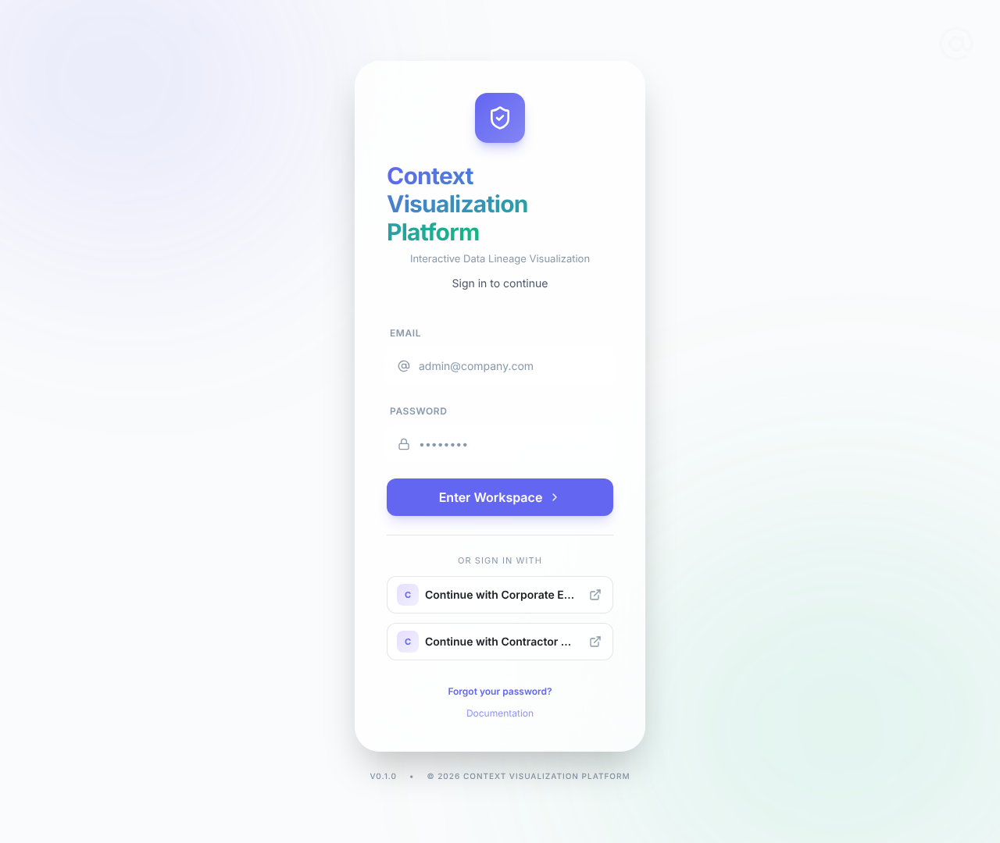

### "Ask for an email first" turned people away

Routing needed an exact match in a connection's **Email domains**. Any other address — a
new subsidiary, an alias, or a deployment with one connection and no domains listed — was
answered with "We don't recognise that email's domain".

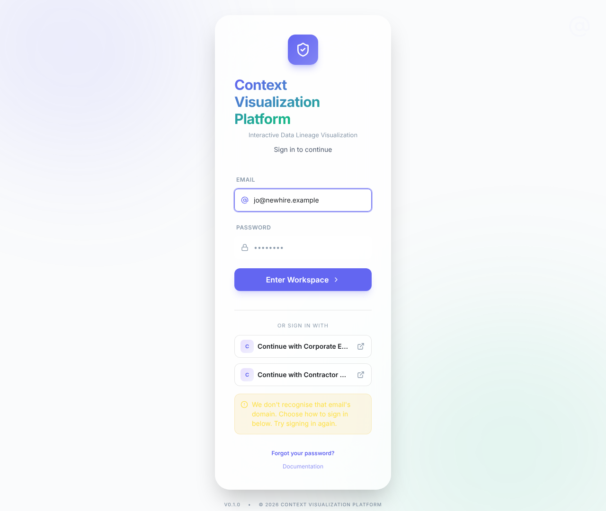

### Enforcing single sign-on was a bet against the identity provider

With **Passwords** off, only break-glass (system) accounts kept a password, through the
unadvertised `/login?password=1`. The switch-off guard refused while any Super Admin had
no SSO identity — which blocked the deployment's own seeded administrator — yet never
checked that a usable break-glass account existed, so an all-SSO admin team could turn
passwords off and then be locked out, with everyone else, by the first outage. When it did
refuse, the page showed a toast and dropped the list of who was affected.

### An outage stranded people who were already signed in

At the 24-hour re-authentication, renewal sent people to their identity provider — down,
during an outage — and left them on its error page. Starting a sign-in against an IdP
whose discovery document or metadata could not be fetched showed a bare `503` JSON body.

### Enterprise gateway users waited on a gateway that was down

Nothing noticed a gateway outage. A session that outlived its connection's outage grace
was sent to the gateway's own sign-in, which could only fail again, and both the sign-in
page's automatic gateway sign-in and the app's in-place re-sign-in waited out the
gateway's timeout first.

---

## 2. What changed

### The sign-in page leads with single sign-on

Wherever a connection is live:

- The first thing on the page is **Continue with** the *primary* connection — the first in
  login-page order (**Priority**, lowest first), now marked **Primary** in Administration →
  SSO → Providers. Other connections follow as secondary buttons.
- Below it, **or continue with email**: an address and **Continue**. Enter always leads
  somewhere — to the connection whose **Email domains** list the address's domain,
  otherwise to the primary — and while someone types, the button already names where it
  will go. There is no password field on this step, so the browser has nothing to demand.
- Passwords are the deliberate fallback. **Can't use single sign-on? Sign in with email
  and password** opens a password step that carries the address (with a hidden username
  field, so password managers still fill it). A single sign-on attempt that fails comes
  back with **Use your password instead**.

A deployment with no connection keeps the single email-and-password form.

| Light | Dark | Phone |
|---|---|---|
|  | 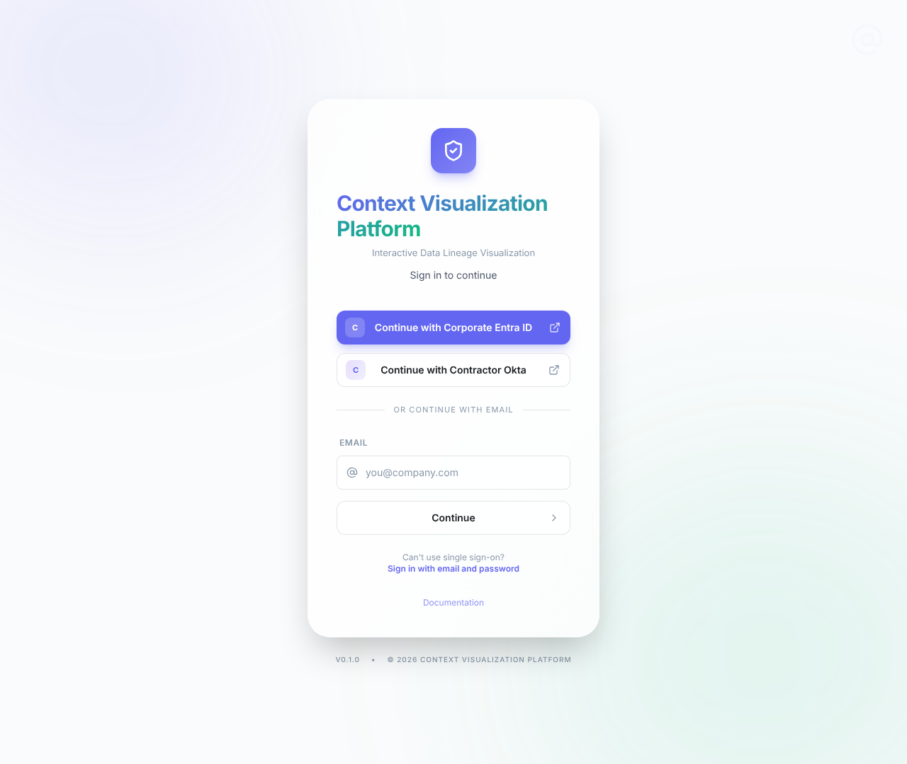 | 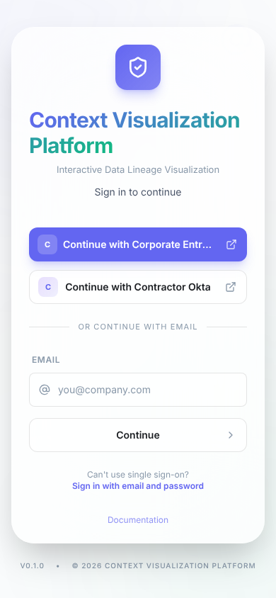 |

| An address that routes | Enter: the hand-off | The password step | Back from a failed sign-in |
|---|---|---|---|
| 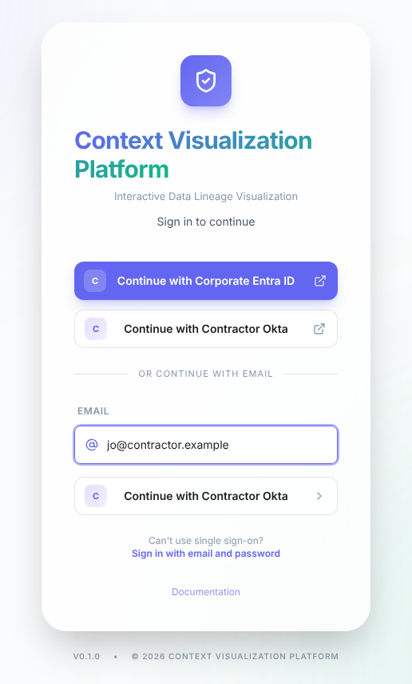 |  | 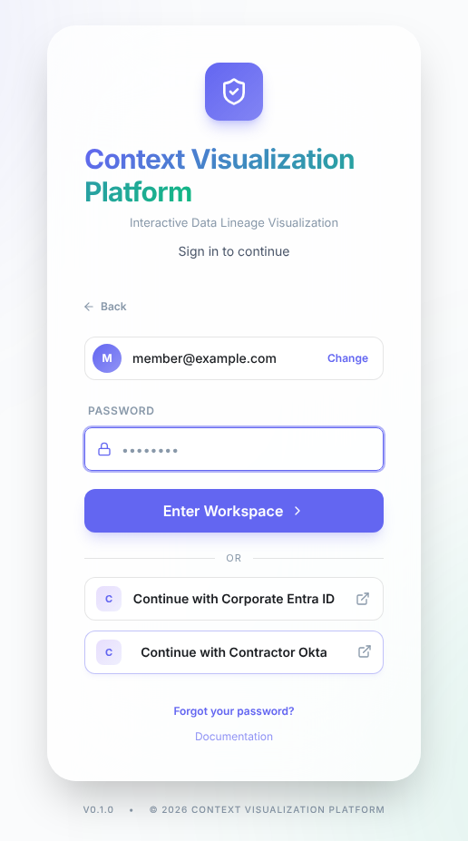 | 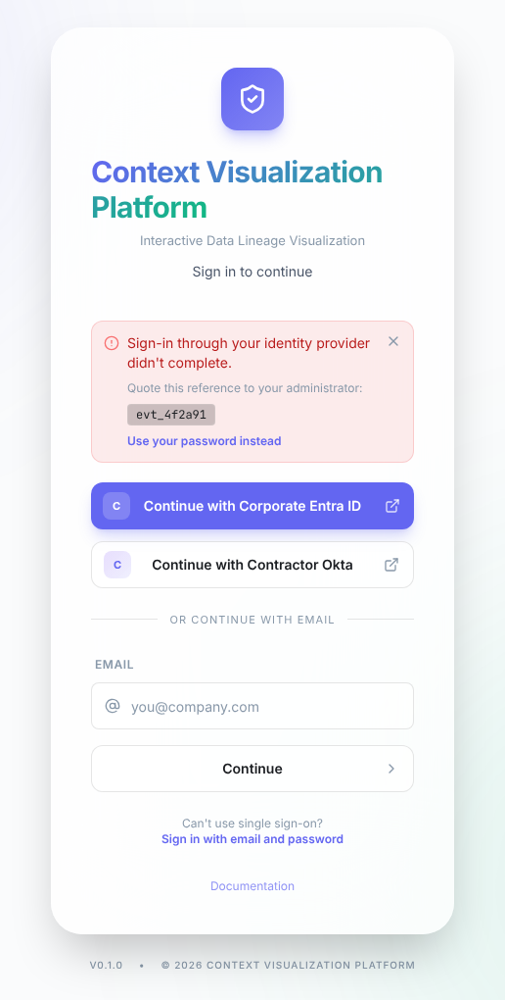 |

### One rule for who may use a password

`password_access` in the auth service decides, the server enforces it, and the page shows
the same answer (`passwordAccess` in `GET /auth/login-context`):

| | Passwords on | Passwords off | …and an outage confirmed | …and the emergency window open |
|---|---|---|---|---|
| Break-glass (system) account | yes | yes | yes | yes |
| Super Admin with a password | yes | no | **yes** | yes |
| Everyone else with a password | yes | no | no | **yes** |

While passwords are off, an account that may not use one now gets `401 "Invalid email or
password"` — after a password check that costs the same as a real one — instead of
`403 local_login_disabled`. The form can no longer be used to find out which accounts are
break-glass accounts or Super Admins. The activity log still records
`local_login_disabled`.

| Passwords off: no password offered | `/login?password=1`: the break-glass door |
|---|---|
| 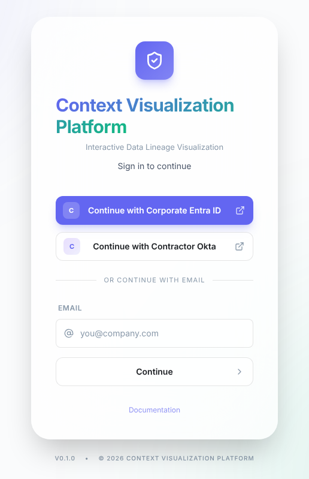 | 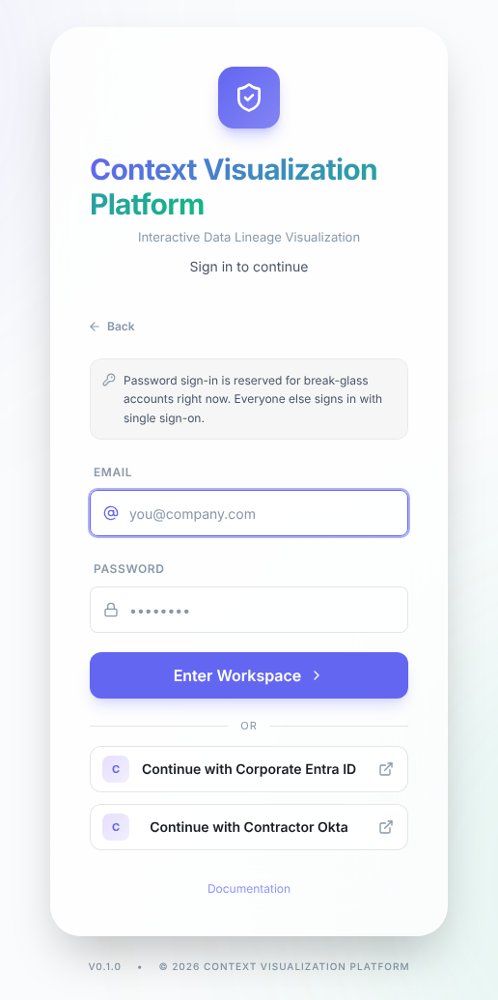 |

### Turning passwords off needs a ready break-glass account

The switch-off is refused (`409 no_break_glass_account`) until an active Super Admin with a
password is marked as a system account — the door that survives an outage. Super Admins
without an SSO identity are now a warning rather than a refusal: the confirm lists them,
each with **Make break-glass**, and **Turn off anyway** proceeds
(`acknowledgeAdminsWithoutSso`). Both checks run on the switch-off only, so saving another
switch while passwords are off is never blocked by them, and the last ready break-glass
account cannot be unmarked while passwords are off.

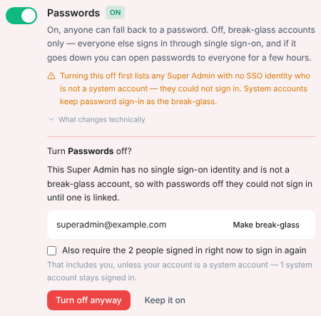

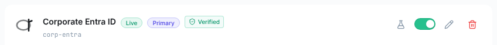

### When an identity provider goes down

**Detection.** A prober on the control plane probes every enabled, published connection
each minute, one process at a time, and asks what a sign-in would ask: for OIDC the
discovery document **and** the signing keys; for SAML whether the single sign-on URL
answers at all; for an Enterprise gateway whether the gateway URL answers at all (see
below). A connection is **confirmed down** only after the prober has seen it working,
then seen it fail continuously for **3 minutes**, on evidence no older than 3 minutes. It
is over after **5 minutes** of health. Every transition is audited once
(`idp.outage.detected` / `idp.outage.resolved`).

**What people see.** The sign-in page says *We can't reach {connection} right now*. Super
Admins with a password get in through **Administrator sign-in**; break-glass accounts always
could.

| The outage notice | Administrator sign-in |
|---|---|
| 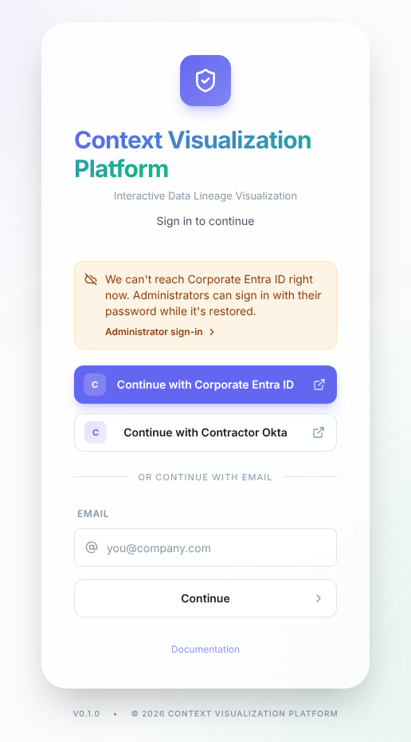 | 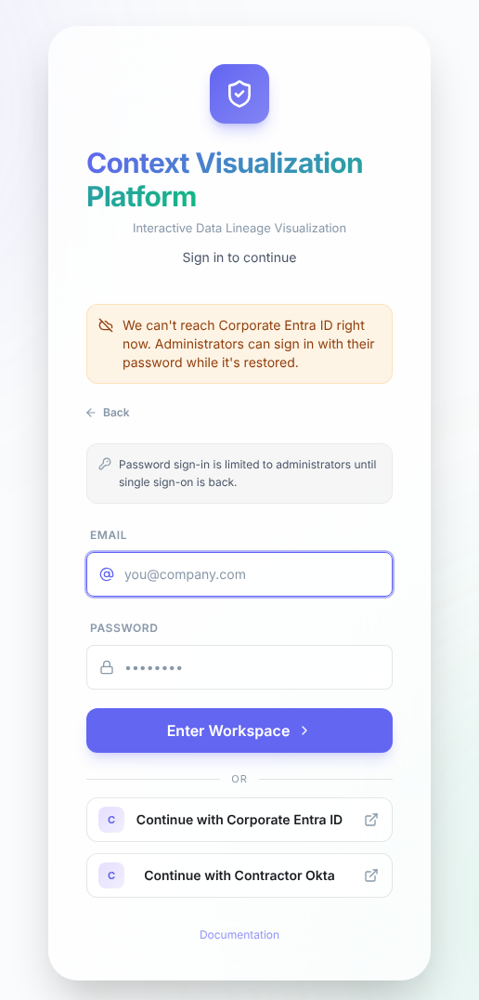 |

**The emergency window.** Any admin opens password sign-in to everyone for 1 to 24 hours
from Administration → SSO → Settings → **Emergency password access**, with a reason. It
closes itself; **Close now** ends it early. The same page shows **Single sign-on status**
(which connection is down and since when, when detection last ran, and a warning when it
is not running) and **Break-glass accounts** with their readiness.

| The page while the window is open | Single sign-on status |
|---|---|
| 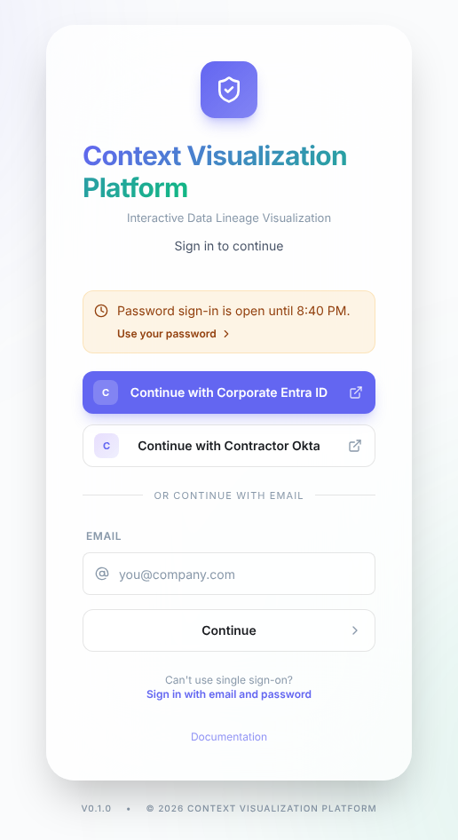 | 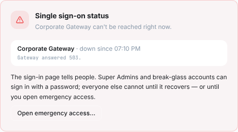 |

| Emergency password access, open | Break-glass accounts |
|---|---|
| 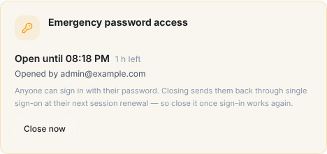 | 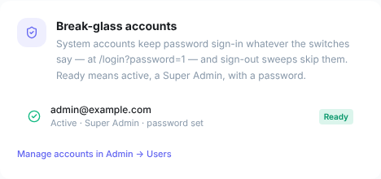 |

**Sessions through an outage.**

- *Signed-in SSO users keep working.* At the 24-hour re-authentication, a session whose own
  connection is confirmed down is renewed instead of being sent to an IdP that cannot
  answer — for at most one more ceiling period, measured from the server's record of when
  they authenticated, and every extension is logged. The 12-hour idle and 7-day absolute
  limits still apply.
- *Nobody is sent to a dead IdP.* Any re-authentication that would land on a connection
  confirmed down goes to the sign-in page instead, which says why.
- *Emergency password sessions end when the emergency does.* A password session opened only
  because single sign-on was down — through the window, or as a Super Admin during an
  outage — carries a signed refresh claim, `pwfb`. It ends at its first renewal after its
  door closes, and within 24 hours regardless, back through single sign-on without forcing
  a fresh credential: a warm IdP session signs the person straight back in on the page
  they were on. Break-glass sessions are never marked.

### Enterprise gateway connections

Gateway connections get the same treatment, adapted to how they work:

- **Detected.** In server mode the sign-in servers call the gateway on every sign-in and
  renewal, so the prober asks the gateway URL too — through the back-channel allowlist and
  the connection's TLS setting, as the real calls go — with no session handle. Any answer
  below 500 is "up": a healthy gateway says 401 or 405. A 5xx, a timeout or a refused
  connection, sustained, is an outage. A destination outside the allowlist is "not
  probed", never "down". A gateway whose exchange runs in the browser is not probed: the
  server never calls it, and cannot speak for the browsers' network path.
- **The outage grace is unchanged.** Every renewal still re-asks the gateway, and an
  unanswered re-check is tolerated for the connection's outage grace (15 minutes by
  default) — the integration contract's promise to the gateway team. What changes is where
  a session that ends during a confirmed outage lands: the sign-in page with the notice and
  whatever password door is open, never the gateway's own sign-in.
- **Nothing waits on a dead gateway.** The page's automatic gateway sign-in and the app's
  in-place re-sign-in skip a connection confirmed down.
- **Back through the gateway, in place.** Once the gateway is back and the window has
  closed, an emergency password session's next renewal is replaced through the gateway
  without a visible redirect.

| A gateway-first deployment | Gateway confirmed down | Down, with the window open |
|---|---|---|
|  | 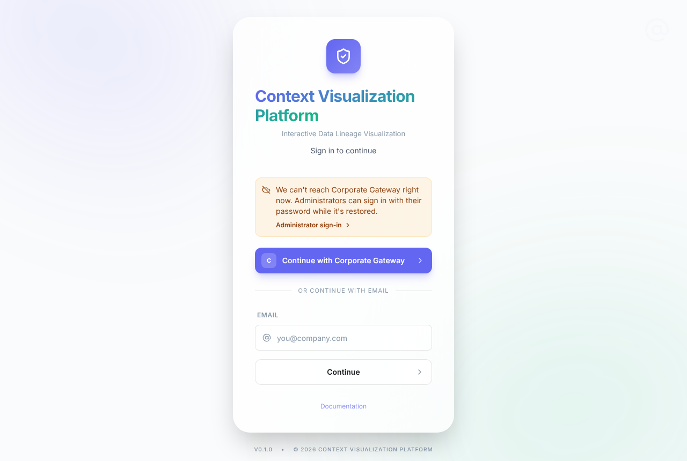 | 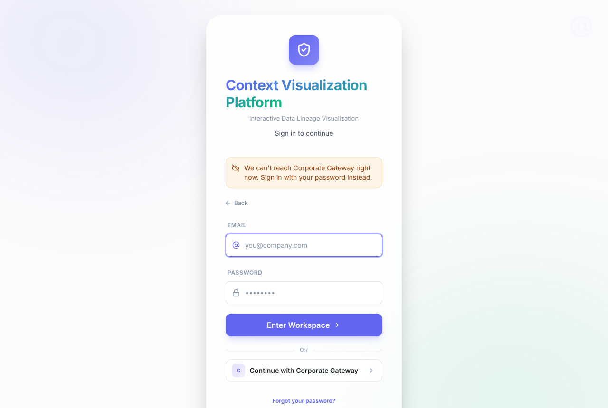 |

### Problems reported on gateway connections

- **"Database is temporarily unavailable" on a first sign-in.** The log said
  `duplicate key value violates unique constraint "uq_users_email"`. Two first sign-ins for
  the same person ran at once — tabs restored together, each running the page's automatic
  gateway sign-in, or a double submit — both read "no account" and both created it; the one
  that committed second hit the constraint, and the generic database handler answered 503.
  Every write of a sign-in shares one transaction, so the loser leaves nothing behind: it now
  reads again and signs in to the account the winner created. A conflict that survives the
  re-read is not a race (an account the email lookup cannot see still holds the address); it
  is refused as `account_conflict`, with a reference and an explanation in Diagnostics.
- **"No gateway_url configured; this provider cannot sign anyone in"** on a connection that
  signs people in perfectly well. Its exchange runs in the browser, which has no gateway URL
  by design, and the health check demanded one regardless of mode. It now checks what the
  server actually depends on in each mode: the gateway and exchange URLs in server mode; in
  browser mode the browser exchange URL, and the JWKS URL when the connection verifies
  against one.
- **"This connection is live and unverified"** — a true statement, but the same sentence for
  every cause, so nobody could tell which setting to change. The rating has not changed; the
  server now explains it per connection — *Trust unsigned* is on, TLS verification is off, or
  a portal's payload is unsigned — with the fix, and the card puts **Open its settings**
  beside it. For a gateway, the way to **Verified** is the gateway's JWKS URL, public key or
  shared secret instead of trusting unsigned replies; running the exchange on the server when
  the corporate cookie reaches this app; and the corporate CA bundle
  (`SSO_OUTBOUND_TLS_CA_CERTS`) rather than switching TLS verification off.
  An admin who has read the warning can **Hide** it on their own screen; it opens again if
  the cause changes, and the **Unverified** pill stays.
- **How worried to be about that warning — and a gap it understated.** Asking that question
  of a gateway trusting unsigned replies turned up something worse than the sentence said.
  Its claims, `email_verified` included, are whatever the sender writes, and under the
  default **Strict** linking policy a hand-written payload naming an existing account's
  email *linked to that account*: one unauthenticated request signed in as the break-glass
  Super Admin (reproduced against the test stack before the fix). An unverified connection
  now never links itself to an existing account (`unsafe_auto_link`, reason
  `unverified_connection`); people link it from their own account page once signed in
  another way. What remains is what *Trust unsigned* means — anyone who can reach the sign-in
  endpoint can sign in as anyone already linked to that connection, or as someone new — so
  on an intranet the exposure is every person and device that can reach the application,
  and the fix is to make the connection Verified.

| The warning, naming its cause and fix | Folded away once read |
|---|---|
| 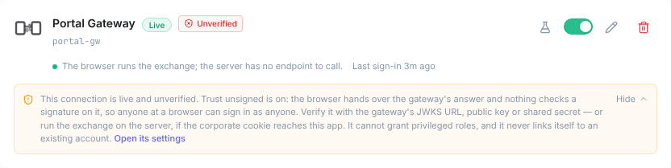 | 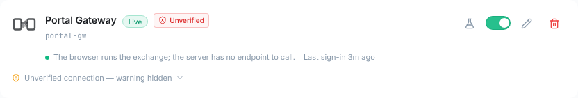 |

### When nobody can sign in at all

No break-glass account ready, every admin SSO-only, and the IdP down: one command on the
host sets a password, marks the account as break-glass, clears its failed sign-in count
and signs its old sessions out. Then sign in at `/login?password=1`.

```bash
python -m backend.scripts.reset_admin_password --email you@example.com --break-glass
```

---

## 3. Why it is built this way

- **Single sign-on leads automatically, with no setting.** A live connection is the
  operator's statement that people should use it. The primary is the first routable
  connection in the order the page already used, so there is no new column to keep in step
  with Priority.
- **Only the server's own probes count.** A browser's report and a failed SSO callback can
  both be produced by anyone, and a confirmed outage opens a door. For the same reason the
  rules fail closed: a connection never seen working is never "down" (a prober whose
  network or CA bundle differs from the sign-in servers' cannot invent an outage),
  evidence older than three minutes means nothing (a stopped prober opens nothing), and
  five minutes of health are needed to end an outage, so a flapping IdP does not end the
  sessions opened during it.
- **Automatic for Super Admins, one click for everyone else.** Anyone able to make the IdP
  unreachable *from the server* can produce a confirmed outage. Letting that admit only
  Super Admins with a password — the people who can then decide — bounds what it is worth;
  opening the door to everyone stays a person's decision, time-boxed and audited.
- **The same answer for every refused password.** During an outage, a 403 for "not
  allowed" and a 401 for "wrong password" would tell anyone which addresses belong to
  administrators. Answering 403 only after checking the password was rejected too: it
  confirms the password.
- **No per-request cost.** The confirmed outage rides the existing 30-second posture
  snapshot, so sign-in, renewal and the login context read no extra rows. A failed read of
  it means "no outage" — never the posture failsafe that opens passwords.
- **The emergency claim is signed, not stored.** `pwfb` is an expiry in the refresh token,
  propagated on rotation exactly like the existing `idp_exp`, so rotation cannot extend it
  and no table gains a column.
- **Bounded ride-through.** Only the 24-hour re-authentication rides through, for one
  extra period at most, logged. Idle, absolute, `idp_exp` and gateway re-check limits are
  never extended.
- **The gateway's outage grace is respected.** The back-channel contract tells gateway teams
  that a sustained outage ends sessions rather than extending them; the operator already has
  the knob (*Outage grace*). Overriding it automatically would trade away the integration's
  revocation guarantee without anyone deciding to.
- **The gateway probe is a live request.** The admin health card deliberately never calls a
  gateway. The prober must: only a live request can confirm an outage. It carries no
  handle and none of the configured headers, and the contract tells gateway teams to
  expect it (one request a minute).
- **The window does not bump the configuration version.** Otherwise the Settings page's next
  save would be refused as a conflict. It is refused while passwords are already on, where
  it would mean nothing.

---

## 4. What it trades

Accepted and bounded, and in the activity log:

- Anyone able to make the IdP unreachable from the server can open the password door for
  Super Admins — which is why only they get in automatically.
- A closed emergency window keeps working on other servers for up to 30 seconds.
- Anyone who knows a break-glass address can run its per-account throttle down, as before;
  the host recovery command clears it.
- Deactivating or deleting the last break-glass account is not blocked; the Settings page
  flags it in red.
- During an outage the ride-through gives a user disabled at the IdP up to one more day of
  an existing session.
- Each Enterprise gateway in server mode receives one request a minute with no session
  handle.

---

## 5. How it was verified

- **Backend.** New suites pin the prober rules (confirm at three minutes, recover at five,
  stale evidence, never-seen-working, a gap restarting the streak, the advisory lock), the
  gateway probe (any answer below 500, browser mode never probed, an un-allowlisted address
  never counted, the allowlist passed through), the password matrix and the uniform 401,
  `pwfb` across both rotation paths and every way it ends, the ride-through bounds, where an
  ended gateway session lands, the window endpoints, the switch-off guard and the recovery
  command. The full backend suite shows no regressions against `main`. The migration was
  run up, down and up again on PostgreSQL 16.
- **Frontend.** The page's decisions are plain functions with a matrix test
  (`loginShape.test.ts`); the page, the gateway flows, the in-place re-sign-in and the admin
  cards have component tests, including that nothing calls a gateway confirmed down. The
  type check and lint add nothing to `main`'s baseline.
- **End to end**, against PostgreSQL, Redis, the API and the Vite dev server, in Chromium:
  every state above in light, dark and phone widths, the admin flows, and the whole gateway
  story — a stand-in corporate gateway on a private address reached through the allowlist,
  silent sign-in through its cookie, the real prober confirming its outage at three minutes
  and clearing it after five, the notice with no call to the dead gateway, a Super Admin
  signing in, a signed-in gateway user landing on the sign-in page, a password sign-in
  through the window, and that session returning to the gateway in place once it was back.

---

## Upgrading

- **The sign-in page changes for every deployment with a live connection.** It leads with
  single sign-on; people who use a password use the password link. Set **Priority** so the
  connection most people use comes first.
- **Super Admins with a password can sign in during a confirmed outage even while passwords
  are off.** If that is not acceptable, remove their passwords and keep break-glass
  accounts only.
- **Clients that read `403 local_login_disabled` from `POST /auth/login`** now get the `401`
  a wrong password gets.
- **`POST /auth/resolve` answers whenever single sign-on is on**, not only under **Ask for
  an email first**. Misses all look the same, as before.
- **Passwords already off without a break-glass account** stay off; the new check applies
  to the next switch-off. Check **Break-glass accounts** on the Settings page.
- **Tell your gateway team** that each server-mode Enterprise gateway now receives one
  request a minute with no session handle, and that answering 401 for it is correct.
- **Migration** `20261014_1000_sso_fallback` adds three nullable columns to
  `app_auth_config` and the `idp_provider_reachability` table.

---

## Where the code is

| Concern | Where |
|---|---|
| Outage detection | `backend/app/services/idp_reachability.py`, scheduled from `backend/app/main.py` and `services/aggregation/controlplane.py` |
| Who may use a password | `password_access` in `backend/auth_service/app_auth_config.py`; enforced in `LocalIdentityService.login` (`backend/auth_service/service.py`) |
| Sessions through an outage | `refresh()` and `_reauth_url` in `backend/auth_service/service.py`; `pwfb` in `backend/auth_service/core/tokens.py` |
| Public endpoints | `backend/auth_service/api/router.py` (`login-context`, `resolve`, the unreachable-IdP redirect) |
| Admin endpoints | `backend/app/api/v1/endpoints/admin_sso_config.py` (guard, window, status), `users.py` (last break-glass) |
| Host recovery | `backend/scripts/reset_admin_password.py --break-glass` |
| Sign-in page | `frontend/src/components/auth/LoginPage.tsx`, decisions in `loginShape.ts` |
| Gateway re-sign-in | `frontend/src/services/backchannelReauth.ts` |
| First sign-in race | `complete_sso_login` in `backend/auth_service/service.py` |
| Gateway health, per mode | `_probe_backchannel` in `backend/app/services/idp_health.py` |
| No auto-link from an unverified connection | `_link_deny_reasons` in `backend/auth_service/service.py` |
| Why a connection is (un)verified | `assurance_explained` in `backend/auth_service/providers/assurance.py`; the card in `IdpProviderCard.tsx` |
| Admin console | `frontend/src/components/admin/sso/tabs/SettingsTab.tsx`, `tabs/settings/FallbackCards.tsx` |
| Schema | `backend/alembic/versions/20261014_1000_sso_fallback.py` |

Reference: [SSO operator reference §1.14, §1.17, §2.15](SSO.md), the
[SSO operations guide](guide/SSO_OPERATIONS.md#when-your-identity-provider-is-down) and the
[back-channel integration contract](SSO_BACKCHANNEL_CONTRACT.md).
