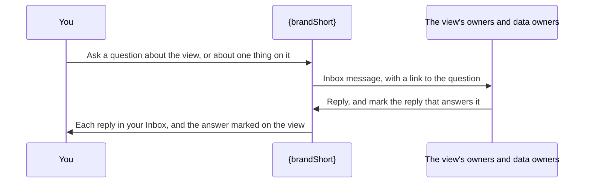

# Asking Questions

*For anyone who opens a view and wonders what it shows, where its data comes from, or
whether it's right — and for the people who look after it.* Every view has a place to ask:
the question goes to the people who own the view and the data under it, the conversation
stays with the view, and the answer is there for the next person who wonders.

> **Before you start:** Questions are off until a platform administrator turns on
> conversations in [Feature Switches](/guide/feature-switches). You can ask about any view you
> can open, and anyone who can open it can be asked or mentioned.

---

## Ask a question

Open the view and click **Questions** in its header — the number beside it counts the
questions still open. The drawer that opens lists who looks after the view, every question
asked about it so far, and **Ask a question…** at the top. You can also start from **About**
(or **Details → About**) in the view's header, where **Who to ask** names each owner and why
they are one, with **Ask a question** under them.

Write your question and press **⌘↵** (Ctrl+Enter on Windows and Linux), or click **Ask**.
Type `@` to mention someone who can open the view — their name joins the question, and they
are told.

### Who it goes to

**Send to** has two switches, both on for a view:

* **View's owners** — whoever made the view and the people who can edit it.
* **Data owners** — the data source's named owner and stewards. Where nobody is named yet,
  the people who connected the data or asked for it stand in.

Faces and a count show who each one reaches. **Add people** asks anyone else who can open
the view. Someone who can't open it can't be asked: the composer names them before you send,
so you can share the view with them first. If nobody at all can be asked, the question goes
to the workspace's admins.

### Who can see it

* **Everyone who can see this view** — the default. Anyone who can open the view can read
  the question and reply, so the answer helps the next person too.
* **Only the people involved** — a private question. Only you, the people you ask or
  mention, anyone who replies, the view's owners and the workspace's admins see it. A
  private question carries a **Private** badge; hover it to see who can read it.

## Follow the conversation

Every reply reaches you in your Inbox; click one to open the question at that reply. In the
drawer:

* a line marks **New since you last looked**, before the first reply you haven't seen;
* **Open**, **Answered**, **All** and **Mine** filter the list, each with its count, and an
  unread question carries a dot;
* the **…** on a question offers **Copy link**, **Mute notifications** (stop hearing about
  it), **Follow** (hear about it without having taken part), **Close question** and
  **Reopen**;
* the **…** on a message offers **Copy link**, and **Edit** or **Delete** on your own. An
  edited message says so; a deleted one leaves a note in its place.

**Watch** in the drawer's header tells you about every new open question on the view, even
ones you weren't asked.

## Answer a question

When you're asked, reply in the box at the foot of the question. Hover the reply that answers
it and click **Mark as answer** — the asker, the view's owners and admins can. The question
moves to **Answered**, and the reply is framed in green with who accepted it, so the next
reader finds it first. Changed your mind? **Unmark as answer** from the reply's **…**.

A question nobody has answered after three days is brought up again with the people asked,
and after a week with the workspace's admins.

If someone else changed a question while you were looking — answered or closed it — the
drawer says **This changed** with **Reload**, rather than overwriting what they did.

## Where to next

- [Browsing Views](/guide/browsing-views) — when you're looking for the view to ask about.
- [Managing Views](/guide/managing-views) — when you own a view and want to share it with
  someone who can't open it yet.
- [Requesting Access](/guide/requesting-access) — when the question is really "can I see
  this?".
- [Feature Switches](/guide/feature-switches) — when you administer the switch that turns
  questions on.
