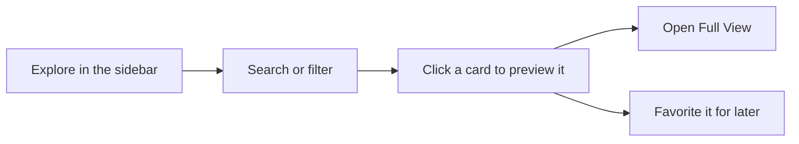

# Finding Views

*For Viewers.* A **view** is a saved, shareable picture of part of your data's
lineage: someone has already chosen what to show and how to lay it out (see the
[Glossary](/guide/glossary)). The **Explorer** lists every view you're allowed to
open, across all your workspaces. This page shows you how to find the view you
need, check it's the right one before you open it, and keep the views you use
most one click away.

## Find a view

1. In the left sidebar, click **Explore**. The **Explorer** opens, headed
   *Discover views across workspaces*.
2. Press `/` to jump to the search box, then type a word from the view's name.
   The list narrows as you type, and its heading changes to
   **Results for "…"**.
3. Click the card you want. A preview panel slides in from the right with the
   view's description, what it's built on and how much it's used.
4. Click **Open Full View**. The view opens on its canvas.

Search looks for every word you type in each view's name, description and
tags, and in the names of its workspace and data source. A view has to match
all the words. To find the views one person made or edited, use the
**People** filter instead (next section), or type it (below). When you click
into the empty search box, your **Recent searches** in this browser appear,
with a few filters you can type; **Clear** empties the list.

### Type a filter instead of picking it

Anything in the search box written as `name:value` is a filter. When you finish
it with a space, **Enter** or **Tab** it turns into the same chip its menu
would make, and the rest of what you typed stays a search. While you type one,
the box suggests its values with how many views each would show: pick one with
the arrow keys and **Enter** or **Tab**.

| Type | To see views… |
| --- | --- |
| `by:ada`, `by:me` | created or edited last by Ada, or by you |
| `created-by:`, `edited-by:`, `published-by:` | by that person in only that role |
| `is:versioned`, `is:external` | whose data is versioned in {brand}, or kept elsewhere |
| `is:private`, `is:workspace`, `is:enterprise` | with that visibility |
| `is:mine`, `is:fav`, `is:shared`, `is:recent`, `is:attention`, `is:deleted` | in that quick filter |
| `updated:<7d`, `created:<30d` | changed, or made, in the past 7 or 30 days |
| `updated:>90d` | not changed for more than 90 days |
| `updated:today`, `created:2026-09`, `updated:2026-09-01..2026-09-15` | changed or made on that day, in that month, or in that range |
| `updated:visit` | changed since your last visit |
| `tag:pii`, `type:graph`, `ws:finance`, `source:warehouse` | with that tag, type, workspace or data source |

Put a name with a space in quotes: `by:"Ada Lovelace"`. A name that matches
more than one person, tag or source isn't guessed: it stays in the box, with a
note under it, until you finish it from the suggestions or remove it.
**Backspace** in an empty search box removes the last chip, with an **Undo**.

### Filter by anything from one list

Press **Shift+F**, or click the filter button beside **Sort**, for every filter
value in one searchable list: each person, tag, source, workspace, type, date
period and visibility, with the number of views it would show and a check by
the ones already on. Type to narrow it — a group's name such as `tag` or
`people` lists that group. **Enter** applies the highlighted value and closes
the list; **Ctrl+Enter** (**⌘+Enter** on a Mac) applies it and keeps the list
open, to pick several in a row.

> **If you don't see the view:** the list says **No views match your search**
> (or **these filters**). Under it, each filter you have set is listed with how
> many views removing just that one would bring back — click one to remove it.
> **Show all views** clears the search and every filter; the message that
> follows has an **Undo**.
> Still missing? See
> [I can't find a view someone shared](#i-cant-find-a-view-someone-shared).

## Narrow the list

The row under the search box starts with quick filters. Click one at a time:

| Click | To see |
| --- | --- |
| **All** | Every view you can open (the default) |
| **My Views** | Views you created |
| **Favorites** | Views you have favourited (see [Keep your favourites one click away](#keep-your-favourites-one-click-away)) |
| **Recent** | Views created in the last 7 days |
| **Shared** | Views someone has shared with you by name or through a group, not your own |
| **Attention** | Views that need attention: not updated for more than 90 days, or whose workspace or data source is inactive or no longer exists |
| **Deleted** | Deleted views that can still be restored (see [Bring back a deleted view](#bring-back-a-deleted-view)) |

The row below holds the filters you can combine: **Versioned** and
**External**, **Date**, **People**, **Workspace**, **Source** (a data source),
**Type** (the canvas type, such as Context View), **Tag** and **Visibility**.
Each one you set shows as a chip under the row, such as *Workspace: Finance* or
*Edited by: You*. Click a chip's **×** to remove it, or **Clear all** to remove
every filter in the row.

Every choice in these menus shows how many views it would leave, counting your
other filters, and so do the **Versioned** and **External** buttons. A choice
that would leave none is greyed out, so you can see a dead end before you click
it.

- **Filter by a tag from a card.** Click any tag on a card to filter by it;
  click it again to remove it.
- **Use the summary tiles.** **Total Views** switches back to **All**, **New
  This Week** switches to **Recent**, and **Need Attention** switches to
  **Attention**. The numbers always describe the list you're looking at, so
  they change with your search and filters.
- **Bookmark a filtered list.** Your search, filters, sort and layout are kept
  in the page address, so you can bookmark the list or send the link to a
  colleague.

> **Tip:** **Shared** lists only views shared with you by name or through a
> group. Views you can open because of their **Workspace** or **Enterprise**
> visibility are under **All**.

### Versioned or external

Click **Versioned** to see only views whose data is versioned in {brand}: it is
changed through drafts, review and publishing. Click **External** for views on a
graph that another system looks after, which {brand} reads but doesn't edit.
Click the highlighted one again to see both. Hover either for a reminder of what
it means.

A view without a data source of its own is judged by its workspace's default
data source. When your administrator has switched **Version control** off, these
buttons don't appear.

### When a view was made or changed

1. Click **Date**.
2. At the top, choose **Created** (when the view was made) or **Updated** (its
   last change of any kind: its settings, its layout or its data).
3. Choose a period such as **Today**, **Past 7 days** or **Last month**, or type
   a number of days next to **Past … days** and click **Apply**.
4. For exact dates, click **Custom range…**, click the first and last day on the
   calendar, then **Apply range**. Both days are included.

The button then reads, for example, *Updated · Past 7 days*. Days are your own
calendar days. A bookmarked list keeps the period, not the dates: a bookmark of
*Past 7 days* still shows the past seven days when you open it next month. With
**Recent** on as well, the list shows views that match both.

Each period shows how many views it would show with your other filters. On the
calendar, a dot under a day marks views created or changed that day; the darker
the dot, the more of them.

### See when things changed

The **Timeline** above the results is a bar for each of the past 90 days: how
many views were created, or updated, that day. Switch between **Created** and
**Updated** at its top. It counts with your other filters, so it answers
questions such as *when did the finance views last change?*

- **Drag across the bars** to show only views from those days, or **click one
  bar** for a single day. The Date filter and its chip change to match.
- **Double-click** the bars, or click **Clear dates**, to remove the dates.
- **From the keyboard:** Tab to the bars, then use **←** and **→** to move a
  day at a time (each day's count is read out), **Shift** with the arrows to
  stretch a range, **Enter** to show it, and **Esc** to let go.

Click **Hide** to fold the timeline away; it stays folded until you show it
again. It isn't shown under **Deleted**.

### Who made or changed a view

1. Click **People**. **You** is always first, then everyone who has made or
   edited a view you can open, with how many views each has.
2. At the top, choose what they did:

   | Choose | To see views they… |
   | --- | --- |
   | **Any** | created, or edited last (the default) |
   | **Created** | created |
   | **Edited** | edited last: the layout or the settings |
   | **Published** | published the data behind last |

3. Click one or more people. Pick several to see views by any of them.

**Edited** and **Published** go by each view's *latest* change: a view records
who changed it last, not everyone who ever did. **Published** is a choice of its
own because publishing data changes every view on that data source, including
views the publisher never opened.

### What changed since your last visit

When you come back after being away for half an hour or more, a line above the
results says what changed while you were gone, for example *Since your last
visit · Tue 14:02 — 4 new · 11 updated*. Both numbers count with your other
filters.

- Click **4 new** to show only views created since then, or **11 updated** for
  views changed since then (new ones included). Click it again to go back.
- Those views also carry **New since your visit** or **Updated since your
  visit** across the top of their card, or a dot before their name in list view.
- **Mark as seen** clears the line and the labels until your next visit.

Your last visit is remembered by this browser, separately for the Explorer and
for each workspace's Views tab, so another computer has its own. The line steps
aside while another date filter is on.

### Change the order and the layout

- **Sort** with the menu on the right of the filter row. **Recently modified**
  is the default; you can also sort by **Recently updated data**, **Oldest
  updated data**, **Recently edited (settings)**, **Newest created**, **Oldest
  created**, **Most liked**, **Most opened**, **A → Z** and **Z → A**.
- **Grid view** shows cards. **List view** shows a table whose **Name**,
  **Type**, **Owner**, **Likes** and **Updated** headers sort when you click
  them.
- The density buttons beside them make the list **Compact**, **Comfortable**
  or **Spacious**.

## What the Explorer shows before you search

With no search or filter, the Explorer is arranged in sections:

| Section | What it holds |
| --- | --- |
| **Featured Views** | Up to three pinned views, when there are any |
| **Continue where you left off** | Views you opened recently, with when you visited. Click one to open it straight away |
| **Trending** | Up to six of the most favourited views. A view nobody has favourited never appears here |
| **All Views** | Every view you can open, with the total beside the heading. More cards load as you scroll |

As soon as you search or filter, only the results are shown.

## Read a view's card

Each card answers "is this the view I want, and does anyone use it?" before
you open anything.

| Part of the card | What it tells you |
| --- | --- |
| Canvas type and name | The kind of canvas (Graph, Hierarchy or Context View) and the view's name |
| Workspace and semantic layer | The workspace the view belongs to, and an icon for the semantic layer that describes its data. Hover either for details |
| **Private**, **Workspace** or **Enterprise** | Who can open it. Hover for a plain-language answer |
| **Versioned** or **External** | Whether its data is versioned in {brand} or looked after by another system. Hover for what that means |
| Health badge | Shown only when something is wrong (table below) |
| Data source | The data the view is drawn from |
| **New to you** | Other people open this view, but you never have |
| Tags | Up to three, then **+N**. Click one to filter by it |
| Heart and number | How many people have favourited it |
| People and number | How many different people opened it in the last 30 days |
| Eye and number | How many times it was opened in the last 30 days |
| Faces | Who shaped it: whoever created it, then whoever edited it last, then whoever published its latest data, each person once. Hover a face for their name and what they did when; click it to show only views by that person |
| **New since your visit** or **Updated since your visit** | A coloured edge across the top: the view was created, or changed, since you were last here (see below) |
| Time | When it last changed. Hover to see when its data and its settings last changed |

Hover the people or eye number for the detail: who has opened it (for example
*Only its author* or *Nobody yet*), *Not opened* when nobody has opened it in
30 days and, when known, how many times it has been opened in all and when it
was last opened. The heart counts favourites, not use: a view can be popular
and rarely opened, or the reverse.

| Health badge | What it means |
| --- | --- |
| **Stale** | The view hasn't been updated for more than 90 days |
| **Warning** | Its workspace or data source is inactive |
| **Source deleted** | Its workspace or data source no longer exists, so it may not load |

## Preview a view before you open it

Click anywhere on a card, or move to it with the arrow keys and press
**Enter**. The preview panel slides in from the right. From top to bottom it
shows:

- the canvas type and visibility (hover the visibility to see who can open
  it), and the view's name;
- a warning if the view is stale or its data source is missing;
- a preview of its layers (for a Context View) or its shape (for a Hierarchy);
- **Description** and **Tags**;
- **What this view is built on**: its workspace, data source (with whether it
  is a versioned or an external graph), graph data provider and semantic
  layer;
- **Details**: who created it; **Contributors**, the faces of whoever else
  edited it last or published its latest data (click one to show only views by
  that person); and under **See all details** when it was created, last
  updated, and when its data last changed (**Data Updated**);
- **Usage**: how many people opened it in the last 30 days, how often, and
  whether you have.

At the bottom, **Open Full View** opens the view and **Activity** lists what has
changed on it. The other buttons (**Edit layout & scope**, **Edit details**,
**Share** and, when you may, **Delete**) are for people who manage the view; see
[Managing & Sharing Views](/guide/managing-views).

## Open a view

Use whichever is closest:

- **Open Full View** in the preview panel.
- Hover a card and click the arrow icon (**Open view**).
- A card under **Continue where you left off**.
- The **Favorites** star in the top bar (see the next section).
- Press `⌘K` / `Ctrl-K`, type the view's name, and pick it under **Views**.

The view opens with its name, canvas type and workspace in the header. It
always opens in its own workspace, so you never need to switch workspace first.

Looking around is safe: searching, expanding and tracing inside a view don't
change the view or its data. A view's own settings are changed by the people who
manage it ([Managing & Sharing Views](/guide/managing-views)), and the data only
in a draft, through **Edit** ([Editing in a Draft](/guide/editing-in-a-draft)).

> **If you see View Cannot Load:** the page explains that the view doesn't
> exist or hasn't been shared with you. Click **Back to Explorer**, then see
> [I can't find a view someone shared](#i-cant-find-a-view-someone-shared).

> **If the canvas shows a message instead of the view:** *Preparing your graph*
> and *Taking a little longer than usual* mean it is retrying by itself. What
> each message means is in
> [Messages you may see](/guide/troubleshooting#messages-you-may-see).

## Keep your favourites one click away

1. In the Explorer, hover a card and click the heart (**Favorite**). The heart
   fills in. Click it again (**Unfavorite**) to take the view off your list.
2. Click the star in the top bar. The **Favorites** popover opens with every
   view you've favourited.
3. Click a view in the popover. It opens straight away.

- **Remove one from the popover:** hover its row and click **×** (**Remove
  from favorites**).
- **Find one in a long list:** once you have more than five favourites, a
  **Search favorites...** box appears at the top of the popover.
- **Reopen something recent:** under your favourites, **Recent** lists views
  you opened lately that aren't favourites.
- **See them all as cards:** click **Favorites** in the Explorer's filter row.
- **From the keyboard:** move to a card with the arrow keys and press `f`.

Favourites are personal: yours don't change anyone else's list. The heart
number on a card is how many people, in total, have favourited it.

## Bring back a deleted view

A deleted view moves to **Deleted** in the Explorer, where a workspace admin can
restore it.

1. In the Explorer's filter row, click **Deleted**. Deleted views appear faded,
   with a **Deleted** badge.
2. Hover the view's card and click **Restore**.
3. A message confirms the view has been restored. It is back in the list, with
   the same visibility as before.

> **If you see "Failed to restore":** only a workspace admin of the view's
> workspace can restore it. Ask yours to restore it for you.

**Delete** on a deleted card removes the view permanently, after you type its
name to confirm. It can't be undone, and only a workspace admin can do it.

## I can't find a view someone shared

Work through these in order:

1. **Clear your search and filters.** Click **All**, or **Show all views** if
   the list is empty.
2. **Check Deleted.** If the view is there, it was deleted; see
   [Bring back a deleted view](#bring-back-a-deleted-view).
3. **Check who it's shared with.** Every view is **Private**, **Workspace** or
   **Enterprise**, and can also be shared with named people or groups; you see
   it only if one of those includes you. The rules are in
   [Who can see a View](/guide/managing-views#who-can-see-a-view).
4. **Ask for access.** Ask the view's owner to share it with you, or
   [request access](/guide/requesting-access) to its workspace.

A view that is still waiting in a draft (for example, one being imported from
another environment) isn't listed until that draft is published.

## Keyboard shortcuts in the Explorer

| Key | What it does |
| --- | --- |
| `/` | Jump to the search box |
| `Shift`+`F` | Filter by anything, from one list |
| `?` | Show the keyboard shortcuts |
| `Esc` | Clear the search, or close an overlay |
| Arrow keys | Move between cards |
| `Enter` | Preview the card you've moved to |
| `f` | Favourite or unfavourite that card |
| `Backspace` | In an empty search box: remove the last filter chip |

## Where to next

- [Reading Lineage](/guide/reading-lineage) — when a view is open and you want
  to understand what the picture shows.
- [Tracing Lineage on the Canvas](/guide/exploring-graph) — when you want to
  follow data upstream or downstream inside a view.
- [Requesting Access](/guide/requesting-access) — when a view or workspace you
  need is closed to you.
- [Creating Views](/guide/creating-views) — when no existing view answers your
  question and you want to build one with **New View**.
