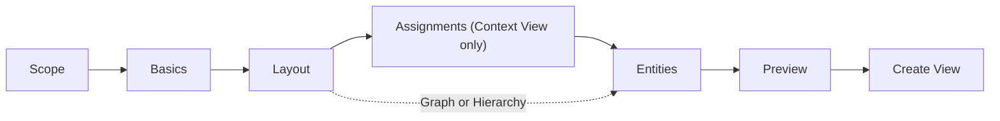

# Creating Views

*For Builders.*

A **View** is a saved, shareable way of looking at one data source: which
entities it shows, how they are laid out, and who can open it. By the end of
this page you can build one with the **New View** wizard, pick the right canvas
type for it, and decide who sees it.

> **Before you start:** You need permission to create views in the workspace —
> the **Workspace member**, **Data engineer** and **Workspace admin** roles all
> have it; **Workspace viewer** does not. The data source works best when it has
> a [semantic layer](/guide/semantic-layer) assigned: without one you can still
> build a View, but with limited entity-type filtering.

## The wizard at a glance

The wizard has up to six steps. **Assignments** appears only when you choose
the **Context View** layout.

**Back** and **Next** move between steps, and **Next** stays greyed out until
the current step is complete. You can click any step you have already finished
to return to it. **Cancel** closes the wizard.

## Open the wizard

1. In the sidebar, choose **Explore**. The **Explorer** opens.
2. Choose **New View** (top right). The **Create New View** wizard opens on the
   **Scope** step, asking *Where should this view live?*

The same wizard opens from **Build a new view** on the Dashboard, from **Create
Your First View** when the Explorer is empty, and from **New view** on a
workspace's **Views** tab.

## Step 1 — Scope: choose the data

Every View is built on exactly one data source. The step shows your workspaces
on the left and the data sources of the selected workspace as cards on the
right.

1. Choose the workspace in the left-hand list. (If you belong to only one, it
   is already selected.)
2. Choose a data source card. A check mark appears on it, and a green banner
   confirms *Semantic layer assigned* when it has one.
3. Choose **Next**. The **Basics** step opens.

Each card tells you whether the source is a good place to build:

| On the card | Means |
| --- | --- |
| **Ready** (green badge under the name) | It has a semantic layer and its lineage has been rolled up — the safest choice |
| **Ontology** / **No ontology** (bottom row) | Whether a semantic layer is assigned |
| **Ready**, **Running**, **Pending**, **Failed**, **Skipped**, **Not run** (bottom row) | The state of its lineage roll-up. You can still build while it runs, but some lineage may be missing until it finishes |
| **Fully managed** / **Federated** | Created and versioned here, or read from an external system of record |

The **Semantic layer** and **Ready** chips filter the cards, and the sort menu
(**Recommended** by default) puts the sources you can build on first.

> **If you don't see your data source:** turn on **All workspaces** to search
> every workspace you can see, or type in **Search data sources...** — a search
> that finds nothing here offers **Search all →** when there are matches
> elsewhere. Choosing a source in another workspace moves the View there.

### Other ways to start

When your deployment offers them, a switch above the picker gives you two more
starting points:

- **Start from blank** — draw lineage by hand, with no data source behind it.
  Pick a **Graph connection** and a **Published semantic layer**; on the
  **Basics** step you also choose the **Graph name** the model is stored under
  (it can't be renamed later). A blank model skips the **Assignments** and
  **Entities** steps. This option appears only when your administrator has
  turned on both **Version control** and **Build lineage from scratch**
  (Administration → Features).
- **Import a view** — bring in a View exported from another environment. See
  [Moving views between environments](/guide/import-export#moving-views-between-environments).

To start from a [layout template](#layout-templates) instead, choose **Use template** on its card
in **Templates**, in its details, or in the Dashboard's **Layout templates**. The wizard opens with
the template's layers already applied on the **Layout** step.

In a workspace whose admin chose a [default template](#a-workspaces-default-template), a new View
starts from it: the **Layout** step says **New views in Finance start from this layout**, and
**Start empty instead** clears it. Choosing another template, or starting empty, sticks however
often you come back to the step.

## Step 2 — Basics: name it and choose who can see it

1. Type a **View Name**. A name that says what the View shows (*Finance data
   lineage*) beats *My view 3*. Click into the empty field for **Suggestions**.
2. Optionally add a **Description** — what the View is for and why someone
   would open it.
3. Pick an **Icon**.
4. Choose a **Visibility**: **Private** (the default), **Workspace** or
   **Enterprise**. The panel underneath says who that is and what they will be
   able to do. The full rules are in
   [Who can see a View](/guide/managing-views#who-can-see-a-view).
5. Add **Tags** — type one and press Enter. Tags make the View easier to find
   in the Explorer.
6. Choose **Next**. The **Layout** step opens.

The line above the name shows the workspace and data source you picked;
**Change** takes you back to **Scope**.

> **If Enterprise says Needs approval:** you can still choose it. The wizard
> explains *We'll ask an admin to publish this*: when you finish, the View is
> created visible to your workspace, and a request to publish it goes to the
> people who can approve it. Add a **Note for your admin (optional)** — saying
> why usually gets a faster answer. You're notified when they answer.

## Step 3 — Layout: choose the canvas type

*Choose your layout type* offers three canvases. Pick the one that matches the
question your View answers:

| If you want to… | Choose | Because |
| --- | --- | --- |
| Read a pipeline stage by stage — sources, staging, marts, reports | **Context View** (marked **Recommended**) | Entities are sorted into columns (layers) you define, with lineage drawn between them. It is also the canvas where you [edit data in a draft](/guide/editing-in-a-draft) |
| Explore how things connect, without a fixed structure | **Graph** | Entities are positioned freely (a force-directed or DAG layout), so relationships stand out |
| Browse what contains what — domain, schema, table, column | **Hierarchy** | Entities are nested inside their parents as a tree you expand and collapse |

If you choose **Context View**, the step continues with its layers — the
columns of the canvas:

1. Under **Choose a starting template**, pick a starting arrangement.
   **Suggested for your data** offers **One layer per top-level type** (when
   offered), which gives each top-level entity type its own column, and **From
   your schema**, one column per level of the semantic layer. The **Template
   library** below offers every [layout template](#layout-templates) you can
   use, with tabs and a search; each card says how well it fits this data —
   **Fits your data**, or **Matches 3 of 4 layers**.
2. A library template's entity types are matched to this data's semantic layer.
   A note above the layers names any it doesn't have: those layers start empty,
   so pick types for them, or place entities in them by hand on the next step.
3. Adjust the layers under **Configure Layers**: open a layer to change its
   **Name**, **Color**, **Description** and **Entity Types**, drag the handle
   to reorder, or choose **Add Layer**. **Switch template** starts over from
   another template; **Save as template** keeps these layers for reuse.
4. Choose **Next**. The **Assignments** step opens.

For **Graph** or **Hierarchy**, **Next** goes straight to **Entities**.

> **Admins:** the layouts on offer are set in **Administration → Features →
> View modes**. A layout you withdraw disappears from the wizard; Views already
> built in it keep working.

## Step 4 — Assignments: place entities in layers (Context View only)

This step decides which entities appear in which column. Your layers are on
the left, and the entities of the data source in the middle.

1. Choose the layer (or a group inside it) you want to fill.
2. Drag entities from the entity list onto it. The entities inside them follow
   them into the layer.
3. To watch the columns take shape, choose **Preview**: a **Live Preview**
   opens on the right (**Hide** closes it). Then choose **Next**.

Layers that list **Entity Types** fill themselves: every top-level entity of
those types lands in the layer without being dragged. **Auto-layer** creates a
column per top-level type or per top-level entity, **Magic Map** suggests a
layer for each top-level entity by matching names (accept them one by one or
all at once), and **Undo** (`⌘Z` / `Ctrl-Z`) and **Redo** (`⌘⇧Z` /
`Ctrl-Shift-Z`) step back through your changes.

**Unassigned only** hides everything that already has a layer, so you can see
what's left.

**Advanced: Orphans only.** An *orphan* is an entity whose type normally sits
inside another but which has no parent in the data — for example a Table with no
Schema. To list only those, open **More filters** (the **⋯** button next to
**Unassigned only**) and tick **Orphans only** under **Advanced**. The menu shows
how many the data source holds, or *many* when the server couldn't count them in
time. You place an orphan in a layer like any other entity. Untick it to see
everything again.

## Step 5 — Entities: choose what to include

*Select what to include* lists the entity types (and relationships) of the
semantic layer.

1. Tick the entity types the View should show. Fewer types give a cleaner,
   faster picture. At least one must be ticked before **Next** works.
2. Optionally choose **Data filters** to narrow further by **Name Contains**,
   **Has Tag** or **Property** (for example `status=active`).
3. Choose **Next**. The **Preview** step opens.

## Step 6 — Preview: check it and create it

*Review your view* summarises the **Layout Type**, **Layers**, **Entity Types**,
**Edge Types** and **Sharing** you chose.

1. Check the summary. To change something, click its step in the step bar.
2. Choose **Create View**. The wizard shows its progress — *Creating the view*,
   then *Applying layers and placements*.
3. When it says **Created**, the View opens by itself after five seconds.
   Choose **Open view now** to go straight there, or **Stay here** to remain
   where you are.

If a stage fails, the wizard says *Something went wrong — nothing was lost* and
offers **Retry**. A retry finishes the same View rather than creating a second
one.

> **Tip:** Closed the wizard half-way? Your work is kept in this browser. The
> next time you open the wizard on the same workspace and data source, *You have
> an unfinished view here* offers **Resume** or **Discard**.

> **Tip:** Already built the View in another environment where the same data
> source is onboarded? Choose **Import a view** on the **Scope** step, or
> **Import view** in the Explorer, and bring in the file exported there. See
> [Moving views between environments](/guide/import-export#moving-views-between-environments).

## After you create it

- **Find it again.** It appears in the **Explorer**; Workspace and Enterprise
  Views also appear for the people who can see them.
- **Keep it close.** Select the heart on its Explorer card to add it to your
  **Favorites** (the star in the top bar).
- **Change the basics.** On the View, **Details** edits the name, description,
  tags and visibility.
- **Change the layout or scope.** On the View's Explorer card, open **⋯** and
  choose **Edit layout & scope**. The wizard reopens as **Edit View**, without
  the **Scope** step; finish with **Save Changes**.

Sharing, versions and housekeeping are covered in
[Managing & Sharing Views](/guide/managing-views).

## Layout templates

A **layout template** is a Context View's layer arrangement, kept for reuse: the layers' names,
order, colours, icons and descriptions, the entity types each column collects, and any rules and
groups. It never holds the entities a View placed. **Templates** in the sidebar is the library;
its tabs are **All**, **Favorites**, **Mine**, **Shared with me**, **Workspace**, **Organization**
and **Built-in** — and, for template managers, **Requests**.

| Template | Who can use it | Who can change it |
| --- | --- | --- |
| **Built-in** | Everyone | Nobody: it ships with {brand} and each upgrade refreshes it. Duplicate it to make your own. Template managers can hide it for everyone. |
| **Organization** | Everyone signed in | People with the **Manage templates** permission |
| **Workspace** | Everyone in that workspace, and anyone it is shared with | Its owner and the workspace's editors; its owner or a workspace admin decides who can use it |
| **Personal** | You, and the people and teams you share it with | You, and anyone you share it with as an editor |

> **Note:** If **Templates** isn't in your sidebar, an administrator has turned layout templates
> off ([Feature Switches](/guide/feature-switches#view-modes)). Views built from a template keep
> their layers either way.

### Find the right one

- **Featured** leads the **All** tab: the templates your template managers recommend. **Recently
  used** follows, with the templates you last built Views from — **Use** starts another.
- The heart on a card or in a template's details makes it a favorite, kept under **Favorites**.
  Favorites are yours alone.
- **Fit for** shows, on every card, how many of a template's layers find their entity types in a
  workspace's data — a ring reading 100 matches all of them — starting with the active workspace.
  Sort by **Best match** to put the closest fits first, or by **Recently used by me**.
- From the keyboard: `/` searches, `n` starts a new template, `i`
  imports one. Once a card has focus, the arrow keys move between cards, `Enter` opens
  one, `u` starts a View from it and `f` makes it a favorite. `?` lists
  them all.

### Make a template

1. On **Templates**, choose **New template**. The studio opens on **Start**: begin **Blank**, from
   **Another template**, or from **One of my views**.
2. **Basics** — give it a name and a description people will search and skim. A **Category**
   groups it in the library.
3. **Layers** — open a layer to change its **Name**, **Description**, **Entity types**, **Colour**
   and **Icon**, drag the handle (or press `Alt`+`↑` / `↓`) to reorder,
   or choose **Add layer**. Entity types are suggestions for any semantic layer: the types of the
   ones you can read are offered, and any other name is accepted. **Preview with real data** fills
   each layer with a few real entities from a workspace you can read, placed the way a View built
   from the template would place them, and names the types that data doesn't have.
4. **Audience** — **Personal**, **Workspace** (then choose which) or **Organization**. A choice
   you can't make stays visible and says why.
5. **Review**, then **Create template**. From there you can **Share with people or teams**, or
   **Use it for a new view**.

To keep the layers of a View you already have, choose **Save layers as a template…** under **This
view** in the View's import and export menu, **Save layers as template…** in its Explorer card's
**⋯** menu, or **Save as template** on the wizard's **Layout** step.

### Share a template with your team

Open a template's **⋯** menu and choose **Share**. Choose who can use it — **Personal** or a
**Workspace** — and add people or groups as a **Viewer** (uses it) or an **Editor** (also changes
it). A group is how a team gets its own templates: everyone in it finds the template under
**Shared with me**, and is told in their inbox. Organization templates are everyone's already, so
they take no shares.

### Edit, duplicate, hide or delete

- **Edit** reopens the studio. Views already built from a template keep their own layers: changing
  the template never changes them.
- **Duplicate** makes a personal copy you can change — the way to adapt a built-in.
- **Hide for everyone** (template managers, built-ins only) takes a built-in out of everyone's
  library; **Show hidden built-ins** finds it again.
- **Delete** says how many Views were built from the template and who loses it; **Undo** brings it
  back, shares and all, for a few seconds afterwards.
- **Export as file** saves the layout as `<name>.layout-template.json` — its name, description,
  category and layers, never who could use it, its shares or its history. **Import** on
  **Templates** reads such a file, from this library or another installation's: it shows the
  layers and how they fit your data, renames one your library already has *(imported)*, and asks
  who it is for.

A View started from a template says so in its **Details**: **Layers started from** names the
template, for anyone who can open it.

### Versions, and updates to the Views built from them

Changing a template's layers makes a new version; renaming it or changing its description does
not. On **Review**, say **What changed?** and choose whether to **Tell the people whose views were
built from it** — they hear about it in their inbox. A template's details list its **Versions**
with their notes; **Compare with current** shows what changed since, and **Restore** (for its
editors) makes an old version's layers the newest version.

A View keeps its own copy of the layers, so a new version never changes it by itself. Instead,
people who can edit the View see **v3 available** on its header and in its **Details**.
**Review update** lists each layer as **Added**, **Updated**, **Removed** or **Conflict**:

- What only the template changed is taken; what only you changed is kept.
- Where both changed the same thing, yours is kept unless you choose the template's.
- A layer the template dropped is removed only if nothing is placed in it and you never edited it.

**Apply** saves the View's layers as a new version of the View (*Template update applied*), with
**Undo**. **Keep my layers** marks the View as up to date and changes nothing.

### Offer a template to everyone

To make a Personal or Workspace template an Organization one, choose **Offer to everyone…** in its
**⋯** menu — anyone who may change who can use it can ask — and say why. Template managers hear
about it and can read the template until one of them answers, in its details or on the
**Requests** tab: **Approve** makes it an Organization template, which template managers look
after from then on; **Decline** leaves it as it was. Either way, a note is sent to whoever asked.
**Withdraw the request** takes it back.

### Featured templates

Template managers choose **Feature it** on a built-in or an Organization template to put it on the
library's **Featured** shelf and first among the Dashboard's templates. **Stop featuring** takes it
off.

### A workspace's default template

A workspace admin chooses **Workspace default…** on a template every member of a workspace can use
— a built-in, an Organization template or that workspace's own — and switches it on for the
workspace. New Views there start from it (see [Other ways to start](#other-ways-to-start)),
and its card reads **Default · Finance**. A workspace has one default; choosing another replaces
it, and switching it off clears it.

## Builder's checklist

Before you call a View done:

- [ ] Its name says *what* it shows; its description says *why*.
- [ ] Only the entity types that matter are included.
- [ ] (Context View) Its layers read left to right as a story.
- [ ] Its visibility is no wider than the audience needs.
- [ ] It carries your team's agreed tags.
- [ ] It opens quickly and reads clearly at a glance.

## Where to next

- [Managing & Sharing Views](/guide/managing-views) — when you want to share the View, change who can see it, or tidy up your collection.
- [Display Rules](/guide/display-rules) — when you want the canvas to flag PII, missing owners or certified data at a glance.
- [The Semantic Layer](/guide/semantic-layer) — when entity types, colours or the hierarchy look wrong.
- [Editing in a Draft](/guide/editing-in-a-draft) — when the View is right but the data itself needs changing.
