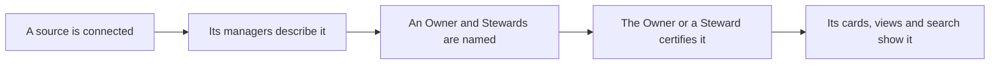

# Describing and Trusting Data

*For the people who look after a workspace's data sources — and for everyone who opens
one and wonders what it is, whether to rely on it, and where it came from.* Each data
source can say what it holds, link to where to read more, carry tags, and wear a badge
that says whether its Owner or Stewards vouch for it and how sensitive its data is.

> **Before you start:** All of this is off until a platform administrator turns on **Data
> source details** in [Feature Switches](/guide/feature-switches). With it off, nothing on
> this page shows — anything already written is kept and comes back when it is turned on.

---

## Where it shows

Open a workspace, go to **Data → Sources** and open a source. **About this data** comes
first on its **Overview**, above **Who to ask about this data**. It shows:

* the **description** — the source's own, or, while it has none, the catalog's, captioned
  **From the catalog**;
* its **links**, each opening in a new tab (only web addresses, `https://` or `http://`,
  are ever followed);
* its **tags**;
* its **status** and **sensitivity**, with who set the status and when ("Certified by Ada
  Okafor · 12 Nov"), and the note that goes with them;
* **How it got here** — when it was connected and by whom, how (from the catalog, started
  blank, from a view package, as a fork, or straight from its provider), and the data
  request it came from, if there was one;
* **Details last edited** — who changed these details last, and when.

The status and sensitivity also show as badges in the source's header, on its card under
**Data → Sources**, and on **What this view is built on** for every view built on it — in
the Explorer's preview and in a view's **About**.

## Who can change what

| What | Who can change it |
|---|---|
| Description, links and tags | Anyone who manages the workspace's data sources — **Edit details**. In the Playground, only the graph's maker. |
| Status, sensitivity and note | The source's named **Owner** and **Stewards** (directly or through a team they are in) and the workspace's admins — **Change status**. Never in the Playground. |

A description can be up to 4,000 characters; a source can have up to 10 links and 20 tags
of up to 40 characters each. Tags are free-form: as you type, the tags already used in the
workspace are suggested, most used first. "Finance" and "finance" are the same tag.

Nobody named yet? **About this data** says **Name an Owner or Stewards so they can certify
it.** to anyone who could. Name them under **Who to ask about this data** (**Name them**).
That card is there whenever data source details or conversations are on — see [Asking
Questions](/guide/asking-questions#ask-about-the-data).

## Certified, In review, Deprecated

| Status | Means | What readers should do |
|---|---|---|
| **Certified** | Its Owner, a Steward or a workspace admin checked it and vouches for it. | Rely on it. |
| **In review** | It is being checked. | Use it with care until it is certified. |
| **Deprecated** | It is on its way out. | Build nothing new on it — the note says what to use instead. |
| *No status* | Nobody has said either way. | Ask the people under **Who to ask about this data**. |

Choose **Change status**, pick a status, and add a **Note** — what was checked, or for a
deprecated source, "Use … instead". A deprecated source's note is shown in red under its
badges, so nobody misses it. Changing the status records you and the time; clearing it
clears both.

## Sensitivity is not restricted publishing

**Sensitivity** says how carefully a source's data must be shared:

* **Public** — fine to share outside the company.
* **Internal** — for people inside the company.
* **Confidential** — only for the teams that need it.
* **Restricted** — the most sensitive data; only named people should see it.

It is a label for people to read. It does not change who can open the source or its views.

The admin's **restricted publishing** setting on a source is something else: it decides
whether a view built on the source needs approval before it is published to everyone. A
source can be labelled **Restricted** without that setting, and the other way round. Hover
the **Restricted** badge and it says so.

## When someone else saved first

If someone changes a source's details while you are editing them, saving says **Someone
changed this — here's the newer version** and shows what they saved. Your changes stay in
the form: save again to replace theirs, or choose **Use theirs** to start again from their
version. **Who to ask about this data** works the same way.

## The Activity tab

A source's **Activity** tab is its history, newest first and a day at a time: when it was
connected, renamed or moved, its description or tags changed, its status set, its contacts
named, and the data request it answered. Each row says who did it. **Show more** goes
further back; history from before a move to this workspace stays with it. A change can take
a few seconds to appear.

## Finding sources

Once a workspace has more than six sources, or any of them is tagged, a filter sits above
**Data → Sources**: type in **Find by name, description or tag**, or narrow the
grid with **Any tag**, **Any sensitivity** and **Any status**. Clicking a tag on a card does
the same. The bar says how many match ("2 of 9"); **Clear** shows them all again.

Search (⌘K) finds a source by its description and tags as well as its name.

## Where to next

- [Workspace Admin](/guide/workspace-admin) — when you add sources to a workspace and look
  after them.
- [Asking Questions](/guide/asking-questions) — when you want to ask a source's Owner and
  Stewards about its data.
- [Requesting Data](/guide/requesting-data) — when the data you need isn't connected yet.
- [Feature Switches](/guide/feature-switches) — when you administer the switch that turns
  data source details on.
