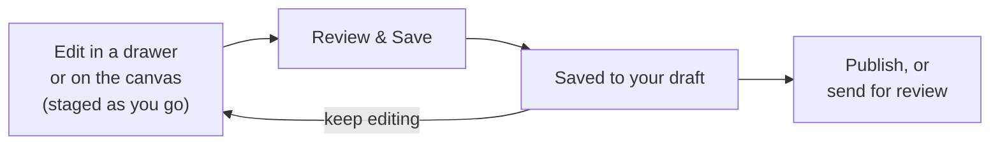

# Editing in a Draft

*For Builders — anyone who changes the data itself.*

This page takes you through changing entities and relationships safely: start
a draft, make your edits in the drawers or on the canvas, save them to your
draft, and send the draft for review. Nothing you do here reaches the version
everyone sees until it's published.

> **Before you start:**
> - Version control must be on — for the deployment and for this data source.
>   See [Is it turned on?](/guide/versioning-change-control#is-it-turned-on-two-levels)
> - The **Edit mode** switch must be on (it is by default). Without it, Views
>   are read-only for everyone.
> - You need permission to manage the workspace's data sources — the
>   **Workspace member**, **Data engineer** and **Workspace admin** roles have it.
> - Edit on a **Context View**. Its header has **Edit** and **Review & Save**;
>   the Graph and Hierarchy canvases show the same drawers read-only.

## How an edit becomes part of your draft

- Every edit is **staged** the moment you make it — press `Enter`, click away,
  flip a switch. A staged edit is kept for review; it is not saved yet.
- **Review & Save** saves everything staged to your **draft** in one go — as
  often as you like — and can go straight on to publishing it.
- Your draft is a working copy of the data source. **Published** — the version
  everyone sees — doesn't change until your draft is published, normally after
  a review in the [Review Center](/guide/review-center).

## Start editing

1. Open a Context View on the data source.
2. In the View's toolbar, choose **Edit** (*Make changes in a draft*).
   The **Start editing** dialog opens: *Edits go to a draft — the published
   view stays untouched.*
3. Choose where your edits go:
   - under **Continue a draft**, select an open draft on this View that you can
     change — yours, or a teammate's; or
   - under **Start a new branch**, choose **Public** or **Private** (it starts
     where your workspace's policy says), optionally type a name, then choose
     **Create & edit**.
4. You're now editing. An amber strip above the canvas shows the draft (*No
   changes yet* at first), and the toolbar shows **Undo**, **Redo**, **Review &
   Save** and **Done**.

You can also start from where you are:

- In an entity's drawer on **Published**, choose **Edit in a draft**.
- In a relationship's drawer, choose **Open a draft**.
- On the Dashboard, **Your work → Unfinished** lists Views where you have an
  unpublished draft; choose **Resume**.

> **If you don't see Edit:** the View isn't a Context View, you can't manage
> this workspace's data sources, or your administrator has turned **Version
> control** off. If **Edit** is greyed out with *Version control isn't set up for
> this data source yet*, see
> [On a data source without version control](#on-a-data-source-without-version-control).

## Change an entity

1. Click the entity on the canvas. Its drawer opens on the **View** tab (in the
   Business view, choose **Details** in the bar at the bottom, or press `Enter`).
2. Change a property right where it is: click its value (or move to it and
   press `Enter`), type, and press `Enter` — or click away. `Shift-Enter` starts
   a new line; ⤢ opens the full editor for long text; a Yes/No switch is kept
   the moment it flips. `Esc` puts the value back.
3. The edit is staged straight away: the row is marked **Edited**, with what it
   was underneath (*was ~~silver~~*; choose ↺ to put it back), the entity gets a
   dashed halo on the canvas, and the footer says how many changes are staged
   on the entity, with **Revert** and **Review & Save**.

Every property says what your draft changed — not only what you just typed:

- **New** (green), **Edited** (orange) and **Removed** (rose, struck through),
  the tree's colours. A hollow dot means *not saved yet*; a solid dot means
  *saved in this draft*. The marks show in the read-only view too.
- **Changes only** narrows the properties to the ones that changed, with how
  many of each (*~2 +1 −1*).
- The drawer opens with a line saying what the draft did to the entity — *In
  this draft · Edited owner · added steward* — and how many fields are staged
  on top.
- **Restore** on a removed property, or ↺ on an edited one, puts it back as it
  is on Published.

To add a property, choose **Add property**:

- As you type the name, the names other entities of the same type carry are
  offered — *owner · 12 others · e.g. Finance* — then names you used recently.
  `↑` / `↓` and `Enter` pick one.
- Type the value as you'd say it: a number, *yes* / *no*, a date or a link is
  stored as one (*read as number*); the type chip changes it.
- **Paste** several `name: value` lines (or two spreadsheet columns) to add them
  all in one step — one **Undo** takes them back. Names already there are left
  as they are.
- `Enter` adds it; `⌘↵` / `Ctrl-Enter` adds it and starts the next. A name that
  is already there offers **Update it instead**.
- **Suggested**, under **Add property**, starts one of those names in one click.
- The **Edit** tab holds the entity's other fields — **Name**, **Business
  label** (the name the business knows it by), **Description**, **Qualified
  name**, **Source system**, **Schema properties** — and each is staged when
  you press `Enter` or leave it.
- **Undo** (`⌘Z` / `Ctrl-Z`) steps back one edit at a time; **Redo** puts it
  back.

To rename an entity without opening its drawer, double-click its row and type.
In the Business view the row shows the business label, so that is the name you
change; in the Technical view you change its **Name**.

### If you leave while typing

Clicking elsewhere stages what you typed. Closing the drawer some other way
while a field still holds typing (`⌘S` / `Ctrl-S` stages it) opens **Unsaved
changes**:

| Choose | What happens |
| --- | --- |
| **Stage and continue** | Your edit is staged for **Review & Save**, then you move on |
| **Keep editing** | You stay where you were. `Esc` means the same |
| **Discard** | Your edit is thrown away, then you move on |

If you try to close the browser tab with an unstaged edit, the browser asks you
to confirm.

## Change many entities at once

1. Select the entities: hold `⌘` (Mac) or `Ctrl` (Windows) and click each one,
   or Shift-click to add a range.
2. In the bar at the bottom of the canvas, choose **Edit N…**. A panel opens on
   the right with how many you hold, of which types, and what they share:

   | It says | Meaning |
   | --- | --- |
   | **Same** | Every one has this value — it's in the box |
   | **Mixed · 7 of 12** | They differ, or only 7 of the 12 have it — the box is empty |
   | **None set** | None of them has it |

3. Change what should be the same for all of them:
   - type a **Description**, or a property's value, to give all of them that
     value (**Leave each as it is** takes a description back);
   - the bin beside a property removes it from all of them;
   - **Add a property to all** adds a new one.
4. Choose **Stage for N**. Each entity's change is staged on its own, as if you
   had edited them one by one — an entity you had already changed keeps that
   change too, and one the edit wouldn't change isn't touched. It is one step
   however many entities you hold: **Undo** on the message (or the toolbar's
   **Undo**) takes the whole edit back.

Outside a draft the same bar says **Details**: the panel shows what they share,
read-only, with **Edit in a draft**. Choosing one entity's own details closes it.

## Change a relationship

1. Click a line on the canvas. The relationship's drawer opens: what it means,
   the two entities it joins, and its properties and history.
2. Choose the **Edit** tab and change its properties.
3. Choose **Stage changes**.

To remove the relationship instead, choose **Delete** in its drawer. The
deletion is staged straight away — it happens when you save, or you can discard
it in **Review & Save**. To turn it round, choose **Reverse direction** next to
**Delete**: it then runs the other way, staged the same way.

Only lineage relationships — the ones your graph's owners author — can be
changed. Rolled-up lines, hierarchy links and other relationship types are
read-only, and the drawer says why.

## Add and connect entities

All of these are staged too — nothing is saved until **Review & Save**.

- **Create an entity:** right-click an empty spot on the canvas and choose
  **Create Entity Here**, or choose **Add entity to** *layer* (the **+** at the
  top of a layer). The **Add entities** panel opens: pick the type, type a
  name, then choose **Add** — or **Add & nest inside** to create the next
  entity inside it. **Paste a list** adds many at once.
  - Click an entity that is already on the canvas while you add, and the panel
    steps aside for its details — kept exactly as you left it. **Continue
    adding** (at the bottom of the canvas, with how many you've added) brings
    it back; **Add inside** *entity* brings it back adding inside that entity;
    closing the details brings it back too. An entity you just added opens in
    the panel itself.
- **Add a child:** choose the **+** on an entity's row (**Add child entity**),
  or right-click the entity and choose **Add Child Entity**.
- **Connect two entities — no dragging needed:** click the **+** on an
  entity's row (it appears as you hover), then click the entity the link goes
  to. Nothing is held down in between, so you can scroll, jump with the Layer
  Strip or search for a target that's off screen. A strip at the top of the
  canvas says what it's waiting for, and the entity under your pointer is
  ringed green when a relationship can join them — or red, with the reason,
  when none can. `Esc` backs out one step at a time. You can still drag from
  the **+** to the target, or right-click an entity and choose **Connect To…**
  or **Link to…**. **Connect** in the toolbar turns the tool on too, in either
  view.
  - When only one relationship type fits, the link is made at once, and the
    message that confirms it offers **Undo**. Otherwise pick the type — only
    the types your [semantic layer](/guide/semantic-layer) allows are offered.
  - To link one entity to several, hold `⌘` / `Ctrl` and click each target,
    then press `Enter` (or **Link N**).
  - For many links in a row, turn on **Connect** in the toolbar (or press `C`
    with nothing selected): click where a link starts, then where it goes, and
    repeat. **Done** or `Esc` turns it off.
- **Copy:** right-click an entity and choose **Duplicate…** (`⌘⇧D` /
  `Ctrl-Shift-D`). It opens ready to make a quick copy of the entity and
  everything inside it, beside the original, with the copy's name selected:
  `Enter` makes it, or type a new name first. Or choose: the entity alone or
  with everything inside it, the links inside the copy, its **Incoming**
  relationships (what feeds the original feeds the copy too) and its
  **Outgoing** ones (the copy feeds what the original feeds), each counted
  before anything is staged. `⌘D` / `Ctrl-D` makes the quick copy without
  asking. The message that confirms a copy offers **Undo**. A copy of more than
  2,000 entities, or more than 500 relationships either way, is too big to make
  in one go and the dialog says so.
- **Move or remove:** right-click an entity for **Move to Layer** and
  **Delete**; right-click a line for **Edit Edge**, **Reverse Direction** and
  **Delete Edge**.

**Undo** (`⌘Z` / `Ctrl-Z`) and **Redo** (`⌘⇧Z` / `Ctrl-Shift-Z`) step through
your staged edits.

## Change the layers

In a draft you can also reshape the View's columns. These change the View,
not the data: they appear in **Review & Save** as layout changes, and **Undo**
takes them back.

- **Insert a layer anywhere:** right-click a column's header — or its pill in
  the **Layer Strip** at the bottom of the canvas, which is always in reach —
  and choose **Insert layer to the left** or **Insert layer to the right**. Or
  hover a header and choose the **+** at its left edge, between it and the
  column before. The new layer appears right there with its name ready to type.
- **Rename, recolour or move a layer:** the same menu offers **Rename**, a row
  of colours, and **Move left** / **Move right**. You can also drag a column's
  header onto another.
- **Delete a layer:** choose **Delete layer** in its menu. Its hand-placed
  entities move to the first remaining layer, and the message that confirms it
  offers **Undo**.
- **Add a layer at the end:** choose **Add layer** after the last column.
- **Edit a layer's settings:** choose **Layer settings…** in its menu. A panel
  opens beside the canvas with the layer's essentials — name, description,
  colour and icon — then its **Custom properties**, which its card shows every
  reader, and under **More**, **Show unassigned entities** and **Delete layer**.
  **Stage changes** keeps what you changed for **Review & Save**.
- **In the Business view**, a column's header keeps to the layer itself: its
  name, count and sort. Choose **⋯** on the header for the layer's menu, which
  also holds **Add entity**, **New group** and **Build a lot at once**.
- **Place entities that have no parent:** choose **More** (`⋯`) → **Entities
  with no parent…** (in the Technical view, **Display → Advanced**). The panel
  lists them, and you place each one in a layer.

Outside a draft, the menu says layers change in a draft and offers **Start
editing to change layers**. **Layer details…** shows a layer's settings,
read-only.

## Review & Save

1. In the toolbar (or an entity's footer), choose **Review & Save** — it shows
   how many edits are waiting. **Review & Save Changes** opens and says what
   you're changing: *You're changing 3 entities and 2 relationships.*
2. Check them — there may be a handful or tens of thousands:
   - **List** has one row per entity, relationship or layout change, saying
     what it does in words — *Renamed orders to Orders v2*, *Connected Orders →
     Sales*. The selected one shows beside the list: each field and property it
     changes, before and after, as the value it is (tags as added and removed
     chips, dates, links, Yes/No), a move's from and to, or what a delete
     takes with it. **‹ ›** (or `J` / `K`, the arrow keys, `Home` / `End`) move
     through them — *312 of 1,240* says where you are. **Show on canvas** goes
     to it; **Step through** walks the changes shown on the canvas (see
     [Step through changes on the canvas](#step-through-changes-on-the-canvas));
     the bin (or `Delete`) discards it (**Redo** brings it back).
   - Narrow what's shown: **All / Entities / Relationships / Layout**,
     **Added / Modified / Removed**, a type, or a search (`/`). **Needs
     attention** shows only changes a save refused or that conflict. *1,240
     shown of 10,482* says how many are left; **Discard the N shown** discards
     just those.
   - **Map** draws the changes shown, with the entities they hang off faded
     behind them. Past 200 entities it groups them by type and kind of change —
     *Table · 4,812 edited* — with the relationships between the groups
     summed; choose a group to list just those.
   - **Hierarchy** lays the same changes out under their containers — a
     database, then its schemas, then its tables — each container saying how
     many changes sit inside (*240 inside ~179 +60 −1*). Open one with →, step
     back with ←. Search or narrow, and each change shown says where it sits;
     **In hierarchy** opens the way down to it. Changes on entities the canvas
     hasn't loaded sit under **Elsewhere in the graph**. **Hierarchy**, **List**
     and **Map** are one choice, remembered.
   - **Already saved on this draft** lists what earlier saves and imports
     changed, a page at a time — it is published with the rest. To take a saved
     change back out of the draft, choose ↺ (**Discard this change from the
     draft**) on its row, or **Discard the N shown** when you've narrowed the
     list. Each goes back to how it was when the draft began, in one new save;
     if others hold it together (a new entity's links, a removed table's
     columns), you're asked first and they go with it.
3. Under **Where should these go?** choose:
   - **Save to draft** — save and keep working; save again whenever you like.
   - **Save & publish** — save, then publish straight away (if you may).
   - **Save & send for review** — save, then raise a review request.
4. Choose **Save N changes** (or **Save & continue to publish / review**).
   *Saved to draft.* confirms it. If you chose to publish or review, the same
   dialog moves on to **Publish** — see
   [Submit your draft for review](#submit-your-draft-for-review); **Not now**
   leaves everything saved on the draft.

A very large save — more than 20,000 changes at once, say after a bulk edit —
is sent in parts and then written as **one** save on the draft, all or
nothing, as any save is. The button says how far it has got: *Uploading 38 of
120 MB…*, then *Writing one commit…*. If the connection drops or you reload
part-way, saving again picks the upload up where it stopped and never saves
the same changes twice. Up to 200,000 changes go in one save; past that, save
part of them, then the rest.

**Cancel** closes the dialog and keeps your edits staged. **Discard all**
throws every staged edit away. With nothing staged but changes saved on the
draft, **Review & Save** opens straight on **Publish**.

> **If it says "Nothing was saved":** the whole save was refused because some
> changes need attention — for example, a relationship your semantic layer
> doesn't allow. Each problem is listed with its reason. Fix it, or choose
> **Discard this change**, then save again.

### Read the canvas while you edit

| On the canvas | Means |
| --- | --- |
| Solid ring (or, on a relationship, a solid halo) | Saved to this draft — an import's changes too |
| Dashed halo | Edited, but not saved yet |
| Green / orange / rose | New / edited / deleted |
| A coloured stripe on a closed row | Something inside it changed — including new children an import added that aren't loaded yet |
| A deleted entity still in its place | A deletion saved to this draft stays visible, marked in rose, until the draft is published. Its drawer says **Deleted in this draft**, and **Restore** brings it back |

**Committed**, in the amber strip, hides or shows the rings for changes already
saved to the draft. After an import they're shown, and a message says what the
import added, updated and removed — **Review changes** lists them, a page at a
time.

### Step through changes on the canvas

To see each change where it sits, choose **Step through** in **Review &
Save**, **Show** on a row of a change list, or the change counts in the amber
strip. A bar at the bottom of the canvas says *Change 12 of 10,482*, with the
entity's name and what happened to it; each step opens it on the canvas and in
its details. **‹ ›** (or `J` / `K`, `[` / `]`) step; **Unsaved / Saved / All**
chooses which changes; `Esc` or ✕ stops. One the view doesn't show says **Not
in this view** — **Skip** goes on to the next.

## When someone else changed the same thing

Two people can edit the same entity. {brand} never overwrites someone else's
work silently — it asks you.

**While saving.** If someone changed fields you also changed since you opened
them, the save is refused — *Nothing was saved — a change conflicts with edits
made since you opened it* — and **Review & Save** opens on the changes
concerned:

1. Each conflicting change says how many fields were changed by someone else,
   and shows each field's value when you opened it (*was …*).
2. For each field, choose **Yours** or **Theirs** — or use **Keep all mine** /
   **Use all theirs**.
3. Choose **Use these values**. Everything else either of you changed is kept.
4. Choose **Save N changes** again.

If the entity was deleted meanwhile, the change says so; choose **Drop this
change**.

**When Published has moved on.** If someone publishes while you work, a banner
says *Updates available — N new changes on the Published version*. **What
changed** lists them. Choose **Get latest updates** to bring them into your
draft; your own unsaved edits are kept. Where both sides changed the same
field, **Review changes from main** asks you to keep **your version** or take
the **incoming** one (**Keep all mine**, **Take all incoming**), then **Merge
with resolutions**.

## Your draft

- **In the Business view**, the version menu shows once you're in a draft. On
  Published, **More** (`⋯`) → **Your drafts…** opens your drafts, and **More →
  Changes & history…** opens a draft's changes, or the published history, its
  reviews and data health.
- **Switch versions.** The version menu in the toolbar shows **Published** or
  your draft's name. It lists **Published**, then **Your drafts**, **Shared
  with you** and **Public drafts**, each marked with a globe (public) or a lock
  (private), and offers **New draft** and **Manage all drafts**. An amber dot
  means Published has moved on since the draft started.
- **Rename or describe it.** In the version menu, choose **Draft settings**
  next to a draft: change its **Name** and **Description**, or copy its
  **Shareable link**. Choose **Save changes**.
- **Choose who can see it.** Under **Who can see it** in **Draft settings**,
  the owner or a maintainer makes the draft **Public** — everyone who can see
  the data source sees it, and everyone who can edit it can change it — or
  **Private** — only you, the people you add, and its reviewers. Making it
  private first saves, under their own names, the unsaved edits of anyone who
  would lose access; the dialog names them. If their edits clash with the
  draft, nothing changes and the dialog says whose they are. Your workspace
  may allow only one level.
- **Share it.** **Draft settings** also lists the draft's **Members**. Its
  owner and maintainers add a person or group as a **Viewer**, **Editor** or
  **Maintainer**, change a role, or remove someone. Removing someone, or making
  them a viewer, saves what they had staged first.
- **Hand it on.** Under **Hand it on**, the owner picks a new owner and chooses
  **Hand on**. They stay on as a maintainer unless they untick **Stay on as a
  maintainer**. A workspace admin can hand on the drafts of someone who left
  the workspace (see [Drafts and reviews](/guide/versioning-change-control)).
- **See who else is on it.** The amber strip shows who saved into the draft,
  and says when someone else saves into it — *Bob saved 3 changes*. If you
  have nothing unsaved, their changes show at once; otherwise choose
  **Refresh** when you're ready.
- **Stop editing.** **Done** leaves the draft and returns you to Published.
  The draft is kept — nothing is discarded. If you still have staged edits,
  **Review & Save** opens instead: save or discard them first.
- **Throw it away.** The bin icon in the amber strip (**Discard draft**) asks
  *Discard this draft? All its changes will be abandoned.* It can't be brought
  back.
- **Idle drafts.** By default, a draft nobody has saved to for 30 days is
  discarded automatically, just as if someone had chosen **Discard draft**.

Everyone who can see the workspace's data sees its public drafts, and everyone
who can edit it can continue them. A private draft is seen only by its owner,
its members and its reviewers — managing the workspace doesn't open it. Someone
else's draft that you can't change opens read-only. **Published** never shows
a draft's changes until it's published.

## If you come back later

Staged edits you haven't saved yet are kept **in this browser**. When you open
the View again on the same draft, a banner says *Restored N unsaved changes
from your last session.* Carry on, choose **Discard all** to drop them, or
close the banner to hide it.

Changes you saved with **Review & Save** are in the draft itself, so they're
there on any device.

If what you have staged is more than this browser can keep, a message says so
— *too large to keep across a reload* — and nothing older is restored in its
place. Save it to the draft to keep it.

## Submit your draft for review

> **Tip:** edits that are only staged aren't part of the draft. In **Review &
> Save**, choose **Save & publish** or **Save & send for review** to save them
> and go on in one step — or, from **Publish**, choose **Review & Save them,
> then publish**.

1. Choose **Publish** in the amber strip (it shows once the draft has
   something to publish), or arrive here from **Review & Save**. It summarises
   what the whole draft changes, including any Views it creates or changes.
2. Give it a **Title** — what changed, in a sentence (from **Review & Save** it
   starts with one taken from what you saved) — and, optionally, a
   **Description** with context for reviewers.
3. Choose **Submit for review**. *Sent for review.* confirms it, and the
   [Review Center](/guide/review-center) opens on your request. Its address
   links straight to the request — send it to whoever should review it.

**Publish now** skips the review and sends the draft straight to Published;
the banner *Published — your changes are now live* confirms it. Use it only
where your team doesn't expect a review — see
[Ways of Working](/guide/ways-of-working).

If the draft already has a review request, the dialog says **Already in
review**: everything you've saved since is part of that request, so there's
nothing to submit — choose **View review**. **Publish now** is still there,
but it asks again (**Publish anyway**), because the open review would be
closed as merged without its reviewers seeing it.

If Published has moved on, you're asked to **Get latest updates** before you
can publish. If **Publish now** finds that Published changed the same things
as your draft, the dialog says so: choose **Submit for review** instead, and
the conflicts are resolved when the request is merged.

## After you publish: is it live yet?

Publishing records your changes straight away, then writes them to the graph
that Views read. The chip beside the data source's name, under the View's name,
tells you where that has got to:

- **In sync · v12** — the latest published version is in the graph.
- **Catching up · 2 versions behind** — it's being written; give it a moment.
- **Summaries updating** — the graph is current and its lineage roll-ups are
  being rebuilt.

Click the chip for details and **Check again**. People who can manage data
sources also get **Open Data health**.

## On a data source without version control

A data source without version control can be read, explored and exported, but
not edited here:

- **Edit** is greyed out: *Version control isn't set up for this data source
  yet*.
- An entity drawer's **Edit** tab is greyed out with the same reason, and
  relationships can't be edited.
- The server refuses any change sent to it anyway.

If you can manage the workspace's data sources, the strip above the canvas
offers **Enable version control** — see
[Turn on version control for a data source](/guide/versioning-change-control#turn-on-version-control-for-a-data-source).

If your administrator has turned **Version control** off for the whole
deployment, **Edit**, drafts and reviews disappear everywhere. If they've turned
**Edit mode** off, entities and relationships can't be changed even in a draft.

## Where to next

- [The Review Center](/guide/review-center) — when your draft is submitted, or you've been asked to review someone else's.
- [Versioning & Change Control](/guide/versioning-change-control) — when you need to undo a published change or roll the graph back.
- [Import & Export](/guide/import-export) — when you have too many changes to make by hand.
- [The Semantic Layer](/guide/semantic-layer) — when the type or relationship you need isn't offered.
