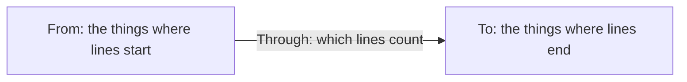

# Finding Connections

*For Viewers, and anyone asking how things link up.* Most searches find
**things**: tables, columns, jobs, dashboards. A **Connections** search finds
the **lines between them**: every connection from the things you describe to
the things you describe next, each with both of its ends. Use it to answer
questions such as *"what flows from this table into the Reporting layer?"* or
*"which fields called bob link to anything in the Smith family?"*. This page
explains what a connection is, walks you through your first search, and gives
worked examples you can copy.

> **Before you start:** open a View and press `⌘⇧F` / `Ctrl+Shift+F` to open
> the **Advanced Search** panel. A Connections search uses the same filters as
> any other search, so if you've never built one, the five-minute
> [Get started](/guide/advanced-search#get-started-in-5-minutes) helps.
> Searching never changes any data, so try anything.

## What a connection is

Everything on a canvas is either a **thing** (an *entity*: a table, a column,
a job, a dashboard, a tag) or a **line** joining two things (an *edge*, which
this page calls a **connection**). Every connection has:

- a **start** and an **end**: the thing it comes from (its *source*) and the
  thing it goes to (its *target*), in the direction the data source keeps it;
- a **kind** (its *edge type*), such as **Produces**, **Transforms**, **Tagged
  with** or **Contains**;
- sometimes **details of its own**, such as a `confidence` score.

| A connection | Starts at | Kind | Ends at |
| --- | --- | --- | --- |
| The job `daily_load` produces the dataset `orders` | `daily_load` | Produces | `orders` |
| The column `order_total` feeds the column `revenue` | `order_total` | Transforms | `revenue` |
| The dataset `orders` is tagged PII | `orders` | Tagged with | `PII` |

A Connections search lists every connection that fits your description,
counted exactly, and lights each one up on the canvas.

## Which search do I need?

| You want | Use | You get back |
| --- | --- | --- |
| Things that match: *"datasets tagged PII"* | An ordinary search: **Find → Entities** | The datasets |
| Things linked to something: *"datasets that feed a dashboard"* | **Entities**, with a [relationship](/guide/advanced-search#relationships) filter such as **Feeds…** | The datasets, not the lines |
| The lines themselves: *"every line from `fact_orders` into the Reporting layer"* | **Find → Connections** (this page) | Each line, with both of its ends and the containers they sit in |
| Routes through several steps: *"every way from this topic to that dataset"* | **Paths from A to B**, under **Add filter → Advanced** | Routes, each a chain of lines |

## Your first connection search

This walk-through finds *every connection from the table `fact_orders`, or
anything inside it, into the **Reporting layer***. Use names from your own
View as you follow along.

1. **Open the panel.** In the View, press `⌘⇧F` / `Ctrl+Shift+F`. The
   **Advanced Search** panel opens beside the canvas.
2. **Switch to Connections.** In the query card's first row, beside **Find**,
   click **Connections**. The card now has three parts: **From**, **Through**
   and **To**, and each end reads **any entity** until you narrow it. Any
   filters you'd already added move into **From**.
3. **Say where the connections start.** Under **From**, click **Add filter**,
   type `inside` and choose **Inside a container named…**. In the box that
   appears, type `fact_orders` and pick it from the list. From now reads
   *Is inside "\*\* / fact_orders"*, and the number beside it says how many
   things it matches: `fact_orders` itself and everything inside it.
4. **Say where they end.** Under **To**, click **Add filter**, type `layer`,
   choose **In layer…** and pick **Reporting layer**.
5. **Leave Through as it is** for now: **Any link**, **From → To**. It says
   which lines count, and which way they point; [Through](#through) explains
   the choices.
6. **Let it run.** With **Auto** on (the default) the search runs a moment
   after your last change; with **Manual**, click **Run**.
7. **Read the answer.** The match bar says how many connections there are,
   the list shows each one, and the canvas lights up the lines that carry
   them. The next section explains what you see.

> **If you don't see Connections:** when the panel opens over an answer, it
> shows the results first and folds the query away. Click **Refine** in the
> panel's header to bring the query back: **Find** is in its first row. If the
> panel itself is missing, see
> [Advanced Search](/guide/advanced-search#where-to-find-it).

## Reading the answer

### The list

Above the results, one sentence says what you asked — *Connections from
anything that is inside "\*\* / fact_orders" to anything where layer is
"Reporting layer", through any link*. Below it:

- **The match bar** says how many connections matched — **8 connections** —
  and holds the canvas controls: **‹ ›** (or `J` / `K`) step through the
  connections, **Highlight**, **Isolate**, **Hide** and **Frame** work as for
  any search, **Export** saves them all to a file, and **×** clears the
  search.
- **One row per connection**: where it starts, its kind, and where it ends,
  each end with the container it sits in — *customer_key* in *fact_orders* →
  **Transforms** → *unique_customers* in *rpt_daily_revenue*. Hover the kind
  to see the connection's own details.
- **On each row**: **Show both ends on the canvas**, a click on either name to
  open that thing, and **Copy the edge's id**.
- **Narrow to** chips appear when the connections are of more than one kind,
  each with its exact count. Click one to see only that kind (it sets
  **Through** for you); click it again to see every kind.
- **Load more** brings the next page of connections, and **Load all** keeps
  going until every one is listed.

### On the canvas

The canvas lights up the **lines that carry your connections**, and dims the
rest. Each lit line has a **badge** saying how many of your connections it
carries.

- **When containers are closed**, one line between two containers can carry
  many connections: here the badge says **8** for the eight connections
  folded inside it. This works even where no summary of those containers'
  connections has been built yet.

  

- **Open a container** and the light moves to the rows inside it, down to the
  exact lines.

  

- **8+** means *at least 8*: more pages of connections are still to load.
- **Very many lines?** Up to 1,000 lit lines are drawn. Past that, a chip on
  the canvas says how many more matched lines weren't drawn.
- **A kind of line you've hidden** in the **Flows** panel stays hidden. The
  match bar says so — *8 of these connections are of a type hidden on the
  canvas* — and **Show them** brings that kind back for this View.
- **Containment** connections ("this contains that") light up their two ends
  only, because the canvas draws containment as one box inside another rather
  than as a line.

### In Search Studio, and as a file

**Search Studio** (⤢ in the panel's header) shows the connections as a table:
**Source**, **Source parent**, **Type**, **Target** and **Target parent**.
The **Edge properties** above the table add a connection's own details as
columns. Tick rows to **Frame on canvas** or **Copy as CSV**.

**Export** in the match bar saves every connection to a **CSV** file (opens in
any spreadsheet) or an **NDJSON** file. Each row has the connection's key, id
and kind; its source and target, each with its parent; and its details as one
**Properties (JSON)** column. Add any detail, such as `confidence`, as a column
of its own.

## Worked examples

Each example shows the ways to ask it: in the **Form**, in plain words with
**Ask**, and in **Code**. To ask in plain words, click **New** on the query
card and type into **Or ask in plain words…**: a question about connections
switches the card to Connections by itself. Use whichever way you're
comfortable with. The Form and Code show the same search, so you can switch
between them at any time.

### A table, or anything inside it, into a layer

*"Every connection from `fact_orders` or anything inside it, to the
Reporting layer."*

- **Form:** **From** → **Inside a container named…** `fact_orders`. **To** →
  **In layer…** **Reporting layer**.
- **Ask:** `connections from anything inside fact_orders to the reporting layer`
- **Code:** `from(inside @"**/fact_orders") to(layer:"Reporting layer")`

**Inside a container named…** counts the container itself as well as
everything in it. Ask reads *inside fact_orders* as the things inside it, not
the table itself. For the table's own connections only, use **Is a named
entity…**.

### Things with certain details, to anything whose parent has a detail

*"Every connection from a field whose `dataType` is `string` and whose
`first_name` is `bob`, to anything whose parent's `family` is `smith`."*

- **Form:**
  - **From** → **Property compares to…** `dataType` **is** `string`, then
    **Add filter** again → **Property compares to…** `first_name` **is**
    `bob`. Two filters in one end must both match.
  - **To** → **Is directly inside…** (its parent, one level up), then on that
    card **Add a condition on them** → **Property compares to…** `family`
    **is** `smith`.
- **Code:** `from(dataType = string AND first_name = bob) to(parent(family = smith))`

### Anything under one thing, to anything whose parent is another

*"Every connection from `fact_orders` or anything inside it, to anything
sitting directly inside `rpt_daily_revenue`."*

- **Form:** **From** → **Inside a container named…** `fact_orders`. **To** →
  **Is directly inside…**, then **Add a condition on them** → **Is a named
  entity…** `rpt_daily_revenue`.
- **Code:** `from(inside @"**/fact_orders") to(parent(@"**/rpt_daily_revenue"))`

For anything inside it at any depth, use **Inside a container named…** in To
as well.

### Match an end by name, by a detail, or both

In these examples the connections end in the Gold layer; change **To** to
suit.

| To match From… | Add to From | Code |
| --- | --- | --- |
| By name | **Name contains…** `first_name` | `from(first_name) to(layer:Gold)` |
| By a detail | **Property compares to…** `dataType` **is** `string` | `from(dataType = string) to(layer:Gold)` |
| Both must be true | Both filters (filters in one end join with **AND**) | `from(first_name dataType = string) to(layer:Gold)` |
| Either will do | Both filters, then click the **AND** between them to make it **OR** | `from(first_name OR dataType = string) to(layer:Gold)` |
| Leave some out | A **NOT group** around what to leave out | `from(type:schemaField NOT tag:Deprecated) to(layer:Gold)` |

Every end can hold as many filters as you need, in groups, exactly as an
ordinary search can.

### Only one kind of connection

*"Every Produces connection from a job to a dataset tagged PII."*

- **Form:** **From** → **Entity type is…** **dataJob**. **Through** →
  **These edge types…** → **Produces**. **To** → **Entity type is…**
  **dataset**, and **Tag is…** **PII**.
- **Ask:** `connections from data jobs to datasets tagged PII through produces`
- **Code:** `from(type:dataJob) to[PRODUCES](type:dataset tag:PII)`

### Either way round

*"Every connection between datasets and jobs, whichever way it points."*

- **Form:** **From** → **Entity type is…** **dataset**. **To** → **Entity
  type is…** **dataJob**. **Through** → **Either way**.
- **Ask:** `connections from datasets to data jobs either way`
- **Code:** `from(type:dataset) linkedTo(type:dataJob)`

Each connection is listed once, and its row still shows which way it really
points.

### Only connections that meet a condition

*"Column-to-column lineage that's at least 80% confident."*

- **Form:** **From** and **To** → **Entity type is…** **schemaField**.
  **Through** → **Lineage**, then **Add edge filter** → `confidence` **is at
  least** `0.8`.
- **Code:** `from(type:schemaField) to[lineage](type:schemaField).via(confidence >= 0.8)`

### Everything that arrives in a layer

*"Every connection into the Gold layer, from anywhere."*

- **Form:** leave **From** empty, so it reads **any entity**. **To** → **In
  layer…** **Gold**.
- **Code:** `from() to(layer:Gold)`

### From one layer to another

*"Every connection from the Silver layer to the Gold layer."*

- **Form:** **From** → **In layer…** **Silver**. **To** → **In layer…**
  **Gold**.
- **Ask:** `connections from the silver layer to the gold layer`
- **Code:** `from(layer:Silver) to(layer:Gold)`

## The building blocks

### From and To

**From** says where the connections start and **To** where they end. Each is
an ordinary search of its own: add filters exactly as you would on the
[Advanced Search](/guide/advanced-search#building-a-query) page, and the
number beside the end says how many things it matches. An empty end reads
**any entity** and matches everything. With both ends empty, the search waits
until you pick edge types under **Through**, so it never lists every line in
the View by accident.

| To describe a thing by… | Choose | For example |
| --- | --- | --- |
| Its name | **Name contains…** | name contains `orders` |
| What kind of thing it is | **Entity type is…** | Column |
| A tag | **Tag is…** | PII |
| A detail (property) | **Property compares to…** · **Has property…** | `dataType` is `string` |
| The layer it's in | **In layer…** | Reporting layer |
| A container it's in, or that container itself | **Inside a container named…** | `** / fact_orders` |
| One particular thing | **Is a named entity…** | `Country / United Kingdom` |
| Its parent (one level up) | **Is directly inside…** | a parent whose `family` is `smith` |
| Any container above it | **Is inside…** | inside a domain called Finance |
| What it holds | **Directly contains…** · **Contains, at any depth…** | a table holding a PII column |
| What feeds it, or what it feeds | **Is fed by…** · **Feeds…** | fed by a topic, up to 3 steps |
| Several conditions together | Join filters with **AND** (all) or **OR** (any) | named like `customer` AND tagged PII |
| What to leave out | A **NOT group** | not tagged Deprecated |

A name path such as `** / fact_orders` finds the name anywhere in the View;
`Country / United Kingdom` follows the containers from the top. Because names
mean the same everywhere, a search that uses them keeps working in other
Views.

An end can't hold a route (**Paths from A to B** or **Within N hops of…**) or
lineage followed more than 3 steps: a connection is one line, so those belong
in an ordinary search.

### Through

**Through** says which lines count, and which way they point.

| Choose | Which lines count |
| --- | --- |
| **Any link** *(the default)* | Every line except the hierarchy's (what contains what): lineage, tags, glossary terms, jobs and the rest |
| **Lineage** | Only the lines data flows along |
| **Containment** | Only "contains" lines: what holds what |
| **Any edge** | Every line, the hierarchy's included |
| **These edge types…** | Only the kinds you pick, such as **Produces** |

| Which way | Finds |
| --- | --- |
| **From → To** *(the default)* | Lines that start at From and end at To, the way the data source keeps them |
| **Either way** | Lines between them in either direction, each listed once |

**Only edges where…** adds conditions on the connection itself. Click **Add
edge filter** and pick one of the connection's own details, such as
`confidence` **is at least** `0.8`.

### The numbers beside each end

Before anything runs, **From** and **To** each say how many things they match:
*9 entities*, *23 entities*. If one says **0**, no connection can start (or
end) there, so loosen that end first.

## Other ways to write it

The **Form**, the cards described above, is the best place to start. The
query card's other views show the same search, and you can switch at any time
without losing anything:

- **Sentence**: the search read as sentences — a map of **From** → **To** with
  each end's count, then a sentence for each end. Click any highlighted word
  to change it.
- **Ask**: click **New** and type a question in **Or ask in plain words…**.
  Before anything changes, it reads the question back under **Reads as**, and
  shows how it read each word you can pick another reading for. **Enter**
  runs it.

  | Say | For example |
  | --- | --- |
  | `connections from` ‹things› `to` ‹things› | `connections from datasets to dashboards` |
  | … `through` ‹a kind, or lineage› | `connections from columns to columns through lineage` |
  | … `either way` | `connections from datasets to data jobs either way` |

  `edges`, `links` and `relationships` work as well as `connections`. Each
  end is read the way Ask reads any question, so *"columns tagged PII"* or
  *"anything inside fact_orders"* works as an end.

  

- **Code**: type the search.

  | Write | It means |
  | --- | --- |
  | `from(A) to(B)` | Connections from A to B, through any link |
  | `from(A) to[PRODUCES](B)` | Only Produces connections. A class works too: `[lineage]`, `[links]`, `[any]`, `[containment]` |
  | `from(A) linkedTo(B)` | Either way |
  | `from(A) to(B).via(confidence >= 0.8)` | Only connections that meet the condition |
  | `from() to(B)` | From anything, to B |

  A connection is the whole query: put every other condition inside its ends.
  **Examples** in Code mode has three ready-made ones.

> **Tip:** Ask understands the names your View uses. If a word is searched for
> as a name instead — *jobs*, say, where the View calls them *data jobs* — use
> the View's own word.

**What this means**, at the top of the card, sums the search up in one line.

## Saving, sharing and reusing

- **Save** a Connections search like any other, for yourself or for everyone
  on the View. In the **Library** it carries a **Connections** badge.
- **Undo** steps back through your changes, the switch between Entities and
  Connections included. Switching back to **Entities** keeps your From
  conditions, and a note names anything left out — *Left out: the To
  conditions. Undo brings it back.*
- **Tag** (making a display rule) is greyed out for a Connections search: a
  display rule colours things, not lines. Make the rule from the From or To
  conditions as an ordinary search instead; see
  [Display Rules](/guide/display-rules).

## Tips

> **Tip:** Build one end at a time. Add From, check its number, then add To.
> A surprising number tells you straight away which end to fix.

> **Tip:** Not sure which way your lines point? Choose **Either way**. Each
> row still shows the real direction, so you can switch back once you know.

> **Tip:** Start with **Any link**, then use the **Narrow to** chips to see
> which kinds of connection you have before you pick one under **Through**.

## When nothing matches

An empty answer shows **No connections**, says why, and lists fixes under
**Try**, each one click to apply:

- *Nothing meets From, so no edge can start there — loosen its conditions*
  (or the same for **To**): that end matches nothing, so fix it first.
- *No edge joins what From and To find, through the edges asked for*: both
  ends match things, but no line joins them. The fixes offered are:
  - **Either way — the edges may be stored the other way round**;
  - **Through any link**, if you'd picked a kind of line;
  - **Without the edge condition**, if you'd added one.

Still nothing?

- **Check where the search runs.** **All nodes in this view** is the default;
  **Entire data source** looks past the View's edges. See
  [Where the search runs](/guide/advanced-search#where-the-search-runs).
- **Check the detail's name and value** in the entity's details panel. A value
  kept only inside an entity's raw properties isn't searched by either end.
- **Lines listed but not lit?** Their kind may be hidden in the **Flows**
  panel: the match bar offers **Show them**.

## Questions people ask

**Can a Connections search change anything?** No. Searching only reads.

**How many connections can it find?** Every one, counted exactly. The list
loads them a page at a time (**Load more**, **Load all**), and the canvas
lights the lines for the first 2,000 loaded.

**Can it follow a chain of lines, such as A → B → C?** Not yet: it finds
direct connections, one line from a From thing to a To thing. Following
several lines is planned. Today, use **Paths from A to B** for routes, or a
relationship such as **Feeds…** with **Steps** for *things* several steps
away.

**Why does one line show a badge of 8?** The canvas draws one line between two
closed containers, however many connections run between what's inside them.
The badge counts yours. Open the containers to see each one.

**Why do some rows have no lit line?** The line may be of a kind hidden in
the **Flows** panel, its ends may sit outside the View, or there were more
than 1,000 lit lines to draw.

**Why can't I make a display rule from it?** A display rule colours things,
and a Connections search finds lines. Make the rule from its From or To
conditions.

**Can I run one from a share link?** No: a share link says *This link can't
follow lineage or relationships: they lead outside its view*. Open the View as
a member of its workspace instead.

**Why didn't a detail match?** Each end reads the details each thing keeps
as its own. A value kept only inside a thing's raw properties isn't searched.

## Words used on this page

| Word | What it means |
| --- | --- |
| **Entity** | A thing in the graph: a table, a column, a job, a dashboard, a tag. |
| **Connection** (edge) | One line between two entities. |
| **Kind** (edge type) | What a connection means, such as **Produces** or **Tagged with**. |
| **Start** and **end** (source and target) | Where a connection comes from and goes to, as the data source keeps it. |
| **From** and **To** | The two halves of a Connections search: where its connections start and end. |
| **Through** | Which kinds of connection count, and which way they point. |
| **Either way** | Count connections in both directions, each once. |
| **Container** / **parent** | The thing another sits inside, such as the table a column belongs to. |
| **Layer** | One of a Context View's columns, such as **Gold** or **Reporting layer**. |

More words are in the [Glossary](/guide/glossary).

## Where to next

- [Advanced Search](/guide/advanced-search) — every filter, saved searches,
  Search Studio and Code mode in full.
- [Reading Lineage](/guide/reading-lineage) — what the lines and boxes on a
  canvas mean.
- [Display Rules](/guide/display-rules) — colour every entity a search finds.
- [Search & Display Rules: developer reference](/docs/feature-search-and-rules-reference#connections-edges-as-results)
  — run a Connections search from a script.
