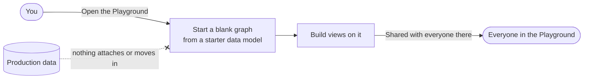

# The Playground

*For anyone who wants to try {brand} out — and for the platform administrators who set it up.*
The Playground is a common area. Anyone who can sign in opens it and builds
graphs, proofs of concept and experiments of their own from blank, explores them
in views and sees what everyone else made — without access to any team's
workspace or its data. This page explains what you can do there, what keeps it
apart from production, and how an administrator sets it up.

> **Before you start:** The Playground is off until a platform administrator turns
> on **Playground** in [Feature Switches](/guide/feature-switches) and sets it up.
> If you don't see **Playground** in the sidebar, it isn't on yet.

---

## Open the Playground

Click **Playground** in the sidebar. You'll also find it:

* on your **Dashboard**, if you aren't in a team workspace yet;
* at the top of **Workspaces → Your workspaces**;
* behind any link someone shares to it.

There is nothing to ask for. The first time you open it you become a **Playground
member** — recorded like any other access, so administrators can see it — and the
Playground opens.

Being in the Playground gives you nothing anywhere else: you still ask to join a
team's workspace the usual way (see [Requesting Access](/guide/requesting-access)).

## Start a graph of your own

The Playground opens on **Your experiments**: the graphs you started, the views you
built, and how many more graphs you may start.

1. Click **Start a new graph**. The View wizard opens on a blank graph, already on
   the Playground's sandbox.
2. Pick a **starter data model**. It decides what kinds of things your graph can
   hold — systems, tables, people, and so on. The administrator chose which ones
   are offered.
3. Name the graph and its first view, choose a layout, and create it.
4. Add things and how they connect on the canvas, or bring them in from a file.

Each graph is a full [blank model](/guide/creating-views): drafts, history and
reviews work as they do anywhere else.

### How many graphs you may have

Each person may have a set number of graphs (five unless the administrator chose
otherwise). The meter under **Your experiments** shows how many you've used.
Experiments never expire — the number is the only limit. When you've used them
all, delete one you're done with to start another. A deleted graph waits in the
trash as usual, and stops counting at once.

## Take an experiment further

When a graph is ready for real work, take it out of the Playground with its views:

* **Into a workspace you run.** Click the move button beside it under **Your
  experiments** (or **Move** in its details). It moves at once.
* **Into a workspace you're in but don't run.** The same button asks that
  workspace's admins to take it; you'll hear when they answer.
* **Into a workspace of your own.** Ask for one with **Request a workspace** and
  tick the graph to bring along (see [Requesting a Workspace](/guide/requesting-a-workspace)).

Only the person who made a graph can take it out. People in the Playground who
aren't in the destination stop seeing its views — the move tells you who, first.

## Share what you made

The Playground is a common area, so a view you make there starts **shared with
everyone in the Playground** (**Workspace** visibility). To keep one to yourself,
choose **Only me** when you create it, or later from **Share**. You can also share
a view with named people.

**Everyone's experiments** on the Overview shows the newest work of everyone else
there — open one for ideas. Your own work is under **Your experiments**.

What you can't do there:

| You can't… | because… |
| --- | --- |
| Publish a view to everyone (**Enterprise**) | The Playground is a sandbox: nothing in it goes out to the whole organization. The option isn't offered, and a request to publish is refused. |
| Change or delete someone else's graph or view | Each member changes only what they made. You can open what others shared, and copy ideas into your own. |
| Attach an existing data source, or move one in | Nothing of production comes into the Playground. Graphs start blank, on its own sandbox. |
| Invite people | Anyone can join by themselves, so there is no one to invite. |

---

## For administrators: set it up

*Needs a platform administrator (`system:admin`).*

1. Turn on **Playground** in **Administration → Features**. It's a security switch:
   if its value can't be read, it counts as off.
2. Give the Playground a **sandbox provider** of its own — a FalkorDB connection
   kept apart from production. Every graph built in the Playground goes there.
3. On **Workspaces**, the Playground card offers **Set it up**. Choose:
   * its **name**;
   * the **sandbox provider**. If that provider is limited to named workspaces, the
     Playground is added to them, so its members can use it;
   * the **starter data models** members may begin from — published ones only.
     Members see these even though no data source of theirs uses them yet;
   * **graphs per person**, from 1 to 100.
4. Save. People can join straight away.

**Settings** on the same card changes any of these later. Lowering the number of
graphs per person stops people over it from starting more; it deletes nothing.

### What keeps it safe

The server enforces each of these, whatever the screen shows:

* Joining grants the **Playground member** role in the Playground and nothing else
  (see [RBAC](/docs/rbac)). It has no catalog access, no member management and no
  publishing.
* No existing data source can be attached to the Playground, and none can be moved
  into it.
* A blank graph is made only on the sandbox provider, within the person's quota.
* A member changes or deletes only the graphs and views they made. Workspace admins
  of the Playground and platform administrators can change anything there.
* Nothing in the Playground is published to everyone, and its publishing and
  joining settings can't be changed: anyone opens it themselves, and publishing is
  closed.

### Turning it off

Turning **Playground** off hides the card and refuses new members. People already
in it keep their access and everything they made, and an administrator still sees
it. Turning it back on changes nothing that was there.

## Where to next

- [Creating Views](/guide/creating-views) — when you want the View wizard step by
  step, blank models included.
- [Managing & Sharing Views](/guide/managing-views#who-can-see-a-view) — when you
  want to know who can see what you share.
- [Requesting Access](/guide/requesting-access) — when you're ready to join a
  team's workspace.
- [Feature Switches](/guide/feature-switches) — when you administer the
  **Playground** switch.
