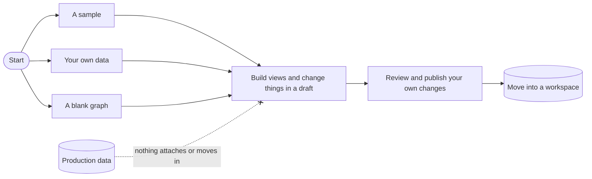

# The Playground

*For anyone who builds with {brand} — newcomers and experienced teams alike — and for the platform administrators who set it up.*
The Playground is your workspace at its very first stage. Anyone who can sign in
opens it and builds graphs of their own — from a sample, from their own files or
from blank — explores them in views, finds things with saved searches and
Cypher, changes them through drafts and reviews, and publishes their own
changes. Nothing in it is production data. When an experiment is ready for real
work, it moves into a workspace with everything built on it.

> **Before you start:** The Playground is off until a platform administrator turns
> on **Playground** in [Feature Switches](/guide/feature-switches) and sets it up.
> If you don't see **Playground** in the sidebar, it isn't on yet.



---

## Your workspace, first stage

Everything you do in a team workspace works here, on graphs of your own:

| Here, as in any workspace | What's different in the Playground |
| --- | --- |
| Views — a graph, a hierarchy or a context view | What you make starts shared with everyone in the Playground |
| Drafts, history, reviews and publishing | You publish and merge your own graphs' changes yourself |
| Saved searches, display rules, Cypher | You change only what you made; others' graphs are read-only to you |
| Details: a description, links and tags | Certifying data is a workspace step, not offered here |
| Data sources on the organization's approved semantic layers | You may also make semantic layers of your own, and edit them yourself |
| | A set number of graphs and data models each, and nothing from production |

Open it from **Playground** in the sidebar. You'll also find it on your
**Dashboard** if you aren't in a team workspace yet, at the top of **Workspaces →
Your workspaces**, and behind any link someone shares to it. There is nothing to
ask for: the first time you open it you become a **Playground member** —
recorded like any other access — and it opens. Being in the Playground gives you
nothing anywhere else (see [Requesting Access](/guide/requesting-access)).

## Start

The Playground opens on **Your experiments**: the graphs you started, the views
you built, how many more graphs you may start, and three ways to start the next.

| Start from… | You get | Best when |
| --- | --- | --- |
| **A sample** | A realistic graph, its views, saved searches and an example change waiting for review | You've never built a graph, or want to see what one is for |
| **A file** | A versioned data source of your things and how they connect, on an approved semantic layer or one of your own, with a Context View and a Graph view | You have a spreadsheet, an export from a workspace, or an import file |
| **A blank graph** | An empty graph on the data model you pick, to draw on | You'd rather build it by hand |

Whatever you start from, you get the same thing a team workspace gives you: a
data source under version control from its first version, held to its semantic
layer's rules, changed through drafts and reviews — and it keeps its semantic
layer when it moves into a workspace.

### Start from a sample

1. Click **Start from a sample**. The samples are just below.
2. Click **Start** on one. The button says **Starting…** while the graph is made.
3. Its **Context View** opens. The notification offers **Take the tour** — a lap
   around the canvas — and **See the example review**.

| Sample | What it shows |
| --- | --- |
| **Retail data pipeline** | Sales data on its way from the online store, the tills and payments, through syncs, warehouse tables and transformations, to the dashboards the business reads. |
| **Customer 360** | The CRM, support, billing and product systems, the records each keeps, how they're matched into one customer and one account, and the reports built on them. |
| **ML feature pipeline** | Raw events and databases becoming datasets and feature sets, the models they train, and the services that use the models' predictions. |

Each sample comes with:

* a **Context View**, one layer per kind of thing in pipeline order — the one
  that opens, and the one you edit in;
* a **Graph view** of the same graph, and a **Hierarchy view** of what the
  pipeline ends in and what it holds — dashboards and their metrics, reports and
  their metrics, or feature sets and their features;
* **saved searches** on the Context View — the data marked PII, the certified
  data, what one team owns, and everything feeding the key output — under
  **Library → This view**, and a display rule tinting what's marked `pii`;
* an **example change waiting for review**, on the Graph view: a private draft
  that adds one more thing, and a review of it nobody was asked to give, so no
  one is notified. Approve and merge it yourself to see how publishing works;
* a description, the tag `sample` and a link back to this page, under **Data →
  Sources**.

A sample is one of your graphs, and yours to change. Its data model — the kinds
of things it holds — is the same for everyone who starts that sample. You can
start the same sample more than once; each time makes a new graph.

### Start from a file

Bring your own data in from files. They're read in your browser first, so
anything that can't be used is shown before anything is made.

1. Click **Bring your own data**.
2. **Files.** Drop your files on the dialog, or choose them. Two kinds work, here
   and in every workspace's **Import**:
   * **The simple files**: **things.csv** and **connections.csv**, or
     **example.json** for both in one file. The templates are a small example — a
     coffee shop's sales — so you can try them as they are. The same files are in
     the repository, under `docs/examples/playground`.
   * **The standard import file** — the one **Export** makes and connectors send
     (CSV, TSV, ndjson, JSON or Excel). Once you've picked a semantic layer you can
     download its template, with a column for everything it holds. A file you
     exported from a workspace comes in as it is.
3. **Data model.** Pick what your data is: the cards are ranked by how much of your
   file each semantic layer already describes, and the best approved one is
   already picked.
   * **Approved** — the organization's published semantic layers, the same ones
     team workspaces use.
   * **Yours** and **Shared** — semantic layers of your own, or that someone in the
     Playground shared (see [Your own semantic layers](#your-own-semantic-layers)).
   * **Starter** and **Sample** — the data models the administrator offers, and the
     samples'.
   * **Make one from my file** — a data model made from the types in your file,
     yours to change afterwards.
4. **Match your types.** Each type in your file is matched to one in the semantic
   layer — by its name, where it can be. Change any that's wrong, or choose
   **Leave these rows out**. A connection the semantic layer doesn't allow between
   those two types is listed under **Rows to fix**. On a semantic layer of your own,
   **Add these types to my data model** adds what's missing.
5. **Name** the data source, and describe it if you like. **More options** chooses
   how rows match things you already have, and can keep the first load in a draft
   for you to review before publishing.
6. Click **Create**. The data source and its views are made, then your rows load —
   the same import every workspace uses, with its progress. When it's done you see
   what was added and anything that couldn't be, with why; **Open it** opens the
   Context View, and **Add more data** opens **Import** on it.

If the rows don't load — the connection drops, or too many are refused — **Try the
import again** loads into the same data source: nothing is made twice. A data
source with no rows yet says so on its card, with **Add data**.

| Simple file | Columns |
| --- | --- |
| Things | `key` (unique, and how connections name the thing), `type`, `name` (the key, if empty), and optionally `description` and `tags` (separated by `;`). Any other column is a property: `owner`, `system`, `rows`… |
| Connections | `from` and `to` (keys of things), and `type` — `FEEDS`, `READS`, `OWNS`, whatever your data says |

A JSON file holds both:

```json
{
  "name": "Coffee shop sales",
  "description": "Where the sales figures come from",
  "things": [
    { "key": "orders_raw", "type": "Table", "name": "Raw orders", "tags": ["pii"], "properties": { "owner": "Data engineering" } },
    { "key": "daily_sales", "type": "Table", "name": "Daily sales" }
  ],
  "connections": [
    { "from": "orders_raw", "type": "FEEDS", "to": "daily_sales" }
  ]
}
```

One import here may carry up to 200,000 rows, unless the administrator chose
otherwise; a data model made from a file holds up to 50 kinds of things and 50 of
connections. Values in quotes may hold commas and line breaks, and a file saved
with semicolons or tabs reads the same.

### Start a blank graph

1. Click **Start a blank graph**. The View wizard opens on a blank graph, already
   on the Playground's sandbox.
2. Pick a **data model**: it decides what kinds of things your graph can hold.
   The same list as for a file: the organization's **Approved** semantic layers,
   your own and **Shared** ones, the administrator's **Starter** data models and
   the samples'. With none to pick, the wizard offers a sample or your own data
   instead — either makes a data model for you.
3. Name the graph and its first view, choose a layout, and create it.
4. Add things and how they connect on the canvas.

### How many you may have

Each person may have a set number of graphs (five unless the administrator chose
otherwise). The meter under **Your experiments** shows how many you've used.
Experiments never expire — the number is the only limit. When you've used them
all, delete one you're done with to start another. A deleted graph waits in the
trash as usual, and stops counting at once. Semantic layers of your own have a
number of their own (20 unless the administrator chose otherwise).

## Build

### Views

A graph can have as many views as you like: the same things seen another way.
Click **New view** on the Playground's page and pick one of your graphs. A
**Context View** sorts things into layers you define and is where you edit; a
**Graph** view lays them out freely; a **Hierarchy** nests them in what holds
them. See [Creating Views](/guide/creating-views).

### Edit in a draft

On a Context View, click **Edit**. Every change waits in your **draft** —
nothing anyone else sees changes — until you publish it. **Review & Save** says
what each change does and saves it to the draft. See
[Editing in a Draft](/guide/editing-in-a-draft).

### Import more

To bring more rows into a graph you already have, click **Add more data** beside
it under **Your experiments**, or use **Import / Export → Import…** on its Context
View. They land in a draft, like any edit, and the same two kinds of file work —
the simple ones and the standard import file. See
[Import & Export](/guide/import-export).

## Find

Every search you run on a view is kept under **Library → Mine**. A sample's
Context View has its searches under **Library → This view** — click one to run
it. Build your own in the **Advanced Search** panel, in plain words or as a
query; its **Cypher** tab shows the Cypher it runs, and **Edit and run** lets
you write your own. See [Advanced Search](/guide/advanced-search).

## Change control

A change goes from your draft to the version everyone sees in one of two ways:

1. **Publish** it straight away, from **Review & Save** or the draft's
   **Publish** dialog.
2. **Submit it for review**: ask people to approve it first. It's merged when
   they have — see [Review Center](/guide/review-center).

Every sample comes with a review waiting, so you can see one before you make
your own: open it from **See the example review**, or from **Reviews**.

### Publish your own

The graphs you made are yours to publish. You publish your drafts, and merge
reviews of them, without the publish permission a team workspace asks for — and
the same goes for everything else that changes the live version: **Revert** and
**Restore** from its history, **Pause editing** and **Resume editing**, merging a
fork's review into it, and **Update from parent** on a fork you made.
Everyone else in the Playground sees your graphs but can't open, change or
resolve drafts on them, and drafts in the Playground start private. See
[Versioning & Change Control](/guide/versioning-change-control#who-can-do-what).

## Your own semantic layers

A semantic layer says what your graph can hold: the kinds of things, how they may
connect, what contains what, and the fields each carries. Build on the
organization's approved ones, or make your own and change them yourself — in the
same **Semantic Layers** editor team workspaces use.

**Your data models**, under **Your experiments**, lists yours and the ones shared
with you. **New data model** starts one:

| Start from | You get |
| --- | --- |
| **Blank** | An empty semantic layer to define by hand |
| **Copy an approved layer** | Your own copy of an approved, starter, sample or shared one, to adjust |
| **Import a layer file** | One exported from **Semantic Layers** — the one your workspace already uses, say |
| **From a file** | Opens **Bring your own data**, and makes one from your file's types |

* **Edit it** in the editor: kinds of things and connections, what contains what,
  fields. You can edit and publish your own even where editing semantic layers is
  switched off for the organization; the organization's own layers aren't yours to
  change.
* **Publish** a version to build on it. Changing a published one makes the next
  version; **Move my graphs to this version** moves the data sources you built on
  the old one.
* **Share with the Playground** lets everyone there build on it, as it is — only
  you change it. Stop sharing whenever you like: what others already built on it
  keeps it.
* **Moving a graph into a workspace** takes its semantic layer along: it becomes
  that workspace's, and its data engineers can change it and approve it for the
  whole organization. If your other graphs still use it, they keep yours and the
  workspace gets its own copy.

## Describe your data

Say what a graph holds and where it comes from: open it under **Data → Sources**
and choose **Edit details** for its description, links and tags. A sample comes
described, tagged `sample` and linked to this page; a graph from your own data
carries the description you gave it. Certifying data — **Certified**, **In
review**, **Deprecated** — is a step for a team workspace, so it isn't offered
here. See [Describing Your Data](/guide/describing-data).

## Your first steps

**Your first steps**, under **Your experiments**, is the path from a first
graph to a change of your own, published:

1. Make a graph.
2. Make a view of your own.
3. Change something in a draft.
4. Send a change for review.
5. Describe your data.
6. Publish a change.

Each step ticks as you do it — what a sample or your own data made for you
doesn't count — and **How** opens the part of this page that says how. A change
you published straight away leaves nothing to tick from, so **I've published
one** ticks it. Hide the list any time; it goes by itself once every step is done.

## Graduate

When a graph is ready for real work, take it out of the Playground. It moves
with its views, saved searches, display rules, drafts, details and contacts — and
its semantic layer: an approved one stays as it is; one of your own goes along and
becomes the workspace's.

* **Into a workspace you run.** Click the move button beside it under **Your
  experiments** (or **Move** in its details). It moves at once.
* **Into a workspace you're in but don't run.** The same button asks that
  workspace's admins to take it; you'll hear when they answer.
* **Into a workspace of your own.** Ask for one with **Request a workspace** and
  tick the graph to bring along (see [Requesting a Workspace](/guide/requesting-a-workspace)).

Only the person who made a graph can take it out. People in the Playground who
aren't in the destination stop seeing its views — the move tells you who, first.

## Share what you made

A view you make in the Playground starts **shared with everyone in the
Playground** (**Workspace** visibility). To keep one to yourself, choose **Only
me** when you create it, or later from **Share**. You can also share a view with
named people. **Everyone's experiments** on the Overview shows the newest work
of everyone else there — open one for ideas. A view in the Playground carries a
**Playground** chip beside its name: nothing there is production data.

| You can't… | because… |
| --- | --- |
| Publish a view to everyone (**Enterprise**) | The Playground is a sandbox: nothing in it goes out to the whole organization. The option isn't offered, and a request to publish is refused. |
| Change someone else's graph or view, or open drafts on it | Each member changes only what they made. You can open what others shared, and copy ideas into your own. |
| Attach an existing data source, or move one in | Nothing of production comes into the Playground. Graphs start from samples, your files or blank, on its own sandbox. |
| Invite people | Anyone can join by themselves, so there is no one to invite. |

## A learning path

1. Start from a sample and take the canvas tour.
2. Change something in a draft — [Editing in a Draft](/guide/editing-in-a-draft).
3. Approve and merge the example review — [Review Center](/guide/review-center).
4. Bring your own data, or more of it — [Import & Export](/guide/import-export).
5. Find what matters in it — [Advanced Search](/guide/advanced-search).
6. Learn how drafts, history and undo fit together —
   [Versioning & Change Control](/guide/versioning-change-control).
7. Move it into a workspace — [Requesting a Workspace](/guide/requesting-a-workspace).

---

## For administrators: set it up

*Needs a platform administrator (`system:admin`).*

1. Turn on **Playground** in **Administration → Features**. It's a security switch:
   if its value can't be read, it counts as off. It needs **Version control** and
   **Build lineage from scratch**, and turns them on with it.
2. Give the Playground a **sandbox provider** of its own — a FalkorDB connection
   kept apart from production. Every graph built in the Playground goes there.
3. On **Workspaces**, the Playground card offers **Set it up**. Choose:
   * its **name**;
   * the **sandbox provider**. If that provider is limited to named workspaces, the
     Playground is added to them, so its members can use it;
   * the **starter data models** members may begin a blank graph from — published
     ones only. Members see these even though no data source of theirs uses them yet;
   * **graphs per person**, from 1 to 100;
   * **semantic layers per person** (20 unless you change it) and the **rows one
     import may carry** (200,000 unless you change it).
4. Save. People can join straight away.

**Settings** on the same card changes any of these later. Lowering the number of
graphs per person stops people over it from starting more; it deletes nothing.

### What keeps it safe

The server enforces each of these, whatever the screen shows:

* Joining grants the **Playground member** role in the Playground and nothing else
  (see [RBAC](/docs/rbac)). It has no catalog access, no member management and no
  publishing to everyone.
* No existing data source can be attached to the Playground, and none can be moved
  into it.
* Members can see and build on the organization's published, organization-wide
  semantic layers — their kinds of things and fields, not anyone's data. Layers
  kept to one workspace, and system ones, stay hidden. A member's own semantic
  layers are theirs alone unless they share them.
* A blank graph is made only on the sandbox provider, within the person's quota.
  A graph from a sample or from someone's files is a blank graph too: the same
  provider, the same quota. Each sample's data model is made, published, the
  first time anyone starts it, and appears among the data models as
  "*sample name* (sample)"; a graph from files gets a data model of its own. If a
  graph's data model can't be made, nothing is kept; if its rows don't load, the
data source stays, empty, for its maker to try again or delete.
* A member changes, deletes, publishes and merges only the graphs and views they
  made; drafts on someone else's graph are closed to them. Workspace admins of
  the Playground and platform administrators can do anything there.
* Nothing in the Playground is published to everyone, and its publishing and
  joining settings can't be changed: anyone opens it themselves, and publishing
  to everyone is closed.

### Turning it off

Turning **Playground** off hides the card and refuses new members and new
graphs. People already in it keep their access and everything they made, and an
administrator still sees it. Turning it back on changes nothing that was there.

Samples and graphs from files are blank graphs, so they're offered only while
**Build lineage from scratch** and **Version control** are on too.

## Where to next

- [Creating Views](/guide/creating-views) — when you want the View wizard step by
  step, blank models included.
- [Editing in a Draft](/guide/editing-in-a-draft) — when you're ready to change
  your graph.
- [Managing & Sharing Views](/guide/managing-views#who-can-see-a-view) — when you
  want to know who can see what you share.
- [Requesting a Workspace](/guide/requesting-a-workspace) — when an experiment is
  ready for a workspace of its own.
- [Feature Switches](/guide/feature-switches) — when you administer the
  **Playground** switch.
