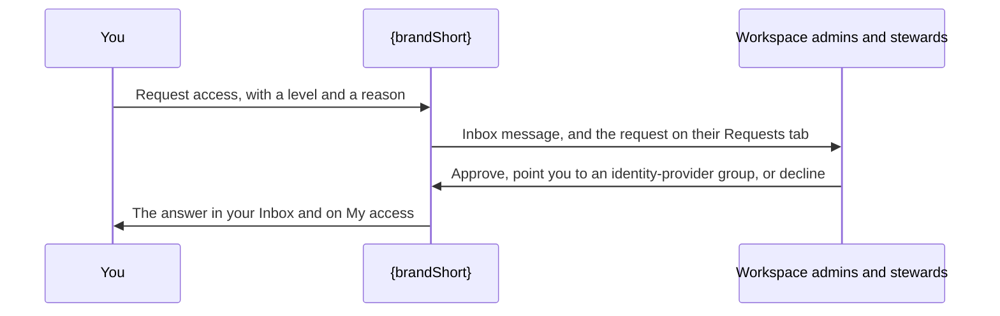

# Requesting Access

*For everyone — and for the workspace admins and stewards who answer requests.*
Sooner or later {brand} will tell you that you can't open or change something,
or you'll need a workspace you aren't in yet. This page explains what each
message means, how to find a workspace and ask to join it — or join one that's
open to everyone — how to follow your request, how to keep access that's about
to end, and how requests are answered.

> **Before you start:** Access is granted **per workspace**: you ask to join a
> workspace at a level — view, contribute, and so on — and the people who look
> after it decide. A single view works differently — to open one, ask its owner
> to share it (see [Get a single view shared with you](#get-a-single-view-shared-with-you)).

---

## What the message means

When {brand} refuses something, you see one of these. Find yours, then follow
the advice next to it.

| If you see… | it means… | so… |
| --- | --- | --- |
| An **Access denied** card at the bottom of the screen, saying what you need — for example "Editing views in this workspace needs edit access." | Your role doesn't allow what you just tried. | If it offers **Request access**, use it ([below](#from-the-access-denied-card)). Otherwise ask a workspace admin. |
| An **Access denied** card whose message says something **is turned off for this deployment** | An administrator has switched that feature off for everyone. It has nothing to do with your access. | Don't request access — it won't turn the feature on, even if the card offers **Request access**. Ask an administrator; see [Feature Switches](/guide/feature-switches). |
| A **Read-only view** card | You're exploring a view shared with you. Everything in it is read-only. | If you need to change it and the card offers **Request edit access**, use it. Otherwise ask a workspace admin. |
| **You don't have access** filling the page | A whole section needs a permission you don't have; the panel names it. | Ask your workspace admin or a platform administrator. |
| **You don't have access to this** or **Access required** inside a page | Your role lacks the permission shown next to **Required**. | Ask a workspace or platform administrator. **Learn about roles & access** opens [Users & Access](/guide/users-access). |
| **You can't open this workspace** | You're not a member of that workspace — or it doesn't exist. {brand} doesn't say which, to keep workspace names private. | Click **Request access** ([below](#from-a-link-to-a-workspace-you-cant-open)). |
| **View Cannot Load** | The view doesn't exist, or it isn't shared with you. | Ask the view's owner to share it ([below](#get-a-single-view-shared-with-you)). |
| **Access revoked** | An admin removed your access while you had the workspace open. | Use **Request access again** ([below](#after-your-access-was-removed)). |
| **Analytics isn't open on this deployment** | Not a permission at all: Analytics hasn't been opened to everyone. | Nothing to request — ask an administrator if you need it ([Feature Switches](/guide/feature-switches)). |
| **This feature is turned off** (or a named version, such as **Reviews are turned off**) | An administrator has switched the feature off. | Nothing to request — ask an administrator if you need it ([Feature Switches](/guide/feature-switches)). |

> **Tip:** The **Access denied** card disappears after a few seconds. Click
> **Details** to keep it open — it shows technical details that are useful if you
> contact support.

---

## Find a workspace

**Find a workspace** lists your organization's workspaces so you can see what
each is for and ask to join one. It's switched off until an administrator turns
it on (see [Feature Switches](/guide/feature-switches)); while it's off, ask a
colleague for a link to their workspace and request access from there.

1. Click **Workspaces** in the sidebar, then the **Find a workspace** tab. If
   you aren't in any workspace yet and can't create one, Workspaces opens on
   this tab — and the **Dashboard** offers **Find a workspace** too.
2. Search by name or what a workspace is for, or use the filter: **All**,
   **Not yours yet**, **Yours** or **Requested**. The counts at the top filter
   the same way when you click them.
3. Read a workspace's card: what it's for, how many people and data sources it
   has, who answers its requests (**Answered by**), how people get in, and any
   note from its admins — "Say which team you're on", for example.
4. Click **Request access** on the card ([the dialog](#the-request-access-dialog)) —
   or, on a card marked **Open to everyone**, click **Join** to become a Viewer
   at once (**Ask for more** asks for a higher level).

**You should now see** the card change to **Waiting for approval** — or, once
you've joined, to **Open**. A workspace you can already open shows **Open**,
one you've asked to join shows where your request is, and one that isn't
taking requests says **Not taking requests — ask its admins to add you.**

| How people get in | What it means for you |
| --- | --- |
| **Approved in the app** | Its admins and stewards approve requests in {brand}. |
| **Through your identity provider** | Membership follows your organization's sign-in groups. The answer to your request may be a group for IT to add you to. |
| **Open to everyone** | Anyone can join as a **Viewer** straight away, without waiting for approval. A higher level is still asked for. |

> **Note:** A workspace's admins can hide it from this list. If you know a
> workspace exists but can't find it, ask a colleague for a link.

---

## Ask to join a workspace

### The Request access dialog

Every way of asking opens the same dialog, in three steps:

1. **What do you need?** Pick a level — **View**, **Contribute**, **Engineer the
   data**, or a level your organization defined. A level you already have says
   **You already have this.** Levels that let you run the workspace or let
   others in can't be asked for; a workspace admin grants those.
2. **Why?** The workspace's note for people asking, if it has one, comes first.
   Then say which team you're on and what you need it for — it's what the
   approver decides on.
3. **What happens next** explains who answers and how you'll hear.

Click **Send request**.

If the workspace is **open to everyone**, the dialog starts with **Join now**:
click it to become a Viewer at once — **You're in** — or ask for a higher level
below it. If the workspace **isn't taking requests**, the dialog says so; ask
its admins to add you.

**You should now see** **Request sent**, with **Follow it on My access**. If you
had already asked to join, the dialog says so and shows your open request —
you can have one open request per workspace.

### From Find a workspace

Click **Request access** on a workspace's card — see [Find a workspace](#find-a-workspace).

### From the Access denied card

When the action that was refused belongs to one workspace, the **Access denied**
card offers **Request access** (in a read-only view, **Request edit access**,
which preselects **Contribute**). Click it to open the dialog.

> **Note:** Read the card's message first. If it says a feature **is turned off
> for this deployment** — for example "Lineage tracing is turned off for this
> deployment." — the refusal comes from a feature switch, not from your role.
> A request can't change that: only an administrator can turn the switch back
> on (see [Feature Switches](/guide/feature-switches)).

### From a link to a workspace you can't open

Opening a link to a workspace you aren't in shows **You can't open this
workspace**. Click **Request access** to open the dialog. It works whether or
not Find a workspace is switched on, and it never shows the workspace's name —
the approvers know which one you mean.

### From Analytics

If your administrator has opened **Analytics** to everyone, it lists workspaces
you aren't a member of — without their names — and lets you ask for read access.

1. Click **Analytics** in the sidebar, then the **Workspaces** tab.
2. Below the table, click the line that ends **you are not a member of —
   counted in the figures above**. Rows named **Restricted workspace** appear,
   each marked **You are not a member**.
3. On the row you want, click **Request access**. A short form, **Ask for read
   access**, explains what you're asking for.
4. In the note box, say why you need it — the approver can't see what you were
   looking at.
5. Click **Send request**.

**You should now see** **Request sent** on the row. This asks for read access
(**View**); if you need more, say so in your note.

### After your access was removed

If an admin removes your access while you have a workspace open, the page
changes to **Access revoked** and, after a few seconds, takes you back to your
workspaces. Click **Request access again** before the countdown ends — it stops
the countdown and opens the dialog.

### Ask someone to add you

You can also ask a workspace admin or steward to add you directly: they use
**Add member** on the workspace's **Members** tab. Stewards add people as
viewers or members; admins can grant any level.

---

## Follow your request on My access

1. Click your avatar at the right of the top bar and choose **My access**.
2. Find **My access requests**. Open requests come first, each with its status:

| Status | What it means |
| --- | --- |
| **Waiting for approval** | Nobody has answered yet. You can **Withdraw** it. |
| **Waiting on your identity provider** | An approver pointed you to the group that grants it — the request says which, and in which provider. Ask your IT team to add you; your access arrives the next time you sign in after that. You can still **Withdraw** it. |
| **Approved** | You're in. It says what you were granted — the level and until when, the team you were added to, or that it came through your identity provider's group — who approved it, and their note. **Open** takes you there. |
| **Declined** | It shows the **Reason:** if the approver gave one, and who declined it. |
| **Withdrawn** | You took it back. |

Answers also arrive in your **Inbox** — the bell in the top bar — and a workspace
you can't see keeps its name hidden there too. Your Inbox also tells you when
someone adds you to a workspace or removes you, and when your access's end date
changes.

Once a request is approved, the workspace is yours straight away: {brand} signs
your sessions back in with the new access, and the workspace appears under
**Workspaces**.

### What My access shows

**My access** — also in **Account settings** and in the `⌘K` palette — answers
"what can I do, and why?":

- a summary at the top: how many workspaces you can reach and what you can do in
  the main ones — or, for a Super Admin or Org Admin, what that role means. With
  no workspace yet, it points to **Find a workspace** (or says whom to ask);
- **My access requests**, when you have any;
- **Effective access** — everything you can actually do, platform-wide and per
  workspace, after combining all your roles;
- **Direct bindings** — roles given to you personally, each with how it came
  about (**Added directly**, **Approved request**, **Exception**, **Joined** or
  **Identity provider**) and when it ends, if it does — with **Ask to keep it**
  when it does ([below](#keep-access-thats-about-to-end));
- **Inherited via groups** — roles you have because you belong to a group, with
  **Team** or **Identity provider**;
- **Group memberships** — every group you're in.

Hover a chip to see who granted it and when. Click **Refresh** to reload the page
after a change.

---

## When your identity provider decides who is in

Some workspaces take their members from your organization's sign-in groups — the
card says **Through your identity provider**. Asking works the same way, but the
usual answer is a group, not a grant:

1. An approver points your request to the group that grants it. You get an Inbox
   message: "Ask your IT team to add you to "finance-analysts" in Entra ID…".
2. Ask your IT team or service desk to add you to that group.
3. Sign out and back in once they have. Your access arrives with that sign-in,
   your request closes as **Approved**, and you and the approver both hear about
   it.

Rarely, an approver lets you in directly as an **exception**. It works the same
day-to-day, but it doesn't follow your groups, and it's labelled as an exception
wherever your access is listed. Once your identity provider's groups grant you
the same access, the exception ends by itself at your next sign-in — "Your
access to … now comes from your identity provider" — with no gap in between.

---

## Keep access that's about to end

Access can be granted for a while — 7, 30 or 90 days, say. {brand} tells you
before it ends: a week ahead for access granted for more than two weeks, two
days ahead for shorter access, in your **Inbox** ("Your access to Finance ends
in 5 days"). A day or two of cover isn't announced.

1. Click your avatar at the right of the top bar and choose **My access**.
2. Under **Direct bindings**, find the workspace and click **Ask to keep it**.
3. Say why you still need it, if you like, and click **Ask to keep it**.

**You should now see** **Asked to keep it** beside the grant, and the request
under **My access requests** as **Keep your access to …**. The workspace's
admins and stewards choose how much longer; when they answer, the request says
when your access now ends. A workspace admin may also change the end date
directly — you hear about that too.

> **Note:** Access you have through your identity provider's groups doesn't end
> this way, so it never offers **Ask to keep it**. And you can have one open
> request per workspace: if you've already asked that workspace for more,
> withdraw that request or wait for its answer first.

---

## Get a single view shared with you

Views have their own sharing. You can open a view if its visibility includes you
— **Workspace** views are open to everyone in their workspace, **Enterprise**
views to everyone signed in — or if its owner has shared it with you directly.
A **Private** view stays closed until someone shares it with you.

1. Ask the person who sent you the link, or the view's creator, to share the
   view with you. On a view card in the Explorer, the creator's initials sit at
   the bottom — hover them for the name and email.
2. When they do, a message arrives in your **Inbox** — the bell in the top bar:
   **"…" was shared with you**, with the role you can open it as.
3. Click the message to open the view.

**You should now see** the view open on its canvas. The rules for who can see
a view are in [Who can see a View](/guide/managing-views#who-can-see-a-view).

---

## Answer an access request

*For workspace admins, stewards, Org Admins and Super Admins.*

> **Before you start:** You answer requests for a workspace if you can let
> people in there — as a **Workspace admin** or **Steward**, or everywhere as an
> **Org Admin** or **Super Admin**. New requests arrive in your **Inbox**; when a
> workspace has no admins or stewards, they go to the Org Admins.

1. Click **Workspaces** in the sidebar, then the **Requests** tab. It lists the
   open requests across every workspace you answer — who's asking, the level,
   the workspace, their reason and when. A request that has waited a day or
   more says **Waiting N days**, and one sent on to the Org Admins says so.
   (A workspace's **Members** tab shows its own requests above its members
   while any are waiting.)
2. Click **Review** on a request. What you can do depends on how people get into
   that workspace:

   | The workspace | Your choices |
   | --- | --- |
   | **Approved in the app** | **Grant a role** — what they asked for, or another level you may grant, with no end date or for **7**, **30** or **90 days**. Or **Add to a team** — a team bound here whose every role you could grant, so they get what their colleagues have. |
   | **Through your identity provider** | **Point to a group** — the identity-provider group that grants it; the request waits and closes itself when their access arrives. Or **Grant an exception** — access here that doesn't follow their groups, for 30 days unless you choose otherwise. |

3. Add a note if you like — they see it — and click **Approve**, **Add to
   team**, **Point to group** or **Grant exception**.

**You should now see** the request leave the open list. **All** shows every
request with how it was answered.

A request **to keep access** reads "asks to keep **Member** — ends …". Click
**Review**, choose how much longer — **30 days** unless you pick **7 days**,
**90 days** or **No end date** — and click **Let them keep it**. The level stays
what it is; within what you may grant.

To decline, click **Deny** on the request, write a reason (the requester sees
it), and click **Decline**.

> **Note:** A **Steward** grants **Viewer** or **Member**. Admins can grant any
> level whose permissions they hold themselves. Nobody answers their own
> request.

> **Tip:** **Point to a group** warns you when the person has never signed in
> through your identity provider — their access can only arrive once they do.

---

## If nobody responds

- **Check My access first** — your request may already have an answer.
- **It's brought up for you.** After three days without an answer, {brand}
  reminds the workspace's admins and stewards; after a week, it tells the Org
  Admins too.
- **Nudge someone.** The card in Find a workspace shows who answers its
  requests — a quick word helps.
- **Find the right person.** Ask the person who invited you, your team lead, or
  someone you know runs that workspace. Org Admins and Super Admins can answer
  requests for any workspace.
- **Contact support.** If your administrator has set up a support address,
  open **Help** (the question mark in the top bar) and click **Contact
  support** to email it.

---

## Where to next

- [Key Concepts](/guide/key-concepts#who-can-do-what-roles) — when you want to
  know what each role lets you do.
- [Workspace Admin](/guide/workspace-admin#giving-people-access-the-members-tab) —
  when you let people into a workspace.
- [Managing & Sharing Views](/guide/managing-views#who-can-see-a-view) — when
  you want the full rules for who can see a view.
- [Users & Access](/guide/users-access) — when you administer roles and groups.
- [Troubleshooting](/guide/troubleshooting) — when something else isn't
  working.
