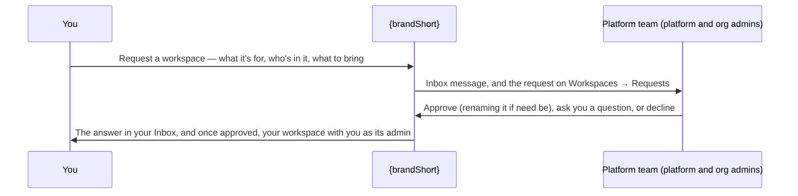

# Requesting a Workspace

*For anyone who'd like a workspace of their own — and for the platform and org admins
who answer.* Once you've found your feet in the [Playground](/guide/playground), you
can ask the platform team for a real workspace: one for your team, a project or a
proof of concept. This page explains how to ask, what happens next, and how a request
is answered.

> **Before you start:** Requests are off until a platform administrator turns on
> **Workspace requests** in [Feature Switches](/guide/feature-switches). If you can
> create workspaces yourself, you won't see any of this — use **Create Workspace** on
> **Workspaces** instead.

---

## Ask for a workspace

Click **Request a workspace**. You'll find it:

* in the Playground, under **Your experiments** — **Ready for a workspace of your own?**;
* on your **Dashboard**, if you aren't in a team workspace yet;
* at the top of **Workspaces**;
* on **My access**, under **Your workspace requests**.

The wizard asks four things:

1. **What it's for.** Pick the closest: a team's home, a project, a proof of concept,
   reporting, or something else. Give it a name and, if you like, a line on who
   should use it and for what.
2. **Who it's for.** You'll be its admin. Name your teammates and they join as
   members the moment it's approved. You can invite more people yourself later.
3. **What it will work with.** Tick the graphs you built in the Playground to bring
   them along — each moves with its views. Then say which data the platform team
   should connect for you.
4. **Review.** Check what the platform team will see, add a note if there's anything
   else they should know, and **Send request**.

The wizard keeps your draft on this browser as you write, so closing it loses
nothing. You can have one request open at a time.

## Follow your request

Your request shows on **My access**, on your Dashboard and in the Playground, with
where it stands: **Sent**, **Reviewed**, **Ready**, and how long it has waited. You
can **Withdraw** it while it's waiting.

| You'll hear… | it means… | so… |
| --- | --- | --- |
| **Your workspace is ready** | It was approved. You're its admin, your teammates are in, and your graphs moved over. | Open it from the message. A welcome on the workspace says what was done and what to do next. |
| **The platform team has a question** | They sent it back to ask something. | Click **Answer & resend**: the wizard opens with their question on top. Change what you need to, answer, and **Send it back**. |
| **Declined** | They said no, usually with a reason. | Read the reason — often a workspace that already does the job. You can ask again. |

If a graph couldn't be moved when the workspace was made, the welcome says so; it is
still in the Playground, and you can bring it over yourself later.

## For platform and org admins: answer requests

*Needs `system:workspaces:create` — Org Admins and Super Admins hold it.*

Requests reach you in your Inbox and on **Workspaces → Requests**, under **Requests
for new workspaces**, with how long each has waited. Click **Review** to open one: what
it's for, who's in it, what comes over from the Playground and what data they need.

* **Approve…** shows exactly what will happen — the workspace created, who becomes its
  admin, the teammates added and the graphs moved — and lets you tidy the name and
  description first. If the name is taken, you're offered a free one. Moving a graph
  takes its views with it: people in the Playground who aren't in the new workspace
  stop seeing them.
* **Send back** asks the requester a question. The request waits on them until they
  answer and resend it.
* **Decline** says no, with a reason they'll see.

You can't answer a request of your own.

## Where to next

- [The Playground](/guide/playground) — when you want to try things before asking.
- [Workspace Admin](/guide/workspace-admin) — when your workspace is ready and you run it.
- [Requesting Access](/guide/requesting-access) — when you'd rather join a team's
  workspace that already exists.
- [Feature Switches](/guide/feature-switches) — when you administer the
  **Workspace requests** switch.
