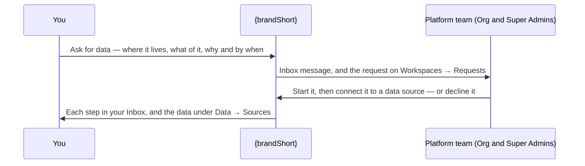

# Requesting Data

*For anyone in a workspace who needs data it doesn't have yet — and for the platform
team who connects it.* You don't need to know how a source is wired up to ask for one:
say where the data lives, what of it you need and why, and the platform team does the
rest. This page explains how to ask, how to follow your request, and how a request is
answered.

> **Before you start:** Requests are off until a platform administrator turns on
> **Data requests** in [Feature Switches](/guide/feature-switches). You can ask in any
> workspace whose data sources you can see — every Viewer, Member and admin can. The
> Playground takes no requests: it never holds production data.

---

## Ask for data

Open the workspace and click **Ask for data**. You'll find it:

* on **Data → Sources** — the main button if you can't add sources yourself, and next
  to **Add source** if you can;
* on the **Overview** and on **Data → Sources** of a workspace with no data connected
  yet.

The wizard asks three things:

1. **What.** Pick where the data lives — **Snowflake**, **Databricks**, **BigQuery**,
   **PostgreSQL**, **dbt**, **DataHub**, **Neo4j**, **A file**, or **Something else**
   if you aren't sure. Your best guess is fine. Give the request a short name, and say
   what exactly you need: the examples change with the system you picked, so you know
   what helps — a database and schema for Snowflake, a project and dataset for
   BigQuery, a dbt project's name, where a file lives and how often it changes.
2. **Why & when.** Say what you'll use it for, and how soon you need it: **No rush**,
   **This month** or **This week** (it's holding work up). Then name the people who
   know the data — its owner, or whoever looks after it — so the platform team can ask
   them about access. They aren't added to the workspace.
3. **Review & send.** Check what the platform team will see and what happens next,
   and click **Send request**.

The platform team is told at once, and so are the workspace's admins.

## Follow your request

Every request asked in a workspace is listed under **Data → Sources**, in **Data
requests**, for everyone who can see the workspace's data: who asked, how long ago,
and where it stands — **Asked**, **In progress**, **Connected**. While nobody has taken
yours on, you can **Withdraw** it.

| You'll hear… | it means… | so… |
| --- | --- | --- |
| **Someone is connecting your data** | A member of the platform team, or one of the workspace's admins, has taken it on. | Nothing to do. They may contact the people you named. |
| **Your data is connected** | It's in the workspace — the message says which data source it became, with a note if they left one. | Open it from the message, and build a view on it. |
| **Declined** | They said no, usually with a reason. | Read the reason — often the data is already in another workspace you can ask to join. You can ask again. |

You don't need to chase it: if nobody connects it, {brand} brings it up again for you
— see [A request left waiting](#a-request-left-waiting).

## For the platform team: connect requests

*Needs `system:workspaces:create` — Org Admins and Super Admins hold it.*

Requests from every workspace reach you in your Inbox and on **Workspaces →
Requests**, under **Requests for data**, with the workspace, how urgent each is and how
long it has waited. Click **Review** to open one: what was asked for, from where, why,
by when, and who knows the data.

* **Start — assign me** takes it on: you become its assignee, and the requester hears
  that someone is on it.
* **Connect…** marks it connected. Pick the data source it became from the workspace's
  sources. If it isn't there yet and you can add sources to that workspace, click
  **Add source** — the source you add is picked for you. Or choose **Connected another
  way** when it didn't become one of the workspace's sources. Add a note if there's
  anything the requester should know.
* **Decline** says no, with a reason they'll see.

### The workspace's admins and a source's Owner and Stewards

A workspace's admins (`workspace:admin`) see **Review** on that workspace's open
requests under **Data → Sources**, and can start and connect them the same way. A data
source's named Owner and Stewards — named directly, or through a group they are in —
can mark a request connected when it became their source. Declining is the platform
team's.

Nobody answers their own request: if you asked for the data, someone else starts and
connects it, even when you are an admin or on the platform team.

### A request left waiting

A request that isn't connected yet — asked, or in progress — is brought up again, sooner
the sooner it's needed:

| Needed | The workspace's admins are reminded after… | the platform team hears after… |
| --- | --- | --- |
| **This week** | a day | three days |
| **This month** | three days | a week |
| **No rush** | a week | two weeks |

The wait counts from when it was asked. Whoever took the request on is reminded with
the admins. Each message goes out once, never to the person who asked, and none while
**Data requests** is off. A data source's Owner and Stewards aren't reminded: a
request names its data source only when it's connected.

## Where to next

- [Workspace Admin](/guide/workspace-admin) — when you look after a workspace and its
  sources.
- [Requesting a Workspace](/guide/requesting-a-workspace) — when you need a workspace
  of your own first.
- [Requesting Access](/guide/requesting-access) — when the data is already in a
  workspace you'd rather join.
- [Feature Switches](/guide/feature-switches) — when you administer the **Data
  requests** switch.
