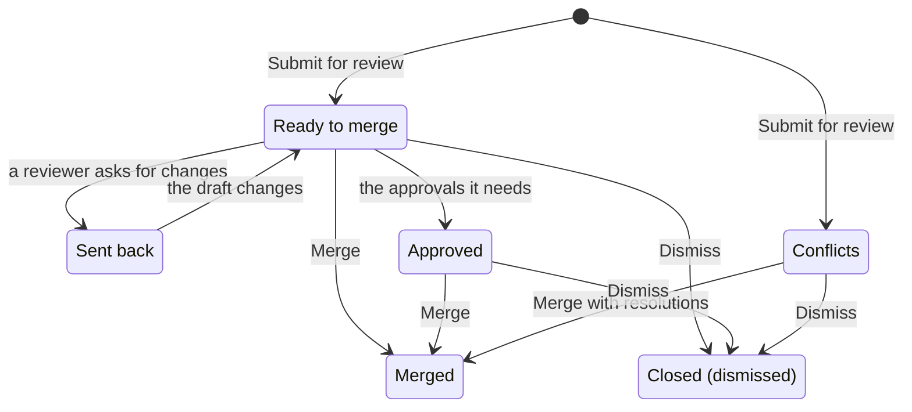

# The Review Center

*For Builders and anyone who reviews changes.*

The Review Center is where submitted drafts wait before their changes reach
**Published**, the version of the graph everyone sees. This page shows you how
to find the reviews waiting on you, work through one, give your verdict, and
merge it — or send it back.

> **Before you start:**
> - **Version control** must be on for your deployment. If it's off, the
>   workspace has no **Reviews** tab and the page says *Reviews are turned off*.
> - To approve, merge, dismiss or change who reviews, you need permission to
>   manage the workspace's data sources — the **Workspace member**, **Data
>   engineer** and **Workspace admin** roles have it. Without it, you see the
>   reviews you raised, those you're asked to review, and those of drafts you
>   can read.

## How a review moves

A **review** (the screens also say *merge request*) is a draft someone has
submitted. It starts **Ready to merge** or with **Conflicts**, and ends
**Merged** or **Closed**.

| Status | Means | What you do |
| --- | --- | --- |
| **Ready to merge** | Nothing in it clashed with Published when it was submitted | Review it, then **Merge** once it has its approvals |
| **Conflicts** | Published changed some of the same things after the draft was started | **Merge**, and choose which values to keep |
| **Approved** | It has the approvals its data source asks for (see [How many approvals a review needs](#how-many-approvals-a-review-needs)) | **Merge** |
| **Sent back** | A reviewer asked for changes, and the draft hasn't changed since | Its author changes the draft |
| **Merged** | Its changes are in Published | Nothing — or **Revert this merge** if it was a mistake |
| **Closed** | Dismissed without merging, or its draft was abandoned | Nothing. A dismissed review's draft is kept |

## Open the Review Center

- **Reviews** in the sidebar opens the reviews of the workspace you're in. Its
  badge counts what waits on you: reviews you're asked to review, and yours
  sent back to you.
- In a workspace, the **Reviews** tab opens the same page.
- Every notice about a review in your **Inbox** opens that review — on the
  thread, for a comment.
- **From a View or a data source**, a review opens as a quick peek: its
  status, description, **What's next** and, once it can, **Merge**. **Open
  review** opens it on its page for everything else.
- **After you submit a draft**, the review you opened is shown. Its address
  opens it directly, if you want to send it to someone.
- **From a View**, choose **Reviews** in its header, then the **Pull
  Requests** tab of **Changes & Reviews**; **From this view** and **Whole data
  source** switch between them.

## Your queues

The reviews are sorted into queues by who they wait on. Each queue says how
many it holds, and a dot marks one with something you haven't seen.

| Queue | Holds |
| --- | --- |
| **Needs your review** | Reviews you're asked to review — yourself, or through a group of yours that no one has answered for yet — and haven't reviewed as they are now |
| **Waiting on reviewers** | Yours, still waiting for approvals |
| **Sent back to you** | Yours, where a reviewer asked for changes |
| **Ready to merge** | Yours, with the approvals they need and nothing holding them |
| **Everything open** | Every open review you can see |
| **Merged & closed** | Reviews that are done, newest first |

A review comes back to **Needs your review** when its draft changes after you
approved it, or when someone asks you again.

Each row shows who raised it and its title, its status, the draft it comes
from, its approvals (for example **1/2**), open threads, and when anyone last
did anything on it. **Updated since you reviewed** means the draft changed
after your last review. A review is marked unread while someone else has done
something on it you haven't looked at — opening it marks it read, and so are
your Inbox notices about it.

- Search titles and descriptions, and narrow by **Data source** or **Author**.
  **Order** switches between **Last activity** and **Opened**; **Clear** resets
  the filters.
- **Load more** lists the next reviews.
- **J** and **K** move between rows, and **Enter** opens one.

If more than 1,000 reviews are open in a workspace, the queues leave out the
oldest and say so — search or filter to find one.

[screenshot-pending]: # "review-center-list — the workspace's reviews: the queues with their counts and unread dots, search and filters, and rows with approvals, open threads, last activity and an Updated since you reviewed chip"

## The review page

Opening a review shows it on a page of its own, in three columns (two, or one,
on a narrower screen):

- **Changes**, on the left — every entity and relationship it adds, modifies
  or removes, a page at a time however many there are. Above them, how many
  you've viewed and decided, and how many threads are open. **Hierarchy** lays
  the changes out under their containers, a level at a time.
- **The change open**, in the middle — what you picked, before and after,
  field by field, with its threads and your decision. **Previous change** and
  **Next change** step through them. Before you pick one, it shows the review's
  description.
- **Where it stands**, on the right — **What's next**, the **Reviewers**, and
  the **Discussion** and **Activity** tabs. **Activity** is the review's
  history beside the draft's saves: who was asked (and asked again), each
  review given with its verdict, summary and what the reviewer did, and when it
  was merged or closed.

The header has the way back to **Reviews**, the review's title (a manager can
rename it), its status and approvals, the one thing to do next, and **More
for this review** for the rest.

[screenshot-pending]: # "review-center-page — a review's page: the changes with viewed and decided progress, one change open before and after, and What's next with the Reviewers card beside it"

### What's next

**What's next** is a checklist of what stands between the review and Published,
each with the action that moves it along:

- **For a reviewer:** **Look through the changes** (**Next to look at**),
  **Decide each change** (**Next to decide**), **Resolve** the open threads
  (**Next thread**), and give your verdict.
- **For its author, and whoever merges:** its approvals (*1 of 2 approvals*),
  who asked for changes and whether the draft changed since, being up to date
  with main (**Pull the latest**), conflicts (**Resolve conflicts**), rejected
  changes (**Merge N accepted** or **Discard the rejected**), unsaved edits on
  the draft, and whether you may merge it.

The button in the header is the first step not done yet.

### Keys

| Key | Does |
| --- | --- |
| **J** / **K** | Next / previous change |
| **N** / **P** | Next / previous change that still needs you |
| **Shift+N** / **Shift+P** | Next / previous change with open threads |
| **V** | Mark it viewed, then the next |
| **A** / **R** | Accept / reject it (rejecting asks why) |
| **C** | Comment on it |
| **⌘↵** (Ctrl+Enter) | The review's next step — the action in the header |
| **?** | These shortcuts |

The **Viewed** ticks are yours, kept in this browser. A change edited since you
viewed it reads **Changed**.

## Decide the changes one by one

For a draft's review, whoever may approve it can decide each change on its own:

1. Choose ✓ to **accept** a change, or ✗ to **reject** it. Rejecting asks why
   (optional) — the author sees your reason under the change.
2. Some changes only make sense together, so deciding one decides what it needs
   too — and you're told (*Accepted 1 change, and 2 it needs.*, with **Undo**):
   - a new relationship needs the new entities it joins;
   - a new entity needs its new link to its parent;
   - a moved entity's old and new links go together;
   - a removed entity takes the changes to its relationships, and a removed
     parent takes its removed children.
   Rejecting works the other way: what needs the rejected change is rejected
   with it. If that would reverse something already decided, you're asked first.
3. Narrow the list with **To decide**, **Accepted**, **Rejected** and **Changed
   since**, and use **Accept N shown** / **Reject N shown** to decide them all
   at once — you're told how many, and what else they take, before anything is
   decided.
4. If the author edits a change after you decided it, your decision no longer
   holds: the row says **Changed**, and it's back under **To decide**.

A fork's review is merged whole, so it has no decisions.

## Discuss a review

Comment where the question is:

- **On one change** — under what changed (*Comment on this change…*).
- **On one field or property of it** — point at that line of the change and
  choose the speech-bubble. The comment names the field (*on Description*).
- **On the review as a whole** — in **Discussion**.

Type **@** to mention someone in the workspace: pick them from the list, and
they're told in their Inbox. The review's author, and everyone already in a
thread, hear about replies. **⌘↵** (Ctrl+Enter) posts. A comment that can't be
sent stays, with **Retry** and **Edit**, so nothing you wrote is lost.

Each thread has **Reply** and **Resolve**. A resolved thread folds to one line
(**Show** opens it; **Reopen** brings it back). A thread whose change the author
edited since is marked *Outdated · changed since*. You can edit or delete your
own comments; someone who manages the data source can delete anyone's.

## Finish your review

When you've been through the changes, give your verdict once, with a summary.
If you're asked to review — yourself, or through a group of yours — **Finish
your review** is the button in the header (**⌘↵** opens it too). It says where
you are — *You viewed 12 of 40 · accepted 10 · rejected 2 · 3 open threads* —
and offers three verdicts:

- **Comment** — feedback, with no verdict. It needs a summary.
- **Approve** — the review can merge as far as you're concerned.
- **Request changes** — it goes back to its author and can't merge until the
  draft changes. Say what should change — if you rejected nothing, a summary is
  required.

A verdict you can't give is greyed out, with why. Choose **Submit review**
(**⌘↵** sends it), or **Keep reviewing** to go back to the changes. The review's
author is told, and what you did is recorded with it: the changes you
accepted and rejected, and the threads you started.

A new verdict replaces your earlier one — approving takes back your request for
changes, and asking for changes takes back your approval. If the draft changed
while you were reviewing, nothing is recorded: *The draft changed while you
reviewed — see what's new* takes you back to the changes.

A fork's review can't be sent back: close it instead.

### Approve all & merge

When nothing is rejected, **Approve all** accepts every change still to decide
and approves the review in one step — and **Approve all & merge** merges it
too, where you may merge. You're asked first, with how many changes it
accepts. If a step is refused, it stops there and says why; what it did before
stands.

## Who reviews

**Reviewers** on the review page lists everyone asked, and where each stands:

| State | Means |
| --- | --- |
| **Approved** | They approved the draft as it is now |
| **Approved an earlier version** | They approved, but the draft changed since — their approval no longer counts |
| **Asked for changes** | They sent it back, and the draft hasn't changed since |
| **Commented** | They gave feedback with no verdict |
| **Waiting** | They haven't reviewed it yet |

A group asked to review is **Approved** once any of its members approves —
it says who.

People who can manage the workspace's data sources can change who reviews,
from the same card:

- **Add reviewers** — search for people and groups. The groups offered are
  those bound to the workspace with a role that manages its data, each with how
  many people are in it.
- **Ask again** (the circular arrow beside someone) — the review goes back into
  their **Needs your review**, even if they reviewed it already. Asking again
  doesn't take back an approval.
- **Remove** (the cross) — stop asking someone, or a group.

You can ask groups when you submit a draft for review, too: **Add reviewers**
in the publish dialog offers them the same way.

Everyone newly asked, or asked again, is told — for a group, each of its
members (up to 200).

### How many approvals a review needs

Each data source says how many approvals its reviews need, under **Drafts and
reviews** (a workspace sets it for all its data sources, and a data source can
choose its own):

| **Approvals a review needs** | Means |
| --- | --- |
| **Everyone asked** (the default) | Every person and group asked must approve. A review that asks no one needs no approval |
| **1 approval** … **10 approvals** | That many approvals that still stand, from anyone who may approve — asked or not |

An approval stands until the draft changes after it. **Open threads hold the
merge** set to **Yes** means a review merges only once every thread on it is
resolved. **Whoever opens a review may approve it** set to **No** means its
author's approval never counts — not even for a group they're in. A fork follows
its parent's rules.

## Merge a review

1. Open the review.
2. If **What's next** says it's **Behind main**, choose **Pull the latest**.
   - *Already up to date — you can merge now.* means nothing new came in.
   - **You’re up to date — here’s what came in** lists the changes published
     since the draft started, and who made them. The draft's own edits stay on
     top. Choose **Got it**.
   - If incoming changes clash with the draft, see
     [Resolve conflicts](#resolve-conflicts). Here, resolving only brings
     Published's changes into the draft; you still merge next.
3. Choose **Merge**.
4. If the draft and Published changed the same things, resolve the conflicts,
   then choose **Merge with resolutions**.
5. If the draft was started from a View, {brand} opens that View on Published,
   where a banner says *Merged — your changes are now live*, with **View in
   history**.

If something holds the merge, it says what: the approvals it still needs and
who is asked, a request for changes that still holds, or open threads where the
data source says they hold it.

### Merge only what's accepted

Once anything is rejected, **Merge N accepted** replaces **Merge**:

- Only the accepted changes land on Published, as one revision. Rejected and
  undecided changes **stay on the draft**, which stays open — its author can
  fix them and open another review for the rest.
- If an accepted change needs one that isn't accepted, **What's next** says
  so, with **Accept them too**.
- Tick **Also discard the N rejected changes from the draft** to take them off
  the draft as you merge.
- The draft must be up to date with Published first, and at most 20,000
  accepted changes merge at a time.

### A fork's review

A review proposed from a [fork](/guide/versioning-change-control#work-in-a-fork)
merges the fork's changes into the data source it came from.

- If it's **Behind its parent**, choose **Update from parent** — the fork
  takes its parent's changes, resolving any clashes as below — then **Merge**.
- A large one merges in the background: it shows **Merging**, and offers
  nothing until it's done.
- Once merged, the fork lives on; **Revert this merge** undoes the merge in the
  data source it came from.
- While forks are turned off, a fork's review can be dismissed, but not
  approved or merged.

### Resolve conflicts

A conflict means the draft and Published both changed the same field of the
same entity. Only real clashes are listed — everything else merges
automatically.

1. For each field, compare the **Original** value with **Your version** (the
   draft's value, even when you're reviewing someone else's draft) and
   **Incoming** (Published's). Choose one, or **revert** to keep the original.
2. Where one side deleted an entity the other changed, choose **Keep it** or
   **Accept deletion**.
3. Choose **Merge with resolutions**.

**Keep all mine** and **Take all incoming** decide every field at once, and
**Filter entities…** shortens a long list. If anything still clashes, you're
told *Some fields still conflict — adjust and retry.* **Cancel** leaves the
review as it was.

## When a review is sent back

A review sent back shows who asked for changes, when and why, and it **can't
merge until the draft changes**. The reviewer who sent it back can take that
back with **Withdraw sending it back** under **More for this review** —
approving it does too.

1. The author opens the draft — **Browse this branch’s changes**, or **Resume**
   under **Your work** on their Dashboard — and saves the fixes with **Review &
   Save**. To take the review's answer as it is, the author chooses **Discard
   the rejected**: the rejected changes (and what holds them together) leave
   the draft in one new save.
2. Everything saved to the draft is already part of the review — nobody needs
   to submit it again. The changes edited show as **Changed**, ready to decide
   again, and the reviewer sees it back in **Needs your review**.

See [Editing in a Draft](/guide/editing-in-a-draft) for the editing itself.

## Dismiss a review

Dismissing rejects a review: nothing is applied to Published. The draft itself
is kept, so its author can carry on editing, submit it again, or discard it.

1. Under **More for this review**, choose **Dismiss without merging**.
   *Dismiss this review?* explains what will happen.
2. Choose **Dismiss**, or **Keep reviewing** to go back. The review is now
   **Closed**, and its reviewers are told.

Abandoning a draft closes its open review too.

## Who is told

| When | Who hears, in their Inbox |
| --- | --- |
| You're asked to review, or asked again | You — or every member of the group asked |
| A reviewer approves or comments | The review's author and the draft's owner |
| A reviewer asks for changes | The draft's people |
| Someone mentions you, or replies in your thread | You |
| It's merged or closed | Everyone on the review |

Nobody is told twice about the same thing while the first notice is unread,
and opening the review marks its notices read.

## What merging does

- The draft's changes land on Published as **one new revision** in the
  history.
- The draft closes as merged. (Merging only what's accepted leaves it open with
  the rest.)
- Views the draft created or changed go live with it.
- The graph that Views read catches up within moments — see
  [After you publish: is it live yet?](/guide/editing-in-a-draft#after-you-publish-is-it-live-yet)

Merged the wrong thing? Open the merged review and choose **Revert this
merge** under **More for this review**. It adds a new revision that undoes the
merge, and the history is kept. See
[Undo vs. Restore](/guide/versioning-change-control#undo-vs-restore--the-distinction-that-matters).

If someone sends the draft straight to Published with **Publish now** while its
review is open, {brand} first warns them that this skips the review. The review
then closes as merged, and its **Activity** says *Published directly by …,
bypassing this review*.

## Who can do what

| Action | Who |
| --- | --- |
| See every review in the workspace | People who can manage the workspace's data sources |
| See a review | Also its author, the people and groups asked to review it, and anyone who can read its draft |
| **Merge**, **Pull the latest**, **Dismiss**, rename it, change who reviews, **Ask again**, **Revert this merge** | People who can manage the workspace's data sources (merging into main also needs publish) |
| **Approve**, **Request changes**, **Accept** and **reject** changes | The same people — except its author where the data source says someone else approves |
| **Comment**, reply, resolve, mention | Anyone who can see the review (a person, not an API key). Deleting someone else's comment: people who can manage the data source |

Organisation-wide admin roles can do all of these in every workspace. People
who open an Enterprise View from outside its workspace don't see **Reviews**.

## Where to next

- [Editing in a Draft](/guide/editing-in-a-draft) — when you need to make the changes a reviewer asked for.
- [Versioning & Change Control](/guide/versioning-change-control) — when a merged change needs undoing, or you want the whole picture.
- [Ways of Working](/guide/ways-of-working) — when your team is agreeing who reviews what, and when **Publish now** is fine.
- [Import & Export](/guide/import-export) — when you'd rather bring a large batch of changes in from a file.
