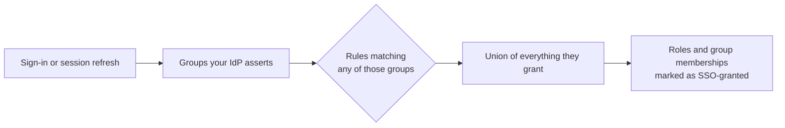

# Running Single Sign-On

*For Administrators.* Once a connection is live, the questions change. Who gets
what, and why. What happens when somebody leaves. Why one person cannot sign in
when everybody else can.

If you are still connecting your first provider, start with
[Single Sign-On](/guide/sso-setup) instead — this page assumes you have one
working.

## Most common tasks

- [Find out why someone can't sign in](#when-a-sign-in-fails)
- [Give people roles from their directory groups](#access-mapping)
- [Let groups decide who is in a workspace](#workspaces-your-identity-provider-controls)
- [Offboard somebody who is leaving](#somebody-is-leaving)
- [End someone's sessions now](#ending-sessions)
- [Make single sign-on the only way in](#enforcing-single-sign-on)
- [Let people in when the identity provider is down](#when-your-identity-provider-is-down)
- [Add a second identity provider](#adding-a-second-identity-provider)
- [Turn a connection off](#turning-a-connection-off)

---

## How access is decided

Everything on this page follows from one loop:



Three properties of that loop matter more than any individual setting.

**It runs constantly — over the groups from their last sign-in.** Every session
refresh (a few minutes apart while somebody has the app open) re-evaluates the
rules on this page, so a rule you change here applies to active sessions within
minutes. The group list itself is read from your directory at sign-in: a change
made *there* — somebody added to or removed from a group — lands at that
person's next full sign-in, within 24 hours at the latest, because no session
outlives the daily re-authentication ceiling.

**It is a union.** Somebody in three mapped groups gets everything all three
grant. There is no ordering, no precedence, and no way for a narrower group to
take away what a broader one gave. If you need somebody to have *less*, they need
to be in fewer groups — not in a group that grants less.

**It only governs what it granted.** Access created by these rules is marked as
SSO-granted, and the loop adds and removes only those. Anything an administrator
granted by hand is invisible to it and survives untouched. That is the single
most important sentence on this page, and [the next section](#three-things-that-surprise-people)
explains what it costs you.

---

## Three things that surprise people

### 1. Removing somebody from a group may not remove their access

The loop only revokes what it granted. If an administrator also granted the same
role by hand, that grant is a different thing wearing the same name — and it
stays after the directory group is gone.

It is worse than it sounds, because the two silently collapse. If the manual
grant already exists when the rule fires, the rule does not create a second one.
So the person has *one* grant, and it is the manual one, and removing them from
the group does nothing at all.

> **Note:** *What to do.* When somebody leaves, do not stop at the directory.
> Check **Admin → SSO → Diagnostics**, find them, and look at what they still
> hold. Suspending the account is the reliable way to end access immediately —
> it is re-checked on every refresh regardless of where a grant came from.

### 2. Changing a connection's trust settings can switch its rules off

A rule granting a platform-admin role only works from a **verified** connection,
and that is re-checked on **every sign-in** — not once when you wrote the rule.

So turning on *Trust unsigned payloads* (a corporate portal), *Trust
unverified sign-ins* (a gateway connection's browser exchange), or switching a
portal to read a proxy header, downgrades the connection's assurance and stops
its platform-admin rules granting from the very next login. The rule stays on
the page looking exactly as it did. Both unsigned postures also record every
accepted login as `user.sso_unsigned_accepted`, so the audit trail shows
exactly which sign-ins rode the reduced trust.

The Access mapping tab marks a rule in this state, so you are not left guessing.
But if somebody reports losing admin access shortly after a connection was
edited, this is why.

### 3. A rule with a mistyped group name fails silently

Nothing validates that `enginering` is a group your IdP actually sends. The rule
sits there matching nobody, indefinitely, and looks identical to one that works.

> **Note:** *What to do.* Group names come from the claim mapped to **Groups**.
> Open the connection's **Claim mapping** section and press **Use last real
> assertion** — the payload it loads contains the exact group strings your IdP
> sends. Copy from there rather than from your IdP's console, where the display
> name and the emitted value often differ.

---

## Access mapping

**Admin → SSO → Access mapping.** Each rule reads as a sentence: *anyone in
`engineering` from Corporate Entra gets Editor in Analytics*.

### What a rule can grant

| Target | Use it when |
|---|---|
| **A role** | The group maps directly onto one job — *everyone in `data-eng` is a Data Engineer in the Warehouse workspace*. The most common case. |
| **Membership of a group** | The access is a bundle you maintain elsewhere. The person joins an internal group under Admin → Groups and gets whatever that group carries, now and in future. Change the bundle once and every rule pointing at it follows. |

Prefer a role when the answer is one role. Prefer group membership when you would
otherwise write the same three rules for four different IdP groups — the internal
group becomes the thing you edit, and the rules stop needing to change.

### Scope is never asked

You pick a role; the scope follows from it. A workspace role asks which
workspace, an organization-wide role does not ask at all. There is no combination
of role and scope you can choose that the server will reject, because the
combinations that would be rejected are not offered.

### What cannot be granted this way

`super_admin` can never be auto-granted — not by any rule, from any connection.
It is refused when you write a rule *and* refused again every time the loop runs,
so a rule inserted straight into the database still cannot grant it.

Platform-admin roles (`org_admin`) have two conditions:

- They must be bound to **one specific connection**, never *any connection*. A
  wildcard rule would apply to an unverified connection added next year, so it is
  refused outright rather than resolved to "fine for now".
- That connection must be **verified**. See [assurance](#assurance) below.

### Assurance

How much a connection's word is worth. Derived from how it is configured, not
stored, so it always reflects reality.

| Level | Means | Can grant platform admin |
|---|---|---|
| **Verified** | The identity was proved against the provider itself — either a signature checked against a key we hold (their JWKS, a pasted public key, or a shared secret), or an answer the provider gave us directly when we asked it | Yes |
| **Asserted** | A trusted network position vouched for it — sound if your proxy strips inbound copies of the header, a full bypass if it does not | No |
| **Unverified** | We cannot tell a genuine claim from a forged one — an unsigned portal payload, a gateway connection running *Trust unverified sign-ins*, or one with TLS verification switched off (anyone on the network path could answer as the gateway) | No |

### Getting a connection to Verified

A live connection below Verified carries a warning on its card that names its cause and its
fix, with **Open its settings** beside it; once you have read it, **Hide** folds it to one
line on your screen (it opens again if the cause changes). The **Unverified** or
**Asserted** pill stays either way.

**Nobody is locked out below Verified.** An Unverified or Asserted connection signs people in
and links existing accounts by email — org admins' included — exactly as a Verified one does.
What it never does is link itself to a Super Admin's or a break-glass account: a forged identity
cannot claim the platform. Super Admins link the connection from their own account page once
(user menu → **Identities** → **Link**), and sign in through it from then on; break-glass
accounts stay password-only. To link *every* existing account automatically, Super Admins and
break-glass included, turn on **Link Super Admin and break-glass accounts too** under the
connection's **Identity** (it appears whenever the connection is below Verified, and the card
says when it is on) — and accept that anyone who can forge what the connection trusts could then
sign in as one of them.

**What linking means on such a connection.** Once an account is linked — by email, by the
person, or through that switch — anyone able to forge a reply naming its subject can sign in as
it. That is what the Unverified rating says, for every account the connection signs in; the
lasting fix is to make the connection Verified, below. Until then, Super Admins can keep signing
in with their password instead of linking.
Whether an existing account links at all is still the **Account linking** policy's call:
*Strict* skips accounts that already have another single sign-on identity (choose *Allow
verified* to stack them), and the gateway's addresses count as verified only while **Treat
the gateway's email addresses as verified** is on (the default).

**What decides the rating:**

| Connection | Verified when | Below it when |
|---|---|---|
| OIDC, SAML | Always: the IdP's signature is checked on every sign-in | — |
| Enterprise gateway, exchange on **our server** | TLS to the gateway is verified (the default): the server asks the gateway itself at every sign-in and renewal | **Skip TLS verification for this connection** is on — *Unverified*, unless the answer arrives as a signed token checked against a pasted public key or shared secret |
| Enterprise gateway, exchange in **the browser** | **Verify the token with** is a JWKS URL, a pasted public key or a shared secret: the gateway's token is signature-checked and accepted once | It is *Nothing — trust it unverified* (Trust unsigned) — *Unverified*; or TLS verification is off with a JWKS URL, since the key set itself would arrive unverified |
| Portal (corporate profile) | Its payload is a signed JWT, read from a cookie or browser storage, checked against the key the connection holds | The payload is read from a **header** — *Asserted*: trusted only as far as your proxy strips inbound copies of it; or it is accepted unsigned — *Unverified* |
| Development sign-in | Never | Always *Unverified*: keep it off wherever real people sign in |

**An Enterprise gateway that trusts unsigned replies**, step by step:

1. **Ask the gateway team for a signed reply.** The translate endpoint returns its answer as a
   JWT signed with their key, and they give you one of: a JWKS URL (best — keys rotate on
   their side without you), a PEM public key, or a shared secret for HS256. What to send
   them is in the [gateway integration contract](/docs/sso-backchannel-contract#when-the-cookie-never-reaches-us-the-browser-side-exchange).
2. **Keep the same subject.** The signed token must carry the same subject (the claim mapped
   to the person's ID) as today's replies. Existing people are matched by it; a token
   naming them differently reads as a new identity, and under *Strict* their account, which
   already has the old one, is not linked.
3. **Let the server reach the key set.** An internal JWKS host needs an entry under
   **Settings → Internal gateways SSO may call** (host **and** port), and, if it is signed
   by your corporate CA, the [CA bundle](/docs/deployment#corporate-tls-trust-for-sso).
4. **Switch the connection over.** Under its settings, set **Verify the token with** to the
   key you were given, and save. Choosing a key replaces *Nothing — trust it unverified*.
5. **Rehearse** from the card before publishing it to everyone: the verdict states which
   reply shape arrived (a signed token or bare JSON), what judged it, and the claims — check
   the subject is the one people already have. The pill turns **Verified**.

If the corporate cookie is set on a parent domain this application shares, there is a second
way: set **Who redeems the corporate session** to *Our server*, give it the **Gateway URL**
and an allowlist entry, and the server asks the gateway itself over verified TLS — no
signature needed.

**A gateway or IdP behind your corporate CA:** mount the
[CA bundle](/docs/deployment#corporate-tls-trust-for-sso) (`SSO_OUTBOUND_TLS_CA_CERTS`)
rather than switching TLS verification off; the bundle keeps the connection Verified.

**A portal:** have it sign its payload as a JWT and give the connection the key. A header
from your proxy can only ever be *Asserted*.

**Once a connection is Verified:**

- Super Admin and break-glass accounts link automatically, by the linking policy, like
  everyone else, and **Link Super Admin and break-glass accounts too** no longer applies (it
  disappears);
- access mapping rules can grant platform administrator roles through it;
- the card's warning goes away;
- people already linked notice nothing: their sign-in, sessions and accounts are unchanged.

For a gateway connection's browser exchange, the rehearsal verdict states
which reply shape arrived (a signed token or bare JSON) and what judged it —
the quickest way to see which rating a deployment's gateway earns.

The verdict also says when the claims carried **no authentication time**.
Such a sign-in is not refused; the line spells out what it means: the
re-certification ceiling (24 hours by default, `SSO_SESSION_MAX_AGE_HOURS`)
then measures from each sign-in instead of from the moment the person
actually authenticated at the IdP. The same happens when the time is too old
to use — a gateway reporting the portal's original login — and the login
event records it as `auth_time_anchored: true`.

---

## Workspaces your identity provider controls

A workspace admin can say that a workspace's members come from your identity
provider: on its **Members** tab, **How people get in** → **Who decides who is
in** → **Through your identity provider**. Nothing changes in the loop above —
the setting changes how *requests* for that workspace are answered:

- An approver answers a request by **pointing it to a group** — any group with
  an [access mapping](#access-mapping) rule that reaches the workspace, at a
  level the approver could grant. The requester is told which group, and in
  which provider, to ask IT for.
- When their next sign-in carries the group and the loop grants the access, the
  request closes itself as approved, and the requester and the approver hear
  about it. A sign-in that grants something else leaves it open.
- Letting someone in without the group is an **exception**: a role granted in
  the app and labelled **Exception** wherever access is listed.

Before you switch a workspace over, write at least one rule for it — without
one, there is no group to point people to, and every answer is an exception.

> **Note:** The request only closes after a full sign-in with the group,
> because the group list is read at sign-in (see [How access is
> decided](#how-access-is-decided)). Someone who has never signed in through
> single sign-on can't receive it at all — the approver is warned.

- An exception ends on its own once the loop grants the same access. At the
  person's next sign-in, an exception for the very role a rule grants becomes
  that rule's grant — the loop then adds and removes it like any other, with no
  gap in between — and one whose workspace permissions the person's other
  identity-provider grants already cover is ended. The person and whoever
  granted it hear about it, and a request to keep the exception closes.

> **Note:** Memberships of app-managed groups bound to the workspace aren't
> policed. An access review ([Workspace
> Admin](/guide/workspace-admin#reviewing-who-has-access)) is the way to go
> through them.

---

## Who can sign in, and how

**The sign-in page leads with single sign-on.** With a connection live, the
first thing on it is **Continue with** your primary connection — the first in
login-page order (**Priority**, lowest first; the providers list marks it
**Primary**). Below it, people can type their email and press Enter: an
address whose domain a connection lists under **Email domains** goes to that
connection, and any other address goes to the primary. Nobody is asked for a
password they do not need. While **Passwords** is on, a quieter **Can't use
single sign-on? Sign in with email and password** link is the fallback, and it
is offered prominently whenever a single sign-on attempt fails.

**Admin → SSO → Settings.** Four switches. The page opens with one sentence
describing what somebody arriving at the sign-in page gets right now, because
four independent switches do not add up to that on their own — watch it as you
change them.

| Switch | On | Off |
|---|---|---|
| **Single sign-on** | Connections appear on the sign-in page | No company buttons at all. Nothing is deleted; turning it back on restores every connection as it was. People already signed in through a connection stay signed in until their sessions expire — the confirm offers to sign them out now, with the count, and the same action stands alone on the page once the switch is off |
| **Passwords** | Anyone with a password can fall back to it | Break-glass accounts only — see *Enforcing single sign-on* below, and *When your identity provider is down* for who else gets in during an outage. Refused until a break-glass account is ready |
| **Create accounts automatically** | An account appears the first time somebody signs in through a connection | They must already exist here. An unknown person is turned away with `jit_disabled` |
| **Ask for an email first** | One email field leads; the connection buttons sit behind **Other ways to sign in** | The primary connection's button leads, with the others under it |

### The combination the server refuses

Turning **Single sign-on** off while **Passwords** is already off would lock
everyone out, so the server refuses it with the same 409 it uses for the
lock-out-an-admin case — whichever switch you turn off second, and whether you
flip both in one save or one at a time. Should a deployment reach that state
anyway (a seeded database, a direct edit), the posture sentence at the top of
the page turns red and says nobody can sign in; existing sessions keep working
until they expire, so there is a window to put one back.

### Enforcing single sign-on

Turning **Passwords** off makes SSO the only way in for everybody except
break-glass accounts. Four things make that safe to actually do:

1. **A ready break-glass account.** The switch is refused until one exists: an
   active Super Admin with a password, marked as a **system account** in
   Admin → Users. **Break-glass accounts** on the Settings page shows whether
   one is ready. It is the door that survives an identity-provider outage.

2. **The lockout warning.** Administrators — Super Admins and org admins —
   who have neither a linked SSO identity nor the system-account mark are
   listed, with their role, when you turn the switch off, each with **Make
   break-glass**. **Turn off anyway** proceeds: they
   keep their accounts and sign in through a connection from then on (it links
   them by email the first time, where the connection's linking policy
   allows).

3. **The system account (break-glass).** A system account is out of scope for
   enforcement: it keeps password sign-in even while passwords are off, and
   forced sign-outs skip it. The sign-in page shows no password form under
   enforcement, so the system account signs in at `/login?password=1` — the
   page does not advertise that address outside an outage, and revealing the
   form grants nothing: every account that may not use a password gets the
   same "Invalid email or password" a wrong password gets, so the form cannot
   be used to find out which accounts may. A fresh deployment's seeded
   administrator is marked automatically; existing deployments mark theirs in
   Admin → Users. Reserve the mark for operational accounts.

4. **Requiring everyone to sign in again.** Flipping the switch changes what
   the *next* sign-in must be; the sessions already out there stay valid under
   the old policy until they expire — up to a day. The confirm offers to end
   them in the same breath, with the counts, and the same act stands alone on
   the page as **Require everyone to sign in again** for the admin who reaches
   for it later. It ends every session, password and SSO alike, except system
   accounts — including your own, unless your account is one; you are walked
   to the sign-in page and come back in through a connection like everyone
   else.

Password **sign-up** is refused under enforcement too, invited or not — an
account created with a password it can never use is a dead end discovered at
first sign-in. Invites are redeemed by signing in through a connection
instead.

### When your identity provider is down

Enforcing single sign-on must not turn an IdP outage into a platform outage.

**What happens by itself.** Every minute the platform checks that each OIDC,
SAML and Enterprise gateway connection still answers — the same calls a
sign-in makes (a gateway is asked with no session, and a 401 counts as an
answer). Once a
connection it has seen working has failed for three minutes in a row, the
outage is confirmed:

- the sign-in page says *We can't reach {connection} right now*;
- **Super Admins with a password can sign in with it**, through
  **Administrator sign-in** on that page — so somebody can always get in to
  support everyone else. Break-glass accounts always could;
- people already signed in through that connection keep working past their
  daily re-authentication, for up to a day more, instead of being sent to a
  sign-in page that cannot answer. Through an Enterprise gateway they keep
  working for the connection's outage grace (see *People on the gateway
  connection keep getting signed out* below), then land on this sign-in page
  with the notice, not on the gateway's.

It counts as over after five minutes of the connection answering again. Only
the platform's own checks count — nothing a browser reports — and when the
checks are not running (Settings says so), nothing opens by itself.

**What you do when people need to work.** Settings → **Emergency password
access** → choose how long (1 to 24 hours) → **Open for everyone**. Anyone with
a password can then use it, and the sign-in page says until when. It closes
itself; **Close now** ends it early once the IdP is back. Use it too for an
outage the checks cannot see: a portal connection, a gateway whose exchange
runs in the browser, or an IdP that answers the platform but not your users.

**An outage longer than the window.** While it is open, the same card offers
**Extend**: keep it open for 1, 4, 8 or 24 hours from now (only the choices that
end later than it does now are offered), with a reason. It is never open more
than a day ahead, so somebody decides again at least once a day, and there is
no limit to how many times it is extended. Extend it **before** it lapses: when
the window closes, everybody who signed in through it is sent back to single
sign-on at their next renewal — to the sign-in page while the IdP is still down.
Each person's own emergency session also lasts a day at most, so during a long
outage people type their password again once a day. Super Admins need no
window: their way in stays open for as long as the outage is confirmed.

**When it is over.** Password sessions opened during the outage end at their
next renewal and go back through single sign-on — usually a brief redirect
that lands people on the page they were on — and never last more than a day.
People who stayed signed in through the outage meet their daily
re-authentication at the next renewal; one who has been signed in for more
than two days in all is sent to sign in again even if the IdP is still down,
when the emergency window is their way back.

**What the activity log records.** Administration → Activity, and the SSO
page's **Activity** tab:

| Event | Says |
|---|---|
| The outage | *SSO connection 'entra' unreachable…* when it is confirmed, and *…reachable again* when it is over |
| The window | Opened (for how long, until when, the reason given), extended (to when, from when, the reason), closed early by an admin, or closed by itself at its deadline — each with who did it |
| Each sign-in through a door | *Signed in with a password through emergency access*, *…while single sign-on was down (Super Admin)*, or *…with a break-glass account's password*; the SSO tab shows the door as the row's reason |
| A refused password | *Failed password sign-in…: local_login_disabled* — the person was told only "invalid email or password" |
| Sessions kept through it | *Kept … signed in past the daily re-authentication — entra is down*, once per session |
| Sessions it ended | *Password session opened while SSO was down ended…*, saying whether after a day or because its way in closed |
| Break-glass accounts | Made or no longer a break-glass account, by whom — or from the server's command line |
| Settings changes | Which switch moved (*Passwords turned off — break-glass accounts only*); for a connection, which settings changed by name, and before → after whether it is on, its linking policy, its rating and **Link Super Admin and break-glass accounts too** |

**When nobody can sign in at all** — no break-glass account ready and every
admin SSO-only — run this on the host, then sign in at `/login?password=1`:

```bash
python -m backend.scripts.reset_admin_password --email you@example.com --break-glass
```

It sets a password, marks the account as break-glass, clears its failed
sign-in count and signs its old sessions out.

> **Note:** *What this trades.* Somebody able to make your IdP unreachable
> from the platform can open the password door for Super Admins — which is why
> only Super Admins get in automatically, and everybody else needs a person to
> open the window. Every sign-in through these doors, and every outage, is in
> the activity log.

### Create accounts automatically

Off is the right answer for an organisation that wants an explicit step before
somebody has an account — the directory says who *may* sign in, but somebody here
decides who *does*. Turn it off and pre-create accounts, or send invites.

Existing people are unaffected either way. This only decides what happens the
first time a person your IdP knows and {brand} does not arrives.

### Ask for an email first

Better once you have several connections: it stops people guessing which button
is theirs, and it stops the sign-in page leading with your list of identity
providers.

Set **Email domains** on each connection first (connection editor → Login page).
An address matching nothing goes to the primary connection.

> **Note:** *It will not tell you when you get this wrong.* Every miss — unknown
> domain, disabled connection, a typo in the domain list — returns exactly the
> same empty response, deliberately, so the page cannot be used to enumerate your
> connections. The cost is that a mistyped domain sends people to the primary
> connection instead. Test with a real address after changing it.

---

## Account linking

When somebody signs in through a connection and an account with that email
already exists, what should happen? That is the **linking policy**, set per
connection in the editor's **Identity** section.

| Policy | Links an existing account when | Choose it when |
|---|---|---|
| **Strict** *(default)* | The IdP says the email is verified, the account is active, and it has **no other SSO identity** | You have one identity provider. Safest. |
| **Allow verified** | Same, but tolerates an account that already has other SSO identities | You have more than one connection and people legitimately use both |
| **Manual only** | Never automatically. The person links it themselves from their own account page | You want the account holder, not the directory, to consent to the link |
| **Disabled** | Never. Every IdP subject gets its own fresh account | Testing the refusal path. Rarely right in production |

> **Note:** *This is what makes a second identity provider look broken.* Under
> **Strict**, an account that already has an SSO identity will not link to a
> second one — the sign-in is refused with `strict_existing_sso` and the person
> is stuck. Move the second connection to **Allow verified**, and understand what
> you are accepting: anyone who controls either directory can sign in as that
> person.

---

## When a sign-in fails

The person is shown a short reference like `a1b2c3d4` and nothing else — telling
them the real reason would describe your configuration to anyone who can reach
the sign-in page. Ask them for it, then **Admin → SSO → Diagnostics → Given a
reference?** — **Look up** opens the Activity tab with it searched.

**Activity** is the full log: every sign-in, failure, session ending, sign-out,
identity link and SSO configuration change, one row per event with the person,
the connection, the outcome, the reason and the error behind it, the reference,
and the network address and browser as columns. Filter by outcome (each chip
shows its count), by connection, by window, and search by person, email,
reference or address; click a person or a connection in the table to narrow to
them, and open a row for the whole record. Every filter runs on the server, so
pages are full and "Load more" continues where the last page ended.

Nobody has quoted anything yet? **Sign-in problems**, at the top of
Diagnostics, lists everyone who failed to sign in over the last day, week or month —
one row per person, the people **still failing** first. Filter by reason, by
connection, or find a person by name, email or id. Open a row for:

- **The account.** Whether it has a password at all, the connections it can sign
  in through, and when it last signed in successfully. Someone who has signed
  in since their failures shows **Signed in**, and needs nothing.
- **Why, in words.** Each reason code, how often, and what to do.
- **Where each attempt came from.** Network address, browser, time, the
  reference, and the underlying error — an upstream status, an exception
  message — kept beside the code.
- **Why their session ended before it**, when it did (below).
- **Failures just before, from the same browser**, that happened before anyone
  could be named — a connection that could not reach its gateway, no corporate
  session on the request. Same address and browser is strong evidence, not
  proof: an office can share an address.

The list is built on the server from at most the 5,000 most recent records in
the window; it says so when there were more. Finding a person reads that
person's records directly, however many others there are.

### Password failures for accounts that sign in with SSO

A password attempt now records which refusal it was. The person still sees
"Invalid email or password" whichever it is.

| Code | What happened | What to do |
|---|---|---|
| `no_local_password` | The account has no password — it signs in only through single sign-on | They used the password option, usually because their SSO sign-in failed first: look at the failure just before it. Switching passwords off stops it being offered |
| `invalid_credentials` | Wrong password for an account that has one | Nothing, unless it repeats |
| `user_not_found` | No account uses that address | Nothing, unless it repeats |
| `account_inactive` | The account is pending or suspended | Approve or reinstate it under Admin → Users |
| `throttled` | Too many failures for that address in a short time | It clears by itself; a burst across many addresses is a password spray |
| `local_login_disabled` | Passwords are switched off and nothing opened one for this account | Expected — only break-glass accounts, Super Admins during a confirmed outage, and everyone while the emergency window is open may use one. Point them at their SSO button |

Rows written before this change say `invalid_credentials` for all of the first
four.

### Why a session ended

Shown beside a person's failures, because a session that stopped renewing is
usually why they were signing in at all.

| Code | Meaning |
|---|---|
| `reauth_ceiling`, `idle`, `absolute` | An SSO session reached the daily re-authentication limit, its idle limit, or its maximum age — they are sent back through their provider |
| `session_idle`, `session_expired` | The same limits, for a password session |
| `reuse_detected` | A renewal token was used twice, so the session was ended. Once is two tabs racing; repeatedly for one person, suspect a copied cookie |
| `sessions_revoked` | All their sessions were ended at once — "sign out everywhere", or an access change |
| `user_inactive` | The account stopped being active while signed in |
| `no_record`, `family_revoked` | The server had no record of the session, or it had already ended |

### Ending sessions

| To end | Do this | What happens |
|---|---|---|
| One person's sessions, keeping the account | Admin → Users → **End sessions** on their row | Every browser they are signed in on is refused at its next request; they can sign straight back in |
| One person, for good | **Suspend** | As above, and they cannot sign back in until reactivated |
| What one identity minted | Unlink the identity (theirs, or an admin's unlink) | Only the sessions that identity started end; their others carry on |
| What one connection minted | The connection's **End sessions** | Every session that connection started ends. Disabling a connection alone stops new sign-ins but ends nothing |
| Everyone | Settings → **Sign everyone out now** | Every session except the system accounts' |

Signing out, a password change or reset, a suspension and a role change take
effect on the next request, on every route. Sessions also end on their own at
the limits set in the deployment: `SSO_SESSION_MAX_AGE_HOURS` (default 24, the
daily re-authentication), `SESSION_IDLE_MAX_HOURS` (12) and
`SESSION_ABSOLUTE_MAX_HOURS` (168). The server refuses to start with an SSO
limit no longer than one access token (`JWT_EXPIRY_MINUTES`), and — in
production — with an absolute limit longer than the refresh-token lifetime
(`JWT_REFRESH_EXPIRY_DAYS`), which could never fire.

### Codes

Each row explains its code in place. The full vocabulary for linking:

| Code | What happened | What to do |
|---|---|---|
| `jit_disabled` | They are unknown here and automatic account creation is off | Create the account or send an invite, or turn the switch on |
| `sso_disabled` | The master switch is off | Settings → Single sign-on |
| `unsafe_auto_link` | An account with that email exists but the linking policy refused it. The specific reasons follow | See the reasons below |
| `strict_existing_sso` | That account already has an SSO identity, and this connection is **Strict** | Move this connection to *Allow verified*, or have them link it themselves |
| `email_unverified` | Their IdP did not say the address is verified | Fix it in the IdP, or map a claim that does carry verification |
| `unverified_connection` | The connection is below Verified, and such a connection never links itself to a Super Admin's or break-glass account — its claims, email included, are whatever the sender wrote. Everyone else, org admins included, still links | They sign in with their password and link it from their own account page; or make the connection Verified; or, accepting the risk, turn on **Link Super Admin and break-glass accounts too** on the connection (Identity) |
| `policy:manual_only` | The connection never links automatically, by design | The person links it from their own account page |
| `policy:disabled` | Linking is off for this connection | Change the policy, or expect a separate account |
| `existing_status:pending` | The account exists but was never approved | Approve it under Admin → Users |
| `existing_status:suspended` | The account is suspended | Reinstate it, if that is what you want |
| `existing_deleted` | The account was deleted | Restore it, or let a new one be created |
| `account_conflict` | Another account already holds that email in a way the sign-in could not resolve, even after reading again — for example a deleted account that still keeps it | Look the address up under Admin → Users. Two sign-ins racing for the same person — tabs restored together, a double click — never end here: the second signs in to the account the first created |
| `sso_account_inactive` | Their linked account is no longer active | Same as suspended — check Admin → Users |
| `link_target_inactive` | The account they are trying to link to is not active | Reactivate it first |

Missing claims show as a mapping error naming the field. That is a claim-mapping
problem, not a linking one: open the connection's **Claim mapping**, load the last
real assertion, and see what actually arrived.

### Enterprise gateway connections

These make calls out to your own network, so they fail in ways the other kinds
cannot.

The code names the failure class; the audit row's summary carries the
specifics (which URL, which path, which status).

| Code | What happened | What to do |
|---|---|---|
| `backchannel_no_session` | The request arrived without your portal's session cookie (or header) | Usually correct — they are not signed in to the portal. If they say they are, the cookie is not reaching us: check its domain and `SameSite` |
| `backchannel_idp_rejected:401` / `:403` | Your gateway said the session is not valid | Also usually correct. It is what makes signing out of the portal sign them out here |
| `backchannel_unavailable` | We could not get an answer. The audit summary says which way: `idp_blocked:…` means we refused to make the call — almost always the host allowlist (Settings → *Internal gateways SSO may call*; check the host **and the port**); `idp_unreachable:…` means it did not answer in time; `idp_status:5xx` means it answered with an error | Allowlist problems are yours; outages and 5xx are theirs — quote them the summary. An `idp_unreachable` whose summary mentions *certificate verify failed* means this deployment does not trust the gateway's TLS: mount your corporate CA bundle (`SSO_OUTBOUND_TLS_CA_CERTS`) rather than switching verification off. Existing sessions ride out a short outage; see below |
| `backchannel_token_absent` | Their reply did not contain a token where we were told to look | The path in the connection's settings does not match what they actually send. Rehearse and read the reply |
| `backchannel_claims_absent` | Same, for the user details | Same fix |
| `backchannel_claims_unmappable` | The details arrived, but the claim mapping could not produce an identity from them | Open the connection's **Claim mapping**, load the last assertion, and see which required field (subject, email) has no source |
| `backchannel_auth_time_absent` | Only on failures recorded before this was retired: their reply carried no authentication time | Nothing — such sign-ins now succeed, with the daily re-authentication ceiling measured from each sign-in. Asking them to include the time makes it measure from their own sign-in |
| `backchannel_jwt_invalid` | Their reply carried a signed token we could not accept — undecodable, wrong signature, unknown key, or an issuer/audience that fails the pins | Compare the connection's JWKS URL and pins against what their team publishes; the audit summary names the exact refusal |
| `backchannel_jwt_expired` | The signed token in their reply had already expired | Clock skew or a cached answer on their side |
| `backchannel_replayed` | A browser-delivered sign-in token was presented twice | Once is a harmless double submit; a pattern is replayed captured tokens — treat as an incident |
| `backchannel_failed` | None of the above — an unclassified failure, including a connection whose stored settings no longer build | Read the audit summary; if it names a setting, fix the row and save it (saving re-validates) |

### "People on the gateway connection keep getting signed out"

Usually this is the feature working. That connection re-checks with your gateway
every time it renews a session, so anyone your portal has signed out is signed
out here too, within one access-token lifetime — a few minutes on the default
setting. Before treating it as a fault, ask
whether the portal considers those people signed in.

If the gateway itself is down, sessions are *not* dropped straight away — they
keep working for the connection's grace period (15 minutes unless the
connection sets otherwise), measured from the last time the gateway actually
answered rather than the last time we tried. A brief outage is invisible. A
long one ends sessions rather than extending them indefinitely, which is
deliberate: an outage should spend that allowance down, not renew it. A
re-check that has not answered within 10 seconds counts as the gateway being
down for that renewal. Once the platform has confirmed the outage (three
minutes, see *When your identity provider is down*), the people whose
sessions end land on the sign-in page, which says the gateway can't be
reached and offers whatever password sign-in is open, instead of on a
gateway sign-in that can only fail again.

**Set the grace to at least twice the access-token lifetime.** The gateway is
asked once per renewal, and a renewal comes round once per access-token
lifetime (`JWT_EXPIRY_MINUTES`). A grace shorter than two of those can end
sessions at the first renewal that finds the gateway down, and against the
Helm chart's 60-minute tokens the default 15 minutes always does. *Outage
grace (seconds)* is on the connection's settings.

**Two settings that pass a rehearsal and fail at the first renewal.** A
rehearsal proves the sign-in; neither of these touches it:

* **A sign-in trigger connection whose *Cookie name* is the portal's own
  host-only cookie.** The renewal re-check reads that cookie off requests to
  *this* application, and a cookie scoped to the SSO host
  (`sso.corp.example`) never arrives here. Every renewal then reads as
  "signed out upstream": people are signed in again silently every token
  lifetime, and their other sessions end. Name a cookie set on a domain both
  hosts share, or turn off *Re-check with the provider on every session
  renewal*.
* **A handle-only connection that presents the handle as a cookie with no
  name.** With *Present the ambient token* on cookie and neither a *Cookie
  name* nor *Send it under a different cookie name* filled in, the gateway
  receives a cookie with no name. Name it, or present the token as a header.

**Tabs left open across an upgrade** keep running the page they loaded until
they are reloaded, including its sign-in and renewal code.

---

## Reading a connection's card

Every connection on the Providers tab is one card, and the card leads with
the only two questions that matter: can people use this, and is it about to
break. Every control on it explains itself when you hover.

**The state chip** says which of three states the connection is in:

* **Draft — not visible to anyone.** Still being set up; nothing on the
  sign-in page yet. Once a rehearsal has completed against it the chip adds
  **rehearsed ✓** — the difference between "configured" and "proven".
* **Live.** Published and enabled: on the sign-in page, accepting sign-ins.
  Live cards also show **Last sign-in** so a connection nobody has used in
  weeks reads differently from one that carried somebody in an hour ago.
* **Off — sign-ins refused.** The switch is off. This wins over everything
  else: a published connection that is switched off says *Off*, not *Live*.
  Configuration, mappings and linked identities are all kept — turn it back
  on and it is exactly as it was.

**The switch** turns the connection on and off. Turning one **off** asks
first and says how many people are signed in through it right now, with the
offer to sign them out in the same step (see
[Turning a connection off](#turning-a-connection-off)). Turning one **on**
is immediate — it strands nobody.

**Publish** exists only on drafts, and it asks first too: the confirm names
the consequence — in front of everyone on the sign-in page — and says
whether a rehearsal has ever completed against this configuration, which is
the one fact worth weighing at that moment.

**The flask** rehearses a sign-in: you sign in as yourself at that IdP,
nothing is written, no session is created, and the card reports who would
have signed in and what they would have been granted. **The pencil** opens
the connection's settings. **The bin** opens the same settings at the danger
zone — deletion asks you to type the slug, never one click from the list.

**The shield** is the assurance level ([Assurance](#assurance)); hovering it
gives the level's meaning in plain words plus the server's reason for this
row.

**The health line** is the "about to break" answer: certificate days
remaining on a SAML connection, or **No certificate to check** where there
is genuinely nothing to probe (a gateway connection, for instance) — which
is a different fact from **Not checked yet**, the muted line you see before
the first background sweep. If the health read itself failed, the line says
**Health unavailable right now** rather than pretending the connection was
never checked; hovering shows the full detail and when the last check ran.

One banner overrides all of it: when the platform's SSO master switch is
off, the tab says so at the top — no connection signs anyone in, whatever
the individual cards say.

## Worked scenarios

### Somebody is leaving

1. Remove them from the directory groups. That lands at their next full
   sign-in — within 24 hours at the latest — so on its own it is tidy-up,
   not prompt offboarding. Step 3 is the part that is immediate.
2. **Check what is left.** Diagnostics → find them. Anything an administrator
   granted by hand is still there and will stay there.
3. **Suspend the account.** This is the part that actually ends access, whatever
   its source, and it takes effect on the next refresh rather than the next
   sign-in.
4. If they had a linked identity you want to reuse, unlink it before the account
   is deleted — the external ID is the join key, and a new account claiming the
   same one is what "orphaned" means.

Removing the connection itself is not an offboarding tool: it turns off a route
for everyone, and grants already made stay made.

### Turning a connection off

Disabling a connection (the switch on its card) removes it from the sign-in
page and 404s its routes immediately — but that is only half of "off":

* **Sessions it minted keep going.** They rotate until their ceilings fire, up
  to 24 hours. The disable confirm shows how many people that is and offers to
  sign them out in the same step; password sessions are never touched, so
  anyone with a local account can sign straight back in that way. The
  platform-wide equivalent lives on the Settings tab once the master switch is
  off ("Sessions that outlived the switch").
* **The liveness probe stops too.** A disabled gateway connection is no longer
  re-checked upstream on refresh, so its surviving sessions are *more* durable
  than they were while it was on — deliberate (a disable must not read as a
  mass sign-out you didn't ask for), and exactly why the sign-out offer exists
  as the explicit lever.
* **A signed-in user whose connection vanished** is caught at their next
  renewal: the silent recovery finds the connection gone from the catalog and
  lands them on the sign-in page with "This sign-in method is no longer
  available. Ask your administrator how to sign in now." — not on a dead URL.
* **Nothing is deleted.** Configuration, mappings and linked identities all
  survive; re-enabling restores the connection exactly as it was. If people
  need a way in meanwhile, the admin Users screen can grant reset tokens that
  give even SSO-only accounts a password.

### Adding a second identity provider

Common after an acquisition, or when contractors use a different directory.

1. Connect and publish it exactly as you did the first — draft, rehearse,
   publish.
2. **Expect the collisions.** Anybody who exists in both directories will fail on
   the second connection with `strict_existing_sso`, because Strict refuses to
   add a second identity to an account that already has one.
3. Decide which you want:
   - **Allow verified** on the second connection — they can use either. Accept
     that either directory can now authenticate as them.
   - **Manual only** — the person links it themselves from their account page.
     Slower, and the consent is theirs.
4. Set each connection's **Email domains**, and turn on **Ask for an email
   first** once both are live. Two buttons is where people start guessing.
5. Remember that platform-admin rules are bound to one connection. If admins
   arrive through both, each connection needs its own rule — and both must be
   verified.

### Onboarding a contractor cohort

1. Have the directory team put them in one group — `contractors-acme`.
2. One rule: *anyone in `contractors-acme` from that connection gets Viewer in
   the Delivery workspace*. Workspace-scoped, so nothing else is exposed.
3. Leave **Create accounts automatically** on for the duration, so the first
   person through does not need a ticket. Turn it off afterwards if that is your
   normal posture.
4. Confirm the group name is real: load the last assertion after the first
   contractor signs in and check the group string matches your rule exactly.
5. **When the contract ends,** removing the group from the directory removes the
   access. Then delete the rule — a rule matching nobody is not harmful, but the
   next person to read this page should not have to work out whether it is live.

---

## Keeping it healthy

**Certificate expiry.** A SAML signing certificate that expires takes every
sign-in down at once, and the date is readable months ahead. Each connection
shows its remaining days and warns from 30 days out. After rotating one, rehearse
a sign-in rather than waiting for a user to find the problem.

**The stat tiles.** The row above the tabs is the quickest health check you have:
drafts nobody has rehearsed, and failed sign-ins in the last 24 hours. Both
should usually be zero.

**Rehearse after changes.** The rehearsal from setup is available on every
connection's card at any time, not just during setup. It writes nothing and
creates no session, so there is no reason not to use it after editing a
connection. Its verdict also tells the avatar story — whether the mapped
picture would arrive (type and size), or which rule refused it and, when the
host is the problem, which host to add to the avatar image hosts list.

---

## Where to next

- [Single Sign-On](/guide/sso-setup) — when you need to connect another
  identity provider or change how a connection is set up.
- [Users & Access](/guide/users-access) — when you want to manage roles,
  groups and accounts by hand.
- [The Admin Console](/guide/governance-ops#activity) — when you want the
  wider activity log of role, group and account changes.
- [Troubleshooting](/guide/troubleshooting#someone-has-too-much--too-little-access)
  — when someone has too much or too little access.
