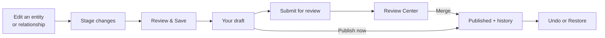

# Versioning & Change Control

*For Builders who change data, and anyone who reviews or rolls back changes.*

Version control is how the graph's **data** changes safely: you edit in a
draft, someone can review it, it is published, and every published
change stays in a history you can undo or roll back. This page explains what
it gives you, how it is switched on, and the path through this part of the
guide.

> **Note:** *The one-sentence model* — editing a graph works like editing a
> shared document with track changes: you draft, someone reviews, it publishes,
> and nothing is ever silently lost.

## What version control gives you

- **Edit safely in drafts.** Your changes stay in a draft until they are
  published. The live graph — what {brand} calls **Published**, the version
  everyone sees — is never touched by work in progress. A draft is **public**
  (everyone who can see the data source sees it, and everyone who can edit it
  can change it) or **private** (its owner, the people added to it and its
  reviewers).
- **Review before anything ships.** Raise a change for review, see exactly what
  moves, resolve conflicts, then merge.
- **Full history, and a way back.** Every publish is a revision you can
  inspect, undo on its own, or roll the whole graph back to.

Version control covers the graph's entities and relationships. It is not the
same as the versioning of a [semantic layer](/guide/semantic-layer) (the
meaning of your types), or the
[versions of a View's design](/guide/managing-views#go-back-to-an-earlier-version-of-a-view)
(its layers and settings).

## Is it turned on? Two levels

Version control is switched on at two levels, and both must be on before you
can edit a data source.

| Level | Who controls it | Where | Default | While it's off |
| --- | --- | --- | --- | --- |
| **The whole deployment** | Your administrator | **Administration → Features → Version control** | On | Every version-control surface is hidden and canvases are view-only: no drafts, no reviews, no publishing, no blank models. Existing history is kept, and switching it back on restores everything as it was |
| **Each data source** | Anyone who can manage the workspace's data sources (the **Workspace member**, **Data engineer** and **Workspace admin** roles) | On the canvas, or the data source's **Versioning** tab | Off until someone turns it on (a model built from scratch has it from the start) | The data source can be read, explored and exported, but not edited: **Edit** says *Version control isn't set up for this data source yet* |

A third switch, **Administration → Features → Edit mode** (on by default),
decides whether anyone may change entities and relationships at all. With it
off, Views are read-only and the server refuses any change to a node or edge,
even in a draft.

> **If you see "Reviews are turned off":** the deployment-wide **Version
> control** switch is off. Ask your administrator.

### Turn on version control for a data source

*For people who can manage the workspace's data sources.*

1. Open a View built on the data source. A strip above the canvas says
   **Version control is off for this data source**. (Or open **Workspaces**,
   choose the workspace, select the data source on the **Data Sources** tab, and
   open its **Versioning** tab — it says **Version control is off**.)
2. Choose **Enable version control**. The **Turn on version control** dialog
   opens on **What it means**: what version control gives you, and what
   happens to changes another tool writes straight to the graph (see **If
   another tool keeps writing to the graph**, below). Choose **Continue**;
   the dialog then says how much it will copy into the version history.
3. Choose **Turn on version control**. The strip shows the copy's progress —
   *N of M items copied*. You can keep using the graph while it runs, and
   nothing changes until every item has been checked against the source.
4. When it finishes, the strip says **Everything checked out**: *Your graph is
   now under version control — and we verified the copy against the source
   before switching it on.* Choose **Done**.

If some identifiers (URNs) belong to more than one item, the copy pauses before
copying anything and the strip says **Some identifiers are used more than once**.
It shows how many, which copy of each it would keep (the one synced most
recently), a **Download full list (CSV)** button, and a warning when other data
sources read the same graph. Someone who can manage the data sources then
chooses **Collapse *N* duplicates and continue**, **Re-check source** after
fixing them at the source, or **Give up**.

If the data source names its items by another property than `urn` — an `id`,
say, set as its identity property — the copy first gives each item a `urn` from
it, because version history tells items apart by `urn`. Each one also gets a
`urnSource` saying where it came from. An item with no identifier at all stops
the copy before anything is copied, and the strip says how many: give them one,
then start over.

Turning version control on doesn't change your existing data, except in two
ways. Collapsing duplicates removes the extra copies from the graph itself, for
every data source that reads it. And items given a `urn` keep it. **Give up**
undoes neither. If the copy stops part-way, the strip explains why and offers
**Resume** or to start over.

**If another tool keeps writing to the graph.** Something outside this app (an
ETL job, say, or a connector) may keep writing to the data source's graph after
version control is on. What it writes stays in the graph and shows in views, but
it isn't in the version history. The data source's **Versioning** tab says so
under **Not in history**: how many items and connections, or that the tool
reported a change. Someone who can publish chooses **Bring into history** to take
it in as one published change. It adds and updates items; it never removes
anything from the version history. **Rebuild** on that tab writes what version
history holds back into your own graph: items' fields go back to their values in
history, and nothing else in the graph is removed. **Not in history** counts what
the tool adds: if it also removes items the version history holds, as many as it
adds, nothing shows there. **Check sync** lists such missing items, and
**Rebuild** puts them back.

## The life of a change

1. **Edit** — in a draft, change an entity or relationship in its drawer, or
   add and connect entities on the canvas.
2. **Stage changes** — keep the edit for review. Nothing is saved yet.
3. **Review & Save** — check your staged edits and save them to the draft as
   one save point.
4. **Publish** your draft — **Submit for review**, or **Publish now** if you
   don't need a review.
5. **Review Center** — a reviewer checks the changes, pulls in newer published
   work if needed, and **Merge**s it, or **Dismiss**es it.
6. **History** — every merge or publish becomes a revision you can undo or roll
   back to.

## Follow the track

Read these in order the first time; afterwards, jump to what you need.

1. [Editing in a Draft](/guide/editing-in-a-draft) — start a draft, change
   entities and relationships, Review & Save, and submit your draft for review.
2. [The Review Center](/guide/review-center) — find the requests waiting for
   you, check what they change, and merge or dismiss them.
3. [Import & Export](/guide/import-export) — make many changes at once from a
   file, and take backups out.
4. [Undo vs. Restore](#undo-vs-restore--the-distinction-that-matters), on this
   page — fix a mistake that has already been published.

## Words you will see

| On screen | Means |
| --- | --- |
| **Published** | The live version of the graph that everyone sees |
| **Draft** | A working copy where your changes wait until they're published |
| **Stage changes** | Keep an edit for **Review & Save** — nothing is saved yet |
| **Review & Save** | Save your staged edits to your draft |
| **Publish** | Send your draft to **Published** — through a review, or directly |
| Review request / merge request | A draft submitted for someone to check and merge |
| **Merge** | Apply a reviewed request to **Published** |
| **Get latest updates** / **Pull latest** | Bring newer published changes into a draft that has fallen behind |
| Revision | One published change in the history |
| **Fork** | A copy of a data source's graph to work in, with its own drafts and history |
| **Update from parent** | Take the newer changes of the data source a fork came from into the fork |
| **Propose to parent** | Open a review of a fork's changes into the data source it came from |

More terms are in the [Glossary](/guide/glossary).

## See the history

1. Open a View on a data source with version control.
2. In the View's header, choose **Reviews**. The **Changes & Reviews** panel
   opens — on **Changes** if you're in a draft, on **History** if you're on
   **Published**. (It's called **Commits** if an administrator has turned off
   the revision viewer; see below.)
3. On **History**, choose the scope: **This draft**, **This view** (changes made
   from this View) or **Whole graph**. Select a revision to see its changes.

After a merge or publish, the banner *Merged — your changes are now live* (or
*Published — …*) offers **View in history** too. A data source's **Versioning**
tab lists its drafts, open merge requests and its whole history.

The history is listed newest first, by month and day, and keeps loading older
revisions as you scroll — all the way back to the first.

### See the graph as it was

> **On by default.** An administrator can turn it off under Admin → Features →
> **Revision history viewer: the graph as it was**. Then no past revision opens
> or compares, and the **History** tab is called **Commits** again.

Like checking out an earlier commit, you can open the published graph as it was at
any revision, read-only, and compare any two revisions.

1. In **Reviews → History**, open a revision's **⋯** menu and choose **Open on
   canvas**. Or choose **Months** to go to the end of any month or day: darker
   months saw more revisions. A data source's **Versioning** tab has the same
   history: choose a view under **Open in**, and its revisions open there.
2. The canvas shows the graph as it was. The banner above it says when that was,
   which revision it is and who made it, and how much has changed since.
3. Choose **Back to Published** (or press **Esc**) to return to the graph as it is now.

While a past revision is open:

- **Search finds entities by name as they were then**, ignoring case. In the
  Context View, type in the search box; on the other layouts, choose **Search**.
- **Lineage traces follow the flows as they ran then**: the Context View's trace
  and Lens, and the lineage in an entity's details on any layout.
- **Nothing can be edited**, and Advanced Search, display rules, subset views,
  Narrow and the graph and hierarchy layouts' trace are off: they read the graph
  as it is now. Each says so.
- **The layout is today's**: the view's layers and the ontology as they are now.
- **Exporting** downloads the graph as it was.
- **The address in your browser** (`?rev=…`) opens the same revision for anyone
  who can read the data source. **Copy link** on a revision gives you one.
- **When Published moves on**, the banner keeps counting the changes since up to
  when you opened the revision, and says *Published has moved on*. **Update**
  counts them up to now.

To compare, choose **Compare with now** (on a revision or in the banner) or
**Compare with…** and then the other revision. You see how much was added,
modified and removed, over how many revisions and by whom, which types changed
most, and every change. **Highlight on canvas** rings them on the graph, up to
20,000 of them; past that it says how many there are and offers **Open the list**.
In the Context View, **Review changes** rings them and lists them beside the canvas
instead (see [Review changes](#review-changes)).

Deleted entities are drawn where they were, struck through and marked
**Deleted**: under their parent when it's on the canvas, up to 500 of them. Deleted
relationships are rose dashes. Hover **Deleted** to see between which revisions it
went. The chip above the canvas counts what was added, modified and deleted; hover
it for what each mark means. When not every deletion could be drawn, it says how
many were, such as **3 of 40 deleted drawn**, and **Open the list** lists them all.
In the Context View, choose the count to review the deletions beside the canvas.

A revision more than 100,000 changes back is too far to draw. It opens as a
comparison with now instead, and you can still export the graph as it was then.
One open while Published moves that far on is handed over the same way.

### A deleted entity's details

Select a deleted entity or relationship drawn where it was, or choose **Deletion
details** on a deleted row of any list of changes. You see:

- **Who deleted it, when, and in which revision.** For a deletion published from a
  draft, who published it too, and the message it was published with.
- **Where it lived**: the entities it sat in, or the two a relationship joined.
- **What it held** when it was deleted.
- **What went with it**, when you unfold it: what it contained, and the
  relationships that went with them.
- **Its history**, when you unfold it. Each published revision's number shows what
  that revision changed.

On a canvas of that data source you can also:

- **Open just before it was deleted**: the graph as it was the revision before, with
  the entity selected. A revision too far back opens as a comparison with now
  instead. Save or discard your unsaved edits first.
- **See the change**: the revision that deleted it, compared with the one before. For
  a deletion in your draft, its **Changes**.

**Copy URN** is always there. **Restore** is there for a deletion saved to a draft
you can edit.

## Review changes

In the Context View, you can go through every change one at a time, each found on
the canvas where it is: a draft's, a past revision's, or two revisions compared.
That holds however many there are, and deletions are found even where the canvas
draws only 500 of them.

**Start a review** from wherever changes are counted:

- the counts in the strip above the canvas (**+12**, **~40**, **−1,798**): each
  one starts on its own kind of change;
- **500 of 1,798 deleted drawn**, which starts on the deletions;
- **Review changes** on two revisions compared (the chip above the canvas, or
  **Reviews → History → Compare**);
- the counts in a past revision's banner, which list what changed since;
- **Reviews → Changes → Review changes**.

**What it covers** depends on where you are:

| Where you are | What it covers |
| --- | --- |
| In a draft | **This draft**: its saved changes |
| A past revision open | **Since #12**: what changed after it. Or **Changed in #12**: what that revision changed |
| Two revisions compared | **#3 → #12**: everything in between |
| Published, nothing open | **The latest revision · #42**: what it changed |

### One change at a time

A bar at the bottom of the canvas takes you through the changes, starting with the
first. It says what each one is in plain words, such as *Deleted · orders_legacy ·
from Sales › crm · by Ana*. Technical users also see its type and qualified name.

- **‹** and **›**, or the **←** and **→** keys, go to the previous or next change.
  Each one is opened on the canvas down to where it sits, selected and scrolled to,
  however deep it is, and whether or not it was loaded.
- **All**, **Added**, **Modified** and **Deleted** show one kind of change at a time.
- **Details** opens what the canvas knows of it: an entity's details, or a deleted
  entity's (who deleted it, when, what went with it).
- **List** opens every change beside the canvas (below).
- **×** ends the review.

When a change isn't drawn here, the bar says so. For example, an entity added after
the revision open isn't on its canvas. It takes you as near as the canvas gets.

### Every change, beside the canvas

**List** opens the changes in the place beside the canvas that search results use.
Opening one closes the other, and each comes back as you left it. Technical users
get the list with every review; business users get the bar alone. Either way,
**List** changes it, and your choice is kept for your next review.

- **The title** names what it covers. Where there's a choice, it's a menu.
- **Show one kind of change at a time**, as in the bar, with counts.
- **Search** by name, URN or type.
- **Filter** by entities or relationships, and by type. The button says which
  kind the list is showing.
- **Choose a row** to go to that change on the canvas; the bar moves with it. Its
  arrow shows what changed in it. **↑** and **↓** move between rows.

The canvas rings what you're reviewing. **Changed in #12** and **The latest
revision** are highlighted on it while you review them, and the highlight goes when
you end the review.

### Deleted inside

A row whose deleted entities aren't all drawn says how many aren't, with a small
bin, such as **🗑 120**. Choose it to draw them under the row, 200 at a time.

The graph and hierarchy layouts keep their own lists: **Reviews → Changes** for
a draft, and **History → Compare** for revisions.

## Undo vs. Restore — the distinction that matters

Two different tools fix a published mistake, and they're not interchangeable.
Both add a **new** revision to the history rather than erasing anything, so
nothing is ever truly destroyed.

| | **Undo just this change** | **Restore graph to here** |
| --- | --- | --- |
| **What it does** | Reverses *one* published revision | Resets the *whole graph* to how it looked at the chosen revision |
| **Later work** | Kept — only the chosen revision is reversed | Rolled back along with everything else after that point |
| **Can it conflict?** | Yes — if a later revision changed the same items, it stops and offers to restore instead | No — it can't conflict, by design |
| **Use it when** | You know exactly which change was wrong, and other work since then should stay | You need to get back to a known-good state, whatever has happened since |

To use either:

1. Open the history (**Reviews → Commits**, scope **This view** or **Whole
   graph**).
2. On the revision, open the **⋯** (**Revision actions**) menu.
3. Choose **Undo just this change** or **Restore graph to here**.
   - *Undo this change?* shows the revision and reminds you that later changes
     are kept. Choose **Undo change**.
   - *Restore the graph to this point?* works out the exact impact first — how
     many later revisions it rolls back and how many items are updated, removed
     or brought back. Choose **Restore**.
4. A notification confirms that a new revision was added to the history.

If **Undo** can't apply cleanly, the dialog says *This change can't be undone on
its own*, names the items a later revision changed again, and offers **Restore
to just before it instead**.

A merged review request offers the same undo from the Review Center: **Revert
this merge**.

Undo and Restore are for people who can manage the workspace's data sources —
the same people who can merge. They are not offered on the **This draft** scope:
a draft that's wrong is simply discarded.

> **Tip:** If in doubt, Undo first. It's the narrower, safer tool. Reach for
> Restore only when you need to reset everything back to a specific point, or
> when Undo tells you it can't apply cleanly.

### Bring back one deleted entity

When the published graph lost one entity you want back, and the rest of its
revision should stay, bring back just that entity through your draft.

1. Open the deleted entity's details (see [A deleted entity's details](#a-deleted-entitys-details)).
2. Choose **Restore into my draft**. Your draft opens if it isn't open yet.
3. The entity comes back where it was. So do what it contained and its
   relationships to entities your draft still has, each under its own id.
   **Review & Save** opens with them.
4. Save, then publish your draft. The entity is back as it was, with the same id.
   Its history keeps both revisions: the one that deleted it and the one that
   brought it back.

It doesn't restore, and says why, when:

- your draft began before the deletion, so it still has the entity: pull the
  latest from Published into your draft first;
- your draft has the entity, or something deleted with it, again;
- your draft no longer has what held it: restore that first;
- too much went with it (over 1,000 entities or 5,000 relationships): undo the
  change that deleted it instead.

**Restore into my draft** is for people who can manage the data source, with
editing and version control on, on a view they can edit.

## Work in a fork

*When your administrator has turned on **Administration → Features → Forks**
(it is off unless they do).*

A **fork** is a copy of a data source's graph to work in, with its own drafts
and history. It reads the data source it came from — its **parent** — as it
was when the fork was made, takes the parent's newer changes when you ask
(**Update from parent**), and offers its own changes back as a review
(**Propose to parent**). A fork is a data source of its own, in the same
workspace, with its parent's settings.

### Fork a data source

*For people who can manage the workspace's data sources.*

1. Open **Workspaces**, choose the workspace, select the data source on the
   **Data Sources** tab, and open its **Versioning** tab.
2. Under **Forks**, choose **Fork**.
3. Give it a name and choose **Create fork**. Its data source is named after
   its parent and the name — for example *Sales · Q3 restructure*.

The fork appears in the list. If it can't be made — the data source already
has as many forks as it may, or its editing is paused — the dialog says why.

### See how far a fork is from its parent

Each fork in the list shows who made it and when, and **ahead · behind**: the
changes made on the fork since it last merged into its parent, and the
parent's changes it hasn't taken in yet. *Update recommended* means the fork
has fallen far behind, or so far that it reads more slowly; updating fixes it.

**Open** shows the fork's own data source. At the top of its **Versioning**
tab — and above the canvas of a View built on it — a strip says **Fork of**
its parent (a link back), how far it is, and offers **Update from parent**
and **Propose to parent**.

### Take the parent's changes

Choose **Update from parent**. Changes only the parent made simply show up in
the fork; what the fork and its parent both changed is merged. Where they
changed the same thing differently, the conflict dialog opens, as for
**Get latest updates**: for each, keep **Your version** (the fork's) or take
**Incoming** (the parent's), then choose **Merge with resolutions**. A large
update runs in the background: the button says **Updating…** until it is done.

Drafts on the fork then show as behind; bring them up to date with
**Get latest updates**.

### Offer the fork's changes back

1. Choose **Propose to parent**.
2. Give the review a title, a description and reviewers, and choose
   **Open review**. It opens in the [Review Center](/guide/review-center).

If the fork is behind its parent, **Propose to parent** says
*Update from parent first*: its review merges only once the fork has taken its
parent's changes. A fork has one open review at a time; proposing again opens
that one. The fork lives on after its review merges — propose again whenever it
has more.

To remove a fork, choose **Delete** in the list; **Restore** brings it back for
30 days. Close its open review, and delete any forks made from it, first.

> **If you see "Forks are turned off for this deployment":** forks stay listed
> and readable, and can still be deleted and restored, but nothing changes in
> them — **Fork**, **Update from parent**, **Propose to parent**, and approving
> or merging a fork's review, aren't offered. Ask your administrator.

## Who can do what

Version-control actions follow the workspace's data-source permissions, not the
View's sharing.

| Action | Who |
| --- | --- |
| See a data source's history, its public drafts and its Review Center | Anyone who can read the workspace's data. A private draft, and its review, only its owner, its members and its reviewers |
| Turn on version control for a data source | People who can edit the workspace's data sources — the **Workspace member**, **Publisher**, **Data engineer** and **Workspace admin** roles |
| Start a draft, and edit a public one: **Review & Save**, **Submit for review** | The same people. A private draft: its owner and its **Editor** and **Maintainer** members |
| Rename a draft, change who can see it, add members, **Discard draft** | Its owner or a maintainer |
| Hand a draft on | Its owner; a **Workspace admin** for someone who has left |
| **Publish now** (skip review) | Its owner or a maintainer who can also publish — the **Publisher**, **Data engineer** and **Workspace admin** roles. Not where the data source has someone else merge |
| **Merge**, **Pull latest** in the Review Center | People who can publish — and not whoever opened the request, where the data source has someone else merge |
| **Dismiss** | People who can edit the data |
| **Approve** | People who can edit the data, shown on requests that name them as reviewer — whoever opened the request too, unless the data source has someone else approve |
| **Undo just this change**, **Restore graph to here**, **Revert this merge** | People who can publish |
| **Fork** a data source; **Delete** and **Restore** a fork | People who can edit the workspace's data sources |
| **Update from parent** | People who can publish |
| **Propose to parent** | Anyone who can read the fork |
| **Drafts and reviews** settings | **Workspace admins** |
| Switch version control or edit mode off for everyone | Administrators, in **Administration → Features** |

Organisation-wide admin roles can do all of the above in every workspace.

> **Note:** Review can be required. Where a data source has someone other than
> whoever opened a review merge it, drafts are published only through a review
> — see below.

## Drafts and reviews settings

On a workspace's page, **Drafts and reviews** sets, for every data source in it:

- **New drafts start** — **Public** (the default) or **Private**;
- **Drafts may be** — **Public or private**, **Public only** or **Private only**.
  Turning private drafts off leaves existing private drafts as they are;
- **Whoever opens a review may approve it** — **Yes** by default;
- **Whoever opens a review may merge it** — **Yes** by default. With **No**,
  drafts are published only through a review someone else merges.

A data source can set its own on its **Versioning** tab; each setting is its
own or **Use the workspace's setting**. Only workspace admins change them.

**Drafts whose owner left**, below them, lists the open drafts of people who
have left the workspace — their name, owner, level and when they last changed,
never what they hold. Choose **Hand on** to give one a new owner.

## Where to next

- [Editing in a Draft](/guide/editing-in-a-draft) — when you're ready to make your first change.
- [The Review Center](/guide/review-center) — when someone has asked you to review a change.
- [Import & Export](/guide/import-export) — when you need to change many items at once, or take a backup.
- [The Semantic Layer](/guide/semantic-layer) — when you mean the *other* kind of versioning: the meaning of your types.
