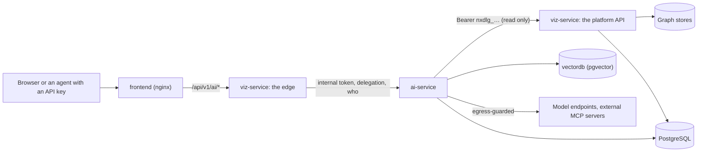

# AI Service

*For engineers, architects and operators.*

The AI service answers questions in plain language about the views, lineage and data a person can see, writes Advanced Search queries and Cypher for them, answers "how do I…" from the product's documentation, and serves that knowledge to other teams' agents over MCP. This page covers how it is built, what it can and cannot answer reliably, how it reaches data and models, and how to run it.

**This page covers:**

- What it answers, how reliably, and why
- The **architecture**: the edge, the delegation, the service
- **Identity and access**
- **Models and sign-in** — connecting any OpenAI-compatible endpoint, with enterprise authentication
- **The agent**: grounding, tools, playbooks, concepts, follow-ups
- **Semantic matching and knowledge**: the vector store, the docs corpus, MCP
- The **HTTP contract** and the **knowledge MCP server**
- **Configuration**, **operations** and **limitations**

The decisions behind it: [ADR-031](/docs/decisions#adr-031-the-ai-service-is-a-separate-process-behind-the-web-tier), [ADR-032](/docs/decisions#adr-032-read-only-delegations-for-the-ai-service) and [ADR-033](/docs/decisions#adr-033-semantic-matching-on-pgvector-behind-a-store-port-as-derived-data). The user guide is [AI Assistant](/guide/ai-assistant).

## What it answers, and how reliably

The assistant answers from the platform's own reads — Advanced Search, the lineage trace, the catalogue of properties, the views list, the documentation — and from nothing else. How good an answer can be depends on what the metadata records, and every answer says what it rests on.

| Question | How it is answered | Reliability | What it says when it cannot be sure |
|---|---|---|---|
| "What are the downstream consumers of *suppliers*, and what breaks if it is removed?" | The name is resolved; physical lineage is walked downstream (`trace/closure`); rolled-up lineage gives the breadth when the walk is cut short; exact counts come from a search walked from the target | High on FalkorDB | Neo4j and Spanner sources have no closure walk or search (501), so answers are partial; a walk cut at its node budget is said, with exact totals |
| "If `first_name` in table A is dropped, who is affected, why and when?" | Column-level closure; affected assets grouped by table and container; **who** from the consumers at the end and the owners recorded on assets or their containers; **why** from the path and what each edge records about the transformation; **when** from the schedules of the jobs on the path | High for what and why where column lineage is ingested | Owners and schedules only where the metadata holds them; otherwise "no owner is recorded", "no schedules are recorded" |
| "Which tables hold PII, and were any updated last week?" | "PII" and "updated" are resolved against this data source's tags, properties, values and glossary entities, with counts; then one search | High once the reading is confirmed | There is no first-class classification in the ontology, so the assistant asks which reading is meant, and remembers the answer if asked to |
| "Do any of those feed my datasets in domain A?" · "Which ingested tables feed these?" | Earlier results are kept as the predicate that produced them and composed with the new condition | High | "My" needs an owner property; "ingested" needs a layer, tag or type — asked once, remembered |
| "Do we have views about supply-chain failures?" | Keyword search as the person, for the topic and its synonyms, fused with semantic matches from the views collection, each verified as the person | Medium-high | Private views are found by keyword only |
| "Write the search for…" / "Write the Cypher for…" | A validated `SearchQuery` with its exact count, shown as the query language; Cypher checked by the native-query guard | High for searches, medium for Cypher | The person always runs Cypher themselves |
| "How do I share a view?" · "Why can't I edit?" | Hybrid retrieval over the docs and user guide, answered with citations to the exact section; feature switches checked | High | When the docs do not answer, it says so and gives the support contact |
| "What do you know about this view?" · "Explain its hierarchy" · "What kinds of connection are there?" | The context brief: the view's details and layers, the semantic layer's types with counts in the view and the source, how they nest, every kind of connection with its direction and count, what the entities carry, and what limits answers there — shown as a card | High | Says when the schema is still being computed or stands in from the semantic layer alone |
| Any of the above on a data source with a generic schema (everything is a `Node`, a `kind` property says what it is) | The property is detected with its counts and confirmed once; searches, counts and impact reports then read kinds of thing through it | High once confirmed | Asks which property it is rather than guessing; says when nothing is hierarchy, nothing is lineage, or no semantic layer is assigned |
| "Tables about supplier payments" across millions of entities | Synonym expansion into text conditions | Medium | Entity-level semantic search comes with the entity index |
| Questions across every data source at once | — | Not yet | Search is bound to one data source; the assistant asks which |

### What would make answers better

The assistant is only as good as the metadata. In order of effect:

1. **Classification and ownership in the semantic layer.** A field-level sensitivity classification and an owner role in the ontology would replace guessing with knowing; concept mappings bridge the gap until then.
2. **An ingestion contract for owners, schedules and SLAs.** "Who" and "when" are only as complete as these properties.
3. **Deep Search and closure walks on Neo4j and Spanner**, and DataHub reads.
4. **Provenance on rollups.** `AGGREGATED` edges record no source edges, so evidence for a rolled-up link costs extra reads.
5. **A fulltext index** for names and descriptions (`match: fulltext` is refused today).
6. **A server-side parser for the query language**, so API and MCP clients can send text as well as JSON.
7. **A search endpoint across data sources.**
8. **Enforcing `DEEP_SEARCH_RATE_LIMIT_PER_MIN`**, read but not enforced today; the assistant's own per-person limits stand in front of it.

## Architecture

1. **The edge** (`backend/app/api/v1/endpoints/ai.py`) authenticates the request as any other — a session, or an API key on the MCP routes — checks the **AI assistant** switch and `workspace:ai:use`, limits turns per person (`AI_RATE_LIMIT`) and data tool calls per person (`AI_MCP_RATE_LIMIT`), records the question in the activity log (`workspace.ai.question_asked`, never the text), mints a delegation and forwards, passing streams through as they arrive.
2. **The AI service** (`backend/ai_service`) runs the turn: grounding, the model, the tools. Every tool reads the platform API with the delegation, so RBAC, view scoping, admission control, caches and circuit breakers all apply exactly as they do for the person.
3. **What it owns**: its `ai_*` tables in the management database and the vector store. Nothing else.

| Module | Holds |
|---|---|
| `llm/` | The provider port, the OpenAI-compatible adapter, sign-in strategies, the egress guard, the JSON tool protocol |
| `agent/` | Grounding, tools, playbooks (`impact`, `views`), concept resolution, result references, the turn loop, events |
| `knowledge/` | The docs corpus, BM25, the vector store port and pgvector, the embedder, the indexer, retrieval, knowledge sources |
| `mcp/` | The MCP server (tools), the MCP client, the knowledge server |
| `api/` | Chat, drafting, conversations, status and concepts; administration; MCP |
| `connections.py`, `settings_store.py` | Model connections and their test; the assistant's settings |

## Identity and access

- **The switch.** **AI assistant** (`aiAssistantEnabled`) ships off and fails closed. Off, the edge refuses every AI route and every delegation stops working at once.
- **The permission.** `workspace:ai:use`, held by every built-in role that reads data sources — in the workspace a request names, or any workspace when it names none. A view names its own workspace, whatever the request sent. Administration needs `system:admin`. With an API key (the MCP routes), it is the key owner's permission that is checked, since a key carries view and data permissions only; what is read stays narrowed to the key. See [RBAC](/docs/rbac#the-ai-assistant).
- **Shared views.** Someone who reads a view through a share or organisation-wide visibility, not as a member of its workspace, may ask about it when they hold `workspace:ai:use` in any workspace. Their delegation reaches **that view alone**, every read names it (`?viewId=`), and the edge tells the service so (`X-AI-Reach: view`): searches stay inside the view, and lineage-following conditions, which the platform refuses past a view's edge, are not attempted. Traces still work.
- **The delegation** (ADR-032). A `nxdlg_` token per request, read only, one turn long, narrowed to the request's workspace (or, for a shared view, to the view) and to the API key it came with, if any. It is accepted on the API-key path: the deny-by-default endpoint surface, the resource fence, claims from the person's live access. It is refused on writes, on native queries, after the session ends and when the switch is off.
- **Internal token.** `AI_INTERNAL_TOKEN` between the edge and the service; the service will not start in production without it.

## Models and sign-in

An administrator adds **connections** under **Administration → AI**. A connection is data, not code:

| Field | Meaning |
|---|---|
| Kind | `openai_compatible` — OpenAI, Azure OpenAI, vLLM, Ollama, LiteLLM and most gateways |
| Base URL | e.g. `https://api.openai.com/v1`, or an internal gateway |
| Sign-in | `none`, `api_key` (any header and prefix, or a query parameter), `bearer`, `basic`, `oauth2_client_credentials` (token URL, client id and secret, scope, audience), `token_mint` (any request to a token URL — a username and password, a client secret, a custom JSON or form body — whose answer holds a token at a JSON path, used in a header of your choosing) |
| Models | Per role: `chat` (answers), `fast` (optional), `embedding` (and its dimensions) |
| Options | `chatPath` and `embeddingsPath` (with `{model}`, so Azure's deployment paths are configuration), `queryParams` (Azure's `api-version`), extra headers, streaming, tool calling, JSON mode, retries |

Secrets are encrypted with `CREDENTIAL_ENCRYPTION_KEY`, write-only (an answer says which are configured, never what they are), merged on update and never logged. Minted tokens are cached, refreshed at 80% of their life by one caller at a time and dropped on a 401, after which the call is retried once. An endpoint without tool calling is used through a strict JSON protocol instead. **Test connection** checks that it answers, that it can call a tool and that it can embed, and records what it found.

Every outbound call — model, token endpoint, MCP server — goes through the shared network guard (`backend/common/netguard.py`, the same classifier the SSO fetches use): loopback, link-local (cloud metadata) and reserved addresses are always refused; private addresses only when an operator lists their `host:port` in `AI_EGRESS_ALLOWED_HOSTS`; plain http is refused in production; redirects are never followed.

**What is sent to a model** is set under **Administration → AI → Assistant → Data sharing**: names and structure always; descriptions, property values and sample values each switchable; a cap on result rows; patterns redacted from everything sent. The person's own answer cards carry the full data — they could read it anyway.

## The agent

A turn (`agent/loop.py`):

1. **Checks** — a chat connection is set; the persona is on; the person has budget left today (`dailyTokensPerUser`) and fewer turns running than `maxConcurrentTurnsPerUser`.
2. **Grounds** — for the data persona, the **context brief** (`agent/brief.py`): the view's details, layers and scope; the semantic layer's types with their counts in the view (catalogue) and in the whole source (introspection), how they nest, every kind of connection with its class, direction and count; the property catalogue and tags; caveats about the source's shape; plus the confirmed vocabulary, what the person has selected, and earlier results. Every graph read names the view; cached per person and view for five minutes. The model gets a ranked, bounded version under the data-sharing policy, fitted to its budget by shedding detail (values, later descriptions, the long tail of properties and tags) rather than cutting it mid-structure. On a workspace, data source, semantic layer or Explorer page the brief describes that page — a data source or Explorer page reads through the source's most used view so searches work — and on a guide page the Help persona knows the page's title and sections.
3. **Answers** — the model streams text and calls tools, at most `maxStepsPerTurn` times, within `AI_TURN_TIMEOUT_SECONDS`.
4. **Keeps** — the question, the answer with its cards, steps and follow-ups, the result references and confirmed concepts, the tokens spent.

**Tools** (`agent/tools.py`) read through the platform API and return two things: cards for the person, with all the data and every caveat; and a compact, policy-filtered summary for the model, so a million-entity answer costs a few hundred tokens.

| Tool | Does |
|---|---|
| `search_entities`, `count_entities` | Advanced Search: counts by type and container, the first items, exact counts for up to 32 conditions |
| `find_entities`, `get_entity` | Names and paths to entities; one entity's details and place |
| `resolve_concept` | A business term read against this data source (below) |
| `analyze_impact`, `trace_lineage`, `explain_rollup` | The impact and provenance playbooks; the physical edges behind a rolled-up link |
| `find_views`, `set_context` | Views about a topic across workspaces; working inside one |
| `describe_context` | The context brief as a card — "what do you know about this view?" |
| `show_query`, `draft_cypher` | A search or Cypher for the person to open and run |
| `search_docs`, `get_feature_switches` | The docs and guide, with citations; what is switched on |
| `ask_user`, `suggest_followups` | A choice for the person; follow-up chips |

The model writes predicates in the platform's `SearchQuery` grammar. Before anything runs, they are **expanded** (`{"kind":"resultSet","ref":"r2"}` becomes the predicate behind an earlier answer; `{"kind":"concept","name":"PII"}` becomes its confirmed reading), **validated** by the platform's own model — and a field the model does not know is an error, not silently dropped — and **canonicalised**, so what runs is what the person can open in Advanced Search.

**Concepts** (`agent/concepts.py`). "PII", "owner", "updated", "ingested" rarely match a field. The assistant uses a reading confirmed in the conversation, remembered by the person, or set for the workspace; otherwise it gathers candidates from the data — tags, property keys, property values, tag and glossary entities — counts each one exactly, and applies one on its own only when it is the word itself and nothing else matches. Otherwise it asks, with the counts and "any of these", and remembers the answer for the data source if the person says so. Administrators curate shared readings under **Business vocabulary**.

**Generic schemas.** A source that keeps (almost) everything under one type — a generic `Node`, `Entity`, `Asset` — usually says what each entity is in a property. The brief detects candidates from the catalogue: a string property on at least 90% of that type, with 2–60 distinct short, word-like values, ranked by a name like `type`, `kind` or `category`; for a dominant type with a real name only those names count. It never applies one on its own. When a question names a kind of thing that is not a type ("tables"), the assistant asks once — *Which property says what kind of thing each one is?* — with what each candidate holds; the answer is remembered like any reading (concept `entity type`) and can be made the workspace's. From then on `entityType in [table]` runs as `entityType in [Node] AND kind in [table]`, results are grouped by the property, impact reports name the kinds, and the Cypher drafter is told. A type the source does not have at all goes back to the model with the types it does have.

**Impact** (`agent/impact.py`) resolves the target (asking when a name matches several), walks physical lineage to a node budget, falls back to rolled-up lineage and exact counts when the walk is cut short, and reports the affected assets by type and container, the consumers at the end, the owners, the paths with each edge's transformation, the job schedules on the way ("daily at 04:00 UTC") and a heuristic severity with its reasons. It relies on no type names: consumers are where lineage ends, ranked by the types the semantic layer says lineage ends at; a job is whatever records a schedule; owners come from the confirmed reading of "owner", then the catalogue's owner-like keys. The affected set is kept as a predicate, so "who owns those?" composes with it.

## Semantic matching and knowledge

- **The store** (ADR-033): pgvector on its own instance (`AI_VECTOR_DB_URL`) behind a `VectorStore` port. Collections are versioned by embedding model, dimension and chunker, each version with its own partial HNSW index over `halfvec`; a sync re-embeds only chunks whose content changed; a new model builds a new version beside the old and switches at once. The store is derived data: delete it and it is rebuilt.
- **Collections**: `docs` — the documentation and user guide, as sections with the in-app reader's anchors, built into the image by `frontend/scripts/gen-ai-docs-corpus.mjs` — and `views` — every non-private view a read-only service account (`AI_INDEXER_API_KEY`) can list, re-synced every `AI_VIEWS_SYNC_INTERVAL_SECONDS` and reconciled daily.
- **Retrieval**: dense and BM25 results fused by reciprocal rank; BM25 alone when the store or the embedding model is unavailable. Everything a store returns is checked as the person before it is shown.
- **Sources**: the Help persona asks the product's knowledge through the knowledge MCP server (in memory) and any MCP servers an administrator added (**Knowledge → External sources**: URL, sign-in, tool, argument and result mapping, personas, timeout, trust label), each with its own deadline. External results are labelled with their source everywhere and treated as untrusted data.
- **Next**: entity embeddings, selective — documentable types by default, columns reached through containment, more types per data source with the cost shown first.

## The HTTP contract

All under `/api/v1/ai/`, through the edge.

| Method | Path | Purpose |
|---|---|---|
| GET | `/status` | Whether a model is connected, which personas are on, the knowledge collections' state, the data-sharing policy |
| GET | `/context` | The context brief for a view (`viewId`) or page (`pageKind`, `pageId`, `pageTitle`) — for the person, unfiltered, no model called; gated as a question about it would be |
| POST | `/chat/stream` | Ask; the answer streams as server-sent events: `meta`, `step`, `text`, `block`, `clarify`, `actions`, `followups`, `usage`, `error`, `done` |
| POST | `/query/draft` | A search (`mode: search`, validated and counted) or Cypher (`mode: cypher`, guard-checked) for a question |
| GET, DELETE | `/conversations`, `/conversations/{id}` | The person's own conversations |
| POST | `/messages/{id}/feedback` | 👍 or 👎, with a comment |
| GET, DELETE | `/concepts`, `/concepts/{id}` | The person's remembered readings |
| * | `/admin/*` | Connections and their test, settings, knowledge and re-index, external sources, business vocabulary, usage (`system:admin`) |
| POST | `/mcp/knowledge` | The knowledge MCP server |
| POST | `/mcp/data` | The data MCP server: find, describe, search, trace, impact |

Cards (`block` events) are typed: `results`, `impact`, `query`, `views`, `citations`, `entity`, `context`, `notice`, and `clarify` for a choice. Each carries what the person needs to act — the predicate to open in Advanced Search, the trace to open on the canvas, the view to open.

## The knowledge MCP server

`POST /api/v1/ai/mcp/knowledge` speaks the Model Context Protocol (2025-06-18; 2025-03-26 and 2024-11-05 accepted) over stateless streamable HTTP with JSON answers: `initialize`, `ping`, `tools/list`, `tools/call`. No session is held, so any replica answers any call.

| Tool | Returns |
|---|---|
| `list_collections` | `docs` and `views` |
| `search_knowledge` | `{query, collection: docs \| views \| all, limit}` → passages with title, link and text; views only those the caller can open |
| `get_document` | The full section a passage came from |

Authenticate with an API key (`Authorization: Bearer nxpat_…` or a service account's `nxsat_…`); the key's own scope narrows what views appear. The route is on the API key surface as a read.

## The data MCP server

`POST /api/v1/ai/mcp/data` serves the assistant's own data tools to other teams' agents, over the same protocol and with the same authentication. No model is called: each tool runs the playbook the assistant would, as the person or key calling, and returns the data of the card the person would see.

| Tool | Arguments | Returns |
|---|---|---|
| `find_views` | `query`, `synonyms` | Views about a topic across every workspace the caller can read, ranked, with why each matched |
| `describe_view` | a place | The context brief: details, layers, types with counts, hierarchy, connections, properties and tags, caveats |
| `find_entities` | a place, `names`, `entityType`, `scope` | For each name or path, how many entities match, their urns and paths |
| `get_entity` | a place, `urn` | Type, description, properties, tags and ancestor path |
| `search_entities` | a place, `predicate`, `scope`, `limit` | The total (exact or a lower bound), counts by type and container, the first items, and the predicate that ran |
| `count_entities` | a place, `rules` (up to 32 `{label, predicate}`) | Exact counts |
| `trace_lineage` | a place, `urn` or `name`, `direction`, `depth` | The lineage report: totals, the ends, owners, paths, schedules, the grain walked |
| `analyze_impact` | a place, `urn` or `name`, `change`, `depth` | The impact report, with its severity and reasons |

**A place** is a `viewId` (from `find_views`), or a `workspaceId` (and `dataSourceId`), whose data source's most used view is read. The edge gates each tool call as a question about that place: `workspace:ai:use` in the view's workspace (or in any workspace, for a view read through a share, whose delegation then reaches that view alone), and narrows the delegation to it. `search_entities` describes the predicate grammar in its own description.

**Stateless choices.** A tool that needs a choice answers `{"status": "needs_choice", "clarificationId", "question", "options", "howToAnswer"}`. Which of several entities a name means: call again with the option's `urn`. How to read a business term (`{"kind": "concept", "name": "PII"}` in a predicate) or which property says what kind of thing each entity is on a generic schema: call again with `choices: {clarificationId: optionId}`. A term's clarification id is the same on every call, so no session is needed, and nothing is remembered. Earlier results are not kept: compose with the `query.predicate` a search returned.

**What comes back** is what the caller may read, as the platform API would give it to the same key. The data-sharing policy governs what this deployment sends to its own model connection; it does not apply here, since no model is called.

Tool calls are limited per person (`AI_MCP_RATE_LIMIT`, 60 a minute), apart from questions; `initialize` and `tools/list` are not counted. Unlike questions, calls are not recorded in the activity log.

## Configuration

Operator settings are environment variables (see [Configuration](/docs/configuration), section *AI assistant*): `AI_SERVICE_URL` and `AI_INTERNAL_TOKEN` on both sides; `AI_PLATFORM_API_URL`, `AI_EGRESS_ALLOWED_HOSTS`, `AI_OUTBOUND_TLS_CA_CERTS`, `AI_VECTOR_DB_URL`, `AI_INDEXER_API_KEY` and the timeouts on the AI service; `AI_DELEGATION_SIGNING_KEY`, `AI_DELEGATION_TTL_SECONDS`, `AI_RATE_LIMIT` and `AI_MCP_RATE_LIMIT` on the web tier. What an administrator decides — connections, personas, data sharing, limits, retention, vocabulary, external sources — is under **Administration → AI**.

## Operations

- **Health**: `GET /health` on port 8093 (Compose healthcheck, Kubernetes probes).
- **Deploy**: Compose services `ai-service` and `vectordb`; Kubernetes `services/ai-service` and `infrastructure/vectordb` with network policies (the web tier to the service, the service to the platform API, Postgres and the vector store); Helm `services.ai`, with egress for model endpoints in `networkPolicy.aiEgressCidrs`.
- **Retention**: conversations older than the retention period (30 days by default) are deleted hourly.
- **Audit**: questions (`workspace.ai.question_asked`, who and where, never what), connection, settings and knowledge-source changes (`platform.ai.*`).
- **Knowledge state**: **Administration → AI → Knowledge** shows each collection's version, model, size, last sync and errors, and rebuilds one on request.

## Limitations

- Searches and closure walks need FalkorDB; Neo4j and Spanner sources get partial answers, DataHub none.
- Questions are about one data source at a time.
- A type property is detected for entities only; a single generic edge type whose own property says what kind of connection it is is reported, not read through.
- On a view shared with someone outside its workspace, searches cannot follow lineage past the view's edge (the platform refuses it); traces can.
- Entity-level semantic matching is not built yet; view and docs matching are.
- The first provider kind is OpenAI-compatible; Anthropic, Bedrock, Vertex and a custom HTTP template are next.
- Per-person concurrency is counted per AI service process.

## Where to next

- [AI Assistant](/guide/ai-assistant) — using it, and setting it up
- [Search: Deep & Advanced](/docs/services-search) — the search the assistant writes
- [RBAC](/docs/rbac#the-ai-assistant) — the permission and the delegation
- [Decisions](/docs/decisions#adr-031-the-ai-service-is-a-separate-process-behind-the-web-tier) — why it is built this way
