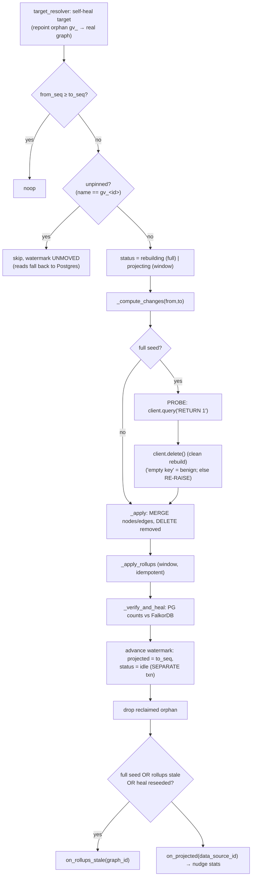
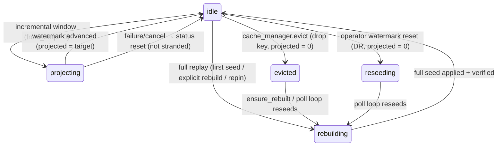
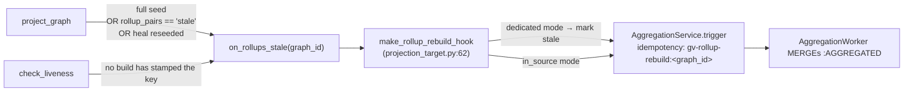
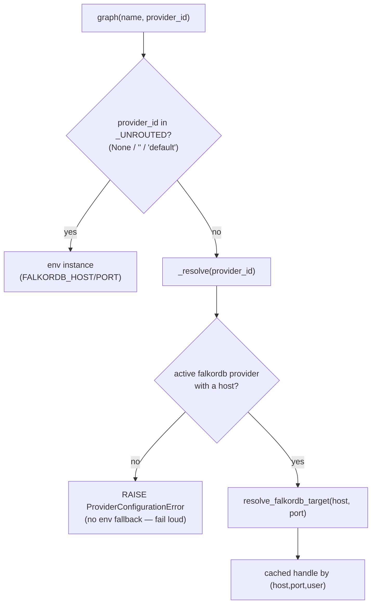

# 04 · Projection & Cache — FalkorDB as a Rebuildable Read Graph

> **Audience & scope:** engineers operating or extending the read path, and architects assessing the
> caching model. Covers how committed `main` becomes a hot FalkorDB graph, how staleness is bounded,
> how the cache self-heals, how `:AGGREGATED` rollups stay consistent, how a graph is routed to its
> FalkorDB instance, and the cache's lifecycle. See [02 · Data Model](02-data-model.md) for the store
> and [03 · Branching, Commits & Merge](03-branching-commits-merge.md) for what produces commits.

**TL;DR.** Postgres (`graphver`) is the source of truth; **FalkorDB is a derived, rebuildable read
cache of committed `main`** written by the `FalkorProjector`. Two properties make it safe to run
unattended: every write is an idempotent `MERGE`/`DELETE`, and the **watermark advances only after a
batch lands** — so a crash gives bounded staleness, never corruption. Reads serve from FalkorDB only
when the projection is caught up; otherwise they fall back to Postgres composition. The cache can be
dropped and rebuilt from Postgres at any moment, which is why the projector treats a full seed as a
*non-destructive clean rebuild* (probe-before-drop) and reconciles counts after every apply.

The whole subsystem lives in `backend/app/services/versioning/projection.py` (the projector),
`reconcile.py` (drift audit), `cache_manager.py` (eviction/leases), `worker.py` (the runtime),
`backend/app/services/projection_target.py` (app-layer hooks), and the provider layer under
`backend/app/providers/`.

---

## 1. Why a projection cache at all

The canvas needs low-latency graph traversals (children-with-edges, lineage traces, aggregated
rollups) that a Cypher-native store serves far better than reconstructing state from append-only
Postgres rows per request. So committed `main` is **projected** into the data source's *real*
FalkorDB graph — the same graph, keyed and labelled exactly as the existing reader expects — and the
`ContextEngine` reads it natively when it is fresh.

> **Invariant (safety).** *Postgres is truth; FalkorDB is derived.* The cache can be evicted and
> rebuilt from Postgres at any time with no data loss. Every projection write is a `MERGE` (upsert)
> or `DELETE`, and `projection_state.projected_commit_seq` advances **after** the batch lands, in a
> separate transaction (`projection.py:9-14`, `:320-328`). A crash mid-apply leaves the watermark
> behind; the retry re-`MERGE`s and converges.

> **Invariant (draft ≡ main).** A draft never gets its own FalkorDB graph. It reads through the
> [`DraftOverlayProvider`](#10-the-read-providers) as *main ⊕ sparse delta*, so an unchanged draft is
> a pure pass-through over main's cache (including its materialized rollups). See §8.

---

## 2. The projector — reader-compatible schema

`FalkorProjector` (`projection.py:147`) writes **byte-for-byte the schema the reader already
consumes**. It imports the reader's own helpers verbatim (`_compute_searchable_text`,
`_sanitize_label`, `_split_user_properties`, `projection.py:44-48`) so a reader-schema change flows
through the projector automatically.

- **Nodes** are `urn`-keyed and labelled by `entityType`. The MERGE (`_node_merge_cypher`,
  `projection.py:57-67`) sets the denormalized read fields (`entityId`, `displayName`,
  `qualifiedName`, `description`, `tags`, `layerAssignment`, `childCount`, `sourceSystem`,
  `lastSyncedAt`, `propertiesRaw`, `searchableText`), spreads native scalar properties with
  `n += item.nativeProps`, and `REMOVE n.properties` (strips the legacy blob). The row is built by
  `_node_item` (`projection.py:109-128`), which splits `properties` into native vs residual and
  computes `searchableText`.
- **Edges** are typed by `edgeType` and keyed by `r.id == entity_id`. The MERGE (`_edge_merge_cypher`,
  `projection.py:95-103`) `MATCH`es both endpoints by **label + urn** — endpoint labels ride on each
  `EdgeUpsert`, resolved from the committed `entityType` (window nodes first, then `_urn_label_for`,
  `:965`, fork-aware) — so every endpoint lookup is a per-label URN **index seek** instead of the
  pre-2026-07 unlabeled full-node-scan-per-row; then sets `id`, `confidence`, and a JSON-stringified
  `properties`.
- **Deletes** are label-anchored too, and none scans the graph:
  - `_delete_nodes_cypher`: label + urn, `DETACH DELETE`.
  - `_delete_edges_cypher`: typed + endpoint-anchored, with `r.id` matched inside the `(a)->(b)`
    adjacency.
    - A deleted edge is deleted at every position it may hold: where it was before the window, and
      wherever the window put it (`_edge_positions`, version columns only). That covers an edge
      created and deleted in one window after a failed attempt wrote it.
    - An id with no position was never written, so nothing is deleted for it. The per-id scan of
      every relationship (`MATCH ()-[r {id: i}]->()`) is gone.
  - `_delete_nodes_by_pair_cypher`, heal only: matches by (label, indexed `urn`) **and confirms
    `entityId`**, so a reused urn is never wrongly deleted.
  - A rebuild deletes a relationship by its internal id from its source node, matched by urn
    (`_reconcile_streamed`), not by scanning every relationship.
- **A node whose urn changes is moved in place** (`_rekey_in_place`, `SET n.urn`) before the
  window's merge. It keeps its internal id, its relationships and the rollup cells on it.
  - A MERGE under the new urn used to create a second node and leave the old one behind, with
    every edge.
  - The verify then held every pass back for that extra node until a rebuild.
  - A node FalkorDB already holds under the new urn is left as it is.
- **Every projector query carries a server-side budget** via `_q` (`projection.py:69`):
  `PROJECTION_FALKOR_WRITE_TIMEOUT_S` (default 60, clamped under the fleet's `TIMEOUT_MAX`) /
  `PROJECTION_FALKOR_READ_TIMEOUT_S` (default 30), plus a client-side hang net. Without an explicit
  budget the FalkorDB fleet's `TIMEOUT_DEFAULT 30000` killed un-budgeted seed batches mid-load.
- **A graph enabled in place keeps its relationships' ids.** Nodes and edges share one id space, so
  the enable re-keys an edge whose id is also a node's to `edge:<id>` in history; the graph still
  calls it `<id>`. On a key the platform doesn't own, the edge merge sets `r.id =
  coalesce(r.id, item.eid)`, and the typed delete matches `r.id IN [eid, pid]` (`pid` without one
  `edge:` prefix), so a change or delete reaches it. `GraphVersioningService.resolve_edges` turns
  the id the canvas holds into the edge it names (never a node that shares it) for both write
  providers' `update_edge` / `delete_edge`; `/graph/changes` has the service do the same
  (`apply_ops_detailed(aim_edges=True)`) once the draft is found writable by the caller and a retry
  answered, a retry aimed as its first attempt was.
- **A graph enabled in place keeps its own spelling of its types.** History stores each type as the
  ontology declares it (`Table`, `FLOWS_TO`); the graph may say `table` and `flows_to`. Enabling
  version control records the graph's spelling of every type
  (`projection_state.physical_types`, `{"nodes": {type: label}, "edges": {...}}`), and every
  label and relationship type a pass writes or matches goes through it (`reconcile.spelled_label` /
  `spelled_type`, set per pass), as does Check sync. Types are matched without case, so a type the
  ontology has since re-cased is still found. So an edit updates the node that is there rather than
  adding a `:Table` copy beside it. A type the graph never had is written as declared. A graph that
  spells one type two ways (`table` and `TABLE`) stops the enable at its checks
  (`one_spelling_per_type`). Keys the platform owns are written with the declared spelling.
  - **A graph enabled before 2026-10-28** has no recorded spelling. Its next pass reads it from the
    graph (`reconcile.graph_spelling`: its labels and relationship types; of several spellings of
    one type, only those still holding something count, since a label outlives its nodes) and
    records it once nothing is ambiguous. A type two spellings of which still hold nodes — such as
    the `:Table` copies earlier passes wrote into a `:table` graph — is never written: the pass is
    held back with `last_error` naming both spellings (`AmbiguousSpelling`, logged without a trace),
    Check sync answers with the same reason, and nothing in the graph is written, copied or
    relabelled until one spelling is left.
  - **Bringing changes into history** records the spelling of each type it reads, over what was
    recorded, so a type another writer introduced is written back as that writer spells it. A type
    the graph spells two ways is refused (**409 `spelled_two_ways`**). A type history already holds
    keeps history's casing, so a re-cased ontology doesn't retype every item.

> **Limitation (phantom keys).** A node with no `urn` in its payload is keyed as `gv:<entity_id>` and
> logs a WARN (`_node_urn`, `projection.py:93-106`; `_urn_for`, `:701-718`). This is a deliberate
> "FalkorDB-not-a-subset-of-Postgres" signal for reconciliation, not a handled case — a `gv:`
> fallback for a node that *should* have a urn can duplicate an existing urn-keyed node.

The projector is injected with everything that would otherwise couple it to the management DB — a
`graph_client_factory` `(name, provider_id=None) -> graph`, a `target_resolver` (self-heal the
projection target), an `edge_types_resolver` (ontology edge types for rollups), an `on_rollups_stale`
hook, and an `on_projected` nudge (`FalkorProjector.__init__`, `projection.py:150-186`).

---

## 3. Full seed vs incremental window — `_compute_changes`

A projection pass takes one of two paths:

- **Full replay (`from_seq <= 0`)** — a first seed, an explicit rebuild or a repin **reconciles in
  place** (`_reconcile_in_place`) rather than going through `_compute_changes`: it reads narrow heads
  without payloads, scans FalkorDB in internal-id pages, diffs off the event loop, fetches payloads
  only for the rows it must write, and never drops the graph (dropping renumbered every label, type
  and property id under long-lived readers, and took the indexes and every `:AGGREGATED` rollup with
  it). On a fresh key the diff is simply "everything", so a first seed is the same path.
- **Incremental (`from_seq > 0`)** — `_compute_changes` (`projection.py:789`) selects
  `node_versions`/`edge_versions` rows in `(from_seq, to_seq]` ordered by `(commit_seq, created_at)`
  and **net-folds by `(kind, entity_id)`** — keyed on the tuple, *not* `entity_id` alone, so a node
  and an edge that ever share an id can't clobber each other. It produces `(node_upserts,
  edge_upserts, node_deletes, edge_deletes)`; last op per entity wins; `delete` → a delete list,
  else an upsert.

`_apply` writes in a fixed order: nodes-in (grouped by label), edges-in (grouped by **(type,
srcLabel, tgtLabel)** so the endpoint MATCH stays index-eligible), edges-out (typed + anchored via
`_run_edge_deletes`), nodes-out (grouped by label).

**Every chunked statement fits its budget (the statement ladder, `_laddered`).** A FalkorDB write
is clamped to a share of the cluster's failure detector (`clamp_write_budget`: 6 s at a 15 s
`cluster-node-timeout`). One statement past it used to fail the pass, and the window was replayed
whole every retry, growing as commits landed. Now every chunked projector statement goes through
the ladder: node and edge merges, the removed-property read, deletes, relabels, fingerprint reads,
rollup cells, the tombstone sweep, and the rebuild's deletes.
- **Chunk width.** Rows go out at a width kept per graph and statement kind, starting at
  `PROJECTION_BATCH_SIZE` (5000).
- **On a timeout or memory refusal,** the chunk is split in half and the halves sent again. A
  connection failure is raised at once, so the pass backs off.
- **Sizing (AIMD).** A chunk that failed, or used more than half its budget, halves the width.
  Eight quick chunks in a row grow it by a quarter, but not back to a size that failed until 64
  quick chunks in a row. So a graph whose statements fit 700 rows settles just under 700.
- **One row that still fails** is retried `GRAPHVER_PROJECTION_FLOOR_RETRIES` times (3), after 2 s,
  4 s and 8 s plus jitter, then given up on, failing the pass. A node delete gets one more try
  first: a hub, whose `DETACH DELETE` must drop every relationship at once, has its relationships
  deleted 10,000 at a time (halved on a timeout), then the node. That holds wherever the delete
  names the node: by label and urn in a window, and in a rebuild for every copy of a node the key
  holds twice; by internal id in a rebuild (a node main no longer holds); by label, urn and entity
  id in the tombstone sweep.
- **Why sending again is safe.** FalkorDB rolls back a statement it aborts, and every projector
  write is an idempotent `MERGE`, `SET` or `DELETE`. A rollup write sets the absolute weight it
  computed.
- **Reporting.** Each pass logs one line: its statements, rows, slowest statement, splits and
  narrowest width. A pass that wrote returns them as `stats`. The same feed the
  `graphver_projection_*` metrics ([Observability](../OBSERVABILITY.md)).

**One entity that still fails is held back, not the graph (`projection_quarantine`).** A
statement that still times out for a single row is held in `graphver.projection_quarantine`.
This happens after its retries, and for a node delete after its hub path. The pass goes on.
- **What it holds.** The table keeps the statement and its row, the error, the attempts and
  when. A node is named by its urn; an edge by its id where the statement puts it, with its type
  and ends (`<id>@<type>:<source urn>-><target urn>`).
- **What is held.** Node and edge merges and deletes, relabels and re-keys. Reads, rollup cells
  and deletes by internal id still fail the pass.
- **Edges that wait for a held node.** An edge merge whose end node the pass holds, and the key
  lacks under the label the edge matches (a new node whose merge is held, say), is held with it,
  not sent: it would match no node, and be lost once the node lands. All of a chunk's are held in
  one write. A node the key holds, whose own update is held, still matches, so its edges are
  written.
- **Retries.** Every later pass retries the graph's held statements first, oldest first, so its
  own writes land after them. One that lands leaves the table, and so does any held statement for
  an entity a later write lands: for an edge, a write at the same type and ends. A write of the
  edge somewhere else supersedes nothing held where it was.
  - An edge merge held for its end node is not tried while that node is still held after its own
    retry, and stays held. Held after the node, it is retried after it.
  - A graph that is caught up gets a pass of its own once its held statements are due
    (`projection_state.quarantine_next_at`, every `GRAPHVER_PROJECTION_QUARANTINE_RETRY_SECS`,
    300). The poll selects it, and the pass has an empty window.
  - A full seed that starts over rewrites everything, so it clears the graph's rows first. A full
    seed that resumes from its cursor (below) writes nothing again before where it stopped, so it
    retries them instead, as a window does.
  - The rollups moved with the held entities' window, which the key lacked, so moving them by the
    reconcile's difference would count those entities twice. Clearing the rows therefore records,
    in the same transaction, that the `:AGGREGATED` rollups are owed the aggregation job (§8):
    `projection_state.rollup_state.moved`. Every full seed reads it, hands the rollups to the job
    instead of moving them, and the one that publishes clears it, whatever passes failed first.
- **While any are held,** the graph's passes publish `unverified`: its counts cannot match.
- **Where it shows.** The watermark lists them (`quarantine: {count, entities}`), and so does the
  **Data health** tab, while the graph is projected. An evicted graph, one waiting for room in
  memory, or a trashed one is retried by nothing: its rows are cleared by its load's full seed, or
  by the purge, and neither the watermark nor `graphver_projection_quarantined` counts them.
- **Switch.** `GRAPHVER_PROJECTION_QUARANTINE=0` turns it off; a stuck entity then fails every
  pass, as before.

**Long passes stop at a page and resume (the pass cursor).** A window too large to hold is written
a page at a time (`_apply_paged`), and so is a rebuild of a graph too large to hold
(`_reconcile_streamed`).
- **The cursor.** After each page lands, the pass writes where it is on the pass marker:
  `_GVProjMeta.pFrom`, `pTo`, `pStep`, `pAfter`.
  - A paged window's steps are `node` and `edge`, each positioned by version id. Its cursor also
    carries what its pages so far did that the pass publishing the window must know:
    `pStructural`, a retype, re-key or containment change, and `pDropped`, the writes that did not
    land.
  - A streamed rebuild's are `fk_node` and `fk_edge`, positioned by internal id, then `node` and
    `edge`, by entity id.
- **The time box.** Past `GRAPHVER_PROJECTION_PASS_MAX_SECS` (300) the pass stops at the next
  page boundary. It publishes nothing, records no error and no backoff, and nudges itself. Other
  graphs get their turn meanwhile. A rebuild that stops so stays `rebuilding` (a load
  `rehydrating`), so the pass that resumes it is never taken for a first seed: with the Graph
  residency switch on, that would queue the graph for a load into a fresh key and leave the
  rebuild's pages behind. A pass after it that fails or is cancelled leaves the graph `idle` at
  seq 0, as any failed pass does, so the first-seed check also reads the key's cursor (with
  `GRAPH.RO_QUERY`, which creates no key): a key holding one the pass resumes is no first seed.
- **Resuming.** A pass from the same watermark finishes the cursor's window (`pTo`) first, after
  the last page that landed, then publishes it. The window after it is the next pass's. A resumed
  paged window starts from what its cursor says the pages before it did, so the pass that
  publishes it bumps the graph's generation for a retype an earlier pass made, and verifies a write
  an earlier pass dropped.
- **Where it lives.** The cursor is in the key, so a key that lost a page lost the cursor with it,
  and is projected from the start. A pass that has gone through all its pages clears it, whether
  its verify publishes the window or holds it back: the pass after one held back projects the
  window from the start, rather than resume past its last page and write nothing. An operator's
  rebuild (`POST …/projection/rebuild`) clears it too once it is accepted, after a rebuild that
  stopped part-way and then failed, so it replays main from the start.
- **A resumed streamed rebuild** does not know what earlier passes wrote, so it hands the rollups
  to the batch job.
- **At main's head,** a rebuild pages main's `entity_heads` by their primary key, each joined to
  its version by the version's. A page costs its own size, not a `DISTINCT ON` over every version
  of the graph. Main's head is read again after each such page: a commit moves the head and the
  heads in one transaction, so once one has landed, that page and the rest are read as of the
  rebuild's seq instead. The rebuild never writes what the commit made of an entity (a new type,
  a new urn) as a second node beside the one it kept; the next window moves it in place. A
  relationship's ends are keyed as of the rebuild's seq too, where it checks the relationships the
  key holds and where it writes main's: keyed by what such a commit made of an end, one the key
  holds would be deleted, and one it lacks written against a node the rebuild did not write,
  matching nothing.
- **Progress.** A paged window reports it too (`progress_done` / `progress_total`), in version
  rows.

**A graph that cannot be brought up to date rebuilds itself (`GRAPHVER_PROJECTION_ESCALATE`, on).**
An incremental pass no longer heals inside itself. It ends unpublished, and makes the reset an
operator's rebuild makes (`request_projection_rebuild`, fenced on its epoch), when either:
- its verify finds FalkorDB short of committed main, or, on a key the platform minted, holding more
  after the tombstone sweep;
- the same window has failed `GRAPHVER_PROJECTION_ESCALATE_AFTER` passes in a row (3) on a timeout
  or memory refusal the statement ladder and the quarantine could not absorb. They are counted in
  `projection_state.pressure_failures`: a pass that ends any other way (published, held back, or
  failed on something else, such as a connection error) starts the count again, and a cancel
  leaves it. `failed_attempts`, which spaces out the retries, counts every failure.

The next pass reconciles the key in place (streamed and resumable on a large graph) and publishes.
Until then the graph's last error reads "rebuilding on its own: …". A window that moved the
`:AGGREGATED` rollups before its verify, or owed them to the job, records that they are owed
(`rollup_state.moved`, as above) in the same reset: they already count what the rebuild writes, so
the rebuild hands them to the job, as the inline heal did, rather than moving them by its
difference again.
`graphver_projection_escalations_total{cause}` counts them. Off, a shortfall is healed inside the
window's pass and a surplus holds the graph back until a rebuild, as before.

> **Limitation (full-replay memory).** A full replay no longer composes the live state, but its diff
> still holds whole-graph maps of small tuples **in memory**, `O(N + E)` — narrow ids, not payloads —
> rather than streaming by keyset. The per-edge endpoint lookup is no longer the bottleneck — since
> 2026-07 it is a label+urn index seek (the unlabeled form was a full node scan per row, O(N·E)
> overall; the same pattern measured ~2000× slower on `save_custom_graph`'s bulk path). A
> keyset-streaming reconcile is the documented upgrade path (see
> [09 · Scale & Limits](09-scale-limits-and-roadmap.md)).

---

## 4. `project_graph` — the apply pipeline

`project_graph(graph_id)` (`projection.py:209-393`) catches a single graph up to its target
watermark. The full sequence:

Key guards:

- **Unpinned graphs are skipped without advancing the watermark** (`projection.py:227-235`). A
  synthetic `gv_<id>` name means there is no real FalkorDB target (a test graph, or one whose data
  source couldn't be healed); even an empty `GRAPH.QUERY` would instantiate an orphan key, so the
  projector refuses. `project_pending` applies the same exclusion in SQL (`:411-413`).
- **Forks are never projected** (`skipped: "fork"`), whatever their `projection_state` row says: a
  fork reads through its root's store with its patch set over it
  ([17](17-forks-and-residency.md) §6). `project_pending` leaves forks out in SQL too, and neither a
  rebuild nor an eviction's reseed touches one.
- **The cancel/failure handler resets a committed `projecting` row** (`projection.py:329-363`). Once
  `status="projecting"` is committed, a later exception *or a cancellation* (e.g. the `project_now`
  timeout, a `BaseException` that plain `except Exception` would miss) must reset the row to `idle`
  or it strands the UI's "Refreshing…" badge forever and blocks the manual rebuild escape hatch. The
  reset is `asyncio.shield`ed against a second cancel and re-raises `CancelledError` per contract.

**Entry points that drive it:**

| Function | Where | Purpose |
|---|---|---|
| `project_graph` | `projection.py:209` | Catch one graph up to target. |
| `project_pending(limit, concurrency)` | `projection.py:395` | Catch up all lagging graphs, **stalest first**, `Semaphore(PROJECTION_CONCURRENCY=8)`, keyed by PK (no same-graph race), per-graph failures logged not fatal. |
| `project_now(graph_id)` | `endpoints/versioning.py` | Interactive post-write catch-up. It projects a window of at most `GRAPHVER_PROJECTION_INLINE_MAX_ROWS` (20,000) version rows itself, inside `asyncio.wait_for(_SYNC_PROJECTION_TIMEOUT_SECS=10.0)`; a larger one, or a first seed, it leaves to the worker with a nudge, rather than start a pass its budget would cancel mid-write. Like a nudge, it waits out a failed pass's backoff. |
| `rebuild_now(graph_id)` | `endpoints/versioning.py:193` | Operator "Rebuild"; `_rebuild_inflight` guard (`:190`), a generous `REBUILD_SYNC_TIMEOUT_SECS=900` budget (`config.py:130`) because a full reseed is O(whole graph). |

---

## 5. Watermark & bounded staleness

`ProjectionStateORM` (`models.py:223-250`) is the per-graph control row:
`projected_commit_seq`, `target_commit_seq`, `status ∈ idle|projecting|rebuilding|evicted|reseeding`,
`falkor_graph_name`, `falkor_provider`, `last_error`, `last_projected_at`, and
`progress_done`/`progress_total` (live full-seed progress).

- **Writers advance `target`.** Every main-advancing commit (publish, merge, sync, revert, direct
  `apply_ops`) bumps `projection_state.target_commit_seq` to the new head.
- **The projector advances `projected`** to `to_seq` after the apply lands (`projection.py:322`).
- **Freshness** is `projection_watermark` (`service.py:1606`), which returns `committed`
  (`graph.main_head_commit_seq`), `projected`, `target`, `status`, plus **`fresh = projected >=
  committed`**, **`served`** (below) and the fields the Data-health UI polls (`last_error`,
  `progress_*`).
- **Live rebuild progress** is written throttled — at most ~1/s, always on the final item — by
  `_progress_writer` (`projection.py:863-885`), so the progress bar moves without a DB write per
  chunk. Best-effort; a progress write can never fail the projection.

### Serving while it updates

Reads of main stay on the key while the projection catches up or rebuilds, at the version the key
holds, and stay available and complete. One rule decides it for every read path (ContextEngine, the
neighbors endpoint, native queries): `serving_seq(projected, committed, status, served_commit_seq)`
in `service.py`, reported on the watermark as `served` (with its `served_revision`).

| The key | Reads of main are served from | `served` |
|---|---|---|
| holds the head (`fresh`) | the key | `committed` |
| catching up after a publish or an import (`projected < committed`) | the key, at the version it last published | `projected` |
| rebuilt in place (a rebuild resets `projected` to 0, not what the key holds) | the key, at the version it held | `served_commit_seq` |
| written from nothing (a first seed, a move, an Adopt, a repin), lost, evicted, being loaded or reset | Postgres (`VersionedBranchProvider`), slower and without the lineage summaries | `null` |

- **`projection_state.served_commit_seq`** is the version the key holds whole: every pass that
  publishes sets it to its `to_seq`; a rebuild keeps it; a move, an Adopt, a repin, an eviction, a
  purge and an operator reset clear it; liveness lowers it with the watermark (to the marker's seq,
  or `NULL` for a missing key). A full pass that finds its key gone clears it before writing
  (`_forget_served`), so a lost key rebuilt before liveness saw it serves nothing meanwhile.
- **The projector's writes yield to reads.** A write holds the graph's write lock, and every read of
  it on that node, while it runs. So every chunked projector write is cut off at New-version builds'
  **Longest write statement** (10 s) on every FalkorDB mode, not only under a cluster's failure
  detector; a chunk slower than the **Write statement target** (500 ms) narrows the next, no
  narrower than 50 rows for being slow; and after each one the projector pauses the **Pause after
  each write** share of what it took (0.25), the **Pause while reads wait** share (2.0) while the API
  says reads on that node are starving (`agg:readpressure:<node>`; `graphver_projection_yields_total`),
  at most 5 s. While it writes, it holds `gvproj:writing:<endpoint>`: readers there whose deadlines
  run out in a row are then answered busy (retryable) rather than as a failover, which would answer
  every read of the graph from a memo for seconds (`FALKORDB_STREAK_IGNORE_PROJECTOR_WRITES`).
- **What a reader sees while it updates.** The version the key last published, with part of the
  next window or of the rebuild's repairs over it, until the pass publishes; then
  `after_projection` bumps the read cache's generation and the view refetches (the frontend's
  `useRefreshWhenGraphUpdated`, on the sync chip's poll). The view header's sync chip says an earlier
  version is showing, which, and which is being written ("Showing #12 · writing #14"); the read-route
  chip says the same in the Technical view.
- **A draft** overlays whatever serves main, the key at its served version included: it shows main as
  main's readers see it. Its cached reads are keyed by that version too, so none outlives the update.
  **A past revision** (`?asOfSeq=K`) reads the key only while it holds K or later (the patch set
  rewinds everything changed after K); else Postgres. **A fork** reads through its root's key at the
  version the key serves while the key holds exactly that version: its head, or behind it, idle
  since it published, with no window in flight and no failed pass that may have written part of one
  (`fork_serving_seq`). Its patch set is then against the root there (`root_at`), so it reads as the
  fork does and never shows a change its root made after the fork's base. A key part-way through a
  window would show some, so meanwhile the fork reads its root from Postgres
  ([17](17-forks-and-residency.md) §2).
- **`GRAPHVER_READ_MAX_LAG`** caps how many versions behind the key may serve: `-1` (default) any; `0`
  the head only, as before this, so a read the key is behind for goes to Postgres
  (read-your-writes for a person's own change, at the cost of the lineage summaries meanwhile).
- **A graph published before `served_commit_seq` existed** had it `NULL`: the migration
  `20261113_1000_gv_ps_served_fill` fills it from the watermark, and a pass, the first-seed gate or
  liveness that finds it still missing restores it from the key's marker (by compare-and-swap on the
  epoch; `graphver_served_restored_total{via}`), so its first rebuild after the upgrade keeps serving.
  A replay that would have reloaded such a graph into a fresh key reconciles it in place instead
  (`graphver_projection_first_seed_avoided_total`).
- **A window in flight keeps its key.** A window too large to hold is written a page at a time,
  over passes of `GRAPHVER_PROJECTION_PASS_MAX_SECS`; the pass that stops part-way records the
  window's version rows (`projection_state.window_rows`) and the pass that publishes clears it.
  Meanwhile eviction leaves the graph alone and the capacity planner keeps room on its master for
  the rest of the window ([17](17-forks-and-residency.md) §11): evicted there, the key would lose
  the pages written and the version it serves.
- **Reads from Postgres are bounded.** A graph the key holds no version of is read from Postgres,
  each read composing the whole graph. Each read takes a place among the process's and the graph's
  (New-version builds' **Reads per process**, **Reads of one graph**; past them `429`), and each
  statement is cut off at its **Statement limit** (`503 graph_read_busy`, retryable), so one large
  graph can't take the connections every other read needs (`db.bounded_read_sessions`,
  `ProviderManager.pg_read_slot`). The lookups that route a read — the graph of a data source, its
  main branch, its watermark, its key — run on a small pool of their own
  (`GRAPHVER_ROUTE_POOL_*`, two-second statements), so reads that fill the main pool can't stop
  routing. And `ContextEngine.for_workspace` reads the route before it needs FalkorDB: a FalkorDB
  that can't be reached fails only reads that need it, never a graph Postgres serves.

---

## 6. Non-destructive rebuild (probe-before-drop)

A full seed is a **clean rebuild**: it must `DROP` the graph so the projected result equals committed
main exactly (a MERGE-only apply would leave a deleted entity alive — "the delete still shows on
Main"). But dropping against an unreachable or misrouted instance would wipe the cache with no way to
repair it. So the projector (`projection.py:270-299`):

1. **Probes first** — `client.query("RETURN 1")` proves the resolved client is reachable *before* any
   destructive op (`:278`). If unreachable, the error propagates to the outer handler with nothing
   dropped — reads keep serving Postgres and the existing cache is intact.
2. **Drops, then classifies the drop error** — `"empty key"` is the benign fresh-graph case (the
   MERGE will create it, `:295-297`); **any other drop error re-raises** (`:298-299`) so a MERGE never
   runs over a half-broken drop.

> **Decision.** A full replay reconciles the key in place and never drops it, so the key keeps the
> version it last published until the rebuild publishes, and reads keep serving that version
> (`served_commit_seq`, §5). Only a key written from nothing serves nothing until its first pass
> publishes: reads of it go to Postgres meanwhile.

---

## 7. Verify & self-heal — `_verify_and_heal`

After an apply (when `PROJECTION_VERIFY_ENABLED`, default on), the projector reconciles **live
node/edge counts** between Postgres and FalkorDB and bounded-heals a mismatch (`_verify_and_heal`).
A count that fails does not hold the pass back. It is not taken as a clean verify either: the pass
publishes, answers `unverified`, and the next pass verifies again rather than waiting out the
interval.

**How often.** A pass that applied only main's newest commits verifies at most every
`PROJECTION_VERIFY_INTERVAL_SECS` per graph (default 300; `0` verifies every pass). Before, a graph
taking a commit every few seconds counted itself in both stores every few seconds. The verify still
runs on every:
- full seed;
- pass that dropped a write;
- pass on a key with drift on record;
- pass on a graph whose last verify healed or failed, or that this process has not verified yet.

A delta dropped silently between verifies is caught by the next one
([19](19-change-streams.md) §3.8).

- **PG counts** come from `entity_heads` via `reconcile.pg_live_counts` (the single source, shared
  with the reconciler), but **only for a main that is fully caught up** (`_pg_live_counts`); a
  lagging head verifies on catch-up. A fork is never projected (§4).
- **FalkorDB counts** come from `reconcile.falkor_counts`, which excludes `:AGGREGATED` and the
  meta nodes.
  - **On a key the platform minted,** they are FalkorDB's constant-time counts: unfiltered
    `count(n)` and `count(r)`, less each derived label's count and the `AGGREGATED` count, all
    answered from the label and relation matrices. A `WHERE` on every node or relationship was a
    scan, and timed out on the largest graphs.
  - **On a customer's key,** where only urn-bearing nodes and distinct `(source, type, target)`
    triples count, they are taken a window of 20,000 internal node ids at a time
    (`id(n)` ranges seek, relationships windowed by their source), so no statement costs the
    whole key.
- **FalkorDB has *more* than committed main**: first `_sweep_tombstoned` DETACH-DELETEs anything
  `main` has tombstoned that the incremental pass stranded, then re-counts. Nodes are matched by
  committed `urn` with `entityId` confirmed; edges are typed and anchored on their last ends.
  It reads only the deletes since the last sweep (`_GVProjMeta.sweptSeq`, version columns, no
  payloads), not the graph's whole history.
  A key that lost the marker is swept from the start. Whatever extra remains carries no tombstone and is **not** deleted. In a key the platform
  minted it holds the pass back, with an error that says Rebuild replaces it with what history
  holds: nothing else should write there, so there is nothing to bring into history. In a
  customer's own graph (`owns_falkor_graph` false) it is what the graph's other writers put there —
  an ETL that kept writing — so the pass publishes, and records how much in
  `projection_state.external_drift` (`{at, nodes, edges, via}`, `via: verify`), which the next pass
  that counts none clears (a pass that doesn't count, because the head moved on, leaves it); the
  watermark's `externalDrift` carries it to the UI. A loader's or connector's change notification
  (`signal_source_changed` with origin `script` or `connector`; `/source-changed` is a connector's)
  flags it too, `via: notification`, before the signal's change check, which a property edit
  passes unseen; no pass clears it, since such an edit changes no count. A key the platform minted
  is never flagged. Bringing those changes into history (`POST /graph/resync`, [06](06-api-reference.md))
  reads the graph, only while it holds main, as the enable reads it, and commits what history
  doesn't hold; it deletes nothing from history. It clears the flag it began under (one raised
  while it read stays), and queues a rebuild of the rollups, since the publish that follows moves
  them by relationships the batch job may already have counted. Two guards keep a
  surplus from hiding a loss: the edge merge returns how many of its items landed, and one whose
  endpoint wasn't there is a shortfall, healed; and a surplus equal to the one last recorded skips
  the sweep, which reads every tombstone of the graph. Counts can't see a balanced change, though:
  a writer that removes items history holds and adds as many of its own leaves them level, so the
  pass publishes, views read the graph without those items, and nothing is flagged. Check sync
  (§12) lists the missing nodes, but relationships only by count; Rebuild writes them back.
- **A customer's graph loses nothing history doesn't hold.** A reconcile into it (Rebuild, the heal
  below) deletes no node, relationship or duplicate copy history doesn't hold, whatever its share of
  the graph; it sweeps only what history tombstoned, and hands the rollups to the batch job when it
  kept anything. An incremental pass removes only properties the node's payload had before the
  window (`_mark_removed_properties`' `prior`); a reconcile removes none.
- **FalkorDB has *fewer*** (`projection.py:795-813`): **bounded reseed once** — recompute the full
  `_compute_changes(0, to_seq)`, drop, re-apply, re-verify. Returns `reseeded=True`, which (because it
  wipes rollups) makes the caller queue a rollup rebuild via `on_rollups_stale`.

---

## 8. `:AGGREGATED` rollups — incremental maintenance

Coarse-grained lineage edges (column→table, etc.) are materialized in FalkorDB as `:AGGREGATED`
relationships. The projector maintains them **incrementally per committed window** so a publish's
rollups are fresh without waiting for a full aggregation job.

- **Compute deltas, after the raw writes** — once a window's raw writes have landed,
  `_compute_rollup_deltas` nets rollup adjustments from its edges. A pass that stops part-way (§3)
  computes none; the pass that finishes the window does. It reads the window's distinct edge ids a
  page at a time (`GRAPHVER_PROJECTION_PAGE`, a keyset on the id), and compares each edge's value
  **before vs after the window** (`_skeletons_at(from_seq)` and `_skeletons_at(to_seq)`, from the
  version rows' type and end columns, never a payload) using a `(src, tgt, edgeType)` signature —
  robust to create+update, delete+recreate, and endpoint/type rewrites that op-labels alone would
  mishandle. Each lineage create contributes **+1** and each delete **−1** over the **Cartesian
  product of the endpoints' containment-ancestor chains** (`contribute`, one batched climb per page);
  moved containers trigger a bounded recount of the subtree's lineage edges. Complexity: O(window
  delta × chain depth²), in any size of window.
- **Netted in bounded memory** — contributions net by cell (`_CellNet`) in memory up to
  `GRAPHVER_ROLLUP_NET_MAX_CELLS` (200,000) cells. Past that, the cells are converted to what the
  apply writes (urns, labels, level stamps) and added to `graphver.rollup_deltas`, one row per cell
  keyed by its ends' urns, summed on conflict. A pass that stopped while netting there leaves rows
  the next one deletes before it starts, so nothing is counted twice.
- **Bounded only for restructures** — a window's own lineage edges have no cap: a publish of millions
  is maintained by delta. A *move* is a node there before and after the window that gained or lost
  a containment parent; a node the window created or deleted is none, since its lineage is the
  window's own (a node's edges are created after it and deleted with it). So a large import of new,
  contained nodes is no move. Moves whose nodes, subtree, or lineage under it exceed
  `PROJECTION_ROLLUP_INLINE_CAP` (50,000) return the sentinel `"stale"`: a restructure is the
  aggregation *job's* territory, not the projector's inline math.
- **Apply idempotently** — `_apply_rollups` stamps a graph-level `_GVRollupMeta.seq` high-water marker
  and a per-pair `gvSeq`. A retried window skips already-stamped pairs (weights never double-count); a
  partial/foreign overlap returns `False` so the caller rebuilds rather than guesses. Cells netted in
  `rollup_deltas` are applied a page at a time, the marker after the last, and their rows are deleted
  however the apply ends. The property shape (`weight`, `sourceEdgeTypes`, `aggKey`, `gvSeq`,
  `latestUpdate`) **mirrors the aggregation worker**, so a later full rebuild MERGEs onto the same
  relationships.

**When incremental maintenance can't keep up, it hands off to a rebuild:**

**A key no build has stamped.** Readers serve the `:AGGREGATED` layer as built only once an
aggregation run has stamped the key (`_AggMeta`); until then every canvas says its connections
between collapsed items haven't been summarised. Deltas never write that stamp, so the liveness check
asks for the first build (`_ask_for_first_summaries`): for an idle graph whose key holds what it
should but carries no stamp, once per commit. A fork, a source whose summaries live in a dedicated
key, and an ontology with no lineage are left out.

The hook fires after the watermark is durable (`projection.py:376-382`) so the rebuild sees the
projected raw edges. `make_rollup_rebuild_hook` (`projection_target.py:62-98`) resolves the data
source and triggers the aggregation service with a stable idempotency key that collapses churn to one
job. A source in **dedicated mode** keeps its rollups in `{graph_name}_proj`, which the projector never
writes, so every publish that changes its lineage or containment comes here: its summaries are marked
stale (`source_changed`, cleared when the job completes) and the job is queued in dedicated mode.
A change signal on such a source (the reconciliation sweep's, a loader's) marks and rebuilds it as
any source's, rather than only refreshing reads as for a versioned source the projector maintains.
A publish whose job is turned away because one is already running is not lost:
- **In dedicated mode** the running job is compared afterwards against the fingerprint it took
  before it ran (`worker._gate_fingerprint`), so the sweep sees what was written while it ran and
  queues another.
- **In the source's own graph** the hook records the ask as owed
  (`projection_state.rollup_state`, `{pending, since, asked}`): the job running may have read the
  graph before the change that asked. Recording it keeps a `moved` a full seed owes (§3). The
  hook answers `queued`, `active`, `unreachable` or `refused`. An `active` or `unreachable` ask
  stays owed, and the projection worker's liveness loop asks again, at most every
  `GRAPHVER_ROLLUP_REASK_SECS` (300) per graph, until one is queued. A control plane that answers
  a 5xx (it failed, or is still starting) is `unreachable`. A refusal (a 4xx: no ontology, a
  misconfigured provider) is logged and owed no more.
`resolve_aggregation_edge_types` (`projection_target.py:22-49`) answers such a source's types with
`"dedicated"` after them, and `_compute_rollup_deltas` and `_reconcile_in_place` then answer `"stale"`
for a window or reconcile that changes lineage or containment, writing no rollup.

> **Fixed (standalone-worker rollup gap).** The standalone worker now wires
> `on_rollups_stale=make_rollup_rebuild_hook(...)` like the in-process worker and the interactive
> path (`backend/app/services/versioning/__main__.py:94`), so a full-seed wipe, a `"stale"` window
> or a heal-reseed queues the rollup rebuild on every wiring.

> **Limitation (restructures, overlaps and forks).** Incremental rollups carry level and depth stamps
> (`sourceLevel`, `targetLevel`, `sourceDepth`, `targetDepth`, `levelDigest`), and a window of any
> size is maintained by delta, but a move of a subtree over `PROJECTION_ROLLUP_INLINE_CAP` (50,000)
> or an overlapping window still punts to `"stale"` → full rebuild. A fork has no rollups of its own:
> it is never projected, and reads its root's with its own changes over them
> ([17](17-forks-and-residency.md) §2).

---

## 9. Provider resolution & routing

Reads, the projection registry, and key-listing all resolve a `(host, port)` through **one** function
so the read instance and the projection instance can never drift:

- **`resolve_falkordb_target(host, port)`** (`falkordb_provider.py:192`) composes, in order,
  `apply_local_dev_falkordb_override` (`manager.py:46` — opt-in host-run dev override) then
  `_normalize_falkordb_host` (`falkordb_provider.py:163` — Docker→host rewrite and IPv4 pin to dodge
  IPv6 `::1` failures).
- **`make_registry_graph_factory`** (`falkor_graph_registry.py:52`) returns the async
  `(name, provider_id=None) -> graph` factory that routes each graph to **its data source's pinned
  FalkorDB instance** (`ProviderORM.host/port` + decrypted creds), caching handles by
  `(host, port, username)`. `_UNROUTED = (None, "", "default")` (`:36`) short-circuits to the env
  instance (`graph()`, `:125-126`).

> **Decision (fail loud, no silent fallback).** `_resolve` (`falkor_graph_registry.py:70-110`) raises
> `ProviderConfigurationError` for a pinned provider that is missing / inactive / non-`falkordb` / has
> no host, rather than silently landing writes on the env-default instance — that would be a
> data-corruption risk (raw edges and `:AGGREGATED` rollups on different instances). Failures are not
> memoized (`:78`) so a since-fixed provider is retried. The env-instance
> `make_falkor_graph_factory` (`projection.py:922-941`) is the explicit fallback and **ignores**
> `provider_id`.

The probe-before-drop guard (§6) turns an unreachable pinned instance into a raised error before any
destructive op — so a misroute never wipes the cache.

**Moving a graph's projection.** `projection_state` (`falkor_provider`, `falkor_graph_name`) is
authoritative: `ensure_projection_target` heals only a graph with no key or the `gv_<id>`
placeholder, and a pinned key changes only by a move. Readers and rollup writers of a versioned data
source follow the pin, not `ds.graph_name`, which stays the logical name: `ProviderManager.get_provider`
routes through `versioned_sources.physical_key`, and ContextEngine serves main from FalkorDB only when
the provider it holds serves the published pin (`serves_pin`). A platform admin moves a graph with
`POST /admin/versioning/graphs/{graphId}/projection/move {providerId, key?}` (doc 14 §6, phase 1: a
reseed move). Only owned keys move; the customer's own graph, an unpinned graph and a key other data
sources read answer 409 `projection_not_adopted`. The new key is the graph's `gvp_<graphId>{<tag>.<n>}`
(the first free one when `key` is omitted). `move_projection` swaps the pin, bumps the epoch (a pass
in flight is superseded), lowers the watermark to 0 (`reseeding`) and appends the old key to
`retired_keys`; reads fall back to Postgres until the reseed catches up. The worker's retire loop
(`keymigrate.retire_moved_keys`) drops the old key under `gvproj` once the new key has reached the
head at the move and `RETIRE_GRACE_SECS` have passed, unless something still reads or pins it; purge
drops pending retired keys too. A key without the projector's pass marker is dropped only when it is
one of the graph's own `gvp_` keys, which a reseed cut short leaves unmarked; the retire loop keeps
any other, with its `retired_keys` entry, so the inventory still shows it. Until then, a move back
onto the retired key reconciles it in place.

---

## 10. The read providers

The `ContextEngine.for_workspace` routing block (`context_engine.py:65-218`) selects the read
provider per request:

| Situation | Provider | Anchor |
|---|---|---|
| `main`, the key serves a version of it (fresh, catching up, or rebuilt in place, §5) | live **FalkorDB** provider at that version (hot path; the only place materialized rollups live) | `context_engine.py` (`main_served`) |
| `main`, the key holds no version (written from nothing, out of FalkorDB, or `GRAPHVER_READ_MAX_LAG` past) | `VersionedBranchProvider` (Postgres composition) | `context_engine.py` (`not main_served`) |
| a live **draft** | `DraftOverlayProvider` wrapping whatever serves main | `context_engine.py:130-146` |
| `main` **at a past revision** (`?asOfSeq=K`, the revision history viewer) | `DraftOverlayProvider(as_of_seq=K)` over the key while it holds K or later, else over the Postgres reader, with the patch set of everything main changed since K put back; read-only | `context_engine.py` (`revision`) |
| **as-of / historical** (versioning routes) | `VersionedBranchProvider(as_of_seq=…)` (read-only snapshot) — routed through the versioning service, not constructed here | `versioned_branch_provider.py:50` |

- **`DraftOverlayProvider`** (`draft_overlay_provider.py:97`) serves a draft as **main ⊕ sparse
  delta**. Every read short-circuits `if delta.empty: return base` (`_OverlayDelta.empty`,
  `draft_overlay_provider.py:67`), so an unchanged draft is a pure pass-through — *the draft IS main
  by construction*, including main's materialized rollups. `get_aggregated_edges_between`
  (`:310`) returns main's rollups verbatim when there is no lineage delta, else adjusts them by the
  draft's delta. Writes reset the cached delta and delegate to an internal `VersionedBranchProvider`
  writer (`:387-403`).
- **A past revision of main** is read as a fork of main at that revision with no changes of its
  own: main's store at its head (FalkorDB while the projection holds the head, else the Postgres
  reader) with `revision_overlay_delta`'s patch set over it — the entities main changed since K,
  told apart by content hashes at K and at the head, their values loaded as of K for the page a
  read serves. So opening one costs what changed since, never the graph, and no FalkorDB copy is
  made. Its delta is a line of its own (`main@K`) in the shared delta cache, extended when the head
  moves; its answers are cached under the branch `main@K`, so the published top level's
  materialized payload never serves one. Ancestor chains are walked at K; search and traces
  refuse (`RevisionUnsupported`, 501), writes too (`RevisionReadOnly`, 409); a rollup under
  containment that moved since K is flagged `stale` (`revision_structure_moved`). Which graph
  routes read a revision is decided in one place, `api/v1/revision_gate.py` (see doc 06); past
  `GRAPHVER_REVISION_REWIND_MAX` changes since K, the engine refuses (`RevisionTooFar`, 409).
  Forks, drafts and data sources without version control have no revisions to open
  (`RevisionUnsupported`).
- **`VersionedBranchProvider`** (`versioned_branch_provider.py:45`) is an ordinary provider over one
  `(graph_id, branch_id[, as_of_seq])`, composing base+overlay from Postgres. Its
  `get_aggregated_edges_between` returns **empty** (a draft/Postgres read has no materialized rollups;
  the engine degrades gracefully, `:165`); as-of views are read-only (a `_commit` with `as_of` set
  raises). Its `get_stats`/`get_schema_stats` recompute counts with the projector's own label
  sanitizer so they match FalkorDB once main projects.
- **`VersionedWriteProvider`** (`versioned_write_provider.py:64`) wraps any provider: reads and
  lifecycle delegate transparently via `__getattr__` (`:86`), but **a write lands only as an
  audited commit** on main in Postgres and never reaches the inner provider; `_record` (`:141`)
  then nudges the projector, the one writer of the graph's FalkorDB data, to carry it there.
  Until it does, reads of main show the version the key last published, and the view's sync chip
  says so (§5). A data source with
  no versioned graph refuses the write (`VersioningNotEnabled`, 409; `_graph_id`, `:119`).
  `set_containment_edge_types`/`set_ontology_rules` are intercepted (`:99-117`) so every recorded
  commit enforces containment/ontology rules. ContextEngine always wraps a versioned graph's
  provider (`context_engine.py:230`); `GRAPHVER_VERSIONED_WRITES=0` opts out only data sources
  without version control, whose writes then go to the provider directly.

---

## 11. Cache lifecycle — leases, single-flight rebuild, eviction

`CacheManager` (`cache_manager.py`) treats FalkorDB as a bounded, evictable resource (called out as
"the riskiest scale bet" at `cache_manager.py:17`):

- **Single-flight rebuild** — `ensure_rebuilt` (`cache_manager.py:110`) takes a Redis `SET NX`
  lock (TTL `REBUILD_LOCK_TTL=120s`, `config.py:139`) so only one rebuild runs per graph across the
  standalone worker, the in-process loop, and a read-trigger; the holder flips `evicted→rebuilding`
  and calls `project_graph`.
- **Read leases** — module-level `acquire_lease`/`release_lease`/`is_pinned`
  (`cache_manager.py:46-63`, TTL `LEASE_TTL=60s`, `config.py:140`) refcount in-flight reads so a
  graph isn't evicted mid-read. The neighbors endpoint pins the graph on the FalkorDB path
  (`versioning.py:1750`). Best-effort — a broker outage never fails a read.
- **Evict** — `evict` (`cache_manager.py:87`) **skips a pinned graph**, and a key another data source
  or catalog entry reads, or whose readers can't be asked (`purge_worker.graph_key_readers`); marks `status=evicted` +
  `projected_commit_seq=0` (so the poll loop rebuilds it), and drops the FalkorDB key on the graph's
  pinned provider. Reads of an evicted graph serve the bounded Postgres fallback meanwhile.
- **Per-provider RAM budget** (no longer run: see the note below) — `ProjectionWorker.evict_once`
  (`worker.py:86`) evicts the coldest
  resident graphs per provider (`lru_candidates` by `last_projected_at`, `cache_manager.py:159`) down
  to that provider's budget, taking the next coldest when one is refused, so a provider whose other
  graphs are all refused stays above it. Budgets come from `make_registry_budget_resolver` (`eviction_budget.py:24`,
  provider row → `vconfig.falkor_budget_for` fallback).

> **Superseded (the count budget is not run).** The versioning worker no longer starts this loop:
> `GRAPHVER_FALKOR_MAX_RESIDENT`, `GRAPHVER_FALKOR_BUDGETS`, `GRAPHVER_EVICT_SECS` and a provider's
> `falkorMaxResident` are not acted on, whether Graph residency is on or off. Graph residency
> replaces them: FalkorDB keeps each graph by its class and each master's memory once a system
> administrator turns it on ([17 §16](17-forks-and-residency.md#16-turning-residency-on)). A later
> release removes them.

> **Limitation (ephemeral pool unimplemented).** The `EPHEMERAL_POOL_MAX_GRAPHS` /
> `EPHEMERAL_TTL_SECS` / `TRACE_LEASE_TTL_SECS` knobs (`config.py:189-194`) have **no call sites** —
> time-travel reads are served from Postgres (`_state_as_of`), and the active read lease uses
> `LEASE_TTL`, not `TRACE_LEASE_TTL_SECS`.

---

## 12. The reconciler — entity-level drift audit

`_verify_and_heal` only checks *counts*. `ProjectionReconciler` (`reconcile.py:168`) answers the
stronger question — *is all of committed main present entity-for-entity?* — and is the operator tool
behind the Data-health "reconcile" action. `reconcile` (`reconcile.py:180`) streams in bounded
batches (O(batch) memory, safe on a million-node graph) at three levels: **counts** (shared
`pg_live_counts`/`falkor_counts`), an **id-set diff** (a sorted merge, `reconcile.py:142`, of
keyset-paginated PG `entity_heads` under `COLLATE "C"` vs a FalkorDB scan — `_stream_pg_nodes`,
`:266`), and an optional **deep field check** (`_field_mismatches`, `:412`).

> **Limitation (collation parity).** The sorted merge assumes FalkorDB's string `ORDER BY` matches
> Postgres `COLLATE "C"` byte order (`reconcile.py:88-95`) — true for ASCII ids; non-ASCII ids could
> mis-align and need a keyset upgrade with a shared collation. Legacy entries with null
> `entityId`/`r.id` are excluded from the diff and only surface via count drift.

---

## 13. Worker runtime & deployment topology

The projector runs in one of two runtimes (never blocking boot):

- **In-process** (`main.py:1530`) — gated by `GRAPHVER_PROJECTION_INPROCESS` (`config.py:157`; no
  compose file sets it), and honoured only with `SYNODIC_ROLE=dev`. Builds a `ProjectionWorker` with the full hook set:
  `make_registry_graph_factory()`, `target_resolver=repair_projection_target`,
  **`on_rollups_stale=make_rollup_rebuild_hook(...)`**, `on_projected`, and
  `evict_budget=make_registry_budget_resolver()` (`main.py:903-913`).
- **Standalone** (`python -m backend.app.services.versioning`, `__main__.py`) — the same worker and
  hook set, `on_rollups_stale` included; Compose and the Kubernetes manifests run this one.

`ProjectionWorker.run` (`worker.py:112`) gathers several loops: `_poll_loop` (the durable backstop —
`project_pending` every `PROJECTION_POLL_SECS=5`, `config.py:115`), `_stream_loop` (a Redis-stream
consumer that reacts to `nudge_projection` events, `worker.py:159`), and optional `_sweep_loop`
(idle-draft janitor) and `_evict_loop`. `_reclaim_pending` (`worker.py:182`) does PEL recovery on
boot via `XAUTOCLAIM`. `_project_one` (`worker.py:65`) serializes per-graph via an in-memory
`_inflight` set so the poll loop and stream consumer never project the same graph concurrently.

> **Invariant.** `ProjectionStateORM` is the durable queue — a lost stream nudge is always caught by
> the poll loop, so no committed change is permanently unprojected.

---

## 14. Operating it — Data health & config

- **Watermark** — `GET /graphs/{gid}/watermark` (`versioning.py:1397`) drives the "Refreshing…"
  badge and the Data-health hero (status, `fresh`, progress, `last_error`). See
  [06 · API Reference](06-api-reference.md).
- **Rebuild** — `POST /graphs/{gid}/projection/rebuild` (`versioning.py:1418`) schedules `rebuild_now`
  unconditionally (self-heals a stranded status); 409 if there is no real target; idempotent.
- **Reconcile** — `POST /graphs/{gid}/projection/reconcile` (`versioning.py:1457`) runs the entity-
  level drift audit; concurrent calls 409, a read-layer failure 503.

| Knob | Default | Meaning |
|---|---|---|
| `GRAPHVER_PROJECTION_BATCH_SIZE` | 5000 | Rows per MERGE/DELETE chunk at most; the statement ladder narrows it per graph and statement kind (§3). |
| `GRAPHVER_PROJECTION_FLOOR_RETRIES` | 3 | Retries of a one-row statement that still times out, backing off 2 s, 4 s, 8 s (§3). |
| `GRAPHVER_PROJECTION_INLINE_MAX_ROWS` | 20000 | The largest window `project_now` projects inside the request; larger ones go to the worker. |
| `GRAPHVER_PROJECTION_QUARANTINE` | on | Hold back one entity's statement that still fails on its own, so the rest of the window publishes (§3). |
| `GRAPHVER_PROJECTION_QUARANTINE_RETRY_SECS` | 300 | How often a caught-up graph retries what it holds back. |
| `GRAPHVER_PROJECTION_PASS_MAX_SECS` | 300 | A paged window or streamed rebuild stops at the next page past this, and the next pass resumes (§3); `0`: no limit. |
| `GRAPHVER_PROJECTION_ESCALATE` / `_ESCALATE_AFTER` | on / 3 | Rebuild a graph on its own on drift, or after this many pressure failures in a row of one window (§3). |
| `GRAPHVER_ROLLUP_NET_MAX_CELLS` | 200000 | Rollup cells a window nets in memory; past it, in `graphver.rollup_deltas` (§8). |
| `GRAPHVER_PROJECTION_ROLLUP_INLINE_CAP` | 50000 | The largest moved subtree whose rollups the projector moves itself; a larger move goes to the aggregation job (§8). |
| `GRAPHVER_ROLLUP_REASK_SECS` | 300 | How often, per graph, liveness asks again for a summaries build a running job turned away (§8); `0`: never. |
| `GRAPHVER_PROJECTION_POLL_SECS` | 5 | Reconciling poll cadence (`config.py:115`). |
| `GRAPHVER_PROJECTION_CONCURRENCY` | 8 | Max graphs projected per pass (`config.py:118`). |
| `GRAPHVER_READ_MAX_LAG` | -1 | How many versions behind its head a key may serve reads of main while it updates (§5): `-1` any, `0` the head only (reads go to Postgres while it catches up). |
| `GRAPHVER_PROJECTION_VERIFY` | on | Post-apply count reconcile + heal (`config.py:124`). |
| `GRAPHVER_PROJECTION_VERIFY_INTERVAL_SECS` | 300 | Per graph, how often an incremental pass runs that verify (§7); `0` = every pass. |
| `GRAPHVER_PROJECTION_INPROCESS` | off | Run the worker lanes in the web process, only with `SYNODIC_ROLE=dev` (`config.py:158`). |
| `GRAPHVER_REBUILD_TIMEOUT_SECS` | 900 | Operator-rebuild budget (`config.py:130`). |
| `GRAPHVER_REBUILD_LOCK_TTL` / `GRAPHVER_LEASE_TTL` | 120 / 60 | Single-flight rebuild lock / read-lease TTLs (`config.py:139-140`). |
| `GRAPHVER_FALKOR_MAX_RESIDENT` / `_BUDGETS` | 0 / {} | Per-provider eviction budget — no longer acted on; Graph residency replaces it. |
| `GRAPHVER_EVICT_SECS` | 300 | Eviction sweep cadence — no longer acted on. |

---

## 15. Limitations at a glance

Consolidated here and expanded in [09 · Scale & Limits](09-scale-limits-and-roadmap.md):

1. **Reads while the graph updates show an earlier version** (§5): a change, a person's own
   included, shows once the pass that carries it publishes; the sync chip says so meanwhile.
   `GRAPHVER_READ_MAX_LAG=0` reads it from Postgres at once instead, without the lineage summaries.
2. **A full re-projection holds `O(N + E)` ids in memory** — it reconciles in place from narrow
   heads, but is not keyset-streamed (§3).
3. **No eviction budget is set anywhere** (default 0 = unlimited; the loop runs and skips) and the
   **ephemeral time-travel pool is config-only** with no call sites (§11).
4. **Overlapping windows, and moves of more than 50,000 entities, rebuild rollups in full** (§8).
5. **Reconcile sorted-merge assumes ASCII collation** (§12).
6. **`gv:<id>` urn fallback can mint phantom nodes** — a reconciliation signal, not a handled case
   (§2).
7. **Credential rotation reaches the stats service and the control plane only on restart** — the
   other processes drop their copies on a provider-edit broadcast.

---

### Related chapters

- [03 · Branching, Commits & Merge](03-branching-commits-merge.md) — what advances `target` and how
  `_state_as_of` composes the state the full seed projects.
- [06 · API Reference](06-api-reference.md) — the watermark / rebuild / reconcile / neighbors
  endpoints and their gates.
- [09 · Scale, Limits & Roadmap](09-scale-limits-and-roadmap.md) — the consolidated performance and
  roadmap view.
- [`../VERSIONING_DRAFTS_LINEAGE_AND_MERGE.md`](../VERSIONING_DRAFTS_LINEAGE_AND_MERGE.md) — the
  draft-overlay design and the merge-time reseed that made a data-loss bug visible graph-wide.
