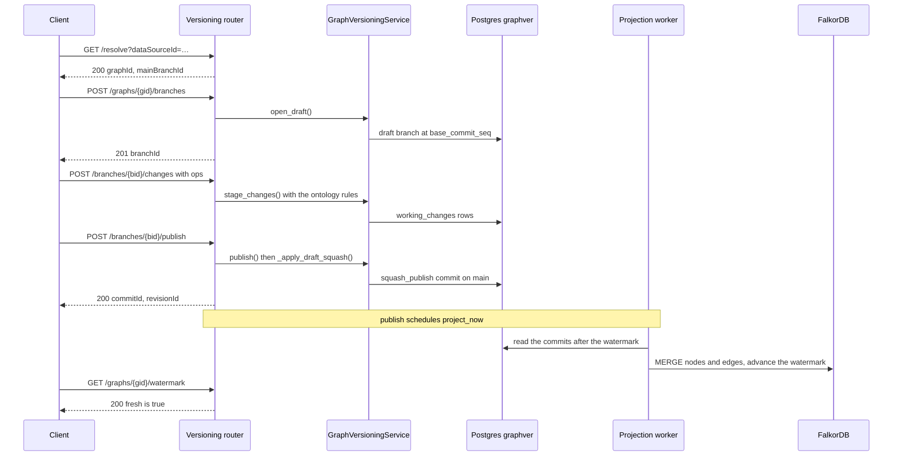

# 06 · API Reference — REST Surface & the Draft-Aware Graph Plane

*For integrators and backend and frontend engineers who call the versioned graph over HTTP.*

This is the contract for the two workspace-scoped routers behind version control: every route,
who may call it, and what it answers. For how the operations behave, see
[03 · Branching, Commits & Merge](/docs/versioning-branching-and-merge). To sign a script in, see
[Sign in from a script](/docs/api-guide#sign-in-from-a-script) in the API Guide.

**How to read it.** Paths in §2 are relative to `/api/v1/{ws_id}/versioning`; paths in §4 are
relative to `/api/v1/{ws_id}/graph`. **Gate** is the permission a route needs (`_READ` or
`_MANAGE`, [§1](#permissions-rbac)), plus any feature switch that can close it. `{gid}` is a graph
id (`graph_…`), `{bid}` a branch id (`br_…`), `{cid}` a commit id (`cmt_…`) and `{pr}` a pull or
merge request id (`pr_…`). Every route and its exact request and response models are also in the
live OpenAPI explorer — see [Find the endpoint you need](/docs/api-guide#find-the-endpoint-you-need).

**TL;DR.** Two workspace-scoped FastAPI routers own everything. The **versioning router**
(`/api/v1/{ws_id}/versioning`) is the *only* path between a client and the `graphver` Postgres
store — it delegates to `GraphVersioningService`. The **graph router** (`/api/v1/{ws_id}/graph`) is
the provider and engine read and write plane, made **draft-aware** by a single `?branchId=` query
parameter. Auth is a cookie session plus CSRF, or an API key; authorization reuses **data-source permissions** (a
graph is 1:1 with a data source); a graph, request or data source in another workspace answers
**404**, never 403.

Both routers are mounted on `api_router` in `backend/app/api/v1/api.py`: the versioning router with
the `versioning_write_gate` dependency, the graph router with `require_ds_read_or_view`. Wire shapes
are camelCase over snake_case Python (`_ApiModel`, `populate_by_name=True`), with the exceptions the
tables call out.

---

## 1. Auth, RBAC & tenancy

### Session & CSRF

`POST /api/v1/auth/login {email, password}` sets the session cookies, among them `nx_access`
(`HttpOnly`) and `nx_csrf`. Send the cookies back on every request, and copy `nx_csrf` into the
`X-CSRF-Token` header on **every** `POST`, `PUT`, `PATCH` and `DELETE` — including the reads that are
`POST`s. `GET`s need no header. The access cookie lasts `JWT_EXPIRY_MINUTES` — 15 minutes in the
Compose files, 60 in the Helm chart, 5 where it isn't set; `POST /api/v1/auth/refresh` renews every
cookie, `nx_csrf` included. Working curl, `requests` and
`httpx` helpers are in the [API Guide](/docs/api-guide#sign-in-from-a-script). The routers trust the
authenticated `User` and `PermissionClaims`; they never re-derive identity.

### API keys

`Authorization: Bearer nxpat_…` — or a [service account](/guide/service-accounts)'s `nxsat_…` —
replaces the cookies and the CSRF header — see [API Keys](/guide/api-keys). The key acts as its
owner, a person or a service account, narrowed to what it was limited to: data read for the routes
`_READ` gates, data read & write for those `_MANAGE` gates ([below](#permissions-rbac)). Every route below accepts a key except a blank model
(`/blank-graphs` and its name check `GET /blank-graphs/name-check`), every fork
route (create, list, delete, restore), adding or removing a draft's members, projection rebuild
and reconcile, everything else that advances `main` (a fork review's merge, revert, restore),
`GET /reviewers`, freeze and unfreeze, the platform routes of
[§2.14](#214-platform-administration), and on the graph router `/bootstrap/decision`,
`/bootstrap/abandon`, `/resync` and `edges/aggregated/materialize`. Setting up the graph an import
goes into takes a key, held to what a person needs (`_MANAGE`): `POST /graphs` and `POST /resolve`
(each holding the key to the data source its body names, and `POST /resolve` to a view it may edit
for `originatingViewId`), and on the graph router `POST /bootstrap` and `/bootstrap/retry`, beside
`GET /bootstrap/status` and `/bootstrap/duplicates`.
Those answer a key with **403** `{"detail": {"error": "api_key_not_allowed", "message": …}}`. A
key limited to particular data sources reaches a graph, branch or request only when the data
source behind it is one of them — otherwise `403 api_key_out_of_scope`, or `404` across
workspaces; opening a fork's pull request (`POST …/pulls`) also needs the parent graph's data
source.

Publishing a draft (`POST …/branches/{id}/publish`), merging a draft's merge request
(`POST /merge-requests/{id}/merge`) and syncing a snapshot (`POST …/graphs/{id}/sync`) accept a key
where its owner holds publish (`versioning_gate.require_publish`), as bulk ingest does; elsewhere
**403** `publish_required`, whose message says it is the key's account that needs Publisher. An
import asked to publish itself (`autoPublish`) is held to the same. A fork's review stays closed to
keys on either merge route (**403 `api_key_not_allowed`**).

A read-only key reads, and may also create an export (`POST …/exports`, which only reads the
graph) or dry-run an import (`POST …/imports/validate`, which writes nothing). It can't open a pull request or cancel an export, though `_READ` gates both: they change
something. A service account can't approve a pull request or be named its reviewer (**403
`person_required`**), and nobody approves one opened through a service account they manage, or one
from a draft it owns (**403 `self_review`**) — both with `"type": "access_denied"`.

### Permissions (RBAC)

Three permission strings gate the whole surface (`_READ`, `_MANAGE` and `_PUBLISH` in
`backend/app/api/v1/endpoints/versioning.py`):

| Constant | Value | Applies to |
|---|---|---|
| `_READ` | `workspace:datasource:read` | All reads; **open a fork PR**; PR and commit inspection; exports |
| `_MANAGE` | `workspace:datasource:manage` | All writes; **fork**, and delete or restore a fork; projection rebuild and reconcile; branch admin; reviews; upload and publish-job status |
| `_PUBLISH` | `workspace:datasource:publish` | On top of `_MANAGE`, everything that advances `main`: **publish**, **merge** (draft and fork PRs), **revert**, **restore** and **sync**, the graph router's `/resync`, and pausing or resuming editing (`…/lifecycle/freeze`, `…/lifecycle/unfreeze`). A `workspace_member` does not hold it: a person without it gets **403** `{error: "missing_permission", permission, scope, message}` (an `error` key, no `type`). These routes are closed to API keys (**403 `api_key_not_allowed`**, [above](#api-keys)), except publishing a draft, merging a draft's merge request and sync, where a key's owner must hold it (**403 `publish_required`**). A direct publish also needs the draft's owner or a maintainer; refused for that, the 403 (`not_draft_owner` / `not_owner_or_member`) carries `hint: "merge_request"`, since anyone with publish merges the draft's review. A person also needs it to write `main` directly — **bulk-ingest**, and the graph router's writes with no draft (§4) — or gets **403** `publish_required`; an API key makes those writes only where its owner holds publish (for a service account's `nxsat_` key, the service account, through its own workspace roles) |

> **Decision — governance by permission asymmetry.** Anyone who can *see* a fork may propose its
> changes: **opening a PR** (`POST /graphs/{gid}/pulls`) needs only `_READ`. **Forking**
> (`POST /graphs/{gid}/forks`) creates a graph, so it needs `_MANAGE`, as do editing drafts and
> raising reviews. Landing changes on a shared `main` — **merge** and **publish** — needs `_PUBLISH`
> as well.

`system:admin` implies both everywhere, `system:org-admin` in every workspace, and `workspace:admin`
in its own workspace. Which roles hold which permission is in [RBAC](/docs/rbac). One read accepts
more than membership: `GET /resolve` also admits a caller who can read the view passed as `viewId`,
so a read-only canvas can boot. Every other versioning route is membership-only.

### The switches that close these routes

| Switch (Administration → Features) | Key | Closes |
|---|---|---|
| **Version control** | `versioningEnabled` | Every `POST`, `PUT`, `PATCH` and `DELETE` on the versioning router except `…/projection/rebuild`, `…/projection/reconcile`, `POST …/exports` and `…/lifecycle/freeze`; on the graph router, `POST /bootstrap`, `/bootstrap/retry`, `/bootstrap/decision`, `/bootstrap/abandon` and `/resync`. Reads stay open |
| **Forks** | `forksEnabled` | Off by default. `POST /graphs/{gid}/forks`; on a fork's graph or a review from or into a fork, every `POST`, `PUT`, `PATCH` and `DELETE` except the fork's trash (`DELETE /graphs/{fork}`), closing a review, and the ones **Version control** leaves open; `POST /resolve` for a fork's data source; on the graph router, `/changes`, node and edge writes, `/save` and `/commands/batch` on a fork. Reads and restoring a fork stay open; so does every background job but the one a large publish, update or merge on a fork runs as ([17](17-forks-and-residency.md#turning-forks-on)) |
| **Export graph data** | `graphExportEnabled` | Export plan, stream, job creation and download, on both routers |
| **Build lineage from scratch** | `blankModelsEnabled` | `POST /blank-graphs` |
| **Edit mode** | `editModeEnabled` | `POST /graph/changes`, `POST /graph/nodes/create`, and `POST`, `PATCH` and `DELETE` on `/graph/edges` |
| **Lineage trace** | `traceEnabled` | The `/graph/trace…` routes ([§4](#lineage-trace-routes)) |

A closed switch answers **403** with `{"detail": {"type": "feature_disabled", "feature": …, "message": …}}`.
Every switch and its default is in the [Feature Switches API](/docs/api-features) reference.

### Tenant isolation → 404, not 403

Every `{gid}` route depends on `graph_in_workspace`, which resolves the graph and asserts that its
`workspace_id` is `{ws_id}`, raising **404** on a mismatch so existence never leaks across
workspaces. A graph in the trash — its data source deleted, the fork itself deleted, or its purge
running — answers **404** too, except to `POST /graphs/{fork}/restore`, which finds a fork in the
trash and scopes it to `{ws_id}` itself. `pr_in_workspace` does the same for a request's **base** graph and also requires you to
take part in the request — its author, an assigned reviewer, or a holder of `_MANAGE` — else **404**.
Moving a data source to another workspace moves its graph and the graph's forks with it, and the
forks' data sources, so they answer there and no longer here. A resumable upload under way must start again in the new
workspace.
`view_in_workspace` resolves a view from the **management** database (a separate store from
`graphver`) with the same rule. On the graph router, the enablement routes check the data source
with `_data_source_in_workspace`, and `/changes` and `/nodes/{urn}/delete-impact` check the graph
that backs `dataSourceId`.

### Domain → HTTP error map

`_domain_errors()` translates the service's domain exceptions centrally:

| Exception | HTTP | Body `detail` |
|---|---|---|
| `MergeConflict` | **409** | `{type: "merge_conflict", conflicts: […]}` |
| `OntologyViolation` | **422** | `{type: "ontology_violation", violations: [{entity_id, kind, reason, rule}]}` |
| `AccessDenied` | **403** | `{type: "access_denied", message}`. Routes outside this router answer it the same way |
| `DraftNotReadable` | **404** | `"unknown branch"` — a read of a draft you can't read (someone else's private draft): the same answer as a branch that doesn't exist |
| `NotDraftOwner` | **403** | `{type: "access_denied", code: "not_draft_owner", branchId, owner, message}` — a write to someone else's private draft with no members; a change of a draft's level, members, name or state by someone who doesn't manage it; a hand-on by anyone but its owner (or a workspace admin, once its owner left). To someone who may not read the draft at all it is a **404**, as for a read |
| `DraftRoleRequired` | **403** | `{type: "access_denied", code: "not_owner_or_member", required, branchId, message}` — a draft with members refused the caller: `required` is `editor` to write it, or `maintainer` to publish, abandon, change its level or manage its members. A member through a group counts |
| `SelfReview` | **403** | `{type: "access_denied", code: "self_review", prId, message}` — an approve by whoever opened the PR, where its data source's policy has someone else approve (`selfApproval` off); the draft's owner, when someone else opened it, approves either way. A manager of the service account that opened the PR or owns its draft, or anyone who made a key for it, gets the same answer from the approve routes, whatever the policy |
| `SelfMerge` | **403** | `{type: "access_denied", code: "self_merge", prId, message}` — a merge by whoever opened the PR, where its data source's policy has someone else merge (`selfMerge` off) |
| `ReviewRequired` | **409** | `{type: "review_required", branchId, message}` — a draft published directly where its data source's policy has someone else merge: a direct publish is its publisher's own merge. Open a review instead |
| `StagedChangesUnsaved` | **409** | `{type: "staged_changes_unsaved", actors, message}` — a draft's level, members or owner could not change: what `actors` staged, who would lose write access, clashes with the draft (or breaks its ontology) and could not be committed first. Nothing about the draft's access changed; what the others staged was committed |
| `IneligibleOwner` | **422** | `{type: "ineligible_owner", userId, reason, message}` — who a draft was to be handed to can't own it: `reason` is `unknown_user`, `inactive`, `service_account` or `no_manage` |
| `PersonRequired` | **403** | `{type: "access_denied", code: "person_required", message}` — a service account named as a PR's reviewer (raising it, or in either PATCH), or approving one: its managers would review through it |
| `PublishRequired` | **403** | `{type: "access_denied", code: "publish_required", required: "workspace:datasource:publish", message}` — a person without publish wrote a versioned graph's `main` directly (bulk-ingest, or a graph-router write with no draft). Edit in a draft instead. An API key is refused the same way unless its owner holds publish: the person, or for a service account's `nxsat_` key the service account, through its own workspace roles |
| `GroupsUnavailable` | **503** | `{type: "groups_unavailable", retryable: true, message}`, `Retry-After: 2` — the caller's role on a shared draft turns on a group, and their groups can't be looked up right now. Retry; it is never read as "no groups" |
| `IneligibleMember` | **422** | `{type: "ineligible_member", subjectId, reason, message}` — who was to be added to a draft can't be: `reason` is `owner`, `unknown_user`, `unknown_group`, `no_read` (no workspace read) or `no_manage` (an editor or maintainer without workspace manage). A service account answers **409** with `reason: "service_account"` (`ServiceAccountMember`): its access is the workspace roles on its own page |
| `ApprovalRequired` | **409** | `{type: "approval_required", pending: […], stale: […]}` — `pending` are the requested reviewers without a standing approval; `stale` are those of them who approved an earlier version (a content commit landed on the draft since) and must approve again |
| `HeadMoved` | **409** | `{type: "head_moved", prId, headCommitId, message}` — an approve named the head the reviewer saw (`expectedHeadCommitId`), and the draft has moved on; review `headCommitId` and approve again |
| `BranchNotOpen` | **409** | `{type: "branch_closed", status, branchId, message}` — a write, checkpoint, pull, publish or import reached a draft that is `merged`, `abandoned` or `publishing` |
| `DraftPruned` | **410** | `{type: "draft_pruned", branchId, prunedAt, message}` — a read of a merged or abandoned draft's changes after draft retention removed them ([03](/docs/versioning-branching-and-merge)): its diff, state, change list, commits' diffs, an export of it, a closed review's Files changed. The draft's record — the branch, its commits, its review — still reads |
| `MainWriteForbidden` | **409** | `{type: "main_write_forbidden", message}` — a route that writes drafts was given `main` (by name or id): `/graph/changes`, an import, a publish job; `main`'s id on stage, checkpoint or pull (`…/branches/{bid}/changes`, `…/commit`, `…/rebase`) |
| `JobActive` | **409** | `{type: "job_active", jobId, message}` — another import is pending or running on the draft (a second import, or a publish or merge of it); an Update from parent job is pending or running on the fork (a second one); a fork's review is held `merging` by its job (another merge of it, closing it, or changing its reviewers) |
| `LockBusy` | **503** | `{type: "lock_busy", retryable: true, message}`, `Retry-After` — a graph, draft, lifecycle, move or PR lock was not granted within `GRAPHVER_GRAPH_LOCK_TIMEOUT_MS` (default 5,000; `Retry-After` is that in seconds), or every retry of a write lost to another writer (`Retry-After: 2`). Nothing was written; retry |
| `ProjectionNotAdopted`, `ProjectionKeyInUse`, `ProjectionKeyInvalid` | **409**, **409**, **422** | `projection_not_adopted`, `graph_key_in_use` and `invalid_target_key` — refusals of the platform's projection move ([§2.14](#214-platform-administration)) |
| `RevisionTooFar` | **409** | `{type: "revision_too_far", asOfSeq, headSeq, changed, limit, message}` — a graph read named a revision more than `GRAPHVER_REVISION_REWIND_MAX` entities behind `main`'s head ([§4](#asofseq--the-graph-as-it-was-at-a-past-revision)) |
| `RevisionReadOnly` | **409** | `{type: "revision_read_only", message}` — a write, or a read that plans one, named a past revision |
| `RevisionUnsupported` | **501** | `{type: "revision_unsupported", reason, message}` — a past revision this read can't answer as the graph was then: `reason` is `route` (it reads the graph as it is now), `fork`, `draft` or `unversioned` |
| `NotUpToDate` | **409** | `{type: "not_up_to_date", branchId, behindBy, reason, message}` — pull `main` in with `…/rebase`, then retry. `reason`: `people` (someone changed `main` since the draft's base), `overlap` (automation changed what the draft changes, or met it at an edge) or `size` (a draft past `GRAPHVER_SQUASH_PAGED_ABOVE`). A draft behind automation alone, on nothing it changes, is not refused ([19](19-change-streams.md) §3.5) |
| `ForkNotUpToDate` | **409** | `{type: "not_up_to_date", reason: "parent_moved", behind, graphId, message}` — a fork's review merges only up to date with its parent: `POST …/graphs/{fork}/update-from-parent`, then retry. `behind` counts the entities the parent changed since (to `GRAPHVER_FORK_REWIND_MAX`) |
| `ForkUpdateConflicts` | **409** | `{type: "fork_update_conflicts", conflicts: […], seeds: {…}, message}` — Update from parent found fields both the fork and its parent changed: a pull's conflicts, and the fork's own value of each entity to resolve from. Nothing was written; send it again with `resolutions` |
| `CrossesUpdate` | **409** | `{type: "crosses_update", graphId, commitId, message}` — a revert of a fork's Update from parent (a `sync_parent` commit), or a restore of the fork to before its latest one: the update moved the parent commit the fork reads, which no commit of its own takes back. Fork again from that point instead |
| `ResolutionsWithoutConflict` | **422** | `{type: "resolutions_without_conflict", ids: […], message}` — Update from parent was sent resolutions for entities it found in no conflict; a resolution settles only a conflict the update raised. Nothing was written |
| `PullRequestExists` | **409** | `{type: "pull_request_exists", prId, branchId, title, message}` — the branch already has a live request ([03](/docs/versioning-branching-and-merge)); `prId` is the one that exists, so send the user *to* it |
| `ConcurrencyError` | **409** | `{type: "integrity", message}` |
| `AmbiguousUrn` | **422** | `{type: "ambiguous_urn", urns, message}` — a save named a node by a urn several live nodes carry; refer to it by its id. Nothing was written |
| `EntityExists` | **409** | `{type: "entity_exists", ids, refs, message}` — a create named an id a live entity holds (a node or an edge), or a urn a live node carries: refused rather than it be silently replaced or turned into the other kind. `refs` names each as the client sent it |
| `EdgeEndsMissing` | **422** | `{type: "invalid_patch", ids, message}` — an edge create with no source or no target |
| `UniqueViolation` | **409** | `{type: "unique_violation", violations: [{type, field, value, entities}], total, message}` — a publish (or review or fork merge) would leave two live nodes of a type with the same value in a field the type keeps unique; the first 100 |
| `DiffTooLarge` | **409** | `{type: "too_large_for_tree", changed, limit, message}` — the draft changes more entities than the Changes tree lays out |
| `ValueError` | **404** | `str(message)` — an unknown id, and also a request the state doesn't allow: a pull or merge request already merged or closed, a commit to revert or restore that isn't on `main`, the genesis commit given to revert, `main` where a draft is needed (abandoning or editing it, or raising a merge request from it), a graph that isn't a fork. A closed draft answers `branch_closed` instead, and `main` given to a write, checkpoint or pull `main_write_forbidden` (above). Read `detail` before treating it as missing |

Other refusals you will meet on these routers:

| Answer | `detail.type` | When |
|---|---|---|
| **422** | `invalid_patch` | An `unsetProperties` that contradicts its op or payload; on `/graph/changes`, an edge update or delete whose id names an item, not a connection |
| **422** | `invalid_cursor` | A history page's `before` cursor isn't one the server issued |
| **409** | `private_drafts_disabled`, `public_drafts_disabled` | A draft opened, or changed, to a level its data source's policy rules out ([§2.3](#23-branches--drafts)) |
| **422** | `is_shared_retired` | `isShared` on `PATCH …/branches/{bid}`: a draft's level changes through `POST …/visibility`, and it is shared by adding members |
| **422** | `ontology_required` | A blank (ontology-governed) graph whose data source has no ontology assigned |
| **503** | `ontology_unavailable` | A blank graph's ontology can't be resolved right now; writes wait for it |
| **422** | `graph_too_large_to_sync` | A sync or re-sync on a graph above the size guard ([§2.9](#29-bulk-ingest--authoritative-sync)) |
| **409** | `curation_at_risk` | A sync while `main` holds people's edits from before its last import or sync; `lastHumanCommit` names the newest. A workspace admin may pass `?force=true` |
| **409** | `mass_delete_blocked` | A sync that would delete more than the limit; `{deletes, live, limit}`. A workspace admin may pass `?allowMassDelete=true` |
| **409** | `platform_copy`, `not_ready`, `spelled_two_ways` | Bringing a graph's changes into history ([§4](#cascade-preview--bootstrapresync)) on a copy the platform made; while the projection doesn't hold main (`{status}`); from a graph that spells a type two ways (`{spelled}`) |
| **409** | `fork_limit` | A fork of a graph that already has `limit` live forks (`GRAPHVER_MAX_FORKS_PER_GRAPH`, default 10), or the restore of a fork into a graph that has them; `{limit}` |
| **409** | `not_a_fork` | A fork delete or restore on a graph `…/forks` did not make: a data source's graph, or a fork bound to a data source. It goes to the trash and back with its data source; `{graphId}` |
| **409** | `live_forks` | The delete of a fork that has live forks of its own; `{graphId, forks}`. Delete those first. A data source's permanent delete while forks of it are live answers `{type, message}` |
| **409** | `use_fork_endpoints` | A data-source delete, permanent delete, restore, move, move preview or transfer request on a fork's data source. It goes with its graph, through the fork routes ([§2.11](#211-forks)), and moves with its parent |
| **409** | `fork_settings_follow_parent` | A write to a fork's data source that would change a setting it takes from its parent (its ontology, restriction, access level, identity and name properties, draft policy); `{fields, message}`. Change it on the parent |
| **409** | `fork_has_no_store` | A fork's data source has no graph store of its own: a provider write through it, an aggregation trigger, a dedicated rollup graph or projection mode, a projection move, or bringing outside changes into history; `{dataSourceId, message}` |
| **409** | `blocked`, `graph_busy` (in `detail.error`) | A data-source move (`POST /api/v1/admin/workspaces/{ws}/data-sources/{ds}/move`), an accepted transfer request or an undo while a job is pending or running on the graph or one of its forks, or while turning on version control for it failed and waits to be resumed or cancelled. `blocked` (with `issues`) is the preview's check; `graph_busy` is the version store's own (`MoveBlocked`), a graph lock held past the wait, or another request moving the graph meanwhile. Open drafts and review requests never hold a move back: they move with the graph and its forks. `{error, message, issues?}` |
| **409** | `fork_not_primary` | Making a fork's data source the workspace's default (`POST /api/v1/admin/workspaces/{ws}/data-sources/{ds}/set-primary`): a fork is never one. `{message}` |
| **409** | `fork_not_restorable` | The restore of a fork whose purge is queued (`reason: "purging"`), or whose parent is gone or in the trash (`reason: "parent_deleted"`; restore the parent first); `{graphId, reason}` |
| **409** | `graph_not_writable` | A content write to a graph that isn't live: a save, opening, staging, checkpointing, pulling, publishing or merging a draft, a PR merged into it, revert, restore, bulk ingest, sync and resync, a fork of it, or an import or publish job. `{state, reason, retryable: false}`; `reason` equals `state`, which is `frozen` (editing is paused), `trashed`, `purging`, or a stored state this release has no name for. No `Retry-After`. Reads, exports, projection and abandoning a draft still work |
| **409** | `version_conflict` | A freeze or unfreeze whose `expectedRev` is no longer current; `{resource: "lifecycle", currentVersion}`. Reload and retry |
| **409** | `bootstrapping` | A projection rebuild, or a projection move, while version control is still being enabled for the data source |
| **403** | `feature_disabled` | A switch closed the route ([above](#the-switches-that-close-these-routes)) |
| **403** | `needs_admin` | `?force` or `?allowMassDelete` on a sync by anyone but a workspace admin: `{type: "access_denied", code: "needs_admin", required: "workspace:admin", error: "missing_permission", permission, scope, message}` |
| **403** | — | The route's permission is missing: `{error: "missing_permission", permission, scope: {type, id}, message}`, with no `type`. An API key on a route it can't call gets `{error: "api_key_not_allowed", message}` instead ([§1](#api-keys)) |
| **503** | — | `"Authorization temporarily unavailable"`: a permission check would refuse, but the workspace's grants could not be read. Retry |

> **Invariant.** A conflict or violation is **atomic**: the service raises before any partial write,
> so a 409 or 422 leaves the branch exactly as it was. Resolve, then retry.

### Actor-name resolution

`graphver` stores raw user ids (it is independent of the provider and of the management database).
Answers that carry actor ids — branch lists, PR and merge-request lists and reads, the commit log, an
entity's history and summary — hang a `userNames: {id → "First Last"}` map, filled by one batched,
de-duplicated lookup per request against the management database (`_attach_user_names`). The commit
log carries one map for the whole page; lists carry one per item.

---

## 2. REST catalog — `/api/v1/{ws_id}/versioning`

All paths below are relative to `/api/v1/{ws_id}/versioning`; `…` stands for `/graphs/{gid}`.
"Gate" is the permission required.

### 2.1 Graph lifecycle & resolution

| Method · Path | Gate | Purpose / key fields |
|---|---|---|
| `POST /graphs` | `_MANAGE` | Create a versioned graph holding only its genesis commit. `{dataSourceId, workspaceId, kind?, baseOntologyId?, tenantId?, ontologySpec?, ontologyEnforcement?}` → **201** `{graphId, mainBranchId, genesisCommitId}`. The graph projects into the data source's own FalkorDB graph on its own provider; the caller does not choose them. `workspaceId` must equal the path (else **400**); a data source not in this workspace is a **404**; a source that isn't FalkorDB is **422 `provider_unsupported`**; a FalkorDB graph another versioned graph already projects into, through any provider on the same server (for a sentinel or cluster provider, the server its topology names), is **409 `graph_key_in_use`**. To copy a data source's existing graph in, use **bootstrap** ([§4](#cascade-preview--bootstrapresync)) instead |
| `GET /graphs/{gid}` | `_READ` | Graph metadata (`GraphResponse`: `graphId`, `workspaceId`, `tenantId`, `kind`, `baseOntologyId`, `forkParentGraphId`, `forkBaseCommitSeq`, `mainHeadCommitSeq`, `createdBy`, `createdAt`, `userNames`) |
| `GET /resolve` | `_READ`, or read access to the view in `viewId` | `?dataSourceId&viewId` → `ResolveResponse{graphId, mainBranchId, mainHeadCommitSeq, myDraft?, kind, bootstrap?, lifecycleState, lifecycleRev}`. **Read-only — never opens a draft.** `kind` is `manual`, `authoritative`, `hybrid` or `blank`; `bootstrap` is the enablement job while the graph is still at genesis and that job is pending, running, waiting for a decision (`needs_decision`) or failed — the graph is versioned only once `bootstrap` is `null`. `lifecycleState` is `live` or `frozen` (editing is paused), and `lifecycleRev` is what a freeze or unfreeze names. **404** when no versioned graph backs the data source. For every data source of a workspace at once, `GET /api/v1/admin/workspaces/{ws_id}/data-sources?include=versioning` gives each one's `graphId`, `kind` and the head of `main` — see [Graph Metadata & History API](/docs/graph-metadata-api) |
| `POST /resolve` | `_MANAGE` | `{dataSourceId, originatingViewId?}` → the same shape, but **opens the caller's draft if there is none** (the frontend's `resolveAndOpenDraft`); on a frozen graph that has none, **409 `graph_not_writable`** |
| `POST …/lifecycle/freeze` | `_PUBLISH` | Pause editing: every content write answers **409 `graph_not_writable`** until it is unfrozen. `{expectedRev}` → `{graphId, state, rev}`. A stale `expectedRev` → **409 `version_conflict`**; an already frozen graph → **200**, unchanged. **409 `integrity`** while version control is still being enabled for the data source (or its enablement failed and was not resumed or cancelled); **409 `graph_not_writable`** for a stored state this release doesn't know, which it never overwrites; **404** for a graph in the trash. Waits for saves in flight, and past the lock wait answers **503 `lock_busy`**. Open while version control is turned off. Recorded in the activity log |
| `POST …/lifecycle/unfreeze` | `_PUBLISH` | Resume editing; otherwise as freeze, without the enablement check. Closed while version control is turned off |

> **Note.** "Enable version control" (**bootstrap**) and the authoritative **re-sync** from the
> provider are on the *graph* router ([§4](#cascade-preview--bootstrapresync)), because they snapshot
> the live provider into the versioned base and need the `ContextEngine`.

### 2.2 Blank models (self-service, ontology-governed)

| Method · Path | Gate | Purpose / key fields |
|---|---|---|
| `GET /blank-graphs/name-check` | `_MANAGE` | `?providerId&graphName` → `{available, normalized, reason?, suggestion?}`. A name is 3–64 characters of lowercase letters, digits, `-` and `_`, starting with a letter or digit. The prefixes `gv_`, `gvt_`, `gvtest_`, `blank_` and `__fork_`, and the ending `_proj`, are reserved. The name must be free on that connection: no other data source or catalogued graph uses it, and no graph of that name exists (a live, best-effort check). A taken name comes back with a free `suggestion` (`data_lineage` → `data_lineage_2`) |
| `POST /blank-graphs` | `_MANAGE` + **Build lineage from scratch** | `{name, description?, providerId, ontologyId, graphName?}` → **201** `BlankGraphResponse{dataSourceId, graphId, mainBranchId, graphName, label}`. One call provisions a manual data source, a genesis-only **strict** `kind="blank"` graph, and its aggregation registration; without `graphName`, a name is minted. Preflight: the provider exists, is active, is FalkorDB, is permitted in the workspace (else **403**) and is reachable (`provider_unreachable`); the ontology is **published** (`ontology_not_published`); the name is re-checked under an advisory lock. If creating the graph fails, the new data source is deleted again (no two-phase commit) and the answer is **502** |

### 2.3 Branches & drafts

| Method · Path | Gate | Purpose / key fields |
|---|---|---|
| `GET …/branches` | `_READ` | `?limit(100, max 500)&cursor&status&viewId&scope&visibility` → `[BranchResponse]`, `main` first, then drafts newest first. When another page follows, the `X-Next-Cursor` header carries the `cursor` for it. `status` is repeatable: `open`, `publishing`, `merged`, `abandoned` or `all` (default `open` + `publishing`). Graph-wide by default; `viewId` narrows to that view's drafts (**branch-per-view**). You see `main`, the public drafts, your own drafts, the drafts you are a member of (yourself or through a group; a deleted group counts for nothing), and drafts from which a PR you raised or were asked to review was opened, whatever that PR's status. Managing the workspace opens no one else's private draft. `scope` keeps `all` (default), `mine`, `shared` (those you are a member of) or `public`; `visibility` keeps `public` or `private`. That filter runs before the page is cut, so every page but the last is full. If your groups can't be looked up, the list is narrowed to what you hold yourself instead of failing. Each row carries its `visibility` (`public` or `private`; `main` is public), `myRole` — your role on it, as `…/members` reports it (`null` on `main`, and on a draft that gives you none) — and `access` `{canRead, canWrite, canManage}`, what you may do with it. A `cursor` the server didn't issue is a **422** (`"malformed cursor"`); any other `status` value is a **422** validation error |
| `POST …/branches` | `_MANAGE` | `{name?, originatingViewId?, visibility?}` → **201** `{branchId}`. Without `visibility`, the draft opens where its data source's policy says ([§2.3a](#23a-drafts-and-reviews-policy)); a level the policy rules out is **409 `private_drafts_disabled`** or **`public_drafts_disabled`**. The deprecated `shared: true` opens a private draft |
| `GET …/branches/{bid}` | `_READ` | One branch as the list shows it, with `contributors`: who committed to it, most commits first, then the latest (50 at most). `prunedAt` (the list's too): when draft retention removed a closed draft's changes, null until then. A draft you can't read is a **404** |
| `POST …/branches/{bid}/visibility` | `_MANAGE` | `{visibility: "public" \| "private"}` → `BranchResponse`, by its owner or a maintainer, within its data source's policy (**409 `private_drafts_disabled`** / **`public_drafts_disabled`**). Made private, the people it takes write access from — not its owner, nor its editor and maintainer members — have what they staged committed first, each under their own name, in the order they staged it; then the draft is unknown to them (**404**). When some of it clashes with the draft, the level stays as it was: **409 `staged_changes_unsaved`** naming whose (what the others staged was committed). Recorded in the activity log, and the people who lost it are told in their Inbox |
| `GET …/branches/{bid}/visibility-impact` | `_MANAGE` | `?visibility` → `{visibility, saved: [{actor, changes}], userNames}`: whose staged edits that change would commit first, and how many — for its owner or a maintainer to see beforehand |
| `POST …/branches/{bid}/transfer` | `_MANAGE` | `{to, keepPrevious?}` → `BranchResponse`: hand the draft to `to`. Its owner does, at any time; a workspace admin does once its owner left the workspace (their account is gone or not active, or they no longer read its data sources); anyone else **403 `not_draft_owner`**, or **404** on a private draft they can't read. `to` must be an active person who can edit the workspace's data sources (**422 `ineligible_owner`**). The previous owner stays on as a maintainer (`keepPrevious`, default `true`); with `false`, what they staged is committed first if that takes their write access (**409 `staged_changes_unsaved`** as above). A closed draft is **409 `branch_closed`**. Recorded in the activity log; the new owner is told in their Inbox. Not open to API keys |
| `GET …/drafts/owner-left` | `workspace:admin` | `?limit(200, max 1000)` → `[{graphId, branchId, dataSourceId, name, owner, visibility, status, updatedAt, userNames}]`: the workspace's open drafts whose owner left, the latest changed first — never what they hold. Here the path is `/api/v1/{ws_id}/versioning/drafts/owner-left`. Not open to API keys |
| `GET …/branches/{bid}/members` | `_READ` | A draft's members and your role on it: `{members: [{subjectType, subjectId, role, name}], myRole}`. `name` is the person's or group's display name, or `null`; `myRole` is `owner`, a member role, or `null`. A draft with none answers `[]`. A draft you can't read is a **404**; **503 `groups_unavailable`** when your access or role turns on a group and your groups can't be looked up |
| `POST …/branches/{bid}/members` | `_MANAGE` | Add one, or change their role: `{subjectType: "user" \| "group", subjectId, role: "viewer" \| "editor" \| "maintainer"}`, by the owner or a maintainer (anyone else: **403 `not_draft_owner`** on a draft with no members, **403 `not_owner_or_member`** with `required: "maintainer"` on one with members). Any other value is a **422** validation error. A role lowered so that someone no longer writes the draft has what they staged committed first (**409 `staged_changes_unsaved`** when it clashes). A service account is refused first, before the draft is read or the caller's role on it is checked: **409 `ineligible_member`** (`reason: "service_account"`), whether added or given another role, even on a draft that doesn't exist or that the caller can't manage. A draft can't be shared with one. Anyone else who is added is checked after the caller is: **422 `ineligible_member`** for the owner, an unknown user or group, or a user without workspace read (or manage, for editor and maintainer) |
| `DELETE …/branches/{bid}/members/{subjectType}/{subjectId}` | `_MANAGE` | Remove one → `{removed: true}`, by the owner or a maintainer (refused as for adding). Removing someone who isn't a member also answers `{removed: true}`. What the removed member staged is committed first, under their name, if that takes their write access (**409 `staged_changes_unsaved`** when it clashes, and nobody is removed) |
| `PATCH …/branches/{bid}` | `_MANAGE` | `{name?, description?}`; `""` clears a name or description, by the owner or a maintainer. `isShared` is **422 `is_shared_retired`**: change the level with `…/visibility`, and share a draft by adding members |
| `POST …/branches/{bid}/abandon` | `_MANAGE` | Discard the draft → `BranchResponse`. Its layout edits go with it. By its owner, or a maintainer of a shared draft (anyone else: **403 `not_draft_owner`** or **`not_owner_or_member`**); a merged or publishing draft is **409 `branch_closed`**, and abandoning an abandoned one answers it again. Its pull requests are left as they are |
| `GET …/branches/{bid}/freshness` | `_READ` | Is the draft behind `main`, and who else is saving into it? `?sinceSeq` → `{behind, behindBy, behindByPeople, pullRequired, pullReason, mainHeadCommitSeq, baseCommitSeq, status, headCommitSeq, visibility, access, savedSince, userNames}` — cheap enough to poll while editing. `behindByPeople` counts the commits people made of those it is behind. `pullRequired` says whether it must pull before it publishes, and `pullReason` why (`people`, `overlap`, `size`; `null`: it publishes as it is). For a draft of up to 10,000 changes, whether automation touched what it changes is read on each poll; a bigger one finds out when it publishes. `status` is the draft's own, so a client learns its draft was published or discarded without listing closed drafts. `headCommitSeq` is the draft's own latest commit: send it back as `sinceSeq` next time. With `sinceSeq`, `savedSince` `{commits, changes, by, capped}` is what others committed since — never your own, and of others' only the newest 200 (`capped` when there were more); `by` is most commits first, then the latest, named in `userNames`. A draft you can't read — or may no longer read — is a **404** |
| `POST …/branches/{bid}/rebase` | `_MANAGE` | "Pull latest `main` into the draft." `{resolutions?}` → `{clean, conflicts, seeds, changes, incoming, baseCommitSeq, alreadyUpToDate}`. On `clean: false`, resolve and resubmit with `resolutions`; `seeds` holds the draft's own value of each conflicting entity. **`changes` ≠ `incoming`**: `changes` is how *your own* edits were rewritten onto the new base (usually nothing); `incoming` is what actually arrived from `main` — `{branchId, commitIds, commitCount, contributors, stats, fromSeq, toSeq}`, the window to read as `main`'s change list (`…/graphs/{gid}/diff/*?fromSeq&toSeq`). A clean pull writes a `pull` commit ([03](/docs/versioning-branching-and-merge)) — none when the draft was already up to date (`alreadyUpToDate: true`). `main`'s id is **409 `main_write_forbidden`** |

### 2.3a Drafts and reviews policy

Where new drafts start, which levels a draft may have, and whether whoever opens a review may
approve it and merge it — set for a workspace, and per data source over it. Each field is a level's
own value, or `null` where it sets none: a data source's, else its workspace's, else the built-in
default (`public`, `any`, `true`, `true`). When only one level is allowed, new drafts start at it.
Turning private drafts off leaves existing private drafts as they are. Read where a draft is created,
changes level, or a review is approved, merged or published — never cached.

| Endpoint | Perm | Request → Response · Notes |
|---|---|---|
| `GET /drafts-policy` | `_READ` | The workspace's → `{settings, effective}`: `settings` are its own (`{defaultVisibility, levels, selfApproval, selfMerge}`, `null` where unset); `effective` is what holds, with `sources` naming where each field came from (`workspace` or `default`) |
| `PUT /drafts-policy` | `workspace:admin` | A change, field by field: a value sets one, `"inherit"` clears it, a field left out is left as it is → as `GET`. A real change is recorded once in the activity log. Not open to API keys |
| `GET /data-sources/{ds}/drafts-policy` | `_READ` | `{overrides, workspace, effective}`: the data source's own settings, its workspace's, and what holds for it (`sources`: `data_source`, `workspace` or `default`). Another workspace's data source is a **404** |
| `PUT /data-sources/{ds}/drafts-policy` | `workspace:admin` | Override the workspace's, field by field (`"inherit"` goes back to it) → as `GET`. Recorded in the activity log. Not open to API keys |

### 2.4 Changes → checkpoint → publish

| Method · Path | Gate | Purpose / key fields |
|---|---|---|
| `POST …/branches/{bid}/changes` | `_MANAGE` | Bulk-stage edits. `{ops: [{op: "create" \| "update" \| "delete", entityKind: "node" \| "edge", entityId?, payload?, ref?, changeReason?, unsetProperties?}]}` → `{assigned: {ref → entityId}, count}`. A create without `entityId` takes its payload's `urn` (a node), else a new `urn:uuid:`, a node's urn too ([18 · Identity](18-identity.md)). An update merges properties key by key; `unsetProperties` names the ones to remove. When the data source has an assigned ontology, creates are checked here for fast feedback. `main`'s id is **409 `main_write_forbidden`** |
| `POST …/branches/{bid}/commit` | `_MANAGE` | Checkpoint the draft. `{message?, resolutions?}` → `{commitId?, stagedChanges}`. Resolves the live containment types and ontology rules — the authoritative ontology check. `main`'s id is **409 `main_write_forbidden`** |
| `GET …/branches/{bid}/merge-preview` | `_READ` | Dry-run publish → `{clean, conflicts, changes: {create, update, delete}}` |
| `GET …/branches/{bid}/view-changes` | `_READ` | What the draft changes in views besides the graph: `{branchId, views, hidden}` — views it creates or updates, which go live when it is published. Views you can't read are only counted, in `hidden` |
| `POST …/branches/{bid}/publish` | `_PUBLISH` | Squash-publish the draft to `main`. `{message, resolutions?}` → `{commitId, revisionId, status: "completed"}`; `revisionId` is the revision of `main` that holds it: the `commitSeq` of the commit it landed as, which `GET …/revisions/{revisionId}` and `?asOfSeq` ([§4](#asofseq--the-graph-as-it-was-at-a-past-revision)) read `main` as of (a draft that changed nothing lands no commit, and answers `main`'s head). Staged changes are folded in first. **409 `not_up_to_date`** when people moved `main` since the draft's base, or automation changed what it changes (`reason`) — pull with `…/rebase`, then publish again; nothing is rebased for you. Behind nothing but automation that touched none of its changes, it publishes as it is: the merge lands only its own changes. A draft is published by its owner or a maintainer, at either level (else **403 `not_draft_owner`** or **`not_owner_or_member`** with `required: "maintainer"`); where its data source's policy has someone else merge, a direct publish is **409 `review_required`**. **409 `job_active`** while an import is pending or running on the draft; **409 `branch_closed`** for a draft that is no longer open. A draft that changes more than 20,000 entities (`GRAPHVER_SYNC_PUBLISH_MAX_CHANGES`) publishes as a job: **202** `{jobId, graphId, status, statusUrl}` — follow `statusUrl` (`…/publish-jobs/{jobId}`) until it is `completed`, with the same `commitId` and `revisionId` — after the draft checks (`graph_not_writable`, `branch_closed`, the 403s, `job_active`). `not_up_to_date`, conflicts and ontology violations are found by the job, which fails with them as `error` in `…/publish-jobs/{jobId}` and opens the draft again. The draft reads `publishing` until the job ends. After the write it invalidates `main`'s read cache, stamps the views' data freshness, folds the draft's layout edits into the view, and schedules the in-process FalkorDB catch-up |
| `GET …/publish-jobs/{jobId}` | `_MANAGE` | A publish or review merge run as a job — a fork's review's too, on its parent graph: `{jobId, graphId, status, commitId?, revisionId?, error?}`. Once `completed`, `commitId` and `revisionId` are what the route answers inside the request. `error` is `{status, detail}` — the answer the route would have given inside the request: for example `{status: 503, detail: {type: "lock_busy", …}}` when the graph stayed busy, `503 groups_unavailable`, or `409 job_active` when an import started on the draft. The read itself answers **200**. A refusal keeps the first 100 ontology violations and their `total` |

### 2.5 Projection, Data health, rebuild, revert & restore

| Method · Path | Gate | Purpose / key fields |
|---|---|---|
| `GET …/watermark` | `_READ` | `WatermarkModel{committed, projected, fresh, served?, servedRevision?, status, target, lastError?, lastProjectedAt?, progressDone?, progressTotal?, committedRevision?, projectedRevision?, projectionKey?, providerId?, providerName?, owned, epoch, failedAttempts, nextRetryAt?, livenessError?, readRoute, readsThrough?}`. `status` is `idle`, `projecting`, `rebuilding`, `evicted` or `reseeding` (an operator reset it and a reseed is queued, [§2.14](#214-platform-administration)); each revision is `{commitId, createdAt, actor, message}`. `projectionKey` and `providerId` are the FalkorDB key and provider from `projection_state` (a null provider is the default instance); `owned` is true when the platform minted the key. `livenessError` is set while the last liveness check's reset is the latest error. `served` is the version reads of main show: `committed` while `fresh`; while the graph catches up after a publish or an import, or is rebuilt in place, the version its key last published, served complete until the newer one is in (`servedRevision` names its commit); null when reads of main go to Postgres (the key holds no version: written from nothing, evicted, being loaded or reset). `readRoute` is `{main: 'falkordb'|'postgres', drafts: 'overlay'}` by the canvas read rule: main from FalkorDB while `served` is set, a draft always an overlay on whatever serves main. `GRAPHVER_READ_MAX_LAG` caps how many versions behind `served` may be (`-1`, the default: any; `0`: the head only). A client that must read its own change polls until `served >= ` the revision it published (`fresh` says the head is in). A fork's watermark is its root's, the store it reads through: `readsThrough` names the root's graph, and `projectionKey`, `providerId` and `providerName` are null and `owned` false; `readsFrom` says how it is read, `overlay` or `postgres` past `GRAPHVER_FORK_REWIND_MAX`, when `readRoute.main` says Postgres too. **404** for a fork whose parent's graph is gone ([17](17-forks-and-residency.md) §6). Residency ([17 §10](17-forks-and-residency.md#10-residency-which-graphs-falkordb-holds)): `residency` is the graph's class (`always`, `standard`, `coldline`; null for a fork, which has none), `residencyState` whether its key is in FalkorDB — for a fork, its root's — (`resident`, `evicted`, `rehydrating`: being loaded, or its key written from nothing by a move, an Adopt or a first seed, `waiting_capacity`: its master has no room for it yet; null with no key), with `evictedReason?`, `lastReadAt?`, `sizeBytes?` and, while it is being loaded, `rehydratingSince?`; `status` may then also read `rehydrating` or `waiting_capacity`, and a graph being loaded is not `fresh` until its load is done. Drives the "refreshing…" badge and the Data health tab |
| `POST …/projection/rebuild` | `_MANAGE` | Full replay Postgres → FalkorDB → `{started, alreadyRunning, watermark}`. **409** when there is no real target (unpinned, the synthetic `gv_<id>`, or a fork, which reads through its root). Idempotent; it also self-heals a stranded status |
| `POST …/projection/reconcile` | `_MANAGE` | `{deep?}` → `DriftReportModel` (counts and id-set differences; `deep` also compares fields). A request-scoped full scan: a second one for the same graph → **409**; a read-layer failure → **503**. A fork has nothing of its own to compare: `skippedReason: "a fork reads through its parent's graph"`; nor a graph out of FalkorDB under residency (evicted, waiting for room, or being loaded), whose `skippedReason` says so |
| `POST …/commits/{cid}/revert` | `_PUBLISH` | Apply the inverse of one `main` commit as a new `revert` commit. `{message?}` → `{commitId}` — `""` when there was nothing to undo. **409** if a later commit changed the same entities. The genesis commit can't be reverted (**404**), nor a fork's Update from parent (**409 `crosses_update`**) |
| `GET …/commits/{cid}/restore-preview` | `_READ` | What a restore would do: `{commitsUndone, nodes, edges}`, each with create, update and delete counts. Nothing is written. **409 `crosses_update`** as for the restore |
| `POST …/commits/{cid}/restore` | `_PUBLISH` | Reset `main` to its state at that commit, as one new `restore` commit (point-in-time rollback). `{message?}` → `{commitId}` — `""` when `main` already matches it. No conflict path: everything after the target is overridden by definition. A fork is restored only to a commit since its latest Update from parent: **409 `crosses_update`** before it |

See [04 · Projection & Cache](/docs/versioning-projection-and-cache) for what these do.

### 2.6 State, history & diff

| Method · Path | Gate | Purpose |
|---|---|---|
| `GET …/branches/{bid}/state` | `_READ` | `?asOfSeq` → `{nodes, edges, watermark}` (materialized, limited to what you may read) |
| `GET …/commits/{cid}/state` | `_READ` | Time travel: the full state at a commit |
| `GET …/entities/{eid}/history` | `_READ` | One entity's revisions, newest first, a page at a time: `?branchId&scope(all \| draft \| published)&limit(50, max 200)&before&include=payload&kind(node \| edge)` → `EntityHistoryResponse{entityId, kind, versions, userNames, hasMore, nextBefore}`; each entry of `versions` keeps the store's snake_case names. Send `nextBefore` back as `before` for the next page; a cursor the server didn't issue is **422 `invalid_cursor`**. A draft you can't read is a **404** |
| `GET …/entities/{eid}/summary` | `_READ` | Who created the entity and who last changed it, on the line being read: `?branchId&kind&include=value` → `{entityId, kind, exists, version?, inherited, created?, updated?, revisions, changedOnMainSinceBranch, baseCommitSeq?, value?, userNames}`. `include=value` adds the entity and its concurrency token |
| `GET …/branches/{bid}/diff` | `_READ` | `?fromSeq&toSeq` → `{added, removed, modified}` — **id-keyed**: enough to *count* what changed, not to *show* it |
| `GET …/branches/{bid}/diff-window` | `_READ` | The same window with **whole-payload before and after** (`DiffVsMainResponse`). Past `GRAPHVER_DIFF_TREE_MAX_CHANGES` entities, **409 `too_large_for_tree`**: page it as a change list (`…/diff/entries?fromSeq&toSeq`) |
| `GET …/branches/{bid}/diff-vs-main` | `_READ` | The draft against its base as whole node and edge payloads with `before` and `after` — what the canvas overlay uses for a draft within the tree's cap. `?payloads=changes` leaves out the payloads of modified entities (enough to count and highlight), and names each entry as the canvas does: a node's `urn`, an edge's `sourceUrn` and `targetUrn` (an imported node's `entityId` is not its urn). Past `GRAPHVER_DIFF_TREE_MAX_CHANGES` changed entities, **409 `too_large_for_tree`** in either mode: the canvas reads the draft's `…/diff/index` and `…/diff/summary` instead |
| `GET …/branches/{bid}/diff-vs-main/summary · /children` | `_READ` | The changes as a containment tree: `{groups, groupTotal, counts, entityCounts, edgeCounts, impact, tooLarge?}`, then each container's children by `?containerKey` (`limit` up to 1,000). Past 20,000 changed entities (`GRAPHVER_DIFF_TREE_MAX_CHANGES`) the summary is counts only with `tooLarge: {changed, limit}`, and `/children` answers **409 `too_large_for_tree`** |
| `GET …/commits/{cid}/diff/summary · /children` | `_READ` | The same tree for one commit (the History drill-down). A commit that wrote more than `GRAPHVER_DIFF_TREE_MAX_CHANGES` entities is counted the same way — `tooLarge: {changed, limit}`, with the counts by type from `main`'s change list for that revision (a draft's commit: from what it recorded of itself) — and its `/children` answers **409 `too_large_for_tree`**. List it with `…/diff/entries?fromSeq=K-1&toSeq=K` |
| `GET …/diff/summary` | `_READ` | A **change list's** counts. The origin is a draft (`?branchId`: what it changes against `main` where it branched off) or `main` between two revisions (`?fromSeq&toSeq`, `0 ≤ fromSeq < toSeq ≤` main's head; one revision `K` is `fromSeq=K-1&toSeq=K`). → `{origin, counts, entityCounts, edgeCounts, structureCounts, impact, byType[{kind, type, added, modified, removed}], total, listed, approximate, tooLarge?, window?, userNames}`; `kind` is `node`, `edge` (a relationship) or `structure` (a containment link). A window adds `window: {commitCount, contributors, contributorCount, firstAt, lastAt, from, to}`. Classified once from content hashes — no payload — and kept for its pages, so the summary and the list always agree. Past `GRAPHVER_CHANGE_LIST_MAX` (250,000) changes it is counted, not listed: `tooLarge: {changed, limit}`, `listed: 0`; a window that large is counted from what its revisions recorded of themselves, without a split by kind, and `approximate` over more than one (an entity changed twice counts twice). **422** without exactly one origin; **404** for a window past main's head or a draft you can't read; **503 `change_list_busy`** (with `Retry-After`) when a statement building it ran past `GRAPHVER_CHANGE_INDEX_STATEMENT_TIMEOUT_MS` |
| `GET …/diff/entries` | `_READ` | A page of the same list: `?{origin}&kind(node \| edge \| structure)&status(added,modified,removed)&type&q&offset&limit(100, max 500)` → `{entries, total, offset, limit, hasMore, tooLarge?}`. A fixed order — entities, relationships, structure; by type, then name — that holds still for the list's key (a draft's head, or two revisions), so `offset` neither skips nor repeats. Each entry is `{entityId, kind, status, type, structural}` with a node's `displayName`, `qualifiedName` and `urn`, or an edge's `sourceEntityId`, `targetEntityId`, `sourceName` and `targetName`; `q` matches a name, qualified name, urn, type or id in any case. No payloads |
| `GET …/diff/entries/{eid}` | `_READ` | One entity's value before and after for the same origin: `{entityId, kind, status, before, after}` — what a row shows when it is opened. Two point reads at any size |
| `GET …/diff/index` | `_READ` | The whole list as short arrays for the canvas — `[entityId, "n", status, type]` for a node, `[entityId, "e", status, type, source, target]` for an edge; status `a` / `m` / `r` — about 70 bytes a change. Where a node's urn is not its entity id (an imported node's, or `gv:<id>` for one with none) it follows the type, and an edge's ends' urns follow its ends when either differs: the canvas names nodes by urn. `truncated` past `GRAPHVER_CHANGE_LIST_MAX`, with no entries |
| `GET …/history/months` | `_READ` | `main`'s revisions by month and day in the reader's time zone: `?tz(IANA, default UTC)&originatingViewId` → `{headSeq, tz, months[{month, count, firstSeq, lastSeq, lastAt, days[{day, count, firstSeq, lastSeq}]}]}`, oldest first. A month's `lastSeq` is the graph as it was at that month's end. With `originatingViewId`, what that view's history lists (its publishes and the graph-wide revisions). One grouped read of `main`'s commits, kept per head. **404** for an unknown time zone |
| `GET …/graphs/{gid}/revisions/{seq}` | `_READ` | One revision of `main` and what opening the graph as it was then takes: `{commit, userNames, headSeq, changedSince, limit, openable, reason}` — its commit as the log lists it; how many entities `main` changed since (counted no further than past `limit`, `GRAPHVER_REVISION_REWIND_MAX`); and whether the canvas can read it (`?asOfSeq`, [§4](#asofseq--the-graph-as-it-was-at-a-past-revision)), with `reason` `too_far` or `fork` when not. The count is kept per revision and head. **404** for a seq that isn't a revision of `main` |

### 2.7 Commit-log & squash drill-down

| Method · Path | Gate | Purpose |
|---|---|---|
| `GET …/commits` | `_READ` | `?branchId&originatingViewId&publishedOnly&origin&limit(100, max 500)&before&after&offset` → `CommitLogResponse{commits, userNames, apiKeyNames, hasMore, nextBefore}`, newest first. `origin=people` lists only what people made by hand; `origin=automation` lists only what a service account, the platform, or any API key made. `apiKeyNames` names every key a listed commit came through. Each commit says how it was made: `actor_kind` (`human`, `service`, `system`), `api_key_id`, `correlation_id`, `automation` and `change_reason`. A commit from before these were recorded is classed from its actor; the branch defaults to `main`. `before` and `after` are exclusive bounds on `commit_seq`: send `nextBefore` back as `before` for the next page, and `after` the newest commit you hold to get only what is new — a walk never skips or repeats while commits land. `main`'s log stops at its head, so it shows only commits that have landed. With `originatingViewId`, `publishedOnly=true` gives the view's published timeline (its squash-publishes and the graph-wide commits it shares); without it, every raw draft commit attributed to the view — which spans branches, so it pages by `offset` alone. **400** for `before`/`after` with `offset`, or on that raw view history. Each commit is a stored row in snake_case (`CommitLogEntry`: `commit_id`, `commit_seq`, `kind`, `message`, …) — every field is explained in [Graph Metadata & History API](/docs/graph-metadata-api#each-commit) |
| `GET …/commits/{cid}/squashed` | `_READ` | The raw draft commits folded into a squash — the "merged N commits" drill-down, with `hasMore` and `apiKeyNames`. For a `pull`, the `main` commits it brought in; for a `restore`, the commit it went back to. Empty for any other commit, and for a merged fork pull request, whose commits are in the fork |

Every commit that moves `main` records one activity event, under its data source: who made it,
through which API key and in which request (read from the commit), its kind and its counts.

| Event | Commit |
|---|---|
| `workspace.versioning.published` | A publish, a review's merge or a fork's merge |
| `workspace.versioning.main_edited` | A write straight to `main` |
| `workspace.versioning.ingested` | A bulk ingest |
| `workspace.versioning.synced` | A sync or a re-sync |
| `workspace.versioning.reverted` | A revert |
| `workspace.versioning.restored` | A restore |

Details: `{graphId, commitId, commitSeq, kind, message, changes{create, update, delete},
actorKind, automation, sourceBranchId}`. The event is written once the commit has landed, and never
fails it ([19](19-change-streams.md) §3.6).

### 2.8 Versioned graph read (canvas neighbors)

| Method · Path | Gate | Purpose |
|---|---|---|
| `GET …/graph/neighbors` | `_READ` | `?urn&branchId&asOfSeq&depth(1–20)&direction(out \| in \| both)&edgeTypes&limit(500, max 5,000)` → `GraphReadResponse{source: "falkordb" \| "postgres", watermark, nodes, edges}`. FalkorDB answers for `main` while its key serves a version of it — the head, or, while it catches up or rebuilds, the version it last published (`watermark.served`) — and never for a fork; **drafts and as-of reads always come from Postgres**. A `branchId` you can't read is a **404** |

### 2.9 Bulk-ingest & authoritative sync

| Method · Path | Gate | Purpose |
|---|---|---|
| `POST …/bulk-ingest` | `_MANAGE`; a person also `_PUBLISH` | An NDJSON body, one entity per line — a node `{"kind": "node", "entityType", "urn"?, "id"?, …properties}` or an edge `{"kind": "edge", "edgeType", "source", "target", …properties}`, whose ends name a node in the same body by `urn` or `id` — → **one `import` commit straight on `main`** — no draft, no review. A new entity's id is a `urn:uuid:`, minted as an import mints it ([18 §3](18-identity.md#3-where-each-id-comes-from)). It seeds only an empty graph: on one that has entities it answers **409 `integrity`**; update it with `…/sync`. Invalid lines are reported in `rejected` (`{row, reason}`), not fatal; idempotent on `?idempotencyKey`. Answers in snake_case: `{commit_id, commit_seq, ingested, nodes, edges, rejected, idempotent_replay}`; `commit_id` is `null` when no line was valid. The body is read whole, so the 100 MB request limit applies; for a reviewed load, use `POST …/imports` ([§2.10](#210-imports--exports)) |
| `POST …/sync` | `_PUBLISH` | An NDJSON snapshot into `main` as one `sync` commit, by **3-way merge**: `?strategy=merge` (a field both sides changed → **409**) or `?strategy=external_wins`; also `?source` and `?idempotencyKey`. An entity the snapshot drops is deleted, with its containment subtree, if nobody edited it. An entity is found by its urn (an edge by its ends and type), else by the id it has, whatever its format; one a sync deleted comes back under its id (a node by the urn it last had, an edge by its ends and type); one main doesn't hold takes a `urn:uuid:`, minted as an import mints it. Answers in snake_case: `{commit_id, commit_seq, applied, rejected, idempotent_replay, overrides}` — `commit_id` is `null` when nothing changed. Refused when `main` holds more than 250,000 entities (`GRAPHVER_RESYNC_MAX_ENTITIES`) with **422 `graph_too_large_to_sync`** `{entities, limit, estimatedBytes, message}`. Also refused with **409 `curation_at_risk`** `{lastHumanCommit: {id, seq, kind, actor, createdAt}, message}` when `main` holds a person's commit from before its last import or sync (the merge base would read their work as the source's old values and undo it), and with **409 `mass_delete_blocked`** `{deletes, live, limit, message}` when it would delete more than max(500, 5% of live entities) (`GRAPHVER_SYNC_DELETE_MAX_ABS`, `GRAPHVER_SYNC_DELETE_MAX_FRACTION`). A workspace admin may override with `?force=true` or `?allowMassDelete=true` (each overrides only its own check; anyone else gets **403 `needs_admin`**, an API key included: a key syncs where its owner holds publish, and never overrides). An override is named in the commit message and in the answer's `overrides`. See [10 · Authoritative Sources](/docs/versioning-authoritative-sources) |

### 2.10 Imports & exports

See [08 · Import / Export](/docs/versioning-import-export) for the pipeline, and the API Guide's
[Bulk import and export graph data](/docs/api-guide#bulk-import-and-export-graph-data) for a
scripted run. The endpoints:

| Method · Path | Gate | Purpose |
|---|---|---|
| `POST …/imports` | `_MANAGE` | `?format(ndjson \| csv \| tsv \| json \| xlsx)&reconcileMode(upsert \| replace)&identifier(entity_id \| urn \| prop.<name>; unnamed, the graph's default)&allowMassDelete&branchId&viewId&idempotencyKey&autoPublish`, **body = the raw file** → **202** `{jobId, branchId, sourceUri, status}`. A replace that would delete most of its scope and create most of it again is refused before it deletes anything, its job failed with `summary.failure.code` `mass_delete_blocked` and `summary.replaceGuard` the counts and the limits in force ([08 §6](08-import-export.md#6-reconcile-modes-upsert-vs-replace)); one whose first full window finds almost nothing stops with `identifier_matched_nothing`. `allowMassDelete=true` deletes past the guard. `identifier` says what the file's rows find their entities by ([08 §3b](08-import-export.md#3b-resolve-a-window-at-a-time)): `entity_id` (the default, `GRAPHVER_IMPORT_IDENTIFIER`), `urn`, or `prop.<name>` — a property such as `prop.external_id`, whose index the first import naming it builds (the job fails with `too_many_matching_properties` past `GRAPHVER_MAX_MATCHING_PROPERTIES`, and with `matching_property_on_fork` on a fork); anything else is **422 `invalid_identifier`**, saying what it may be. An entity's id never changes, whichever it is. The file may be up to `IMPORT_MAX_BYTES` (10 GiB; 100 MB as `json` or `xlsx`), sent with a `Content-Length` or chunked: past it, **413**, before any of it is read when its `Content-Length` says so. A dropped connection fails the import there and then; send it again with its `idempotencyKey`. Opens a draft (or adds to the one in `branchId`), streams the file to the object store, then queues the job: `status` is `pending` until a versioning worker's transfer lane claims it (the web tier never runs jobs). Never writes to `main` itself. `autoPublish=true` publishes the import's draft once it has finished with every row applied, recorded on the job's `summary.publish` (`queued` with the publish job's `jobId`, `unchanged` when nothing changed and the empty draft was closed, or `skipped` with a `reason`). It needs `_PUBLISH` (for a key, its owner's: **403 `publish_required`**) and a data source whose policy lets its people merge their own changes (**409 `review_required`**), and it opens its own draft (**422 `auto_publish_needs_own_draft`** with `branchId`), all checked before anything is stored. The publish job checks `_PUBLISH` again when it runs. `viewId` places what it creates in that view's layout, so it needs edit access to the view. Sent again with its `idempotencyKey` — the caller's own: another caller's never finds this job — it answers with the job it started, with no second draft or job, taking this request's file if the first broke off before storing its own, under the rules a new import meets; a key that started an export is **409 `idempotency_key_reused`** |
| `GET …/imports` | `_READ` | The graph's newest 50 import jobs, without those into a draft you can't read |
| `GET …/imports/template` | `_READ` | `?format` (default `csv`) → the data source's template: every column its files can carry, a worked row of each entity type and an edge of each relationship type; Excel adds a Columns sheet explaining each |
| `GET …/imports/schema` | `_READ` | The JSON Schema of one record of this data source's files: format v1 (`backend/common/schema/import-record.v1.json`) narrowed to its types and typed properties. `ETag`, `X-Schema-Version`; `If-None-Match` → **304** |
| `POST …/identities/resolve` | `_READ` | `{identifier, values}` (up to 10,000) → `{identifier, results: [{value, status, entityId, entityIds?}]}`: what each value names on the published graph, as an import naming that `identifier` finds a row's entity, without importing — `status` `found`, `none`, or `duplicate` (two live nodes hold it: `entityIds`). `entity_id`: a live entity of that id; `urn`: the live nodes whose urn it is, else the node an import derived from it; `prop.<name>`: by the property's index, caught up first (`prop.<the identity property>` is `urn`). On a fork, `entity_id` and `urn` answer from its main with what it inherits from its parent; `prop.<name>` is **422 `matching_property_on_fork`**. Values compare trimmed. For clients of the writes that name entities by id (`POST /graph/changes`, a draft's changes). **422** `invalid_identifier`; **409 `identifier_not_indexed`** before an import has built the property's index. An API key may call it (it changes nothing) |
| `GET …/import-settings` | `_READ` | What the graph's imports run under when they name nothing else → `{dataSourceId, overrides, platform, effective, replaceGuard, followsParent, matchingProperties, maxMatchingProperties}`: the default `identifier` and the replace guard's limits (`replaceMinLive`, `replaceDeleteFraction`, `replaceCreateFraction`, `replaceMinMatchFraction`) — the graph's own (null where it sets none), the platform's, and what holds, with `sources` (`data_source` \| `platform`) — and each property its imports match by, with its index's `status`, `seq` and `current`. An API key may read it ([08 §Import settings](08-import-export.md#import-settings)) |
| `PUT …/import-settings` | `workspace:admin` | Set the graph's own, field by field (`"inherit"` goes back to the platform's; a field left out stays) → as `GET`. **422** for an `identifier` it may not name or a fraction outside 0–1; **409 `fork_settings_follow_parent`** on a fork; **409 `no_data_source`** for a graph with none. Recorded once in the activity log (`workspace.versioning.import_settings_updated`). An import already made keeps the settings it was made with (`importSettings` on the job) |
| `POST …/imports/validate` | `_READ` | `?format&branchId&identifier`, **body = the file** → `{summary, rows, rowsTruncated, unknownColumns, checkedAgainst, identifier, identifierSource, schemaVersion}`: the file resolved against `main` or the draft as an import naming that `identifier` would, with nothing written (no draft, no job). Each row says `op`, `matchedEntityId`, `reasons` and, refused, a stable `code` (`no_key`, `two_entities`, `duplicate_value`, `changed_since_export`, `named_already`, `invalid_type`, …; [08 §3b](08-import-export.md#3b-resolve-a-window-at-a-time)). Up to 8 MiB and one window of rows, else **413**; **422** for a file it can't read or an `identifier` it may not name; **503 `identity_unavailable`** with `Retry-After` while the data source's node identity can't be read (rows are never matched without it); **409 `identifier_not_indexed`** for `identifier=prop.<name>` before an import has built that property's index |
| `POST …/imports/uploads` | `_MANAGE` | Start a resumable upload: `{fileName, size, format, partBytes?}` → **201** `{uploadId, fileName, size, format, partBytes, parts, received: [], jobId: null, expiresAt}`. Parts are 16 MiB, unless the client asks for its own `partBytes`: from 5 MiB to 100 MiB, else **422**. `expiresAt` is when it may be swept, `OBJECT_STORE_TTL_HOURS` (24) after it was started: complete it before then. **413** when the file is too large for its format: 10 GiB for NDJSON, CSV and TSV, 100 MB for JSON and Excel |
| `PUT …/imports/uploads/{uploadId}/parts/{n}` | `_MANAGE` | Part `n` (numbered from `0`) as the raw body → `{part, size}`. It must hold exactly its share (the file's bytes from `n × partBytes`; the last part the rest), else **422**, which says the size it should be and how the file is split. A `Content-Length` of another size is refused before any of the body is read. Or the body runs on from part `n` through later parts, to the end of one of them or of the file — the whole file to part `0` — and is cut into its parts as it arrives: → `{part, size, lastPart}`. Such a body that ends anywhere else, or runs past the file, is **422** and none of it is kept; one cut off keeps the parts it brought whole. Past this API process's share of import files at once (`IMPORT_UPLOAD_CONCURRENCY`), **429** with `Retry-After`, before any of the body is read. Sending a part again replaces it, until the upload is completed: then **409** |
| `GET …/imports/uploads/{uploadId}` | `_MANAGE` | The upload, with `received`: the parts stored whole. **404** for another person's upload, or one swept after a day |
| `POST …/imports/uploads/{uploadId}/complete` | `_MANAGE` | `?reconcileMode&identifier&allowMassDelete&branchId&viewId&autoPublish` → **202**, as `POST …/imports`; the import reads the parts in order. **409** while a part is missing. An upload is imported once (its job's idempotency key is `upload:{uploadId}`): asking again — after a lost answer, or twice at once — answers with the same job, and one whose completion broke off before it was queued is queued then |
| `GET …/imports/{jobId}` | `_READ` | The job (camelCase). `identifier`: what its rows find their entities by; `allowMassDelete`: a replace that may delete past the guard; `summary.replaceGuard`, a replace's verdict. `queuedAhead`: for a job queued for the versioning worker, how many were queued before it; `null` otherwise. `summary.publish`: how an `autoPublish` import's publish went. An import into a draft you can't read is a **404** |
| `GET …/imports/{jobId}/preview` | `_READ` | `{job, summary, sample, previewDownloadUrl, rejectedDownloadUrl}`; each sampled row has `reasons` and, refused, its `code`. **404** as for `GET …/imports/{jobId}` |
| `GET …/exports/plan` | `_READ` + **Export graph data** | `?format&asOfSeq&viewId&branchId&ids&types` → what the export would hold, before anything downloads: `{format, nodes, edges, exact, empty, asOfSeq, branchId, view, formatLimit, maxBytes}`; `view` is `{viewId, placements, found, entities}`. Counts are `null` when counting takes longer than `GRAPH_EXPORT_PLAN_BUDGET_SECS` (20 s) |
| `GET …/exports/stream` | `_READ` + **Export graph data** | The same parameters plus `props&filename` → the file, **streamed as it is written** from one pinned snapshot (flat memory at any size; no request time limit). Exports take turns — `GRAPH_EXPORT_CONCURRENCY` (2) per server; one waits up to `GRAPH_EXPORT_SLOT_WAIT_SECS` (15 minutes) for a turn, then gets **429 `EXPORTS_BUSY`** with `Retry-After`. **422 `EXCEL_ROW_LIMIT`** for an Excel file a sheet can't hold. For scripts and large graphs, prefer the job below |
| `POST …/exports` | `_READ` + **Export graph data** | `?format&asOfSeq&viewId&branchId&props&ids&types&filename&idempotencyKey` → **202** `{jobId, resultUri, status}`; sent again with its `idempotencyKey`, it answers with the job it started. The workers write the same records into the object store, up to `GRAPH_EXPORT_MAX_BYTES` (50 GiB) — what the Export dialog does for a data source with version control. `filename` (no extension) names the download |
| `GET …/exports · /{jobId}` | `_READ`, and read access to the export's draft and view | The export jobs you may read among the newest 50, newest first, or one job: `queuedAhead` while it waits; while it runs, `summary` says how far it has got (`nodes` and `edges` this pass, `passes`, `bytes` written); once finished, `kept` says whether its file is still there to download (a day). An export of a draft or view you can't read is a **404**, and left out of the list |
| `GET …/exports/{jobId}/download` | as above + **Export graph data** | The finished file, as a download that resumes: `Content-Length`, `Accept-Ranges: bytes`, `ETag`, `Last-Modified`. A `Range` → **206** with `Content-Range` (one range; a header asking for several gets the whole file); an `If-Range` that names another version → the whole file; a range past the end → **416**. No request time limit. **409 `not_ready`** until the job is `completed`; **404** once swept |
| `POST …/exports/{jobId}/cancel` | as `GET …/exports/{jobId}`; then the export's creator, or `_MANAGE` | Stops an export that hasn't ended → the job, wherever it ended: `cancelled` (its `summary` names `cancelledBy`), or `completed`/`failed` when it ended first, left as it is. A queued export is never claimed; a running one stops at its next progress checkpoint, within seconds, and the part of its file written so far is removed. **403** for anyone else; **404** as for an export you may not read |
| `GET /api/v1/{ws_id}/graph/export/plan · /stream` | `_READ` + **Export graph data** | `?dataSourceId&format[&props&filename]` → the same for a data source **without** version control: its live graph, read from the provider (rows carry URNs, not entity ids). Counts are estimates from the provider's statistics |

> **Limitation.** The export **row and type scoping** parameters (`ids`, `types`) work end to end on
> the backend (the plan, the stream and the job), but the Export dialog sends only `format`,
> `viewId`, `branchId`, `props` and `filename` — so row-scoped export is **reachable over HTTP but
> not offered in the UI**. Whole-data-source, view-scoped, draft-versus-published and extra-`props`
> exports are exercised everywhere. Details in [08 · Import / Export](/docs/versioning-import-export).

### 2.11 Forks

| Method · Path | Gate | Purpose |
|---|---|---|
| `POST …/forks` | **`_MANAGE`** | Copy-on-write fork: a new graph whose `main` starts from this graph's head without copying rows, and a data source of its own in this workspace, with this graph's data source's governing settings ([17 · Forks & Residency](17-forks-and-residency.md)). Optional body `{name?}` (1–80 characters, trimmed): the data source is labelled `"<parent label> · <name>"`, else `Fork` and the end of its id → **201** `{graphId, dataSourceId, mainBranchId, forkBaseCommitSeq}`. **404** when this graph's data source is gone from the workspace. A graph has at most 10 live forks (`GRAPHVER_MAX_FORKS_PER_GRAPH`; a deleted fork does not count): one more is **409 `fork_limit`** `{limit}`. **409 `graph_not_writable`** for a frozen graph; **404** for a graph in the trash, or one moved to another workspace while the request ran (`"unknown parent graph …"`). A reader gets **403** |
| `GET …/forks` | `_READ` | `?limit` (1–500, default 100) → this graph's direct forks, newest first, those in the trash included: `GraphResponse` plus `dataSourceId` and its `label`, `deletedAt`, `deletedBy`, `purging` (its purge is queued, so it can no longer be restored) and `purgeAfter`, the end of its undo window (`deletedAt` + `GRAPHVER_PURGE_GRACE_DAYS`, default 30). A live fork also says how far it is from this graph: `ahead` and `behind` (entities, each stopping at `GRAPHVER_FORK_REWIND_MAX`, `countsCapped` when one did), `updateRecommended`, and `readsFrom` (`overlay` or `postgres`); all `null` for one in the trash ([17](17-forks-and-residency.md) §7) |
| `DELETE /graphs/{fork}` | **`_MANAGE`** | Move a fork to the trash → **204**, and its data source after it (tombstoned). Its drafts and pull requests are kept and come back with it. It can be restored until its purge is queued: by the reaper once its undo window ends (`GRAPHVER_PURGE_GRACE_DAYS` after the delete, default 30), or sooner by its parent's purge, which takes it along. The purge drops a FalkorDB copy an earlier release made of the fork if that copy is its own, never its parent's key, and then its data source. **404** when it is unknown or already in the trash; **409 `not_a_fork`**; **409 `pull_request_exists`** while its pull request into the parent is open (close or merge it first); **409 `live_forks`** while forks of its own are live; **503 `lock_busy`** when the fork stays busy past the lock wait (a delete does not queue behind saves) |
| `POST /graphs/{fork}/update-from-parent` | **`_PUBLISH`** | Take the parent's changes into the fork ([17](17-forks-and-residency.md) §8): `{resolutions?}` → **200** `{commitId, parentSeq, wrote, upToDate}`. One `sync_parent` commit on the fork's `main` (with no rows too) and the fork reads its parent at `parentSeq` from it on; `wrote` counts the rows it wrote — what both changed, merged, and the cascades. Already at the parent's head: `upToDate: true`, `commitId: null`, nothing written — unless the fork reads its parent from before its own merged reviews (right after one merged): then a commit with no rows moves its base (`upToDate: false`, `wrote: 0`). **409 `fork_update_conflicts`** `{conflicts, seeds}` — what both changed, and what the update would break of the fork's hierarchy (`kind: "structure"`, whole-entity, with a `reason`): send it again with `resolutions` (`{entityId: payload \| null}`, settling only the conflicting fields), for those only: **422 `resolutions_without_conflict`** `{ids}` names the rest. What it writes is judged by the fork's ontology, as every write is (**422 `ontology_violation`**). **409 `not_a_fork`** for a graph with no parent; **409 `graph_not_writable`** for a frozen fork; **404** when the parent's graph is gone; **403 `feature_disabled`** while forks are off. One that would merge, or delete in its cascades, more than 20,000 entities (`GRAPHVER_SYNC_PUBLISH_MAX_CHANGES`) runs as a job pinned to the parent's head now: **202** `{jobId, graphId, status}`; one update job per fork at a time (**409 `job_active`**). Recorded as `workspace.versioning.fork_updated` |
| `GET /graphs/{fork}/update-jobs/{jobId}` | `_MANAGE` | An Update from parent run as a job: `{jobId, graphId, status, commitId?, parentSeq?, wrote?, upToDate?, error?}`. `error` is `{status, detail}`, the answer the route would have given — **409 `fork_update_conflicts`** with the conflicts, which the caller resolves and asks again with (past 100, the first 100, the seeds of their entities, and `total`), or **403 `feature_disabled`** when forks were turned off before it ran. Readable while forks are off. A job run again after its update landed answers `upToDate` |
| `POST /graphs/{fork}/restore` | **`_MANAGE`** | Bring a fork back from the trash, and its data source after it → **204** (also when it was not in the trash; nothing changes then). **409 `fork_not_restorable`** `{reason}`; **409 `fork_limit`** when its parent already has the maximum of live forks; **409 `not_a_fork`**; **404** when it is unknown; **503 `lock_busy`** as for delete |

None of the fork routes is open to API keys (**403 `api_key_not_allowed`**), and creating, deleting,
restoring and updating a fork are closed while version control is turned off. Forking, a fork's
delete and restore, and its Update from parent are recorded in the workspace's activity
(`workspace.versioning.fork_created`, `…fork_deleted`, `…fork_restored`, `…fork_updated` — when it
ran, `{forkParentGraphId, parentSeq, wrote}`, or `{…, jobId}` when it was queued). A pull request from a fork in the trash cannot be opened or merged (**404**).
A fork's data source goes to the trash, back and away only through these routes, and moves only
with its parent: the data-source routes refuse it (**409 `use_fork_endpoints`**).

### 2.12 Pull requests (fork → base)

| Method · Path | Gate | Purpose |
|---|---|---|
| `POST …/pulls` | **`_READ`** | Here `{gid}` is the **fork**: open a PR from its `main` back to its parent's `main`. `{title?, description?, reviewers?}` → **201** `{prId}`. Listed `reviewers` must all approve before it can merge (**409 `approval_required`**); a service account among them → **403 `person_required`** |
| `GET …/pulls` | `_READ` | Here `{gid}` is the **target**: `?limit&offset&viewId` → `[PrResponse]`, the PRs into this graph. Without `_MANAGE`, only those you opened or review. `PrResponse`: `prId`, `graphId`, `sourceBranchId`, `headCommitId`, `targetGraphId`, `targetBranch`, `baseCommitSeq`, `behind`, `behindBy`, `status` (`mergeable`, `conflicts`, `approved`, `merged` or `closed`), `title`, `description`, `conflicts`, `resultingCommitId`, `reviewers`, `approvedBy`, `staleApprovedBy`, `approvalStatus` (`pending`, `approved`, or `null` without reviewers), `checksStatus`, `actor`, `createdAt`, `updatedAt`, `mergedAt`, `mergedBy`, `mergedVia` (`review` or `direct_publish`), `closedAt`, `closedBy`, `originatingViewId`, `userNames` |
| `GET /pulls/{pr}` | `_READ`, and you take part in it | One PR, with `sourceBranchOwner` and `sourceBranchName` |
| `PATCH /pulls/{pr}` | `_MANAGE` | Edit `title`, `description` and `reviewers`. New `reviewers` (de-duplicated; `[]` clears them and `approvalStatus`) re-judge `approvalStatus` from the approvals that still stand; a merged or closed PR's reviewers can't change (**404**), nor a `merging` one's (**409 `job_active`**); a service account among them → **403 `person_required`**. **503 `lock_busy`** when another review change holds the PR past the lock wait |
| `GET /pulls/{pr}/preview · /diff · /diff/summary · /diff/children` | `_READ`, and you take part in it | Merge preview, and the itemised and hierarchical "Files changed" |
| `POST /pulls/{pr}/approve · /close · /merge` | `_MANAGE`; `merge` `_PUBLISH` | `approve` takes an optional `{expectedHeadCommitId}` (**409 `head_moved`** when the source has moved on), and is refused as on a draft request ([§2.13](#213-draft-merge-requests-reviewed-publish--scoped-pr-lists)). `merge` takes `{message}` → `{commitId, revisionId, status: "completed"}`, `revisionId` the revision of the parent's `main` that holds it, as on publish: the fork's own changes since its last merged review, copied onto the parent's `main` and judged by the **target's** ontology; then the target's read cache, view freshness and FalkorDB catch-up. Only up to date with the parent: **409 `not_up_to_date`** `{reason: "parent_moved", behind}` until the fork has updated (`…/update-from-parent`, where conflicts are settled; `resolutions` is not used here). A review whose fork changed more than 20,000 entities since its last merged review merges as a `fork_merge` job: **202** `{jobId, graphId, status, statusUrl}`, `graphId` the parent's (poll `statusUrl`, `…/graphs/{parent}/publish-jobs/{jobId}`); it is queued only approved and up to date, and holds the review `merging` — another merge of it, or closing it, is **409 `job_active`** — until the job ends; a refused job hands it back at once, and one that died, the worker's reaper ([17](17-forks-and-residency.md) §9). A draft's review is merged at `/merge-requests/{pr}/merge`: here it is **404**, before anything is counted |

### 2.13 Draft merge requests (reviewed publish) & scoped PR lists

| Method · Path | Gate | Purpose |
|---|---|---|
| `POST …/branches/{bid}/merge-requests` | `_MANAGE` | Raise a reviewed draft → `main` request. `{title?, description?, reviewers?}` → **201** `{prId}`. You must be able to write the draft: its owner, or an editor or maintainer of a shared one (else **403 `not_draft_owner`** or **`not_owner_or_member`**). **409 `pull_request_exists`** when the draft already has a live one; a service account in `reviewers` → **403 `person_required`** |
| `GET …/merge-requests` | `_READ` | `?limit&offset` — draft requests and incoming fork PRs into this graph's `main` |
| `GET /views/{viewId}/pull-requests` | `_READ`, and the view is in this workspace | `?status&limit&offset` — requests raised from this view's drafts. Requests into a graph in the trash are still listed, but each answers **404** when opened |
| `GET /views/{viewId}/pull-requests/count` | `_READ`, and the view is in this workspace | `{fromView, onDataSource}`, active requests only |
| `GET /data-sources/{dataSourceId}/pull-requests` | `_READ` | `?status&limit&offset` — every request on the data source, newest first; `status=open` lists every request not yet merged or closed (the review inbox), any other status is an exact match; **404** unless its graph is in this workspace |
| `GET /merge-requests/{pr}` (and `/preview`, `/diff`, `/diff/summary`, `/diff/children`) | `_READ`, and you take part in it | The **unified** read surface — it serves draft requests and fork PRs alike. The PR read (as `GET /pulls/{pr}`) adds `resultingCommitSeq` (a merged draft request's commit on `main`, by seq: its change list is `…/graphs/{gid}/diff/*?fromSeq=<seq − 1>&toSeq=<seq>`) and `viewerCan` `{approve, merge, approveReason, mergeReason}`: whether you may approve it and merge it, decided as those routes decide, with the reason code where you may not (`merged`, `closed`, `person_required`, `manage_required`, `publish_required`, `self_review`, `self_merge`). What it still waits for — approvals, a pull of latest — is on the PR itself. A draft's request too large to merge inside a request for its diff — more than `GRAPHVER_DIFF_TREE_MAX_CHANGES` entities changed, counting `main`'s since the draft branched off when it is behind — has its `/diff/summary` counted from the draft's change list (`tooLarge`), and its `/diff` and `/diff/children` answer **409 `too_large_for_tree`**: list it with `…/graphs/{gid}/diff/entries?branchId=<draft>`. A fork's request is merged in the request at any size. A merged draft request's Files changed (`/diff`, `/diff/summary`, `/diff/children`) is what its merge changed, its squash commit on `main`, as `…/commits/{cid}/diff/*` reads it; a closed one whose draft's changes were removed is **410 `draft_pruned`** |
| `GET /reviewers` | `_MANAGE` | `?dataSourceId` → who the caller can ask to review, `[{userId, displayName, email}]`, sorted by name: the workspace's active members, bound directly or through a group, whose role in this workspace grants `_MANAGE` (or `workspace:admin`). Roles held org-wide rather than in the workspace are not listed. The caller too, unless the policy of `dataSourceId` (else the workspace's) has someone else approve; another workspace's `dataSourceId` is a **404**. Never a service account. Not open to API keys |
| `PATCH /merge-requests/{pr}` | `_MANAGE` | Edit `title`, `description` and `reviewers`, as `PATCH /pulls/{pr}` |
| `POST /merge-requests/{pr}/approve · /close · /merge` | `_MANAGE`; `merge` `_PUBLISH` | `approve` takes an optional `{expectedHeadCommitId}`, the draft head the reviewer saw: the PR read's `headCommitId` (**409 `head_moved`** when the draft has moved on); without it, the approval is of the head when it arrives. Whoever opened it approves it too, unless its data source's policy has someone else approve (**403 `self_review`**); a manager of the service account that opened it or owns the draft never does (**403 `self_review`**, checked first); a service account never approves (**403 `person_required`**); a merged or closed PR is a **404**; **503 `lock_busy`** when another review change holds the PR past the lock wait. Any other manager (a person) may approve, but only a requested reviewer's approval counts toward the gate. An approval is of the draft's head: a later content commit on the draft makes it stale, and `merge` answers **409 `approval_required`** with the reviewer in `stale` until they approve again; a pull that rewrote none of the draft's own edits keeps it. The PR's `approvedBy` and `approvalStatus` count only approvals that still stand; `staleApprovedBy` names the reviewers whose approval went stale. Two approvals at the same moment both count. `merge` takes `{message, resolutions?}` → `{commitId, revisionId, status: "completed"}`, as publish answers, checked against the target's live containment types and ontology rules; where its data source's policy has someone else merge, whoever opened it gets **403 `self_merge`** (before a job is queued, and again when the job runs). As with publish, a draft that changes more than 20,000 entities merges as a job: **202** `{jobId, graphId, status, statusUrl}`, then poll `statusUrl` (`…/publish-jobs/{jobId}`) until it is `completed`, with `commitId` and `revisionId`; one its reviewers have not approved is refused with `approval_required` before it is queued |

### 2.14 Platform administration

These routes sit outside the workspace: their full paths are below. Each needs `system:admin`, and
none is open to API keys.

| Method · Path | Gate | Purpose |
|---|---|---|
| `GET /api/v1/admin/versioning/graphs` | `system:admin` | The fleet inventory, one page of every live versioned graph: `?provider` (`default` is the instance from the environment), `status` (`fresh`, `lagging`, `projecting`, `rebuilding`, `evicted`, `rehydrating`, `waiting_capacity` or `failed`), `workspaceId`, `kind` (`main`, `fork` or `orphan`), `q` (a graph or data source id, a key or a data source's label), `cursor` (the previous `nextCursor`), `limit` (50, max 200) → `{graphs, nextCursor}`. Each row names the graph's workspace and data source, its FalkorDB provider and key, whether the platform owns the key, its fork parent, its projection state (`committed`, `projected`, `target`, `lag`, `status`, `lastError`, progress), `retiredKeys` `[{name, provider, retireAfter, afterSeq}]` and its residency (`residency`, `residencyState`, `evictedReason`, `lastReadAt`, `sizeBytes`, `rehydratingSince`). Backs Admin → Infrastructure → Versioned graphs |
| `POST /api/v1/admin/versioning/graphs/{gid}/projection/move` | `system:admin` | Move a graph's projection to another FalkorDB provider or key and reseed it there from Postgres, which serves its reads until the new key catches up. `{providerId, key?}`; without `key`, the graph's first free platform key on that provider (`gvp_<gid>{<tag>.<n>}`), and a graph already on one there is left as it is (`changed: false`). → **200** `{graphId, changed, from: {providerId, key}, to: {providerId, key}, retiring, watermark}`; `retiring` is the old key's entry `{name, provider, retireAfter, afterSeq, movedBy}`. The old key is dropped at the first retire pass after both 15 minutes from the move and the new key's catch-up to `afterSeq`; a move back onto it before then reuses it. A key another graph pins or another data source reads is kept, and only its entry is removed. A key without the projector's pass marker is dropped only when it is one of this graph's own `gvp_` keys. Any other stays in `retiredKeys`, is logged on every retire pass (`retire: '<key>' of graph <gid> holds no projection marker of ours; kept`) and keeps its provider from being deleted. To clear it, check that nothing needs the key and delete it from FalkorDB. The next retire pass finds it gone and removes the entry. Refusals: **404** for an unknown graph or one in the trash; **409 `projection_not_adopted`** `{reason}` — `unpinned`, `customer_key` (the data source's own FalkorDB graph: never moved, written or dropped by a move) or `shared` (other data sources read the key; `sharedWith` counts them); **422 `provider_unsupported`**, **403** or **422 `provider_unreachable`** for a provider that is missing, inactive, not FalkorDB, not permitted in the graph's workspace or offline; **422 `projection_mode_unsupported`** for a data source with a dedicated rollup graph; **409 `job_active`** while a rollup rebuild runs for it; **503 `provider_unreachable`** when the provider's keys can't be listed; **422 `invalid_target_key`** for a `key` that is not this graph's platform key, one of its retired keys or its current key; **409 `graph_key_in_use`** `{providerId, key}` when the key exists or another graph holds it; **409 `bootstrapping`** while version control is still being enabled; **503 `lock_busy`**. With residency on ([17 §17](17-forks-and-residency.md#17-placement-each-new-key-on-the-master-with-the-most-room)): a new key is placed on the provider's master with the most room among those free to take a load, and a move of a graph in FalkorDB is admission-checked on its new key's master first, **409 `capacity_insufficient`** `{master, shortfallBytes, reason, message}` (`reason`: `capacity`, `unsized`, `unmeasured`, `busy` or the master's hold), the graph's state read, and its placement, admission and commit made, under the capacity pass's lock (**503 `lock_busy`** when a pass holds it past 15 s); a graph out of FalkorDB only changes its pin and asks for its load again. Recorded as `platform.versioning.projection_moved` |
| `POST /api/v1/admin/versioning/graphs/{gid}/load` | `system:admin` | Load now (residency, [17 §12](17-forks-and-residency.md#12-loading-a-graph-again)): asks for an evicted graph's load, which the capacity loop admits like any other, so it may wait for room. → `{graphId, state, loadRequested}`; a graph in FalkorDB or being loaded is left as it is (`loadRequested: false`). **404** for an unknown graph or one in the trash; **409 `not_for_forks`** for a fork. A load asked for is recorded as `platform.versioning.load_requested` |
| `PUT /api/v1/admin/versioning/graphs/{gid}/residency` | `system:admin` | Set a graph's residency class: `{"class": "always" \| "standard" \| "coldline"}` → `{graphId, residency, state}`. Always on a graph out of FalkorDB has its room checked first, on its provider's roomiest master (or its own, when its key stays): **409 `capacity_insufficient`** `{master, shortfallBytes, reason, message}` when its load would not fit there (`shortfallBytes` only for `reason` `capacity`; `unsized` or `unmeasured` otherwise), and nothing changes; else the class is set and its load asked for. A master forking or taking a load now refuses nothing here: setting the class writes nothing, and the load waits its turn. **404**, **409 `not_for_forks`** as for `load`; **422** for another class. Recorded as `platform.versioning.residency_changed` with the class before and after |
| `POST /api/v1/admin/versioning/graphs/{gid}/adopt` | `system:admin` | Adopt ([17 §18](17-forks-and-residency.md#18-adopt-a-customers-key-onto-a-platform-key)): a graph projecting into the customer's own FalkorDB key moves onto a fresh platform key on the same provider, reseeded from Postgres, which serves its reads until it catches up; the platform owns the key from then. The customer's key is left exactly as it was (never written, dropped, renamed or retired), and its external-changes flag is cleared: changes other tools make there no longer show, and Bring into history no longer sees them. → `{graphId, from: {providerId, key}, to: {providerId, key}, watermark}`. With residency on the key is chosen first, on the master with the most room among those free to take a load, and the copy admission-checked on that key's master (**409 `capacity_insufficient`** with its `reason`), under the capacity pass's lock (**503 `lock_busy`** when a pass holds it past 15 s). The platform key holds the ontology's spelling of each type, and the customer's key keeps its memory. Refusals: **404**; **409 `not_for_forks`**, **`already_adopted`**, **`projection_not_adopted`** (`unpinned`, `shared`), **`lock_busy`** (a projection pass is writing the graph's key: retry), **`job_active`** (checked again under the capacity pass's lock, just before the commit), **`bootstrapping`**; **422 `projection_mode_unsupported`**; **503 `provider_unreachable`**. Recorded as `platform.versioning.projection_adopted` |
| `GET /api/v1/admin/versioning/residency-policy` | `system:admin` | The residency policy ([17 §13](17-forks-and-residency.md#13-the-policy-every-value)): `{enabled, switch, values: {<value>: {saved, default, effective}}, ranges: {<value>: {min, max}}, updatedBy, updatedAt}`; `enabled` is the Graph residency switch (Administration → Features); `switch` is where it is ([17 §16](17-forks-and-residency.md#16-turning-residency-on)): `{enabled, onSince, evictionsFrom, phase, reloading}` — on, `phase` is `grace` until `evictionsFrom` (90 seconds after the capacity leader first saw it on, `onSince`; both null until its next pass), then `on`; off, it is `reloading` while graphs are still out of FalkorDB (`reloading`: how many, null when they cannot be counted), then `off`; `updatedBy` and `updatedAt` are the policy's own: who last changed a residency value, and when |
| `PUT /api/v1/admin/versioning/residency-policy` | `system:admin` | Change policy values, partially: `{evictionEnabled?, defaultResidency?, standardIdleSecs?, coldlineIdleSecs?, highWaterPct?, lowWaterPct?, loadMarginPct?, bytesPerEntity?, coldlineCanvasLoadAbove?, capacityIntervalSecs?}`, `-1` clearing one to its default → the `GET` answer. A value out of range, of the wrong kind or unknown, or contradicting another, is **422 `invalid_residency_policy`** `{field, message}` and nothing is saved. Recorded as `platform.residency_policy.updated` `{from, to}` |
| `GET /api/v1/admin/versioning/draft-retention` | `system:admin` | How long a merged or abandoned draft keeps its changes: `{days, saved, default, min, max}`. `saved` is null when `GRAPHVER_DRAFT_RETENTION_DAYS` applies (`default`, 30); `0` keeps them for good |
| `PUT /api/v1/admin/versioning/draft-retention` | `system:admin` | `{days}`, from 0 to 3650, or null for the default → the `GET` answer; anything else is a **422** and nothing is saved. Recorded as `platform.draft_retention.updated` `{from, to}`. The versioning worker reads it each sweep (hourly): a shorter window removes the changes of the drafts it now reaches within the hour, and they don't come back if it is lengthened again |
| `POST /api/v1/admin/versioning/residency-policy/preview` | `system:admin` | The capacity planner on proposed values (the `PUT` body, refused as `PUT` refuses it) against current memory and graphs, acting on nothing: `{values, masters: [{endpoint, usedBytes, maxBytes, reservedBytes, usedAfterBytes, hold, evictions, loads, waits}], evictions, evictedBytes, loads}`; each eviction, load or wait names `{graphId, dataSourceId, label, bytes}`, an eviction its `reason`, a wait its `reason` and `shortfallBytes` |
| `POST /api/v1/admin/versioning/watermarks/reset` | `system:admin` | Reseed every live versioned graph projected into a FalkorDB provider from Postgres, after that instance or shard was restored. `{provider, dryRun?}` → `{provider, graphsToReset}` for a dry run (nothing changes or is recorded), else `{provider, graphsReset}`. Each graph reset reads `status: "reseeding"` on its watermark until the projector has reseeded it; reads fall back to Postgres meanwhile. Graphs still being enabled, in the trash, unpinned, already at watermark 0, or parked at genesis on a key the platform doesn't own are skipped. With residency on, a graph being loaded is not reseeded in place: it goes back to the load queue (it still counts among the graphs reset). Recorded as `platform.versioning.watermarks_reset`. Admin → Infrastructure's **Reseed from Postgres** calls it |

Two provider routes refuse what would strand a versioned graph. `PUT /api/v1/admin/providers/{id}`
that points a provider at another server (a change of host, port, mode, sentinel or cluster nodes;
not of credentials, TLS, timeouts or name) while live versioned graphs project into it, or hold a
retired key there, answers
**409 `versioned_graphs_pinned`** `{graphs}` unless `?confirmReseed=true`, and **409
`versioned_graphs_bootstrapping`** `{graphs}` while any of them is still being enabled; confirmed,
the change is applied and those graphs are set to reseed on the new server, or, if that fails
after three tries, the answer is **503** and the change stays applied (run the reseed above).
`DELETE /api/v1/admin/providers/{id}` answers **409** while any live data source, or any versioned
graph (trashed ones included), is on it, pinned to it or holds a retired key there.

---

## 3. Worked flows

### 3.1 Create → draft → change → checkpoint → publish

Sign in first with the API Guide's helper, which defines `B` and `api`
([Sign in from a script](/docs/api-guide#sign-in-from-a-script)). Then:

```bash
WS='<workspace-id>'; DS='<data-source-id>'
V=/api/v1/$WS/versioning

# 1) find the data source's versioned graph (a 404 means version control is off for it — see §4)
GID=$(api GET "$V/resolve?dataSourceId=$DS" | jq -r .graphId)

# 2) open a draft (add "originatingViewId" to attribute it to a view)
BID=$(api POST "$V/graphs/$GID/branches" -d '{"name": "My edits"}' | jq -r .branchId)

# 3) stage a change; a create answers ref → entityId in "assigned"
api POST "$V/graphs/$GID/branches/$BID/changes" -d '{"ops": [{"op": "create", "entityKind": "node",
  "ref": "A", "payload": {"displayName": "Alpha", "entityType": "dataset", "urn": "urn:demo:alpha"}}]}'
# → {"assigned": {"A": "ent_01J…"}, "count": 1}

# 4) optional checkpoint, then squash-publish to main (staged changes are folded in either way)
api POST "$V/graphs/$GID/branches/$BID/commit" -d '{"message": "seed"}'
api POST "$V/graphs/$GID/branches/$BID/publish" -d '{"message": "v1"}'
# → {"commitId": "cmt_01J…", "revisionId": 42, "status": "completed"}
```

Use an `entityType` your data source's ontology defines; a strict ontology refuses anything else
with **422 `ontology_violation`**. The publish answer's `commitId` is the new `main` head, and
`revisionId` its revision: `main` as it was then stays readable at it (`?asOfSeq=42`,
[§4](#asofseq--the-graph-as-it-was-at-a-past-revision)), whatever is published after. A later
`GET $V/graphs/$GID/watermark` shows `committed` advance, and `fresh` turn `true` once the projector
catches up. Until then reads of `main` show the version before it (`served`), complete: poll the
watermark until `served` reaches your `revisionId` to read your own change. If publish answers **409 `not_up_to_date`**, someone published first: call
`POST $V/graphs/$GID/branches/$BID/rebase` with `{}`, then publish again.

### 3.2 The full HTTP lifecycle



---

## 4. The draft-aware graph plane — `/api/v1/{ws_id}/graph`

The versioning router owns the store; the **graph router** owns provider-backed reads and the unified
canvas save. Both become draft-aware through **one dependency**.

### get_context_engine — the ?branchId seam

The `branchId` query parameter of `get_context_engine` is passed to
`ContextEngine.for_workspace(…, branch_id=branchId)`. Every `/graph` read and write built on this
dependency targets a **draft overlay** when `?branchId=br_…` is present, and `main` otherwise. Omit
it, or pass `main`, for the published graph. A draft the caller can't read (someone else's private
draft, unless they manage the workspace, are a member or take part in its pull request) is a
**404**, the same answer as a branch that doesn't exist; on this router its `detail` is the string
`"'branch_not_found: <bid>'"`. A request without `dataSourceId` reads and writes the workspace's
primary data source, versioned graph included. See
[04 · Projection & Cache](/docs/versioning-projection-and-cache).

Without a draft, a write to a versioned data source commits to `main`, so a person needs `_PUBLISH`
for it: `/save`, `/nodes/create`, `POST /edges`, `PATCH`/`DELETE /edges/{id}` and
`/commands/batch` answer **403** `publish_required` otherwise (`require_main_writer`). An API key
makes these writes only where its owner holds `_PUBLISH` (for a service account's `nxsat_` key, the service account, through its own workspace roles). A draft write, and any write to a data source without version control, is unaffected.

A busy graph or a graph that isn't live reaches the caller of these writes: **503 `lock_busy`**
with `Retry-After`, **409 `graph_not_writable`**, and the draft codes of
[§1](#domain--http-error-map) answer as they do on the versioning router.

On a versioned graph, `/commands/batch` lands the commands that succeed as **one** commit (`batch: N
commands`): a busy graph (**503 `lock_busy`**) or one that isn't live (**409 `graph_not_writable`**)
lands none of them, and the whole batch is safe to resend. A command the engine refuses is that
command's result, and the others land together. If the store refuses the batch as a whole (the
ontology, or an edge whose end another command removed), the commands run again one at a time, each
its own commit, so each result says whether that command landed. Then, as before: while none has
landed, a busy graph answers 503 and a graph that isn't live 409; once one has landed, it answers
**200**, the busy command's result reads
`"lock_busy (retryable): …"`, every later command reads
`"Skipped: graph busy; retry only the commands that did not succeed"`, and the batch stops even
with `fail_fast: false`. A graph that stops being live after a command landed is that command's
failure, with its `graph_not_writable` message as `error`. The batch then goes on or stops as
`fail_fast` says.

### ?asOfSeq — the graph as it was at a past revision

A `/graph` read can name a revision of `main` instead of a draft: `?asOfSeq=K` (a commit seq of
`main`) reads the published graph **as it was at revision K**, read-only — the revision history
viewer's canvas. It is a preview: with **`revisionViewerEnabled`** off (as it ships) a request that
names a revision answers **403 `feature_disabled`**; version control must be on too. It needs read
access to the data source itself (`workspace:datasource:read`): a view's share link reaches the
graph as it is now, never its history (**403 `missing_permission`**).

Which routes answer one is decided in one place, `api/v1/revision_gate.py`, a dependency of every
`/{ws_id}/graph` router (v2's included):

| Routes | With `?asOfSeq=K` |
|---|---|
| `GET /nodes`, `/nodes/{urn}`, `/nodes/top-level`, `/nodes/{urn}/children`, `/nodes/{urn}/children-with-edges`, `/nodes/{urn}/ancestors`, `/map/{urn}`, `GET /edges`; `POST /nodes/query`, `/nodes/page`, `/nodes/ancestor-chains`, `/nodes/degree`, `/edges/query`, `/edges/between`, `/edges/beneath`, `/edges/aggregated`, `/canvas/bootstrap`, `/canvas/expand`, `/assignments/compute` | Answered as the graph was at K: main's store with what changed since K put back (see [04 · Projection & Cache](/docs/versioning-projection-and-cache)). Layout, layers and the ontology are today's. A rollup under containment that moved since K says `stale: true`, `staleReason: "revision_structure_moved"` |
| Every write (`/save`, `/nodes/create`, `/edges` writes, `/changes`, `/commands/batch`, `/edges/aggregated/materialize`, `/resync`, `/bootstrap…`, `/introspection/refresh`, `/vocab-alignment/confirm`) and what plans one (`/nodes/{urn}/delete-impact`, `/allowed-children`, `/allowed-edges`) | **409 `revision_read_only`** |
| Everything else — search, traces, membership, subset-view feeds, metadata, statistics, introspection, exports — and any route added later until it is listed | **501 `revision_unsupported`** (`reason: "route"`): never answered from the graph as it is now |

A revision more than `GRAPHVER_REVISION_REWIND_MAX` (100,000) entities behind main's head is
**409 `revision_too_far`** `{asOfSeq, headSeq, changed, limit}`: its change list
(`…/versioning/graphs/{gid}/diff/*?fromSeq&toSeq`), a comparison and an export as of it
(`…/exports?asOfSeq`) still reach it. K at main's head reads `main` itself. A seq that isn't a
revision of `main` is **404**. A fork, a draft (`?branchId` together with `?asOfSeq`) and a data
source without version control are **501 `revision_unsupported`** with `reason` `fork`, `draft`
or `unversioned`. Answers are cached per revision (the branch `main@K`), apart from the published
graph's.

### Per-branch cache scoping

`_cache_scope` keys the read cache on `CacheScope(workspace, data source, branch, graph_ns)`, so draft
reads (`/nodes/query`, children-with-edges, `trace/v2`, edges) cache per branch and never collide
with `main`. `graph_ns` identifies the physical graph, so a data source re-pointed at another graph
never gets the old graph's cached answers. `_invalidate_cache` bumps the scope's generation and —
**only for `main` writes** — nudges the statistics counts; a draft doesn't touch `main`'s statistics
until it is published.

### apply_graph_changes — the unified draft save

`POST /api/v1/{ws_id}/graph/changes?dataSourceId=…&branchId=…` (both required) is the one atomic,
server-merged commit the canvas uses. It needs a signed-in caller with `_MANAGE` and the
**Edit mode** switch. An optional `Idempotency-Key` header (up to 128 characters) makes a retry
safe: a save by the same caller on the same draft with a key that already committed answers with
that first commit and the entities' current values, even if the draft has closed or the graph was
frozen since; a reused key returns the first result whatever the body. Its refusals, in order:
**404** for a data source without a versioned graph here, or a draft that is unknown, another
graph's or one you can't read; **422 `invalid_patch`**; **409 `integrity`** while version control
is still being enabled; **409 `main_write_forbidden`** for `main`; **503 `lock_busy`**;
**409 `graph_not_writable`**; **409 `branch_closed`**; **403 `not_draft_owner`** or
**`not_owner_or_member`** (**503 `groups_unavailable`** when a group decides); then **422
`invalid_patch`** for an edge update or delete whose id names only an item on the draft. An edge
copied in as `edge:<id>`, because an item has `<id>`, is still `<id>` in the graph, and that id
finds it; the ids are matched only once the draft is found writable by you, and a retry is aimed
as its first attempt was.

The canvas names a node by its **urn**; a node an import created may be keyed by another id. So a
node op's id, a move's parent and an edge's ends that are no entity id on the draft but the urn of
one live node go to that node (a create, to the one deleted node holding the urn: a restore); a urn
several carry is **422 `ambiguous_urn`**. A create never replaces a live entity (**409
`entity_exists`**), and an edge create needs both ends (**422 `invalid_patch`**). The answer and its
refusals name each entity as it was sent (violations and conflicts carry `ref`). It:

1. Finds the data source's versioned graph and asserts it is in `ws_id` (else **404**).
2. Translates each op into a service op: `create` mints or echoes `ref → entityId`; `delete` passes
   the id; `move` re-parents a node (`{parentEntityId, edgeType}`; no parent moves it to the top
   level); **`update` forwards the raw partial patch and its `baseVersion`**, and `unsetProperties`
   names the properties to remove. The endpoint never pre-merges; the service does the authoritative
   field-level merge.
3. Calls `GraphVersioningService.apply_ops_detailed(…)` with the live containment types and ontology
   rules.
4. Maps `OntologyViolation` → **422**, `MergeConflict` → **409** (with `current`: each conflicting
   entity as it is now, to rebase the edit onto), `ConcurrencyError` → **409**.
5. Bumps the draft branch's read-cache generation so the next read reflects the commit, and returns
   `{commitId, assigned, entities, entitiesTruncated, versions}` — `entities` is every entity the
   save touched, as a reader sees it now, with its new `version` token (the first 500); `versions`
   is every written entity's token, past that cap too, keyed as `entities` is.

> **Decision — patch semantics live in the service, not the client.** `update` ops carry only the
> changed fields plus a `baseVersion` concurrency token; the service patches them onto the current
> state, or raises a 409 on a same-field clash. This removed a whole class of silent field loss on
> merge — see [03 · Branching, Commits & Merge](/docs/versioning-branching-and-merge).

### Ontology pushdown

`_resolve_containment_types` supplies the live containment types for the delete cascade.
`_resolve_ontology_rules` supplies the rich `OntologyRules` when the data source has an assigned
ontology, and fails closed for blank models (**422 `ontology_required`**, **503
`ontology_unavailable`**). The versioning router does the same with `_live_containment_types` and
`_live_ontology_rules`. See [05 · Ontology Governance](/docs/versioning-ontology-governance).

### Cascade preview & bootstrap/resync

- `GET /nodes/{urn}/delete-impact?dataSourceId=…&branchId=…` previews what deleting a node would
  remove — its containment subtree and every incident edge — via the **same** helper the commit uses,
  so the preview matches the result: `{nodes, edges, nodeTotal, edgeTotal}` (the lists are capped,
  the totals are not).
- **"Enable version control" is an async job**, not a request — a multi-million-entity graph can't be
  paged into one HTTP call. `POST /bootstrap?dataSourceId=…` (`_MANAGE` + **Version control**)
  answers **202** `{jobId, graphId, status}`; **200** `{graphId, alreadyEnabled: true}` when the data
  source is already versioned; **422 `provider_unsupported`** for a source that isn't FalkorDB. Poll
  `GET /bootstrap/status?dataSourceId=…` → `{jobId, graphId, status, phase, processed, total,
  percent, startedAt, updatedAt, error, report}`; `status` ends `completed`, `failed` or `cancelled`.
  The status route isn't switch-gated, so a job stays observable after the switch is turned off.
  Before reading, the pre-flight stamps `urn` (with `urnSource`) from the data source's identity
  property on a graph that names its items by another one (`id`, say), and `identityStamped`
  (`{property, stamped}`, kept through a restart) counts the properties it set; they stay on the
  graph whatever happens to the job. An item with no identifier left (no `urn`, nothing to take one
  from) fails the job before anything is copied (`failure.code` `integrity`, naming the count).
  When the pre-flight finds identifiers used by more than one item, the job pauses before copying
  anything: `status` reads `needs_decision`, with `duplicates` (the counts, the `fingerprint` a
  decision must carry, a sample, and `sharedWith`, the other data sources reading the same graph).
  `GET /bootstrap/duplicates?dataSourceId=…&after&limit(100, max 500)` (`_READ`) pages every copy —
  `{items: [{urn, copy, kept, label, internalId, lastSyncedAt}], next}`, or with `format=csv` the
  whole list as a download; **404** when the job found none, and the list is kept after the job
  ends. `POST /bootstrap/decision?dataSourceId=…` `{action: "collapse", fingerprint}` (`_MANAGE` +
  **Version control**) keeps one copy of each identifier (the latest `lastSyncedAt`, then the
  lowest internal id), moves the others' connections to it, removes the others from the source
  graph and lets the copy carry on: **202** with the job, **200** when the same decision was
  already recorded, **409 `stale_decision`** when the list changed since it was shown,
  **409 `not_awaiting_decision`** when the job isn't paused.
  `POST /bootstrap/retry?dataSourceId=…&mode=resume|restart` (**202**) and
  `POST /bootstrap/abandon?dataSourceId=…` drive recovery. The worker reads the source in bounded
  windows, can resume after a crash, and finishes only after an integrity report proves the copy —
  see the [End-to-End Testing Guide](/docs/versioning-e2e).
- `POST /resync?dataSourceId=…&strategy=merge|external_wins` (`_MANAGE` + `workspace:datasource:publish` + **Version control**)
  brings what the data source's own FalkorDB graph holds that history doesn't into history
  (**Bring into history**) as one `sync` commit, with the service's 3-way merge; **404** when the
  data source isn't versioned. It reads the key the projection publishes into, through the
  projection's pin, not whatever serves reads, and only while that key holds main: **409
  `not_ready`** `{status}` while the projection is behind main, evicted, being rebuilt or moved
  (`reseeding`), since what it hasn't written would read as the graph's own change. A key the
  platform minted (a blank graph's, a fork's) is **409 `platform_copy`**: nothing else writes
  there, and Rebuild rewrites it from history. **503 `graph_unavailable`** when the graph server
  can't be reached or cuts replies short (`RESULTSET_SIZE`). It stamps `urn` first, as the enable
  does, then reads the graph whole as the enable reads it: id windows over nodes with a urn and
  nothing derived, relationships between two of them, no rollups, no child counts. Each type is
  spelled as history spells it (a type history holds, in history's casing); an empty field a read
  fills in that the item never held is left out, and a connection whose id is also an item's is
  keyed `edge:<id>`. A type the graph spells two ways is **409 `spelled_two_ways`** `{spelled}`;
  otherwise the graph's spelling of each type it read is recorded for the projector. An identifier several
  nodes share with different contents is left out and listed in `duplicates`. **Nothing is
  deleted from history**, whatever the graph lacks. On success it clears the watermark's
  `externalDrift` and queues a rebuild of the lineage summaries. It refuses above
  `GRAPHVER_RESYNC_MAX_ENTITIES` (250,000) with **422 `graph_too_large_to_sync`** before it reads
  the graph. Neither sync check applies, and it takes no override of one: the key holds every edit
  people made, and nothing is deleted. An API key can't call this route. See
  [10 · Authoritative Sources](/docs/versioning-authoritative-sources) and
  [Re-sync at Any Scale](/docs/versioning-resync-at-any-scale).

### Lineage trace routes

Four routes trace lineage. Each needs `_READ` (or a readable view passed as `viewId`) and the
**Lineage trace** switch, honours `?dataSourceId` and `?branchId`, and answers **200** with
`truncated` and `truncationReason` when a cap stops it, rather than failing. A walked-through example
is in the API Guide's [Run a lineage trace](/docs/api-guide#run-a-lineage-trace).

| Method · Path | Body (defaults) | Answers |
|---|---|---|
| `POST /trace/v2` | `TraceRequest{urn, direction ("both"), upstreamDepth (25), downstreamDepth (25), level (0), lineageEdgeTypes?, includeContainmentEdges (true), includeInheritedLineage (true), includeAncestorChain (true)}`. `level` is a level number or an entity type id such as `"dataset"`; `0` is the top of the hierarchy | `TraceResult` — the nodes at the requested level and the `AGGREGATED` edges between them, with `containmentEdges`, `upstreamUrns`, `downstreamUrns`, `focus`, `effectiveLevel`, `truncated` and `truncationReason`. Caps are server settings: `TRACE_MAX_NODES` (2,000) and `TRACE_TIMEOUT_SECS` (120 s) |
| `POST /trace/closure` | `TraceClosureRequest{urn, direction, upstreamDepth (1, max 25), downstreamDepth (1, max 25), lineageEdgeTypes?, maxNodes?, seedUrns? (up to 500), excludeUrns? (up to 2,000), afterCursor?, seedCursor?, grain? ("fine" \| "coarse")}` | `TraceClosureResult` — exact raw lineage around the focus, one page per request. The walk is degree-exact: each node it expands is complete in every requested direction, a page never exceeds `maxNodes`, and nothing is dropped without a `truncationReason`. Adds `frontierUp` and `frontierDown` (each `{urn, totalCount, nextCursor?, reason: "cut" \| "depth"}`), `seedTruncated`, `seedCursor` and `grain`. **422** for an invalid cursor combination; **501** when the data source's provider can't walk closures |
| `POST /trace/expand` | `ExpandRequest{sourceUrn, targetUrn, nextLevel?, lineageEdgeTypes?, includeContainmentEdges (true), drillAnchor?}` | `TraceResult` — the finer nodes and edges inside one rolled-up edge; at the finest level it reads raw lineage edges |
| `POST /trace/expand-batch` | `{pairs: [{sourceUrn, targetUrn, nextLevel}], lineageEdgeTypes?, includeContainmentEdges (true)}` | One merged `TraceResult`. A pair that fails is left out and the rest return; if every pair fails, **404**; a pair shed for load makes the whole batch **429** with `Retry-After`; an empty `pairs` is **400** |

> **Limitation — v1 trace is gone.** `POST /api/v1/{ws_id}/graph/trace` answers **410** with RFC 8594
> headers: `Sunset`, `Deprecation: true` and a `Link` to a successor. That `Link`, and the body's
> `{"error": {"code": "v1_trace_deprecated", …}}`, name `/api/v2/{ws_id}/graph/trace` — **a router
> this release does not mount**. Use `POST /api/v1/{ws_id}/graph/trace/v2` for rolled-up lineage, or
> `/trace/closure` for an exact walk.

---

## Where in the code

| Concern | File | Symbol |
|---|---|---|
| Router mounts and their gates | `backend/app/api/v1/api.py` | `api_router` (the `include_router` calls for `versioning.router` and `graph.router`) |
| The version-control switch | `backend/app/api/v1/versioning_gate.py` | `versioning_write_gate`, `require_versioning_enabled`, `_WRITE_ALLOWLIST_SUFFIXES` |
| The view-capability read gate | `backend/app/api/v1/capability_gate.py` | `require_ds_read_or_view` |
| Versioning routes, permissions, tenant guards, error map | `backend/app/api/v1/endpoints/versioning.py` | `router`, `_READ`, `_MANAGE`, `graph_in_workspace`, `pr_in_workspace`, `view_in_workspace`, `_domain_errors`, `_attach_user_names` |
| Wire models | `backend/app/api/v1/endpoints/versioning.py` | `_ApiModel`, `ResolveResponse`, `BranchResponse`, `WatermarkModel`, `RebaseResponse`, `PrResponse`, `CommitLogResponse` |
| Publishing as a job | `backend/app/api/v1/endpoints/versioning.py`, `backend/app/services/versioning/config.py` | `publish`, `_queue_publish`, `get_publish_job`, `merge_merge_request`; `SYNC_PUBLISH_MAX_CHANGES`, `DIFF_TREE_MAX_CHANGES` |
| The service behind every route | `backend/app/services/versioning/service.py` | `GraphVersioningService` (`publish`, `rebase_draft`, `diff_branch_children`, `_assert_syncable`) |
| Blank models | `backend/app/api/v1/endpoints/versioning.py` | `check_blank_graph_name`, `create_blank_graph`, `_graph_name_availability` |
| Resumable uploads | `backend/app/services/versioning/import_export/uploads.py` | `PART_BYTES`, `MAX_BYTES`, `WHOLE_FILE_MAX_BYTES` |
| Streamed and stored exports | `backend/app/services/versioning/import_export/stream.py`, `backend/app/api/v1/endpoints/graph_export.py` | `MAX_BYTES`, `CONCURRENCY`, `SLOT_WAIT_S`, `PLAN_BUDGET_S`; `take_turn`, `stored_download` |
| Draft-aware graph plane | `backend/app/api/v1/endpoints/graph.py` | `get_context_engine`, `_cache_scope`, `_invalidate_cache`, `apply_graph_changes`, `delete_impact`, `_resolve_containment_types`, `_resolve_ontology_rules` |
| Enablement and re-sync | `backend/app/api/v1/endpoints/graph.py`, `backend/app/services/versioning/bootstrap_worker.py` | `bootstrap_versioned_graph_endpoint`, `bootstrap_status_endpoint`, `bootstrap_retry_endpoint`, `bootstrap_abandon_endpoint`, `resync_versioned_graph_endpoint`; `bootstrap_status` |
| The size guard's answer | `backend/app/main.py` | `_graph_too_large_to_sync_handler` |
| Trace routes and models | `backend/app/api/v1/endpoints/graph.py`, `backend/common/models/graph.py` | `trace_v2`, `trace_closure`, `trace_expand`, `trace_expand_batch`, `get_lineage_trace_deprecated`; `TraceRequest`, `TraceClosureRequest`, `ExpandRequest`, `TraceResult`, `TraceClosureResult` |

## See also

- **The big-picture architecture** → [Overview & Architecture](/docs/versioning-overview)
- **Behavior of every write** → [03 · Branching, Commits & Merge](/docs/versioning-branching-and-merge)
- **What the projection, watermark and rebuild routes do** → [04 · Projection & Cache](/docs/versioning-projection-and-cache)
- **The 422 ontology contract** → [05 · Ontology Governance](/docs/versioning-ontology-governance)
- **How the frontend calls all of this** → [07 · Frontend Integration](/docs/versioning-frontend-integration)
- **Import and export in depth** → [08 · Import / Export](/docs/versioning-import-export)
- **Signing in, conventions and recipes for scripts** → [API Guide](/docs/api-guide)
- **Which switch closes which route** → [Feature Switches API](/docs/api-features)
- **The roles behind the `_READ` and `_MANAGE` gates** → [RBAC](/docs/rbac)
- **Run and test harness, smoke script** → [End-to-End Testing Guide](/docs/versioning-e2e)
- **Glossary and suite index** → [Suite Guide & Glossary](/docs/versioning-guide)
