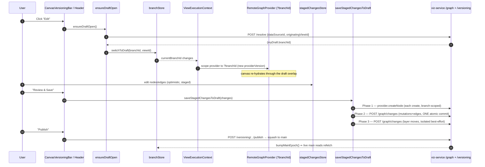

# 07 · Frontend Integration — How the Canvas Drives Versioning

> **Audience & scope:** frontend engineers working on the canvas/versioning UI, and anyone tracing a
> user edit from click to committed draft. Backend contract lives in
> [06 · API Reference](06-api-reference.md); the engine it drives is
> [03 · Branching, Commits & Merge](03-branching-commits-merge.md).

**TL;DR.** The client is a **thin, honest shell over the API** — Postgres is never touched directly.
"Edit mode" *is* an open **draft**; every graph read is routed through `?branchId=` so a draft is a
first-class provider scope; and "Save" is a carefully **three-phase** pipeline that persists creates,
structural mutations, and layer moves with the right atomicity so a partial failure never corrupts a
hierarchy. Two small Zustand stores (`branchStore`, `versioningPanelStore`) hold transient
branch/panel state; everything durable is a React-Query read against the versioning API.

---

## 1. The mental model

> **Invariant.** The browser talks only to the API; `graphver` Postgres is API-only. Every
> versioning affordance below is a call to a route documented in [06 · API Reference](06-api-reference.md).

---

## 2. Branch identity — `branchStore`

`frontend/src/store/branchStore.ts` is the **single source of truth** for *"which branch are we
editing/viewing?"* and *"is the committed-diff overlay on?"*. It is read by `ViewExecutionContext`
(to scope the provider's `?branchId=`), the canvases (to tint diffed nodes), and the versioning
chrome (switcher, banners).

> **Decision — a separate, NON-persisted store.** Branch identity is deliberately split from the
> localStorage-persisted `canvas` store (`branchStore.ts:6-12`). Two reasons: (1) branch identity is
> *not* a graph edit, so it must not bump the canvas's version counter; (2) a stale branch id
> resurrected from localStorage across reloads is a footgun — branch context is **re-resolved per
> session** from `resolveGraph`.

### Branch-per-view scoping

The store is scoped to a `(workspaceId, dataSourceId, viewId)` triple (`branchStore.ts:17-27`).
A `branchId` is valid **only** for its own graph *and the view it was resolved for* — because each
Context View tracks its own draft ("branch-per-view"). The two selector helpers enforce this:

- `branchIdForScope(wsId, dsId, viewId?)` / `useEffectiveBranchId(...)` return `currentBranchId`
  **only if the full scope (including `viewId`) matches** (`branchStore.ts:91-96, 166-177`). Passing
  `viewId` is optional for legacy callers, but the store itself never holds a different view's draft.
- `setResolved(scope, r)` (`branchStore.ts:98-125`): entering a **different** scope (data source *or*
  view) clears branch state → the user lands on Published; a **same-scope** refetch leaves the active
  branch untouched, so a background resolve never overrides an explicit switch.

> **Decision — a view switch never silently resumes a draft.** Even when the backend reports this
> view's own open draft as `myDraft`, entering the scope opens **Published**; the user explicitly
> resumes by clicking Edit (which routes through `ensureDraftOpen`). This keeps "which branch am I on"
> predictable across view switches (`branchStore.ts:111-123`).

`mainEpoch` (`branchStore.ts:47, 149`) is a monotonic counter bumped on publish/merge; §4 and §11
explain how it forces live-main reads to refetch. `activeChangeSet` holds the committed draft-vs-main
diff (owned by the bar's effect, cleared on branch switch); `committedDiffHidden` is a sticky view
preference for the overlay toggle.

| Store field | Purpose |
|-------------|---------|
| `currentBranchId` | `null` = trunk/main (no `?branchId=`); a `br_…` id = an open draft |
| `originatingViewId` | the view a draft was opened from (branch-level attribution) |
| `mainBranchId` / `mainHeadCommitSeq` | main pointer + head seq for "behind main?" checks |
| `activeChangeSet` | committed draft-vs-main diff (drives canvas rings) |
| `committedDiffHidden` | show/hide committed rings (sticky preference; staged always shows) |
| `mainEpoch` | bumped on publish/merge → folded into `providerVersion` to refetch main |

---

## 3. Read routing — `ViewExecutionContext` → provider `?branchId`

`frontend/src/providers/ViewExecutionContext.tsx` builds an isolated execution environment per view:
it picks a **provider from a pool** and overrides the provider context so every downstream hook
(`useGraphProvider`, `useGraphHydration`) targets the scoped provider.

- **Draft scoping** (`ViewExecutionContext.tsx:128-145`): `effectiveBranchId = useEffectiveBranchId(
  workspaceId, dataSourceId, viewId)` — when this scope owns a draft, `getOrCreateProvider(ws, ds,
  effectiveBranchId)` returns a provider that stamps `?branchId=` on every read. A draft is therefore
  **never** the shared global (main) provider.
- **`providerVersion` folds in `mainEpoch`** (`ViewExecutionContext.tsx:161`):
  `providerVersion = (scopeMatchesGlobal ? globalCtx.providerVersion : localVersion) + mainEpoch`.
  Schema (`useGraphSchema`) and canvas hydration are keyed by `providerVersion`, so a publish/merge
  (`bumpMainEpoch`) makes them refetch **once main has actually moved**.

> **Decision — the canvas graph is manually hydrated, not React-Query.** The node/edge graph is
> loaded by `useGraphHydration` keyed on `providerVersion`; it is *not* a React-Query cache. This is
> why publish/merge must `bumpMainEpoch()` (a version bump) to re-read, rather than invalidating a
> query key. React-Query is used for the *versioning metadata* (branches, diffs, commits, PRs), which
> §11 keeps in sync.

---

## 4. Edit → open a draft (`ensureDraftOpen`)

`frontend/src/features/versioning/model/ensureDraftOpen.ts` guarantees an editable draft is active
**before** any optimistic canvas mutation — switching branches reloads the canvas, so opening a draft
*after* staging an edit would discard it (`ensureDraftOpen.ts:1-18`).

Flow (`ensureDraftOpen.ts:36-59`):
1. No-op if already in a draft (returns `currentBranchId`).
2. Resolve the **active view** from the schema store (`getActiveView()`), so write-time attribution
   matches the read side (Changes & Reviews filter by the active view).
3. `resolveAndOpenDraft(ws, {dataSourceId, originatingViewId})` — `POST /resolve`, which
   **opens-or-resumes atomically** and returns `myDraft.branchId`.
4. `switchToDraft(branchId, originatingViewId)` and **fire-and-forget** invalidate the versioning
   caches so the `?branch` deep-link guard (§12) sees the just-opened draft in the cached branches
   list (`ensureDraftOpen.ts:30-34, 53`).
5. Returns `null` when no draft can be opened (context unresolved, or the caller lacks `:manage`) —
   callers treat `null` as "cannot edit"; **Published is read-only**.

Callers: the header's Edit entry (`ContextViewCanvas.tsx:1461` `handleEnterEdit`), the Hierarchy
Builder's "Start building" (`ContextViewCanvas.tsx:2439`), and the builder store's `open()` guard.

> **Invariant — branch-level attribution.** A draft, and every commit made on it, belongs to one
> view via `originating_view_id`. The server also **claim-fills** attribution onto a resumed draft
> that predates view tracking (`ensureDraftOpen.ts:11-17`). See
> [06 · API Reference](06-api-reference.md) `/resolve`.

---

## 5. Staged changes → ops → the three-phase save

Canvas edits accumulate optimistically in `stagedChangesStore` (dashed-halo feedback, unsaved).
"Review & Save" runs `saveStagedChangesToDraft` (`ContextViewCanvas.tsx:2370-2399` `StagedChangesPanel
onConfirm` → `saveStagedChangesToDraft.ts`). The header docstring says "two phases" but the code
implements **three**, and the separation is the whole point:

### Phase 1 — creates via `provider.createNode` (`saveStagedChangesToDraft.ts:46-100`)
`create_entity` is intentionally **excluded** from the ops translation (`stagedChangesToOps.ts:5-7,
119-120`) and run first through its proven branch-scoped provider hook, which constructs the urn +
containment edge and remaps the optimistic temp id. Each create is attempted **independently** so an
ontology rejection is attributed to the *specific* entity; on any failure the code drops
already-persisted creates (retry-safe), skips children of a failed parent (`blockedParentUrns`), flags
the failures, and **stops before Phase 2** — never persisting a partial hierarchy. Layer assignments
are re-keyed temp→real for all of a save's creates at once, in one layout write (`remapEntityIds`,
in `reconcileSaved`), as the canvas swaps every temp node for its real one in one store write.

### Phase 2 — mutations + user-drawn edges as ONE atomic commit (`saveStagedChangesToDraft.ts:102-115`)
`stagedChangesToOps(changes without creates, resolveTempId)` → `applyGraphChanges(ws, ds, branchId,
ops)` → `POST /graph/changes` (one server-merged commit). The translation
(`stagedChangesToOps.ts:48-126`):
- `rename_entity`/`update_entity` → an `update` **node** op carrying only the changed fields
  (`nodeUpdatePayload` normalizes canvas `label`/`type` → `displayName`/`entityType`) plus a
  `baseVersion` OCC token (§ below).
- `edit_edge` → `update` edge stripping client-only/immutable keys (`IMMUTABLE_EDGE_KEYS`).
- `delete_entity`/`delete_edge` → `delete`.
- `create_edge` → `create` edge; temp endpoints resolved to real ids via Phase 1's map.
- `reverse_edge` → delete + recreate flipped (endpoints aren't mutable in place).

> **Decision — the client sends *partial* updates and lets the server merge.** `stagedChangesToOps`
> emits only the fields that changed and the `baseVersion` content-hash the entity was read at
> (`stagedChangesToOps.ts:24-31, 63-64`). The backend applies `update` as a **field-level PATCH**
> (or a 3-way conflict when `baseVersion` is present) — this is the OCC seam that turns a stale
> same-field edit into a conflict rather than a silent overwrite. Absent token ⇒ plain patch, so it's
> safe even before hydration carries `version`. (Backend semantics: [03 · Branching, Commits &
> Merge](03-branching-commits-merge.md).)

### Phase 3 — layer moves in a SEPARATE isolated commit (`saveStagedChangesToDraft.ts:117-142`)
`assign_layer`/`move_to_layer` become `update` node ops on `layerAssignment`, applied in their **own**
best-effort commit *after* the structural one.

> **Decision — why layer moves are isolated.** A layer move rewrites the single field the reload
> placement reads, but it must **not** ride in the atomic Phase-2 batch: if a layer op failed there,
> it would roll back the user's creates/renames/containment edits too — the data-loss trap. Isolated
> and best-effort, a layer failure is logged and skipped; the structural commit already succeeded and
> is safe (`saveStagedChangesToDraft.ts:117-142`).

After saving, `invalidateAggregatedEdges()` refetches rollups (the draft overlay reports adjusted
`:AGGREGATED` edges, but only a fresh fetch shows them). The panel then clears the staged store
*without* discard hooks (to keep the optimistic canvas) and invalidates `VERSIONING_KEYS.all`
(`ContextViewCanvas.tsx:2395-2397`).

---

## 6. The diff overlay — one visual language (`useDiffDecoration`)

`frontend/src/features/versioning/canvas/useDiffDecoration.ts` is the single source of truth for
*"how has this entity changed?"*, shared by graph nodes and the context tree so every surface speaks
one language. It merges two layers (`useDiffDecoration.ts:30-61`):

- **STAGED** (uncommitted) edits from the staged store — always shown, higher precedence.
- **COMMITTED** branch-vs-main changes from `branchStore.activeChangeSet` — shown by default, hidden
  when the user toggles `committedDiffHidden`.

> **Invariant — style encodes commit-state, colour encodes the change.** Line **style**: dashed =
> staged (unsaved), solid ring = committed (not merged). **Colour**: emerald = added, amber/orange =
> modified, rose = removed (`useDiffDecoration.ts:12-14, 69-83`). This makes "saved vs not"
> unmistakable at a glance. `activeChangeSet` is populated by the bar's effect from
> `useDiffVsMain` → `fromDiffVsMain` (`CanvasVersioningBar.tsx:59-66`).

**A deletion reads the same on every surface.** Every card, row, list and the drawer header strikes
the name through (`STATUS_META.removed.strike`) and shows a `DeletedChip` (`NodeDiffBadge.tsx`).
The chip's hover says which deletion it is (`deletedTitle`). It is never colour alone, and lists call
the status **Deleted**. A staged `delete_entity` also marks what it takes with it: the entities and
links in its `before.cascade`, the delete-impact preview it was staged with.

A deleted link is drawn in `DELETED_LINE`: rose, dashed `2 4`, apart from a roll-up's dash.
- **When a line is deleted.** The projection marks a line `isDeleted` only when every link it draws
  is a deletion (`isDeletedEdge`: a ghost, or `isPending: 'delete'`). One live link keeps it live.
- **Where it is drawn.** The Context View overlay (`LineageFlowOverlay`) and the graph layout's
  `LineageEdge` and containment lines.
- **Unsaved deletions.** `withStagedDeletions` keeps them drawn: a link deleted on its own, from the
  copy staged with it; one an entity delete takes, marked in place.
- **Unsaved-change halos.** The overlay finds a line's staged-change halo by its member links' ids,
  not the drawn line's `bundle-…` id.

**Saved deletions are drawn on every layout** (`useDeletionGhosts`, mounted by the Context View, the
graph and the hierarchy).
- **Which are drawn.** `pickGhosts` draws the deletions whose old parent is on the canvas, and those
  that had none, then what each held, parent-first, at most `GHOST_CAP` (500). One whose parent is
  not loaded waits for it: the hook re-runs whenever the canvas's node count changes.
- **Drawn on request, past the cap.** The canvas store's `ghostPins` (`pinGhosts`) are drawn first,
  each with the deleted entities above it (`deletedChain`), outside the cap, wherever what it hangs
  from is on the canvas.
  - At most `PINNED_GHOSTS_MAX` (500). The oldest ask is dropped first, and one asked for again
    becomes the newest.
  - They belong to the change set they were asked in (`ghostPinsOrigin`). Another draft or comparison
    starts without them; a refetch of the same one keeps them.
- **What isn't drawn, per row.** `reconcileGhosts` returns `hiddenByParent`, which the hook publishes
  as `deletedHidden`: for each parent on the canvas, live or a ghost, how many deletions directly
  under it aren't drawn.
- **Parent links.** A deleted parent link is re-added only into a ghost, so a child moved elsewhere
  never gets a second parent.
- **Ghosts are not the graph.** They are left out of the legacy save, and they never page:
  `loadChildren`, the first-page auto-load and the "N more" row skip a ghost. Nor are they a
  parent's loaded children, wherever those are weighed against its `childCount`:
  - `loadChildren`'s "all loaded" check, and `shouldAutoLoadFirstPage` (a parent holding only ghosts
    still loads its first page);
  - the column's "N more" row and header totals;
  - and, through `withoutTombstones`, the anchor's remainder, the lineage aggregation's holders and
    a sort flip's "fully loaded".

  A reveal's level holding its child and ghosts is still unbrowsed, so its "N more" row doesn't
  page itself.
- **Restore** (`useRestoreGhost`) stages the subtree with every id kept. A node comes back by urn,
  its parent link under its own id (`containmentEdgeId`). The lineage links deleted with it come back
  under theirs (`buildRestoreLinks`, `restoreOf`) where the other end is restored or still live.
  Saving it nets the draft's diff for them to nothing.
- **Where Restore is offered.** The card, the Context View row, the hierarchy row and the drawer
  offer it only where the canvas can be edited.

**Compact change lists draw their deletions too.** A comparison highlighted on the canvas and a
draft past the tree's cap (20,000 changes) read `/diff/index`, which names a deleted entity but
holds no payload.
- **What they were.** The hook picks from the index as from a full diff, then asks
  `POST …/diff/entries/batch` for the picked ones it doesn't know yet: one request, at most the cap.
  Each answer seeds that row's `useChangeEntry` cache (`[…changeList(origin), 'entry', id]`), so
  its change-list row opens at once. A full diff makes no request.
- **Comparisons.** They draw on any canvas. A draft's `committedDiffHidden` hides neither their
  rings nor their ghosts. Their decoration carries `between` (the two revisions), so a ghost reads
  "Deleted after #A, by #B".
- **How many are drawn.** The canvas store's `deletedDrawn` holds drawn of total; ones being
  fetched count as drawn, so it doesn't flicker, and a failed fetch takes them off. When not all are
  drawn, the comparison chip and the draft bar say "M of N deleted drawn" and open the list. The
  comparison chip also counts its changes, with `ChangeLegend` on hover, worded for a comparison.
- **Restore on a large draft** first fetches what the subtree and its links were (`restoreNeeds`,
  500 a request). It refuses past `RESTORE_NODES_MAX` (1,000 entities) or `RESTORE_LINKS_MAX`
  (2,000 links) rather than bring back part of it.

**A deletion's details** (`TombstoneDetails`) take a `TombstoneTarget`: the entity id, its kind, and
the change list it was deleted in (a draft, or main between two revisions).
- **What it reads.** `useEntityDeletion` (`…/entities/{eid}/deletion`, `atSeq` the window's newer
  end) when shown, and `useDeletionCascade` (`…/deletion/cascade`) and `EntityHistory` only when
  their parts are unfolded. All three retry a busy server (`BUSY_RETRY`).
- **Two hosts.**
  - On the canvas, the entity drawer and the relationship drawer show it for a tombstone, in place
    of the live view. Its change in the canvas's change set gives the entity id (an imported node's
    urn is not its id) and the origin (`listOriginOf`).
  - Elsewhere, `TombstoneDrawer`, a portal at `z-[120]`/`[121]`, opens it above any panel.
    `DeletionDetailsButton` opens that drawer from a deleted row of `ChangeList`, `ChangeTreePanel`
    (given its `list`), `ChangesPanel` (given `details`; Files changed passes it) and
    `EntityHistory`'s delete rows. Nothing is asked until it is clicked.
- **What moves the canvas** is offered only inside a view (`useViewExecutionContext`) on the same
  graph, and only with the revision viewer on.
  - **See the change** asks the versioning panel for the comparison `N−1 → N`
    (`useVersioningPanelStore.openCompare`), or for Changes after a draft's deletion.
  - **Open just before it was deleted** fetches revision `N−1`'s plan.
    - Openable: it opens the revision with `OpenRevision.reveal` set to the entity's urn (a link's
      source end).
    - Not openable: it opens the comparison with now.
    - Disabled while edits are unsaved.
  - **`useRevisionReveal`**, mounted by the three canvases with their own reveal, runs once the
    canvas reads that revision (`asOfSeq`) and has drawn it.
    - It has drawn when hydration was seen in progress and is complete, or when the entity is
      already there, live. Published never has it, so it never fires early.
    - It reveals the entity, selects it, opens its drawer, and clears `reveal`.
- **`EntityHistory`** links a published revision's `#N` to the same comparison.
- **`DrawerActivity`** says **Deleted**, in rose, when the summary says the entity doesn't `exist`
  on the line.

**Restoring a published deletion** (`useRestoreDeletion`, in `useRestoreGhost.ts`) is the details'
**Restore into my draft**. It is offered for a published deletion inside a writable view on its
graph, to someone with `workspace:datasource:manage`, with edit mode and version control on.
1. It closes an open revision and opens the person's draft (`ensureDraftOpen`).
2. It asks the cascade with `into=<draft>`. A refusal (`draft_predates`, `recreated`, `parent_gone`,
   `too_large`) is said as a notice, and nothing is staged.
3. It builds the restore from what came back: `buildRestoreSubtree` (nodes under their urns, each
   nested by its parent link's id) with `live` as what the draft has, and `buildRestoreLinks` (links
   under their ids), leaving out `skippedLinks`.
4. It stages them parent-first into the draft's own slice, setting the staged scope first
   (`stagedScopeKey`, which `CanvasRouter` also uses). The canvas switches to the draft only on its
   next render, and the restore must not land in Published's slice.
5. It opens Review & Save, with a notice of what came back.

---

## 7. The versioning chrome — the bar, the bridge, the panel

### `CanvasVersioningBar` — one strip, mounted once
`frontend/src/features/versioning/components/CanvasVersioningBar.tsx` carries all versioning chrome
for every canvas (mounted once in `CanvasRouter`). It renders **nothing** for a non-versioned data
source, and an **"Enable version control"** empty state when `needsSeed` (no graph, or a genesis-only
non-blank graph — managers only; a `kind === 'blank'` model is excluded because it's genesis-only by
design) (`CanvasVersioningBar.tsx:98-132`). On a draft it shows an amber strip: `BranchSwitcher`,
`RefreshingBadge`, `ReadRouteChip` (the watermark's `readRoute`: "Serving from FalkorDB · provider" or "Serving from Postgres (catching up)", plus "· draft overlay"; on main it shows only while Postgres serves), `AggregationSyncChip`, the committed `ChangeCountChips` + an *"N unsaved"* staged
hint (`:162-185`), `ViewPrIndicator`, a **Reviews** button, the committed-diff `ChangeHighlightControl`
(toggles `committedDiffHidden`), **Publish** (`CommitDialog`), and **Discard** (`useAbandonDraft`). A
`PullBeforeMergeBanner` appears when the draft is `behindMain` (`:84-87, 228-236`).

### `versioningPanelStore` — a one-shot bridge
`frontend/src/store/versioningPanelStore.ts` is a deliberately tiny, non-persisted store: the Context
View header's far-away "Changes" button calls `openPanel(tab)`; the bar subscribes, opens the panel on
that tab, and clears the request (`CanvasVersioningBar.tsx:73-79`). It carries a transient *request*,
not durable state.

### `ViewVersioningPanel` — the review hub
`frontend/src/features/versioning/components/ViewVersioningPanel.tsx` is a slide-over with tabs
(`ViewVersioningPanel.tsx:24-31`): **Changes**, **Commits**, **Pull Requests**, and **Data health**
(everyone sees its status and `ProjectionHealthCard` — provider, key, platform copy or customer
graph, node/shard/slot, epoch, backoff, liveness, and what a customer graph holds that history
doesn't, from the watermark's `externalDrift`; only managers get Check sync and Rebuild). The same
card, with those two actions for managers, sits on the data source's `DataSourceVersioningTab`, which
also passes the data source to people who can publish: they get **Bring into history**
(`POST /graph/resync`) while the flag is up. The Changes tab shows `PendingChanges`
(unsaved staged edits with a "Review & Save" action, `:35-62`) above the cumulative committed tree, so
after you save, work moves from *Pending* to *Committed* in the same view rather than vanishing. It
requests up to **1000** top-level diff groups so "all branch changes" is genuinely complete (`:92`).

Two change-review presentations sit under it:
- **`ChangesPanel`** — flat, source-agnostic (Entities/Relationships × Added/Modified/Removed), each
  row expandable to a field-level `EntityDiff`; also exports `ChangeCountChips`.
- **`ChangeTreePanel`** — hierarchical, lazy, business-reader-facing: an impact header rolls up per
  entity-type ("17 tables · 40 columns"), with a containment tree whose children page in on demand
  (`summaryFirst`).

### Reviews — every change on the Context View, one at a time
A review goes through one change list at any size, on the canvas and beside it: a draft's, a
revision's, or a range.
- **`reviewStore`** holds what it lists and how it's narrowed: `scope` (null for the canvas's
  default), one `operation` at a time, and `filter` (kind, type, text). It also holds `listOpen`, and
  `available`, which is true while the Context View is mounted.
  - `startReview({scope, operation})` starts with the filter cleared, so an earlier search never
    hides what was asked for.
  - `setScope` starts the type afresh.
  - It holds the change being visited (`current`, `position`, `visit`, and `visits`, bumped by every
    visit), `navigatorOpen`, and how finding the change went (`found`).
  - Another operation, filter or scope starts at the top.
  - Only `listPreferred` is persisted (`nexus-review`). `startReview` opens the navigator always,
    and the list for technical users or whoever chose to keep it (`toggleList`).
- **`useChangesScope(viewId)`** resolves the scope against the branch store (`resolveScopes`, pure):
  - a draft: `{branchId}`;
  - a revision #N: `{N, headAtOpen}` (the default) or `{N−1, N}`;
  - a highlight: its range;
  - Published: `{H−1, H}`.

  A range of one revision is `{kind: 'in'}`, offered once. A choice stands while it is offered; then
  the default takes over.
- **`useDrawScope`** highlights a scope the canvas can draw without moving in time: what the open
  revision changed, or the latest revision. It clears that highlight when the review ends or moves
  on, unless something else has replaced it.
- **`useReviewList` / `useReviewRows`** give the rail and the navigator the same scope, kind and
  debounced filter, so they ask for the same pages (one query) in the same order. Nothing is fetched
  while no review is open.
- **`ChangesExplorer`** sits in the left rail, rendered persistently like `SearchMapPanel`. Its ×
  closes the list to the navigator. Below 1,280 px it gives way while a drawer is open, leaving
  `listOpen` as it was.
  - **The title** is a scope menu.
  - **The controls:** the operation segment (counts for the kind listed), search (debounced), and
    Filter (kind and type; it names the kind).
  - **The rows** are `ChangeRows`, which `ChangeList` now composes under its own controls. Its call
    sites are unchanged.
    - **`onActivate`:** picking a row visits it; its chevron still shows the diff. ↑ and ↓ move
      between rows.
    - **`activeEntityId`:** marks the current row, and scrolls to it when it changes (not when a page
      arrives).
  - **`useReviewRail`** shares the rail with search: opening one closes the other. Unmounting the
    canvas ends the review.
- **`ChangeNavigator`** sits at the bottom of the canvas (`z-40`, above the trace dock's height), and
  is hidden during a trace.
  - **It says what the change is:** status, name, where it lived, and who deleted it and when. The
    last two come from `useEntityDeletion`, for a deletion only. The technical persona adds the type
    and qualified name.
  - **Operation chips**, and **‹ n of N ›** with ←/→. A step past the loaded rows fetches the next
    page and lands when it's there. The keys are left to a control's own arrows, and to any open
    `[role="dialog"]` (the lens, a panel).
  - **Details** opens `openNodeDrawer`, or `TombstoneDrawer` for a deletion that isn't drawn.
  - It visits the first change itself, on start and after a new narrowing.
- **`useReviewOnCanvas`** is mounted once by `ContextViewCanvas`. It calls `useDrawScope`, and runs
  Locate for every visit, one at a time; a visit overtaken by the next is told so through
  `stillWanted`.
- **`useLocateChange`** finds a change on the canvas:
  - **An entity that exists:** `getAncestorChains` (one read; parent first, so reversed), then the
    canvas's `revealSearchHit`.
  - **A deletion:** it waits up to 2 s for the change set the canvas draws to hold it (a highlight
    just set is still loading). Then `deletedChain` up to the live anchor, `pinGhosts`, the anchor
    revealed, the tombstone waited for (`TOMBSTONE_WAIT_MS`, 2 s), the anchor and deleted parents
    expanded, then select and scroll.
  - **A relationship:** both ends, a deleted end as a deletion.
  - **The outcome:** `found`, `nearby` (landed on an ancestor) or `missing`.
  - It indexes the change set's removals once per change set (a `WeakMap`).
- **`DeletedInsideMark`** sits in `FlatTreeItem`'s badge cluster and reads `deletedHidden`. It shows
  nothing at 0. Choosing it pins up to `DELETED_INSIDE_DRAWN` (200) undrawn deletions under the row
  (`hiddenDeletionsUnder`), and expands the row.
- **Cost at 5,000 deletions:** a step's ghost pass (index, pick, hidden counts) takes 4 ms at the
  median and 6 ms at p95, keeping the store to 500 tombstones plus the pins.
- **The glance surfaces** call `startReview` when `available`, and otherwise behave as before:
  - the bar's `ChangeCountChips` (`onPick`), "+N new" and "M of N deleted drawn";
  - the comparison chip;
  - `RevisionBanner`'s since-then counts (`{kind: 'since'}`);
  - the Changes tab, now a `ReviewSummaryCard` for the canvas's scope (the draft tree isn't fetched
    there);
  - `RevisionCompare`, where **Review changes** highlights the range and opens the list, in place of
    the inline list.

---

## 8. Pull-latest / rebase UX

When a draft falls behind `main`, `PullLatestButton`
(`frontend/src/features/versioning/components/PullLatestButton.tsx`) appears (variants row/bar/manager,
rendered only when `behind`). It calls `usePullLatestDraft` (`useVersioning.ts:340-359` →
`rebaseDraft` → `POST /versioning/.../rebase`). A `{clean: false}` response opens the
`ConflictResolver`, whose resolutions feed straight back into a re-call loop. On a **clean** pull it
invalidates branches/state/diff/resolve **and the PR lists** — a clean pull clears the merge gate
(`useVersioning.ts:347-357`). The `PullBeforeMergeBanner` and the PR drawer's `needsPull` banner (§9)
cover the merge-gate case.

---

## 9. Merge / PR flow (`PrDetailDrawer`)

`frontend/src/features/reviews/components/PrDetailDrawer.tsx` is one PR's review surface — overview +
reviewers/approval, **Commits** (draft MRs only, each expandable to a per-commit diff, `:68-72`),
**Files changed** (`ChangesPanel` via `fromPrDiff`, `:93`), a derived activity timeline, and the
**Approve / Merge / Close** action bar. It works for both draft MRs and fork PRs — the backend
endpoint dispatches; the drawer just reads `useMergeRequest`.

`runMerge` (`PrDetailDrawer.tsx:119-148`) is conflict-aware:
- `NotUpToDateError` → set `needsPull`, show the pull banner + Pull-latest (the 409 is a backstop; the
  proactive `pr.behind` flag drives `needsPull` up front, `:114-117`).
- `MergeConflictError` → open the `ConflictResolver`; its resolutions feed a re-merge.
- `approval_required` → a friendly toast.
On success it lands on the freshly-merged main (`switchToMain()`) and closes — read-your-writes serves
`main` even before the projection catches up. `runPull` (`:150-167`) interleaves the pull-resolve mode
in the same resolver.

---

## 10. Import-triggered refresh (brief)

Import/export dialogs are mounted in the canvas (`ContextViewCanvas.tsx`) and hand off to the same
review surfaces. An import commits **server-side** on the draft (no optimistic canvas), and the canvas
refreshes **only when the dialog closes**, so the import preview stays visible instead of the canvas
flipping mid-flow. `ContextViewCanvas` keeps an `importedRef`, and `refreshAfterImport()` runs, in order:

1. **`rereadBranchView`** — the draft's view again: the import placed its new roots in the draft's
   copy of the view's layout, and a canvas read against the old layout leaves them unplaced (a curated
   view never shows them);
2. invalidate `VERSIONING_KEYS.all`, refetch aggregated edges, and **`releaseProviderCaches()`** — the
   answers the providers cached for the draft before the import;
3. **`bumpDraftEpoch()`** — `branchStore.draftEpoch` is folded into `providerVersion` (§3) and keys the
   canvas in `CanvasRouter`, so every draft read refetches, the canvas remounts (its expansion,
   auto-load and assignment latches start over) and the assignment status resets.

Opening the dialog first saves a pending layout edit: the import writes its placements into the same
overlay, and a debounced save landing after it would put the old layout back. "Refresh from others"
(`useRefreshDraftFromOthers`) takes the same path — release, then `bumpDraftEpoch()` — since the draft
moved, not `main`. Full detail in [08 · Import / Export](08-import-export.md).

> **Invariant — the canvas names a node by its urn.** An imported node's entity id is not its urn, so
> committed changes carry `urn` / `sourceUrn` / `targetUrn` (from the diff) and the change set, tints,
> ghosts and created-node lists key by those (`changeAdapters.ts`, `changeModel.ts`,
> `deletionGhosts.ts`, `useBranchCreatedDelta.ts`). A node with no urn reads as `gv:<entity id>`, as
> the server names it.

---

## 11. React-Query keys & the invalidation fan-out

`frontend/src/features/versioning/hooks/useVersioning.ts` defines `VERSIONING_KEYS`
(`useVersioning.ts:12-59`) and every query/mutation.

> **Decision — `viewId` is appended to a cache key only when given** (`useVersioning.ts:14-24`), so
> data-source-level callers keep their exact prior key — no unintended churn — while view-scoped
> callers get branch-per-view isolation.

Freshness polling is surgical: `useProjectionWatermark` polls every 3s **only while a projection is
actively catching up** (`status ∈ projecting|rebuilding`), then stops — a merely-behind-idle graph is
never polled (`useVersioning.ts:103-120`).

The publish/merge fan-out is the subtle part. `usePublishBranch` (`useVersioning.ts:375-399`) and
`useMergeMergeRequest` (`:483-506`) both:
1. invalidate branches + **all** commit-log scopes (`commits`, `viewCommits`) by prefix so History's
   "This view"/"Whole graph" refresh without a reload;
2. invalidate `projectionWatermark` so the "refreshing…" badge can show while FalkorDB catches up;
3. **`bumpMainEpoch()`** — the version bump that makes the manually-hydrated canvas re-read main (§3);
4. `invalidateAggregatedEdges()` **now and again after 4 s** —

> **Gotcha.** Rollups change with `main`, but an *immediate* refetch can hit the stale projection
> window and cache an empty result for the TTL. So the fan-out fires `invalidateAggregatedEdges()`
> once and again via `setTimeout(..., 4000)` after the post-commit projection nudge has had time to
> land (`useVersioning.ts:392-396, 501-503`).

`useRebuildProjection` seeds the watermark cache with the response before invalidating, guaranteeing
the progress effect observes one `rebuilding` tick even on an instant rebuild (`useVersioning.ts:407-414`).

---

## 12. `?branch` deep-link (`useBranchDeepLink`)

`frontend/src/features/versioning/hooks/useBranchDeepLink.ts` two-way-syncs the URL `?branch=<id>`
param with the active branch, making a view+branch shareable and bookmarkable.

- **URL → store**: apply the deep-linked branch only if it names an **open** draft that appears in the
  **permission-gated, view-scoped** branches list; on a *settled* list miss, drop the param, stay on
  main, and toast (`useBranchDeepLink.ts:52-70`). A REJECT waits for the settled list (a just-opened
  draft may not be in the stale one yet); an ACCEPT acts immediately.
- **store → URL**: reflect the active branch (replace, no history spam), with a guard against erasing
  an unapplied deep-link on fresh load (`:73-90`).

> **Invariant — branch-per-view in the URL too.** Both directions are gated on
> `viewResolved = scopeViewId === activeViewId` (`useBranchDeepLink.ts:49`), so a mid-view-switch
> never stamps the previous view's branch into this view's URL (which would make branches appear
> global across views).

---

## 12a. A past revision on the canvas (`?rev=`, the revision viewer)

Behind the **`revisionViewerEnabled`** switch, on unless an administrator turns it off (`useRevisionViewer`: the switch, and
`workspace:datasource:read` — a view's share link never reaches history), a view can read the
published graph **as it was at revision K**, read-only — like checking out a commit.

- **State** — `branchStore.revision: OpenRevision | null` (`openRevision` / `closeRevision`), scoped
  like a draft (`useEffectiveRevision(ws, ds, viewId)`) and cleared by a draft switch, Published, a
  scope change and `reset`. A revision is of Published: opening one leaves the draft, and opening a
  draft closes it. `branchStore.highlight` holds a comparison ringed on the canvas.
- **Reads** — `ViewExecutionContext` asks what opening K takes first (`useRevision` →
  `GET …/graphs/{gid}/revisions/{K}`) and only then puts the view on a provider of its own
  (`poolKey`/`scopeKey` carry `main@K`) whose every read names it (`?asOfSeq=K`), except the data
  source's own chrome (`TODAYS_PATHS`: `/stats`, `/introspection`, `/metadata/ontology|schema`). The
  server answers each read as the graph was or refuses it — never from now. `useRevisionGuard`
  closes a revision that isn't one, and hands one too far back to draw (or a fork's) to History's
  comparison with now (`versioningPanelStore.openCompare`) — by its plan, or once a read at it is
  refused `revision_too_far` because Published moved too far on while it was open (the provider
  dispatches `REVISION_TOO_FAR_EVENT`). The context exposes `asOfSeq`.
- **One canvas per revision** — `CanvasRouter` keys the canvas component by the revision, so nothing
  a canvas remembers of what it drew (expansions, rollups asked for, layer assignments, the
  display-rule latch) crosses between the graph as it was and as it is; the trace clears and the
  reference model's assignment status resets as on a branch switch.
- **Read-only, with the way back kept** — `canEnterEdit` is false, `useEntityEditing` blocks with
  `AT_REVISION`, `ensureDraftOpen` opens nothing and says why. The graph and hierarchy layouts'
  interactions are `readOnly` (`useCanvasInteractions`), and they draw no line, re-draw none, delete
  nothing on Backspace and mount no builder. Unlike `readOnly`, the versioning bar stays: it is the
  way back.
- **What a revision reads** — `useRevisionCapabilities()` says, in one place. The provider holds
  every graph read to the server's list (`providers/revisionReads.ts`; the fixture
  `backend/tests/fixtures/revision_reads.txt` is both sides' list, and a test on each holds its own to
  it) and refuses the rest before sending them, with the server's 501 `revision_unsupported`: a
  canvas at a revision sends no request that fails.
  - **On, as the graph was:** name search — `searchAdvanced` sends a one-leaf query on names to
    `/search/names` and answers a finished page (the Context View's header box in names mode,
    `useViewSearchSessionController({ namesOnly })`; the other layouts' `RevisionNameSearchPanel`) —
    and lineage traces on `/trace/closure`: the Context View's trace, the Lens and `?trace=`/`?lens=`
    links, and the drawer's lineage walk, each without its coarse leg.
  - **Off, saying why** (`OFF_AT_REVISION`), because they read the graph as it is now: Advanced
    Search, display rules (Properties), subset-view layers (`subsetIssue: 'revision'`), Narrow and
    `?narrow=`, the rolled-up trace (the graph and hierarchy layouts' only one), and editing.
- **Chrome** — `RevisionBanner` (mounted by `CanvasVersioningBar`) says when, which revision, whose
  and how far the graph has moved on since; "Opening…" until the canvas reads it, "Rewinding N
  changes…" while it draws; Compare with now, Restore graph to here (publishers), Back to Published
  (Esc, unless a dialog has it). Exporting at a revision exports it (`ExportTarget.asOfSeq`).
  "Since then" counts up to the head it was opened at (`OpenRevision.headAtOpen`), not each new
  one: once Published moves on, the banner and the history rows say so, and Update re-pins it
  (`repinRevision`).
- **Highlight on canvas** asks `…/diff/index?max=20000`: past that, the chip says how many changes
  there are and opens the list instead of drawing. A draft's rings ask for every change.
- **Busy** — a change list, the history and a revision's plan answered 503 `change_list_busy` or
  `revision_busy` (a `BusyError`) are asked again up to three times after its Retry-After, held to
  1–10 s with jitter (`BUSY_RETRY`); a 4xx is not asked again, any other failure once.
- **History** — `ViewHistoryTimeline` pages by `before` (`useHistoryPages`), virtualized, grouped by
  month and day in the reader's time zone with a pinned month header; with the switch on each revision
  of Published opens, compares (`RevisionCompare`, `RevisionPicker`) and copies its link, and
  `HistoryMonthPicker` goes to the end of any month or day (`useHistoryMonths`). The data source's
  Versioning tab shows the same timeline in whole-graph scope; there a revision opens, highlights and
  copies its link in the view picked under "Open in" (remembered per data source), and with no
  views only those three are off.
- **Deep link** — `useRevisionDeepLink` two-way-syncs `?rev=K` like `?branch=` (§12): applied once
  the view is resolved, dropped when it names no past revision, and a `?branch=` beside it goes.
  `?rev=T&hl=K` also highlights what changed after K up to T, read once and then dropped.

---

## 13. Limitations & gotchas (frontend)

> **Limitation.** The `saveStagedChangesToDraft` header comment says "two phases" but the body
> implements three (creates / atomic mutations / isolated layer moves). The code is authoritative;
> the comment is slightly behind.
- **Optimistic canvas vs server truth.** Save keeps the optimistic canvas and clears the staged store
  *without* discard hooks (`ContextViewCanvas.tsx:2395-2397`). If Phase 2/3 partially fail, the review
  panel flags the offending entities (`saveStagedChangesToDraft.ts:81-100`), but the canvas can
  briefly lead the server until the next hydration.
- **Manual hydration means version bumps, not query invalidation.** Anything that changes `main` and
  must show on the canvas has to `bumpMainEpoch()`; invalidating a React-Query key alone won't move
  the graph (§3). This trips up new code that only invalidates.
- **The 4 s aggregated-edge re-fetch is a timing heuristic** (§11), not a signal — a slow projection
  could still serve stale rollups past 4 s until the next interaction.
- **A publish while a revision is open re-reads it.** `mainEpoch` still folds into `providerVersion`
  at a revision (it keeps every version unique), so the canvas refetches the same past data.

---

## Related chapters

- [03 · Branching, Commits & Merge](03-branching-commits-merge.md) — the backend semantics behind
  `update`-as-PATCH, 3-way merge, publish/rebase.
- [06 · API Reference](06-api-reference.md) — the `/resolve`, `/graph/changes`, publish/merge/rebase
  routes this chapter calls.
- [08 · Import / Export](08-import-export.md) — the import dialog + `refreshAfterImport` handoff.
- [04 · Projection & Cache](04-projection-and-cache.md) — why the "refreshing…" badge and the 4 s
  rollup re-fetch exist.
- [README](README.md) — glossary and the suite index.
