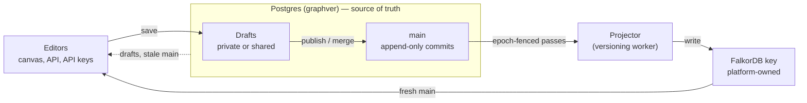

# 16 · Go-Live Stages 1–2: What Shipped and Why

> **Audience & scope:** engineering leads and reviewers of the go-live work. What Stages 1 and 2
> changed, the defect each change closes, how it works, and what it costs. The designs are in
> [13](13-access-and-review.md), [14](14-graph-lifecycle-v2.md) and [15](15-shared-contracts.md);
> every behaviour change with its status codes is in the [CHANGELOG](../../CHANGELOG.md).

**Checked against the code on 2026-10-19 (`e7860d5b`).**

**TL;DR.** Stages 1 and 2 make versioned graphs safe for many concurrent editors. No acknowledged
write is lost or applied twice. Nobody overwrites a colleague's draft. Only people with publish
change `main`. FalkorDB cannot silently drift from Postgres. Contention ends in a retryable
`503 lock_busy`, never in an open-ended wait or a silent overwrite.

## 1. Why

A go-live review re-traced every finding with an independent verifier; 220 of 221 survived, 14
critical. These blocked production:

1. Saves landed in merged, abandoned or other people's drafts and still reported success.
2. Eviction, Rebuild and `POST /graphs` could delete or overwrite the customer's own FalkorDB graph.
3. Postgres and FalkorDB could drift apart while the watermark still read "fresh".
4. Two people could overwrite each other, and approvals did not bind to what was reviewed.
5. Waits for the graph lock were unbounded, so contention showed up as hangs.
6. No versioning integration test ran in CI.

## 2. The shape of the system

Only the projector applies commits to FalkorDB. Publishers may also write `main` directly through
the graph routes; everyone else edits a draft.

## 3. Data safety (Stage 1)

| Fence | What went wrong | How it works now |
|---|---|---|
| Closed-draft and `main` fences | Saves to merged, abandoned or foreign drafts reported success | The draft row is locked `FOR NO KEY UPDATE` and checked open before any write; draft routes refuse `main` (409 `branch_closed` / `main_write_forbidden`) |
| Idempotent saves | A retried save could land twice | `/graph/changes` takes an `Idempotency-Key`; a partial unique index replays the first result under the draft lock |
| Single FalkorDB writer | Canvas writes raced the projector | Edits of a versioned graph commit to Postgres only |
| Key ownership | A customer's graph could be deleted or overwritten | Only keys the platform created (`owns_falkor_graph`) are dropped or evicted; one graph per key (`uq_ps_key`) |
| Epoch fencing | A stale pass could overwrite a reset | `projection_state.epoch` is bumped by every reset, re-pin and eviction; a pass commits only on a matching epoch |
| Pass marker and replica `WAIT` | A failover could lose writes behind a fresh-looking watermark | Each publishing pass writes a `_GVProjMeta` marker; with `GRAPHVER_PROJECTION_WAIT_REPLICAS` above 0 (default 0) it waits for replica acks and holds the watermark until they come |
| Liveness loop | A lost or restored key went unnoticed | Every 60 s on idle graphs: a missing key lowers the watermark to 0, a marker behind it lowers it to the marker, and the projector repairs the key |
| Bounded locks | Contention hung requests | Each lock wait is bounded (`GRAPHVER_GRAPH_LOCK_TIMEOUT_MS`, 5 s); main writes retry with full jitter up to 5 attempts, then 503 `lock_busy` |
| Import safety | Two imports on one draft; a replace deleting on bad rows | One active import per draft (`uq_jobs_ingest_active`); a replace fails closed before any delete |
| Re-sync guard | A re-sync reverted curation or deleted most of a graph | 409 `curation_at_risk` once a sync has landed after human edits; 409 `mass_delete_blocked` above 500 entities and 5% |
| Purge safety | Restored or forked graphs could be purged | Restored graphs and graphs live forks read are skipped; infrastructure failures re-queue; restore is refused once a purge is queued |
| Reply-cap guard | A FalkorDB `RESULTSET_SIZE` cap made bootstrap miss data or delete relationships | Bootstrap refuses any positive cap it can read, before reading anything |

## 4. Collaboration and access (Stage 2, decisions D4–D6)

| Action | Private draft | Shared draft | `main` |
|---|---|---|---|
| Read | Owner, workspace managers, people on its review; others 404 | Also members, directly or through a group | Anyone with read |
| Edit | Owner only (403 `not_draft_owner`) | Owner, editors, maintainers (403 `not_owner_or_member`) | Publish holders, via the graph routes (403 `publish_required`) |
| Publish directly | Owner, with publish | Owner or maintainer, with publish | — |
| Merge its review | Any workspace manager with publish | Any workspace manager with publish | — |

- `workspace:datasource:publish` is separate from manage. `workspace_member` loses it;
  `workspace_publisher` carries it. API keys never publish or merge, and write `main` directly only
  if their owner holds publish.
- Each approval records the draft head it saw. A later content commit makes it stale (409
  `approval_required` with `pending` and `stale`); `POST …/approve` with `expectedHeadCommitId`
  answers 409 `head_moved`; authors and draft owners get 403 `self_review`.
- A member who loses access has their staged, uncommitted edits withdrawn at the next checkpoint.
  Groups are looked up only when a group row could raise the caller's role; an unreadable directory
  answers 503 `groups_unavailable`, never a false 403.

Routes and payloads: [06](06-api-reference.md). Draft rules in depth: [03](03-branching-commits-merge.md).

## 5. Store visibility and lifecycle (Stage 2)

- **Where each graph lives.** Admin → Infrastructure lists every live versioned graph and fork with
  its provider, key, watermark and health; the Graph store page shows which graph owns each key; the
  canvas says whether reads come from FalkorDB, Postgres or a draft overlay.
- **Freeze.** Publishers pause and resume editing per graph (`lifecycle_state`, compare-and-set on
  `lifecycle_rev`). Every content write checks the state under a shared lock.
- **Forks.** Delete to the trash, restore within `GRAPHVER_PURGE_GRACE_DAYS`, purge after; only the
  fork's own key is dropped; at most `GRAPHVER_MAX_FORKS_PER_GRAPH` live forks (409 `fork_limit`).
- **Moves.** Moving a data source to another workspace moves its graph, forks and jobs; a projection
  move (platform admins) relocates a platform-owned key, reads come from Postgres until the new key
  catches up, and the old key drops once it has and 15 minutes have passed.
- **Providers.** A provider with graphs on it cannot be deleted; moving it to another server needs
  `?confirmReseed=true` and reseeds its graphs.

Projection and keys in depth: [04](04-projection-and-cache.md).

## 6. Concurrency

One lock order, taken top to bottom: job row → `gvproj` (projector, evict, retire) → `gvlifecycle`
(exclusive for transitions; shared for content writers and import/publish job creation) → graph
lock (user writes to `main`), then `gvmove` (exclusive for a data-source move, shared for job
creation) → `graphs` row → `branches` row → `merge_requests` → `projection_state`. Writers never
take the projector's lock; the projector never takes the graph lock. The full contract is
[15 §8](15-shared-contracts.md).

- **Fairness.** Row locks let each new `FOR KEY SHARE` slip past a waiting `FOR UPDATE`, so a stream
  of saves could hold a freeze off. Advisory locks queue fairly; content writers take
  `gvlifecycle` shared first, so a freeze waits only for writes already in flight.
- **Job starts take no graph lock.** They fence data-source moves with `gvmove`, so a long publish
  never fails a job start.

## 7. Performance

| Area | Effect | Bound |
|---|---|---|
| Canvas save | Postgres only; projection is asynchronous | One transaction |
| Main write | Serialised per graph | ≤ 5 s per wait, ≤ 5 attempts, then 503 |
| Draft write | Serialised per draft | Different drafts never contend |
| Job start | Never behind a long main write | Waits only on a move or a lifecycle transition |
| Versioned-source read | One graphver lookup for its projection key | Cached 10 minutes |
| Branch list | Filtered in SQL before the limit; `X-Next-Cursor` | One page per request |
| Group access | Lookup only when a group row could raise the role | None without group sharing |

No load test has run yet. The go-live gate's: 300 users across 50 graphs, a 72-hour soak, publish
p95 under 3 s, zero lost acknowledged writes.

## 8. Resiliency

| Failure | Outcome |
|---|---|
| Retried save | Same `Idempotency-Key` returns the original commit |
| Worker dies mid-publish or mid-import | Lease expiry (120 s); another worker finishes the publish once, or the import resumes from its last window; a failed publish reopens its draft |
| FalkorDB failover, flush or old restore | Watermark held (with `WAIT`) or lowered by the liveness loop; the key is repaired from Postgres |
| Stale projection pass | Discarded on epoch mismatch |
| Group directory down | 503 `groups_unavailable` |
| Contention | 503 `lock_busy` + Retry-After after bounded retries; a partly applied `/graph/commands/batch` answers 200 with the rest skipped |
| Data-source move fails after its graph moved | The graph and its forks are moved back, unless the commit landed and only its answer was lost; if moving them back fails, the reaper re-files them under the source's workspace. A retry whose first try landed gets that answer for ten minutes |
| Capped graph server | Bootstrap refuses before reading |
| Worker on a graphver DB missing a required column | Exits; the restart retries |

## 9. Rollout

1. Migrations after `main`'s `20261020_1000_ds_transfers`: `20261017_1000_datasource_publish`, then eight
   `gv_` revisions to `20261018_1200_gv_lifecycle`. Each `gv_` one waits at most 5 s for a lock.
2. With a separate `GRAPHVER_DB_URL`, start the versioning workers before the API pods.
3. Grant `workspace_publisher` to people who land changes and to owners of keys that write `main`.
4. Customer FalkorDB servers on the stock image need `RESULTSET_SIZE -1`.
5. Every pod on this release before using projection moves or freeze: an older pod re-pins a moved
   graph and lets writes through a freeze.

## 10. Known limitations and next

- Fork delete and restore don't take the lifecycle key (503 under contention instead of waiting).
- Replica `WAIT` is off unless configured; the liveness loop then catches a lost window on idle graphs.
- The versioning e2e CI job is informational until it has a green track record.
- Next, per [12](12-streaming-ingestion.md)–[15](15-shared-contracts.md): lifecycle v2 conversion,
  streaming ingest, access enforcement with protected `main`, compaction, and the load and chaos
  gate ([09](09-scale-limits-and-roadmap.md)).
